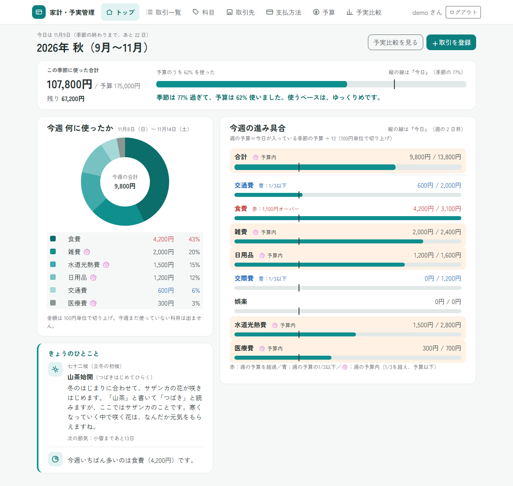
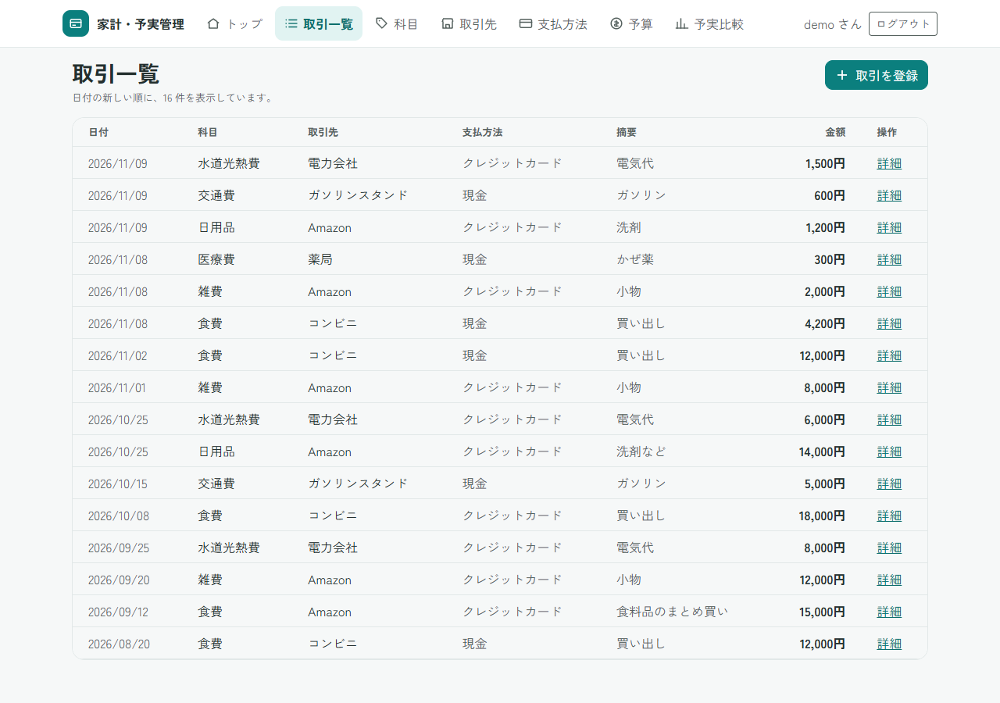
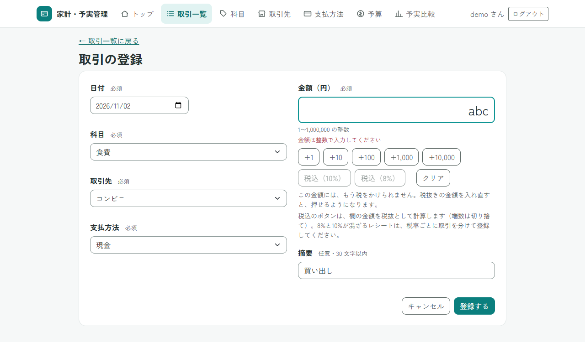
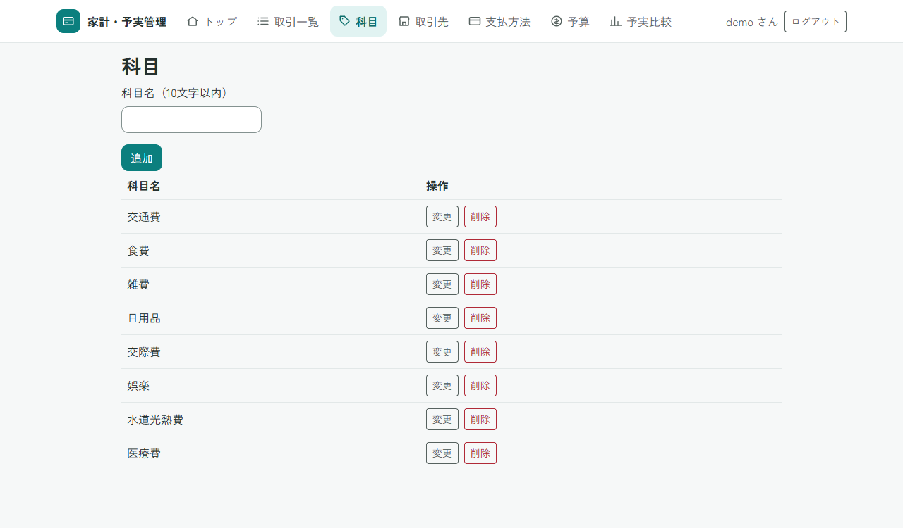
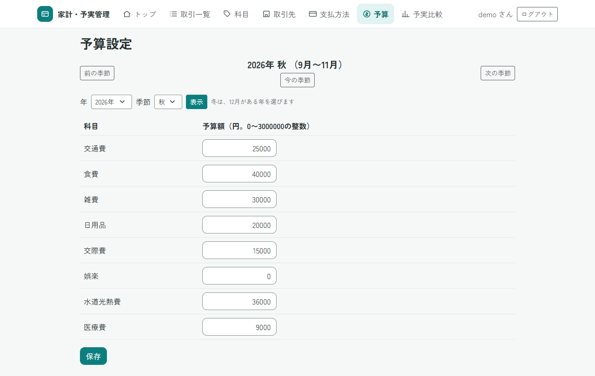
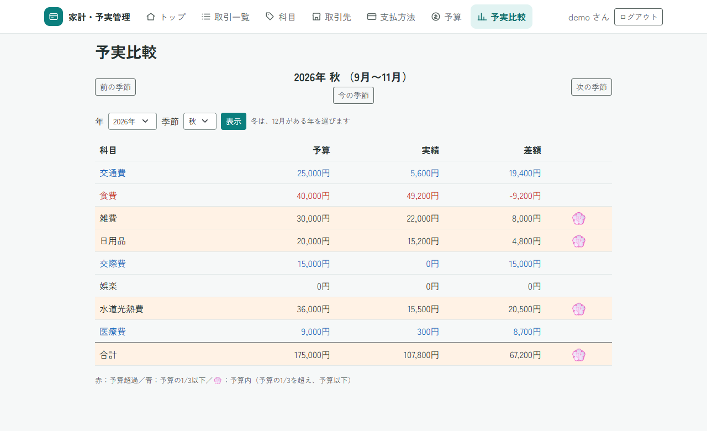
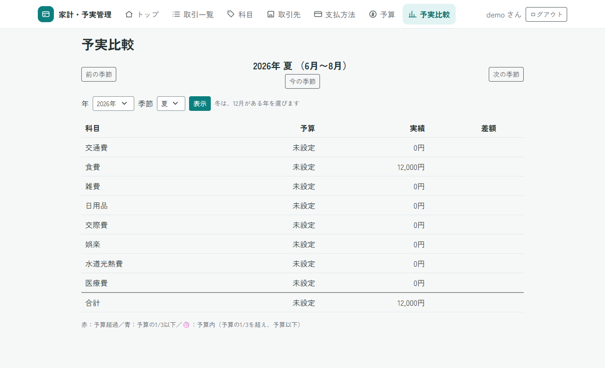
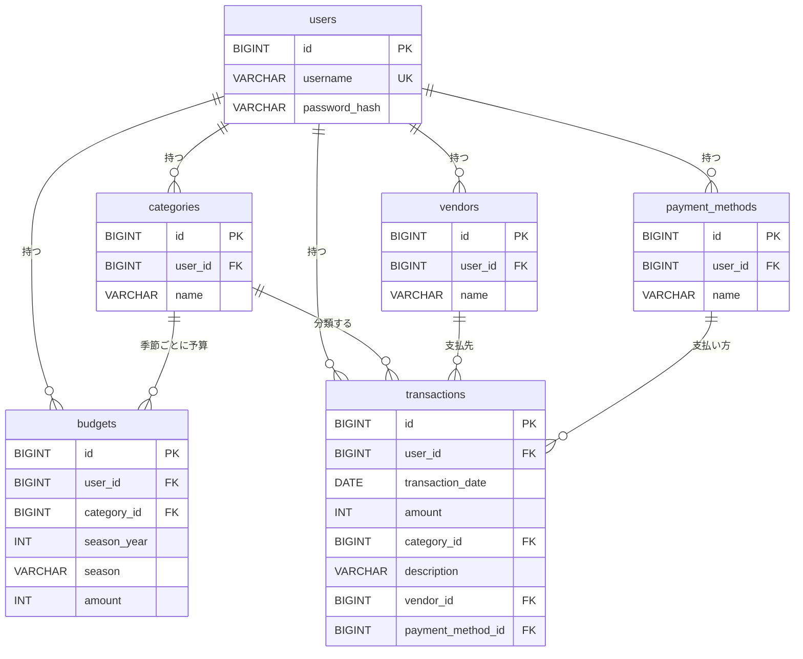

# HouseholdBudget-SpringBoot

家計・予実管理アプリ（Spring Boot版・仕様駆動開発）

## 目次

1. [このアプリについて](#このアプリについて)
2. [目玉の機能](#目玉の機能)
3. [作った目的](#作った目的)
4. [Eclipse 版との違い](#eclipse-版との違い)
5. [主な機能](#主な機能)
6. [画面の紹介](#画面の紹介)
7. [使用技術](#使用技術)
8. [設計と工夫](#設計と工夫)
9. [セキュリティ](#セキュリティ)
10. [テスト](#テスト)
11. [仕様駆動開発と AI の使い方](#仕様駆動開発と-ai-の使い方)
12. [既知の制限と今後の予定](#既知の制限と今後の予定)
13. [起動方法](#起動方法)
14. [ディレクトリと文書の案内](#ディレクトリと文書の案内)
15. [ライセンスと第三者のソフトウェア](#ライセンスと第三者のソフトウェア)
16. [振り返り](#振り返り)

## このアプリについて

季節ごと（3 か月ごと）に、予算と実際に使った金額（実績）を比べる家計簿アプリです。科目（食費・交通費など）ごとに、予算・実績・残り（予算 − 実績）・季節の終わりの見込みを、1 つの表で見られます。予算を超えた科目は赤、予算の 1/3 以下に収まっている科目は青、予算の 1/3 を超えて予算内に収まった科目には 💮 が付くので、状況がひと目でわかります。

アカウントを作ってログインして使い、データは利用者ごとに分かれます。Java と Spring Boot で作りました。先に要件定義書と設計書を書いてからコードを書く「仕様駆動開発」で進め、AI（Claude Code）を活用しています。

<p></p>

<sub>トップの画面（ログイン直後）。画面の数字は、見せるために作ったデータです。</sub>

## 目玉の機能

**自動予算**：予算設定の画面の「自動予算」ボタンで、過去 3 年の同じ季節の実績の中央値と、ここ 3 年の傾向から、予算の案を入力欄に入れます。案には、科目ごとに根拠（中央値、平均、直前の季節のペースなど）が出るので、本人が根拠を確かめて、手で直してから保存します（ボタンを押しても、保存はしません）。
経理の「前年実績ベースの予算編成」にあたります。計算はサーバーだけで行い、決まりと境目の金額は、自動テストで確かめています。

**着地見込み**：予実比較で、今のペースだと季節の終わりにいくらになるかを、合計と科目ごとに出します。「残り」（予算 − 実績）と「見込みとの差」（予算 − 見込み）を分けて見せ、見込みが予算を超える科目は、赤と「超える見込み」の印で知らせます。記録を始めたのが季節の途中なら、その日から数えます。
経理の「着地見込み」にあたります。数字を見せるだけで、前もって知らせるアラートとは別です。

## デモ動画（約 40 秒）

https://github.com/user-attachments/assets/9d5edf67-32b9-4e2a-9310-ba56c8b6c38e

`demo` でログインしたところ（トップ）から始まります。トップを見せる → 「予実比較を見る」で予実比較を開く（交通費は青）→ 取引一覧から「取引を登録」を開き、金額ボタン（+1,000 を 5 回）と税込（10%）で、交通費 5,500 円を登録する（取引一覧が 16 件から 17 件になる）→ 予実比較に戻ると、交通費が青（5,600 円）から 💮（11,100 円）に変わっている → 取引を削除して、16 件に戻す、という流れです。

## 作った目的

前職では 9 年間、経理を中心としたバックオフィスの仕事をしていました。予算と実績を比べる資料づくり、経費の科目ごとの集計、月次・四半期ごとの数字のまとめ、業務のデジタル化・効率化に取り組んできました。

季節ごとに予算と実績を比べられる家計簿がほしくて作りました。月ごとほど細かいと、つけるのが面倒になります。逆に半年ごとなど広げすぎると、比較がしづらく、季節特有の増減もわかりにくくなります。その間の、3 か月ごとの季節にしました。四半期ごとに数字を見てきた経験からも、この長さがちょうどよいと感じています。

予実比較の画面は、わかりやすく、確認する楽しみがあるように考えました。予算を超えた科目は赤、予算の 1/3 以下に収まった科目は青、予算の 1/3 を超えて、予算内に収まった科目には 💮 を付けています。差額も表示するので、次の予算策定にも生かしやすくなっています。

このアプリは、以前 Eclipse（Servlet / JSP）で作ったものを、Spring Boot で作り直したものです。AI を活用しつつ、判断は自分がグリップを握る形にしたかったので、先に要件定義書と設計書で仕様を決めました。そのうえで、AI（Claude Code）が書いたコードを自分で仕様と照らして確かめる、仕様駆動開発で進めました。

## Eclipse 版との違い

このアプリは、以前 Eclipse（Servlet / JSP）で作った家計簿アプリを、Spring Boot で作り直したものです。Eclipse 版のリポジトリは [HouseholdBudget](https://github.com/yutaro081/HouseholdBudget) です。

作り直して、次の点が変わりました。

| 項目 | Eclipse 版 | この版（Spring Boot 版） |
|---|---|---|
| ログイン | ログイン機能がない | Spring Security でログインする。データは利用者ごとに分ける |
| CSRF 対策 | CSRF 対策がない | すべての POST（データを変える操作）で、CSRF 対策をしている |
| 画面のファイル | JSP を URL で直接開けてしまう | テンプレート（Thymeleaf）は、URL で直接開けない |
| 予算 | 1 つの季節分だけで、変更する画面がない（SQL で登録する） | 季節ごとに予算を保存でき、画面から設定できる |
| データベース | H2 | MySQL |
| 自動テスト | ない | 2433 件（v1.10.0 の時点）の自動テストがある |

進め方も変えました。先に要件定義書と設計書で仕様を決め、そのとおりにコードを書いて確かめる「仕様駆動開発」にしました（「[仕様駆動開発と AI の使い方](#仕様駆動開発と-ai-の使い方)」に書きます）。

## 主な機能

### 季節の考え方

予算も実績も、**季節**ごとに扱います。春は 3〜5 月、夏は 6〜8 月、秋は 9〜11 月、冬は 12〜2 月です。冬は 12 月がある年で数えます（例：2027 年 2 月は「2026 年の冬」）。表示できる範囲は、2000 年春から 2100 年冬までです。

### 機能の一覧

- **アカウント登録とログイン**：自分でアカウントを登録して、ログインして使います。ユーザー名は半角英数字で 10 文字以内、パスワードは半角の英数字と記号で 8〜30 文字です。ログインしていないと、ログイン画面と登録画面以外は開けません。ログイン画面と登録画面には、アプリの紹介（季節ごとの予算と実績の比較など）が出ます。
- **利用者ごとのデータ**：取引・科目・取引先・支払方法・予算は利用者ごとに持ちます。他の人のデータは、見ることも変更することもできません。
- **取引**：金額・日付・科目・摘要・取引先・支払方法を登録します。一覧（日付の新しい順。表示している件数が上に出ます）、詳細、編集、削除ができ、削除の前に確認が出ます。入力エラーのときは、入力した値を残したまま、同じ画面にエラーを出します。
- **金額の入力を助けるボタン**：取引の登録・編集の画面の金額の欄に、足すボタン（+1・+10・+100・+1,000・+10,000）、税込のボタン（10%・8%。端数は切り捨て）、クリアを置いています。税込のボタンは、金額に税を二重にかけないよう、一度押したら、欄を書き換えるか空にするまで押せません。ボタンを使わず、手で数字を入力してもかまいません。ボタンで入れた金額にも、サーバーが同じ入力チェックをします。
- **取引の複写**：取引の詳細画面の「この取引を写して登録」を押すと、その取引の科目・取引先・支払方法・金額・摘要が入った登録画面が開きます。日付は今日です。開いただけでは保存せず、「保存」を押したときに、ふつうの登録と同じ入力チェックをして保存します。他人の取引や、存在しない取引は写せません（404）。
- **科目・取引先・支払方法の管理**：追加・変更・削除ができます。それぞれ 1 人あたり 256 個までです。取引で使っているものと、0 円でない予算がある科目は、削除できません。新しくアカウントを作ると、科目（交通費・食費・雑費。今の季節の予算は各 30,000 円）、取引先（コンビニ・ガソリンスタンド・Amazon）、支払方法（現金・クレジットカード）が自動で用意されます。
- **予算**：季節ごとの予算を、全科目まとめて設定します。年と季節を選ぶ欄、「前の季節」「次の季節」、「今の季節」ボタンで、季節を移動できます。まだ保存していない科目の予算額の初期値は 0 円です（保存すると、その額が入ります）。予算額の合計は、表の一番下の合計の行に出て、欄を書き換えるたびに計算し直します（短い JavaScript。数字でない欄や空の欄があるときは、合計に入れず、文で知らせます）。
- **自動予算**：予算設定の画面の「自動予算」ボタンで、科目ごとの予算の案を入力欄に入れます（保存はしません。保存は「保存」を押したときだけ）。案は、上から順に最初に当てはまるもので決めます。①過去 3 年の同じ季節の実績の中央値 × ここ 3 年の傾向 × 選んだ割合。②直前の季節のペース × 選んだ割合。③直前の季節の予算 × 選んだ割合。④どれもなければ、今の値のまま。傾向は全科目で同じで、上限は ±30%、最後に 1,000 円単位で切り上げ、1 科目 3,000,000 円を上限にします。割合は、「1. これで OK」（100%）、「2. 節約したい」（90%）、「3. 上乗せしたい」（110%）から選べ、選び直すたびに、もとから計算し直します。案を入れたあとは、直前の季節の予算・実績、案の根拠の列と、合計の行が出ます。手で直した額があるときは、「自動予算」や 1〜3 を押す前に確認が出ます（JavaScript が有効のときだけ）。表は「科目 → 根拠 → 予算額 → 前の季節の実績 → 前の季節の予算」の並びで、案のもとにした数字（根拠の数字、前の季節のペースか実績、前の季節の予算）には、ターコイズの下線と太字が付きます（材料がない科目には付けません）。どの数字かは、案を決めたルールから、サーバーが決めます。
- **トップ**：ログインしたあとに開く最初の画面です。①今の季節の「使った額 / 予算」と「残り」を、メーターで見せます（棒の上に「今日」の名前を、点線で置きます）。メーターの下には、2 行で、「季節は ○% 過ぎて、予算は ○% 使いました。」と、「このペースだと、季節の終わりには 約 ○円（予算の ○%）の見込みです。」を見せます（「約 ○円（予算の ○%）」は大きく、見込みが予算を超えるときは「予算の ○%」だけ赤です）。②今週（日曜〜土曜）に何に使ったかを、円グラフと一覧で見せます（ターコイズの濃淡と灰色だけ。科目が多いときは上位 5 科目と「その他」）。③今週の科目ごとの「実績 / 週の予算」を、メーターで見せます。週の予算は、今日が入っている季節の予算 ÷ 13 を 100 円単位で切り上げた額、今週の実績も 100 円単位で切り上げた額です。色（赤・青・💮）の決まりは、予実比較と同じです。メーターのすぐ下に、小さなアイコンつきで、**今週いちばん進んでいる科目**の 1 文（「今週いちばん進んでいる○○は、季節では約 ○円（予算の ○%）の見込みです。」）を出します。選ぶのは、週の予算に対する今週の実績の割合がいちばん高い科目で、使っていない科目と、週の予算が 0 円・未設定の科目は選びません。円もメーターも、HTML と CSS だけで描いています（JavaScript もライブラリも使いません）。
- **きょうのひとこと**：トップの円グラフの下の枠です。①暦のひとこと：ふだんはその日の七十二候の文、二十四節気が始まる日は節気の文、年中行事の日は行事の文（行事と節気が同じ日は、行事を先に両方）。次の節気までの日数も添えます。②グラフへのひとこと：今週の数字から、決まった型（今週いちばん多い科目、週の予算の残りと土曜までの日数、今週まだ使っていない科目）で作る一言です。評価や命令の言い方はしません。サーバー側で作って表示し、JavaScript・外部の API・CDN は使いません。
- **予実比較**：季節ごとに、科目別の予算・実績を表で比べます。最下行は合計行です。過去・未来の季節の表は「科目／予算／実績／差額」で、差額は「予算 − 実績」です（予算を超えるとマイナス）。予算を設定していない季節は「未設定」と表示します。今の季節では、表の上に、**着地見込み**（今のペースが続いたとき、季節の終わりに合計でいくらになるか）の要約カード（見込み・予算・実績と、メーター）を置き、表は「科目／予算／実績／残り／見込み／見込みとの差」の 6 列にします。**残り**は、過去・未来の季節の差額と同じ値（予算 − 実績）で、名前だけを変えています。**見込み**は科目ごとに出し、「7,900 / 25,000」の形で、その科目の予算を横に小さく添えます（予算が未設定・0 円の科目は「—」）。**見込みとの差**は「予算 − 見込み」で、マイナスのとき（見込みが予算を超えるとき）だけ赤と「超える見込み」の印を付けます。見込みは、「季節の初めは予算を信じ、日がたつほど実際のペースを信じる」式（見込み ＝ 実績 ×（1 ＋ 残りの割合）＋ 予算 ×（残りの割合）²。残りの割合は、残りの日数 ÷ 季節の日数）で求め、100 円単位で切り上げて「約」を付けます。最初の取引の日が、その季節の途中にあるときは、季節の初日ではなく、その日から日数を数えます（予算は、数える日数に合わせて日割りで混ぜます。要約カードに「○/○ に記録を始めたので、その日から数えています。」と出ます）。数字を見せるだけで、前もって知らせるアラートとは別です。
- **メーター**：トップの季節と今週、予実比較の要約カードの棒は、**予算（100%）を棒全体の 70% の位置**に置きます（右端は約 143%）。予算の位置に灰色の実線を引いて、予算を超えた部分だけを赤で見せます（予算が 0 円で使ったときは、全体が赤）。143% を超えたら、棒は右端で止まり、棒の右に「+○%」（予算を超えた割合）が出ます。「今日」は点線で、季節のメーターとカードでは、棒の上に名前（「今日（79%）」）を置きます。縮尺の 70% は、1 か所（`MeterScale`）だけで決めています。

### 予実比較の色と 💮

| 見え方 | 条件 |
|---|---|
| **赤い文字** | 実績が予算を超えている（予算が 0 円でも、実績があれば赤） |
| **青い文字** | 実績が予算の 1/3 以下（ちょうど 1/3 を含む。実績が 0 円も青） |
| **💮 と薄いアプリコットの背景** | 赤でも青でもなく、予算が設定されていて、実績があり、予算以下（予算ちょうどを含む） |
| 色なし | 予算が未設定の行、予算が 0 円で実績も 0 円の行 |

合計行も、同じ決まりで色と 💮 が付きます（合計の予算は、予算が設定されている科目の合計。合計の実績は、全科目の合計）。色は、今の季節では「残り」（過去・未来の季節では「差額」）のセルに付きます。色だけで意味を伝えないよう、赤には「予算超え」、青には「使い残し」の文字の印も付けます。💮 は、科目名の横に付きます。

### 入力チェック

- 金額：1 円以上 1,000,000 円以下の整数（全角の数字も受け付けます）。予算額：0 円以上 3,000,000 円以下の整数。
- 日付：2000 年 3 月 1 日から 2100 年 12 月 31 日まで。
- 文字数：科目・支払方法は 10 文字以内、取引先は 20 文字以内、摘要は 30 文字以内（摘要は任意）。
- 同じ名前の科目・取引先・支払方法は、同じ利用者の中では登録できません（大文字・小文字、ひらがな・カタカナ、全角・半角の違いは、同じ名前として扱います）。

## 画面の紹介

画面の数字は、見せるために作ったデータです。

**ログイン**


左に、アプリの紹介が出ます。初めての人は、「アカウント登録」から自分のアカウントを作ります。

**トップ（ログイン後の最初の画面）**


今の季節に使った合計と予算（残りと、日の進み方との比べ。棒の上に「今日」の名前）、季節の見込みの 2 行の文、今週使った科目の円グラフ（金額・割合と、週の予算に対する赤・青・💮 の判定）、今日のひとこと、今週の科目ごとの進み具合（メーターのすぐ下に、今週いちばん進んでいる科目の 1 文）が、1 画面で見られます。

**取引一覧**



日付の新しい順に並び、上に表示している件数が出ます。「詳細」から、編集と削除ができます。

**取引の登録（入力エラー）**



入力エラーの例です。金額に数字以外を入れると、エラーを出します。入力した値は残ります。

**科目の管理**



科目の追加・変更・削除ができます。取引で使っている科目は、削除できません。

**予算設定**



季節ごとの予算を、全科目まとめて設定します。年と季節を選ぶ欄、「前の季節」「次の季節」、「今の季節」で、季節を移動できます。「自動予算」を押すと、根拠・予算額・前の季節の実績と予算が並ぶ表になり、案のもとにした数字に下線が付きます。

**予実比較**



このアプリの中心の画面です。今の季節では、上に見込みの要約カード、表に「残り」「見込み」「見込みとの差」の列があります。色と 💮 の決まりは、「[主な機能](#主な機能)」に書いてあります。

**予実比較（予算が未設定の季節）**



予算を設定していない季節は、予算が「未設定」と表示されます（実績は表示します）。

## 使用技術

版は、確認できたものだけを書いています。「Spring Boot が管理する版」は、Spring Boot の版を決めると自動で決まるものです。

| 種類 | 名前（版） | 何に使うか | 選んだ理由 |
|---|---|---|---|
| 言語 | Java 25 | プログラムを書く言語と、実行する環境 | 要件で指定 |
| 土台 | Spring Boot 4.1.2 | Web アプリの土台（組み込みの Web サーバー、設定、起動） | 要件で指定 |
| ビルド | Maven（付属の `mvnw`） | 部品の管理とビルド | 別にインストールせずに動かせる |
| 画面 | Thymeleaf（Spring Boot が管理する版） | 画面（HTML）を作る。表示する値は自動で無害化される | Spring Boot の標準的な画面の仕組みで、XSS 対策が標準で入っている |
| 見た目 | Bootstrap 5.3.8（CSS のみ） | 余白・ボタン・表・フォームの見た目をそろえる | 自作の CSS だけでは手間が大きい。JavaScript は使わず、アプリの中に置く（CDN は使わない）。MIT ライセンス |
| フォント | Zen Kaku Gothic New（SIL OFL 1.1） | 画面の文字（日本語のゴシック体） | 画面の統一感を出すため、本人が選んだ。フォントのファイル（woff2）はアプリの中に置き、CDN は使わない。ライセンスは `THIRD-PARTY-NOTICES.md` と `static/fonts/OFL.txt` |
| 認証 | Spring Security（Spring Boot が管理する版。BCrypt を含む） | ログイン・ログアウト、ログイン必須、CSRF 対策、パスワードのハッシュ化 | 自作せずに、要件 6 章のセキュリティを実現でき、実績がある |
| データの読み書き | Spring Data JPA（Hibernate。Spring Boot が管理する版） | データベースの読み書き | SQL を文字列でつなげずに書けるので、SQL インジェクション対策になる |
| 入力チェック | Bean Validation（Spring Boot が管理する版） | 必須・文字数・範囲のチェック | 項目に印を付けるだけで書け、エラーを画面に戻しやすい |
| データベース | MySQL 9.7 | データの保存 | 要件で指定 |
| テスト | JUnit など（Spring Boot が管理する版） | 自動テスト | Spring Boot の標準のテスト部品 |
| 開発の道具 | VS Code、Git / GitHub、Claude Code | 開発、版の管理、コードの生成 | 要件で指定 |

## 設計と工夫

### 季節の決まりを 1 か所にまとめた

「今日はどの季節か」「この季節は何月から何月までか」「前の季節・次の季節はどれか」という計算は、画面にも DB にも頼らない 1 つの部品にまとめ、予算設定と予実比較の両方で使っています。冬は 12 月がある年で数えるなど、ややこしい決まりを 2 画面で食い違わせないためです。範囲外の年や、存在しない季節を URL に入れると、「ページが見つかりません」の画面になります。

### 色の判定を 1 か所にまとめた

赤・青・💮 を決める判定も、画面とは別の 1 つの部品にあります。画面は、判定の結果を受け取って、色を付けるだけです。判定は、次の順番で行います（科目の行も合計行も同じです）。

1. 予算が未設定なら、色なし。
2. 実績が予算を超えていたら、赤（予算が 0 円でも、実績があれば赤）。
3. 予算が 0 円なら、色なし（実績も 0 円のとき。このとき青にならないよう、先に除きます）。
4. 実績の 3 倍が予算以下なら、青（ちょうど 1/3 も青）。
5. それ以外のうち、実績があって予算以下なら、💮。

境目になる金額（30,000 円の予算で 10,000 円と 10,001 円、30,000 円と 30,001 円など）は、自動テストで 1 つずつ確かめています。金額の合計は大きくなることがあるので、計算は大きい整数で行います。

### 他の人のデータが混ざらない作りにした

データを探すときは、必ず「ID」と「持ち主（`user_id`）」の両方で絞ります。見つからないときは、「他人のデータだから」「存在しないから」の区別をせず、同じ「ページが見つかりません」を返します（他人のデータがあるかどうかを教えないためです）。ログイン中のユーザーの ID は、ログインの情報（セッション）から取り出し、画面から送られた値は使いません。取引や予算を登録するときに、他人の科目の ID を混ぜて送られても、保存しません。確かめているテストは、「[データの分離を確かめているテスト](#データの分離を確かめているテスト)」に挙げています。

### 入力チェックの方針

- 金額は、全角の数字（１２３）も半角に直して受け付けます。`1,000`・`1.5`・`0x10`・`+5` のように、整数でないものはエラーにします。
- エラーのときは、入力した値を残したまま、同じ画面にエラーを出します（パスワードだけは残しません）。
- エラーメッセージの文は、1 つのファイルにまとめています。

### アプリと DB の二重の守り

入力チェックをすり抜けても、DB が止める作りにしています。金額・日付・季節の範囲（CHECK 制約）、同じ名前の科目を 2 つ作れない（一意制約）、同じ科目・同じ季節の予算を 2 つ作れない（一意制約）、持ち主のいないデータを作れない（外部キー）です。

### データの関係（ER 図）



すべての表が `user_id` を持ち、利用者ごとにデータが分かれます。予算は「科目・年・季節」ごとに 1 行です。

## セキュリティ

要件で求められた 5 つ（ハッシュ化、ログイン必須、SQL インジェクション対策、XSS 対策、CSRF 対策）に加えて、次の対策をしました。「確認した方法」は、自動テストと、ブラウザでの確認（Phase 8）です。

| 対策 | やったこと | 確認した方法 |
|---|---|---|
| パスワードの保存 | 元に戻せない形（BCrypt のハッシュ）に変えて保存する。同じパスワードでも、毎回違うハッシュになる | 自動テスト。DB を見て、元のパスワードが読めないことを確認 |
| ログイン必須 | ログイン画面・登録画面・画面の部品（CSS など）・エラー画面以外は、ログインしていないと開けず、ログイン画面へ移動する | 自動テスト。ログアウトした状態で、各 URL を開いて確認 |
| SQL インジェクション | SQL を文字列でつなげず、パラメータとして渡す（Spring Data JPA）。文字列連結の SQL を作っていない | コードの検索。`' OR '1'='1` などを入力して、影響がないことを確認 |
| XSS | 画面に出す値を自動で無害化する（Thymeleaf）。無害化しない出力は使わない | 自動テスト（全テンプレートの検査を含む）。`<script>alert(1)</script>` を入力して、ただの文字として表示されることを確認 |
| CSRF | データを変える操作は POST にし、すべてにトークンを付ける。トークンがないと 403 | 自動テスト。トークンを消して送信して、403 になることを確認 |
| データの分離 | 「ID」と「持ち主」の両方で探す。他人のデータは 404 | 自動テスト。2 人のユーザーで、別のユーザーの ID を URL に入れて確認 |
| セッションの Cookie | JavaScript から読めない設定（HttpOnly）と、他のサイトからの送信に付かない設定（SameSite=Lax）。セッション ID を URL に出さない。ログイン後に ID を新しくする | ブラウザの開発者ツールで確認 |
| エラー画面 | 詳しい中身（例外、SQL、ファイルの場所）を画面に出さない。404・403・400 番台・500 の画面を用意した | 自動テスト。DB を止めて 500 の画面を確認 |
| 応答のヘッダー | 画面の応答に、ブラウザが画面を覚えないよう求めるヘッダー（`Cache-Control: no-store`）が付く | 自動テスト |
| ログアウト後の「戻る」 | 「戻る」で前の画面が見えないよう、短い JavaScript で開き直す | PC のブラウザで確認 |
| 秘密情報 | パスワードや接続先は環境変数から読み、リポジトリに書かない。既定のアカウントは作らない | コードと履歴の検索 |

**限界**：このアプリは、自分のパソコンで動かす前提で、通信は HTTP です（暗号化していません）。インターネットに公開するときは、HTTPS などの対策が要ります（「[既知の制限と今後の予定](#既知の制限と今後の予定)」）。

## テスト

自動テストは **2433 件**（v1.10.0 の時点）で、すべて成功しています。古いレポートが混ざらないよう、`.\mvnw clean test` で流して数えています（`.\mvnw test` でも実行できます）（MySQL と環境変数が要ります。各テストは、データベースの変更を最後に取り消すので、データは残りません）。

| 種類 | 件数 | 何を確かめるか |
|---|---|---|
| 画面（Controller） | 867 | 画面の表示、エラーのメッセージ、入力値が残ること、移動先、他人のデータが見えないこと、金額ボタンの HTML、取引の複写、色とメニューの印、フォント（CSS の指定、ファイル、キャッシュ）、取引の登録・編集画面の 2 列（HTML の並び、印、ボタン、CSS の規則）、トップ（表示、空のときの案内、`style` 属性が数字と固定の文字だけであること、色の変数）、きょうのひとこと（枠の位置、暦の文の出し分け、行事と節気が重なる日の並び、年末・表の外の年、科目が 0 件のとき、科目名のエスケープ、他の人のデータが混ざらないこと、枠の CSS）、ヘッダー（ロゴ、メニューのアイコン、ヘッダーが 1 つだけであること）、ログイン・登録の 2 列（紹介、入力欄の `autocomplete`、CSS）、取引一覧（件数、カードの中の表）、トップの季節のメーター（見込みの一文と、メーターの数字との一致）、円グラフの一覧の今週の判定、予実比較の着地見込みの 1 行（今の季節だけ、「上回ります」が出る・出ない、警告の言葉がない）、予算設定の自動予算（`auto` の 1〜3 以外は 404、案の文、5 列の表と合計の行、ボタンと切りかえの表示、保存のボタンと CSRF、合計・確認の JavaScript に渡す HTML の印）、ログイン・登録の縦の位置（CSS）、メーター（縮尺、予算の線、超えた部分の赤、「+○%」、「今日」の名前）、予実比較の今の季節の列（残り・見込み・見込みとの差、チップ、列の幅、区切り線）、予算設定の列の並びと、案のもとにした数字の下線、トップの季節の文（2 行、赤い部分）と今週のひとこと（置き場所、アイコン、科目名の無害化） |
| 入力チェックと値の変換 | 321 | 必須・文字数・範囲、全角の数字、整数でない入力 |
| 計算 | 683 | 季節の決まり（前後の季節、範囲、冬の年）、色の判定の境目、今週の期間、週の予算と切り上げの境目、「今日」の線の位置、円グラフの並びと割合、二十四節気の日と七十二候の境目（年をまたぐ、表の外の年）、年中行事の日（節分・お彼岸入りは節気から計算）、グラフへのひとことの型と選び方、季節の終わりまでの日数、使った割合と日の進み方の％、着地見込みの式（整理前の式との一致、予定どおりなら予算、100 円切り上げ、桁あふれは例外）、「予算の ○%」と「上回ります」の境目、円グラフの一覧の判定の引き継ぎ（「その他」は判定なし）、自動予算の計算（過去の同じ季節の組み立て、中央値、傾向の％と上限、ペース、案の選び方と 1,000 円切り上げ・上限、桁あふれ）、メーターの縮尺と赤い部分（予算 0 円を含む）、今週いちばん進んでいる科目の選び方、最初の取引の日から数える着地見込みとペース（予算の日割りを含む） |
| 業務処理（Service） | 334 | 登録・更新・削除の決まり、初期データ、予実比較の集計、256 個の上限、トップの集計（週の境目、季節をまたぐ週、他の人のデータが混ざらないこと）、きょうのひとこと（文面 107 個の件数・番号・空の文、二十四節気の日付の表を国立天文台の日付と照らすこと、グラフへのひとことの文に禁止の言葉がないこと）、トップの数字（残り日数、％、状態の文、円グラフの一覧の判定が今週の進み具合と同じこと、着地見込みが予実比較の合計と同じ値から計算されること）、自動予算（「記録のある年」の判定、根拠の文、他人のデータが混ざらないこと、案を入れても保存しないこと）、予算設定の初期値、最初の取引の日から数えた着地見込みが、トップ・予実比較・自動予算に届くこと、案のもとにした数字をサーバーが決めること |
| セキュリティ | 66 | ログイン必須、CSRF、ログイン・ログアウト、応答のヘッダー、フォントがログインなしで開けること |
| データベース | 70 | 読み書き、制約、集計の SQL（月ごとの科目別の集計を含む）、最初の取引の日（自分の取引だけ） |
| そのほか | 80 | メッセージの文、テンプレートの検査、JavaScript のソースの検査（金額ボタン、予算の合計）、エラー処理、設定、起動 |

自動テストでは確かめにくいものは、ブラウザで確かめました（Phase 8）。全画面を開く、入力チェックの境界値、セキュリティ（ログイン前後のセッション ID の変化、Cookie、エラー画面）、2 人のユーザーでのデータ分離です。確認の記録は、[docs/plans/phase-8-polish.md](docs/plans/phase-8-polish.md) にあります。

### データの分離を確かめているテスト

「他の人のデータが見えない・変更できない」ことは、2 人のユーザーを作って、片方から他方のデータを開く・変更する・削除する・混ぜて送る、という形で確かめています。主なテスト（`クラス名.メソッド名`）は次のとおりです。

**取引**

- 一覧に、自分の取引だけが出る
  - `TransactionControllerTest.listShowsOwnTransactionsNewestDateFirstAndNotOthers`
- 他人の取引の詳細は、存在しない ID・数字でない ID と同じ 404 になる
  - `TransactionControllerTest.detailOfOtherUsersMissingAndNonNumericIdsAreTheSame404`
- 他人の取引は、変更も削除もできない（データは残る）
  - `TransactionControllerTest.updateOfOtherUsersTransactionIsNotFoundWhetherOrNotTheInputIsValid`
  - `TransactionControllerTest.deleteOfOtherUsersTransactionIsNotFoundAndKeepsIt`
- 他人の取引は、「写して登録」の元にも指定できない（存在しない ID・数字でない ID と同じ 404）。開いただけでは、取引は増えない
  - `TransactionCopyTest.copyOfOtherUsersMissingAndInvalidIdsIsTheSame404`
  - `TransactionCopyTest.openingTheCopyFormDoesNotCreateOrChangeAnything`
- 登録のとき、他人の科目・取引先・支払方法の ID を混ぜて送られても、保存しない
  - `TransactionControllerTest.registerWithOtherUsersItemIsNotFound`
  - `TransactionServiceTest.registerWithOtherUsersItemsIsNotFoundAndSavesNothing`

**科目・取引先・支払方法**

- 一覧は自分のものだけ。他人のものは、変更・削除の画面も操作も 404
  - `CategoryControllerTest.listShowsOwnCategoriesInOrderAndNotOthers`
  - `CategoryControllerTest.otherUsersCategoryIsNotFoundForViewEditAndDelete`
- 取引先・支払方法も同じ
  - `VendorControllerTest.otherUsersItemIsNotFoundForViewEditAndDelete`
  - `PaymentMethodControllerTest.otherUsersItemIsNotFoundForViewEditAndDelete`
- 他のユーザーと同じ名前でも追加できる。256 個の上限は、ユーザーごとに数える
  - `CategoryControllerTest.addDuplicateIgnoresCaseAndOtherUsersNames`
  - `MasterLimitControllerTest.anotherUsersFullListDoesNotBlockMe`

**予算**

- 他人の科目の ID が 1 つでも混ざっていたら、何も保存しない
  - `BudgetControllerTest.otherUsersCategoryIdIsNotFoundAndSavesNothingEvenIfOtherRowsAreValid`
  - `BudgetServiceTest.otherUsersCategoryIdMakesTheWholeSaveNotFound`
- 2 人が同じ季節の予算を保存しても、別々に保存される。他人の予算は変わらない
  - `BudgetControllerTest.twoUsersSaveTheSameSeasonSeparately`
  - `BudgetServiceTest.saveDoesNotTouchOtherSeasonsOrOtherUsers`

**予実比較**

- 他人の取引・予算が、実績・予算に混ざらない
  - `ComparisonControllerTest.otherUsersDataIsNotShown`
  - `ComparisonServiceTest.otherUsersCategoriesBudgetsAndTransactionsAreNotIncluded`
  - `TransactionRepositorySumTest.otherUsersTransactionsAreNotCounted`

**アカウント登録**

- 初期データ（科目・取引先・支払方法・予算）は、ユーザーごとに別の行として作る
  - `RegistrationServiceTest.eachUserGetsSeparateInitialData`

**データベースの検索**

- 「ID」と「持ち主」の両方で探すと、自分の取引だけが見つかる
  - `TransactionRepositoryTest.findByIdAndUserIdFindsOnlyOwn`

ブラウザでも、2 人のユーザーで、別のユーザーの ID を URL に入れる・送信の内容を書き換える、という確認をしました（Phase 8）。

## 仕様駆動開発と AI の使い方

### 進め方

先に文書を書き、そのあとにコードを書きました。

1. **要件定義書**：何を作るか。
2. **設計書**：どう作るか（画面、テーブル、処理の流れ、入力チェック、セキュリティ、決めたことの理由）。
3. **実行計画書と、各 Phase の手順書**：進め方（Phase 0〜10）と、Phase ごとの手順・確認の方法・決めること。
4. **コード**：主な処理は、自動テストを先に書いてから実装しました。
5. **確認**：自動テストと、ブラウザでの確認。結果は手順書に記録しました。

仕様を変えるときも、先に文書を直してから、コードを直しました（要件定義書は、直す前と後の文を見せて確認してから直しました）。

### 役割分担

| 役割 | すること |
|---|---|
| 自分 | 要件と設計を決める。手順書の「決まっていない点」を決める。各手順の結果を確かめる（ブラウザ、SQL）。DB のパスワードを入力する作業。Git の操作（コミット、push、`main` への取り込み、タグ付け） |
| AI（Claude Code） | 手順書に沿って、ファイル（コード、テスト、文書）を作る・直す。読むだけの調査。テストとビルドの実行（`.\mvnw test`、`.\mvnw compile`） |

### 守った決まり

Claude Code に守らせた決まりは、リポジトリの直下の [CLAUDE.md](CLAUDE.md) に書いてあります。主なものは次のとおりです。

- 1 つの手順が終わったら止まって、確認を待つ（次の手順へ勝手に進まない）。
- 設計書で決まっていないことは、勝手に決めず、一覧にして、自分が決める。
- 変更は、先に文書、次にコード。頼まれていない変更や判断をしたときは、理由を添えて報告する。
- コミット、push、`main` への取り込み、タグ付けは、自分が行う。
- パスワードや接続先の値は、コード・文書・コミットメッセージのどこにも書かない。
- コードの決まり：データを探すときは、必ず「ID」と「持ち主」の両方で絞る（`findById` は使わない）。`th:utext` は使わない。CSRF 対策を無効にしない。

### よかったことと、難しかったこと

**よかったこと**

- AI が書いているもの、書いたものを、文書と見比べて確かめられた。
  - 例：要件に「年と季節を選べる」とあったのに、選ぶ欄がなかったこと。Phase 8 の 4.3 で、要件の文と画面を見比べて見つけて、直しました。
  - 例：取引の日付の範囲と、季節の範囲がずれていて、2000 年 1〜2 月の取引が予実比較に出なかったこと。Phase 7 の 4.4 で、予実比較の自動テストを書いているときに見つけて、直しました。
  - 例：ボタンに見た目の指定を足したら、「このボタンが無い」ことを確かめる自動テストが、条件が合わなくなって、必ず通る形になっていました。見直しで見つけて、直しました。文書に、接続先の値が書かれていたのも、確認で見つけて、伏せました。
- 今何をしているか、今後何をするのか、自分が理解できない点、直した方がいいと感じた点などが、わかりやすかった。
  - 例：手順書ごとに「決まっていない点」を一覧にして、選択肢とおすすめと理由を見ながら、1 つずつ決めました。決めた理由は文書に残るので、複合外部キーを採らなかった理由のように、レビューの指摘にも、その理由で答えられました。
- 事前に決めたルールどおりに制作してくれる安心感があった。
  - 例：1 つの手順が終わったら止まって確認を待つ。決まっていないことは勝手に決めず、一覧にして自分が決める。Git の操作は自分が行う。パスワードや接続先の値は書かない。（「[守った決まり](#守った決まり)」）

**難しかったこと**

- 思ったより時間がかかった。
  - 例：「決まっていない点」は、Phase 8 だけで 40 件以上ありました。
- AI の言っていることを理解するのにも、知識や慣れが必要だった。
- コマンドの入力に慣れず、大変だった。

### 別の AI によるレビュー

AI（Claude Code）が書いたコードを、別の AI にもレビューしてもらいました。ChatGPT に、Phase 6 のあと、Phase 7 のあとの 2 回。Codex に、Phase 9 と、金額を入れるボタン（issue 009）で 2 回、取引の複写（issue 012）で 1 回、フォント（issue 015 の 2 回目）で 1 回、トップ（issue 010）で 1 回、きょうのひとこと（issue 016）で 1 回、ログイン・登録の画面と取引一覧（issue 017 の 2 回目）で 1 回。Gemini に、自動予算（issue 019）で 1 回、着地見込みの続き（issue 020）で 1 回（issue 019 は Codex の使用量の上限のため、Gemini にしました）。コードを見せて指摘を受けました。**指摘は、そのまま直さず、まずテストで本当に起きるかを確かめてから、直すかどうかを自分で決めました。**

#### Phase 6 のあと（1 回目）

最初の指摘は 2 つでした。

| 指摘 | 確かめたこと | 決めたこと |
|---|---|---|
| 予算設定で、行を送らない・null のとき、`NullPointerException`（500）になるのでは | 使い捨てのテストで、画面から送れる 14 通りと、Service を直接呼ぶ 9 通りを試した。画面からは再現せず（500 にならない）。Service を直接呼ぶと落ちた | **直した**。画面からは起きないが、Service の入口でも null を守る（二重の守り）。テストを 6 件足した |
| 予算・取引から科目への、複合外部キー（「科目 ID と `user_id` の組み合わせ」を外部キーにして、他人の科目を DB でも拒否する案） | すでに設計書 3.9 に、この案と、採用しない決定が書いてあった | **直さなかった**。設計書 3.9 の理由：Spring Data JPA での扱いが複雑になり、入門者には負担が大きいため。代わりに Service での確認と、Phase 8 の 2 ユーザーでのテストで守る |

そのあとの追加の質問で、次の 2 つを決めました。

| 指摘 | 確かめたこと | 決めたこと |
|---|---|---|
| 行の番号を書き換えるような、変な値の送信（`rows[-1]`・`rows[abc]` など）が、500 になる | 500 になることを再現した | **直した**。400（送信の形がおかしい）にした。500 は「サーバーの不具合」の意味なので、区別する |
| 科目が 257 個を超えると、予算設定で保存できなくなる（行の数は、Spring の標準で 256 行まで） | 科目が増えたとき、予算を保存できなくなる点を確かめた | **直した**。科目・取引先・支払方法は 1 人あたり 256 個までと、要件に足した（R14）。256 行は保存でき、257 行は 400、257 個目は追加できない、を自動テストで確かめた |

256 個の上限は、当初は「科目の数に上限がなくてもよい」と判断していました。レビューを受けて、見直しました。

#### Phase 7 のあと（2 回目）

不具合や食い違いの指摘は、ありませんでした。「データの分離を確かめたテストを案内できるとよい」という助言があり、「テスト」の節に、テストの名前を挙げて案内しました（「[データの分離を確かめているテスト](#データの分離を確かめているテスト)」）。

#### Codex（Phase 9。README を書いたあと、v1.0.0 の前）

Codex は、コードを読んで指摘する形でした。**テストの実行と、ブラウザでの操作は、していません。** そのため、次の結果は、コードを読んだ範囲のものです。

**セキュリティと不具合の指摘は、ありませんでした。** README について、2 つの助言がありました。

| 指摘 | 確かめたこと | 決めたこと |
|---|---|---|
| README に、作業用の HTML コメント（「確かめたら消す」など）が残っている | 4.6（起動方法の確認）と 4.8（iPad のメモ）のために残してあったコメントだった | **取り入れた**。4.6・4.8 が終わったら消す。コミット前の確認に、「README に作業用のコメントが残っていない」を足した |
| テストの件数に、いつの時点かが書いていない | 件数は書いた時点のもので、v1.0.0 までに変わりうる | **取り入れた**。9 節に「v1.0.0 の時点」と書き添えた |


#### Codex（issue 009：金額を入れるボタン。PR の前）

JavaScript を初めて使った機能（足すボタン・税込のボタン・クリア）を、Codex にレビューしてもらいました。レビューは 2 回でした。**1 回目はブランチ全体、2 回目は Q009-18（金額が入った状態で開いたら、税込のボタンを最初から押せない）の追加の差分**で、2 回目は問題なしでした。**どちらも、GitHub のコードを読んでのレビューで、テストの実行と、ブラウザでの操作は、していません。**1 回目は、**セキュリティの問題は、ありませんでした。** `window.AmountButtons`（Console で計算を確かめるために出している、計算の 2 つの関数）は、残してよい、という結果でした。指摘は 3 件でした。

| 指摘 | 確かめたこと | 決めたこと |
|---|---|---|
| 先頭のゼロを除いた桁数で判定している（`0000000001` に +1 で `2`） | コードのとおりで、この動きが正しい | **コードは直さず、設計書を直した**。「10 桁以上は何もしない」を「先頭のゼロを除いて 10 桁以上なら何もしない」にした |
| JavaScript の `trim()` は、サーバー（Java の `strip()`）より少し広い空白（ノーブレークスペースなど）を取る | ボタンを押した結果は、きれいな数字になる。害はない | **直さなかった**。設計書に、違いがあることだけを書いた |
| 今のテストは、ソースと HTML の確認で、計算やクリックの動きは実行していない（`Math.floor` を `Math.ceil` に変えても気づけない） | そのとおり。動きは、Console の 32 件と、ブラウザでの手順で、自分で確かめた | **今回は直さなかった**。ブラウザを自動で動かすテストが要る話なので、issue 008 に書き足した |

このレビューでも、指摘をそのまま直さず、確かめて、直すか・直さないかを決めました。

#### Codex（issue 012：取引の複写。PR の前）

取引の詳細画面の「この取引を写して登録」（`GET /transactions/new?copyFrom={id}`）を、Codex にレビューしてもらいました。レビューは、ブランチ全体を対象に 1 回でした。見てもらった観点は次の 4 つです。

- **データの分離**：写す元の取引を、ID とログイン中のユーザーの ID の両方で探しているか。他人の取引・存在しない ID・数字でない ID が、同じ 404 になるか。
- **GET でデータベースに書かないこと**：写す画面を開いただけで、取引が増えたり変わったりしないか。
- **登録時の入力チェック**：写した画面から「登録する」を押したとき、ふつうの登録と同じ入力チェックを通るか。
- **テストで確かめきれていないこと**：自動テストが見ていない部分はどこか。

結果は **「問題なし」** で、直したところはありませんでした。**GitHub のコードを読んでのレビューで、テストの実行と、ブラウザでの操作は、していません。** 自動テストは見た目や並びを確かめないので、固定の 1 行の色、ボタンの並び、狭い幅での崩れは、ブラウザで自分が確かめました。

#### Codex（issue 015 の 2 回目：フォント。PR の前）

画面のフォント（Zen Kaku Gothic New）を入れた変更を、Codex にレビューしてもらいました。レビューは、ブランチ全体を対象に 1 回でした。見てもらった観点は次の 4 つです。

- **`/fonts/**` の範囲**：ログインなしで開けるのが、フォントの置き場所だけか（ほかの URL の守りが弱くなっていないか）。
- **`no-store` の維持**：画面（HTML）と CSS・JavaScript の `Cache-Control: no-store` が、そのままか。ブラウザに覚えさせるのが、フォントだけか。
- **OFL の表示**：フォントのライセンス（SIL OFL）の著作権表示と全文が、フォントと一緒に配られているか。
- **テストで確かめきれていないこと**：自動テストが見ていない部分はどこか。

最初の 3 つは **「問題なし」** でした。4 つ目の観点から、指摘が 1 件出ました。**GitHub のコードを読んでのレビューで、テストの実行と、ブラウザでの操作は、していません。**

| 指摘 | 確かめたこと | 決めたこと |
|---|---|---|
| フォントのテストは、ファイルの先頭 4 バイトと大きさしか見ていない。壊れた woff2 や、別のフォントに差し替えても通ってしまう | そのとおり。ファイルの途中の 1 バイトだけを変えて試すと、先頭 4 バイトも大きさも同じなので、それまでのテストは通った | **取り入れた**。配っているフォント 2 つと `OFL.txt` の SHA-256 と大きさを、テストの中で計算して、`THIRD-PARTY-NOTICES.md` に記録した値と照らし合わせる（記録の値は、テストに書き写さず、表から読む）。**直す前に、わざと値を変えて、テストが失敗することを確かめた**（記録の値を 1 文字変える、フォントの途中の 1 バイトを変える。どちらも失敗した） |

このレビューでも、指摘をそのまま直さず、まず本当に起きるかを確かめてから、直すことにしました。

#### Codex（issue 010：トップ。PR の前）

ログイン後の最初の画面「トップ」（季節のメーター、今週の円グラフ、今週の科目ごとのメーター）を、Codex にレビューしてもらいました。レビューは、ブランチ全体を対象に 1 回でした。見てもらった観点は次の 5 つです。

- **データの分離**：今週の取引・科目・予算を、ログイン中のユーザーの ID で絞っているか。他の人のデータが混ざらないか。
- **ログイン後の移り先と守り**：ログイン後にトップへ移ること。未ログインで `/` を開いたときに、ログイン画面へ移ること。`/` が新しく画面を返すようになって、守りが弱くなっていないか。
- **`th:style` の値**：画面の `style` 属性に入るのが、計算した数字と固定の文字だけか。科目名などの入力が入り込まないか。
- **週の区切り・切り上げ・割合の境界**：日曜〜土曜の区切り、季節をまたぐ週、週の予算（÷ 13 を 100 円単位で切り上げ）、実績の切り上げ、円グラフの割合と区切りの境目に、ずれがないか。
- **テストで確かめきれていないこと**：自動テストが見ていない部分はどこか。

最初の 4 つは **「問題なし」** でした。5 つ目の観点から、指摘が 1 件出ました。**GitHub のコードを読んでのレビューで、テストの実行と、ブラウザでの操作は、していません。**

| 指摘 | 確かめたこと | 決めたこと |
|---|---|---|
| 未ログインで `GET /` を開いたときの応答に `Cache-Control: no-store` が付くことを、直接テストしていない（今は、`/transactions` の未ログインの応答で代わりに確かめている） | そのとおり。`CacheControlHeaderTest` の「未ログインの移動」は `/transactions` だけを見ていた。`/` は、ログイン後の最初の画面になったので、直接確かめる価値がある | **取り入れた**。`redirectsAreNotStoredEither` に `GET /` を足した（新しいテストの件数は増えず、1528 件のまま） |

このレビューでも、指摘をそのまま直さず、確かめてから、直すか・直さないかを決めました。

#### Codex（issue 016：きょうのひとこと。PR の前）

トップの「きょうのひとこと」（暦のひとこと、グラフへのひとこと）を、Codex にレビューしてもらいました。レビューは、ブランチ全体を対象に 1 回でした。見てもらった観点は次の 4 つです。

- **日付の計算**：二十四節気の日から七十二候を求める計算（節気の日 +0・+5・+10 日、年またぎ、表にない年の代わりの計算）、年中行事の日（節分・お彼岸入りは節気から計算）に、ずれがないか。
- **2025〜2027 年の二十四節気の日付**：アプリの表（72 件〔24 件 × 3 年〕）が、国立天文台の暦要項と合っているか。
- **`th:text`**：画面に出す文や科目名が、`th:text` だけで出ているか。`th:utext` や `style` 属性に、入力が入り込まないか。
- **テストで確かめきれていないこと**：自動テストが見ていない部分はどこか。

**GitHub のコードを読んでのレビューで、テストの実行と、ブラウザでの操作は、していません。** 結果は次のとおりです。

- **日付 72 件は、国立天文台の暦要項と一致しました。**〔この 72 件の照合は、Codex によるものです。私の目での照合は、行っていません〕
- 指摘は **1 件**でした。

| 指摘 | 確かめたこと | 決めたこと |
|---|---|---|
| コメントが「年末の『次の節気』は次の年の立春」のままになっている（`SolarTermCalendar.java` の 20 行目と、`SolarTermCalendarTest.java` の 159 行目）。実装と画面、設計書は、小寒で正しい | そのとおり。年末の次の節気は、次の年の**小寒**（1 月 5 日ごろ）。実装は日付順に「次の節気」を探しているので、動きは小寒で正しく、テストの期待値（2026-12-31 の次は小寒、あと 5 日）も合っている。**コメントだけが古かった**。実装の途中でこの間違いに気づき、文書と期待値は直したが、この 2 つのコメントを直し忘れていた | 両方のコメントを「次の年の小寒」に直した。動きは変わらない。`.\mvnw test` が全部成功することを確かめた |

このレビューでも、指摘をそのまま直さず、確かめてから、直すか・直さないかを決めました。

#### Codex（issue 017 の 2 回目：ログイン画面・登録画面と取引一覧。PR の前）

ログイン画面とアカウント登録画面を 2 列の形に組み直し、取引一覧に件数を足した変更を、Codex にレビューしてもらいました。ログインと登録のフォームを組み直したので、受けることにしました。見てもらった観点は次の 4 つです。

- **ログイン・登録のフォーム**：CSRF のトークン、送り先（`action`）、パスワードの欄〔値が画面に残らないか、入力欄の属性は適切か〕。
- **ログイン前のヘッダー**：ロゴだけのヘッダーに、メニュー・ユーザー名・ログアウトが出ないか。ログイン後の画面に混ざらないか。
- **取引一覧の件数のデータの分離**：件数が、ログイン中の人の取引だけを数えているか。他人の取引の数が漏れないか。
- **テストで確かめきれていないこと**：自動テストが見ていない部分はどこか。

**GitHub のコードを読んでのレビューで、テストの実行と、ブラウザでの操作は、していません。** 結果は次のとおりです。

- **CSRF、ログイン前のヘッダー、件数のデータの分離は、問題ありませんでした。**
- 指摘は **1 件**でした。

| 指摘 | 確かめたこと | 決めたこと |
|---|---|---|
| ログインと登録の入力欄に `autocomplete` が付いていない。ブラウザやパスワードマネージャーが、ユーザー名の欄・パスワードの欄を見分けにくい（今回の変更で悪くなったのではなく、`main` のときからの状態） | そのとおり。`main` の `login.html`・`register.html` にも付いていなかった。登録画面には、確認用のパスワードの欄はない（パスワードの欄は 1 つ） | **取り入れた**。ログイン：ユーザー名 `username`、パスワード `current-password`。登録：ユーザー名 `username`、パスワード `new-password`。**先にテスト**〔`AuthLayoutTest` に 3 件。ログイン・登録・登録のエラーで表示し直したとき〕を書いて、**失敗することを確かめてから**、テンプレートを直した。動きは変わらない。`.\mvnw test` は 1813 件成功 |

このレビューでも、指摘をそのまま直さず、確かめてから、直すか・直さないかを決めました。

#### Gemini（issue 019：自動予算。PR の前）

自動予算の変更（計算、予算設定の画面、合計と確認の JavaScript）を、Gemini にレビューしてもらいました。Codex の使用量の上限に達したため、Gemini にしました。

- **本当に問題とされた所：なし。**

| 念のため、と挙がったこと | 確かめたこと | 決めたこと |
|---|---|---|
| 1 月・2 月の取引が、前の年の冬に入るか（季節の振り分け） | 過去の冬のもとの額については、すでにテストがあった（`AutoBudgetServiceTest.januaryAndFebruaryBelongToThePreviousYearsWinterAndMarchFirstIsSpring`。2 月 28 日は前の年の冬、3 月 1 日は春）。傾向の 12 季節については、確かめるテストがなかった | **テストを 1 本足した**（`AutoBudgetServiceTest.januaryAndFebruaryTransactionsCountInThePreviousYearsWinterForTheTrendToo`。冬の取引をすべて次の年の 1 月・2 月の日付にしても、前の年の冬として、傾向と中央値に入る）。通った。コードは直していない |
| 差分の日本語が文字化けしていた | レビュー用の差分を PowerShell の `>` で書き出したための表示の問題で、リポジトリーのファイルは UTF-8 のまま | **直すものはない**。ただし、**日本語の文（メッセージ・画面の文）は、このレビューでは読めていません**（文の中身は、自分の確認と自動テストで確かめました） |

**Gemini もコードを読んでのレビューで、テストの実行と、ブラウザでの操作は、していません。**

#### Gemini（issue 020：着地見込みの続き。PR の前）

issue 020 の変更（科目ごとの見込み、トップのひとこと、予実比較の作り直し、メーターの縮尺）を、Gemini にレビューしてもらいました。

- **本当に問題とされた所：なし。**

| 念のため、と挙がったこと | 確かめたこと | 決めたこと |
|---|---|---|
| トップの画面を作るときに、数え始めの日の検索（`countingStart`）が 2 回走っている | 着地見込みと、今週のひとことで、同じ引数で 2 回呼んでいた | **直した**。予実比較の画面と同じように、1 回だけ呼んで、両方に渡す |
| メーターの「+○%」の計算（`PeriodProgress.roundedPercent`）が、大きな額であふれないか | 引数も中の計算も `long` で、あふれない | **コードは直していない**。大きな額（実績 3,000,000,000・予算 1,000,000）のテストを 1 本足した |
| 文書の「決まったこと」が、今の実装と違う（印の名前、メーターの縮尺） | 見直しで決め直したあと、issue の文書が古いままだった | **文書を直した**（印は「超える見込み」、メーターは予算を棒の 70% の位置に置く縮尺。決め直した経緯も添えた） |

**Gemini もコードを読んでのレビューで、テストの実行と、ブラウザでの操作は、していません。**

## 既知の制限と今後の予定

### 既知の制限

利用者に影響するものです。

- **通信は HTTP です（暗号化していません）。** 自分のパソコンで動かす前提です。インターネットに公開するときは、HTTPS などの対策が要ります（今後の予定を参照）。
- **ログアウトのあと、ブラウザの「戻る」で前の画面が見えないよう、短い JavaScript（`back-reload.js`）で開き直しています。** ただし、削除やログアウトのように「POST だけで開ける URL」のエラー画面を、ブラウザが覚えていて、「戻る」で開き直すと、別のエラー画面（405 など）になることがあります。データは表示されません。
- **ブラウザの JavaScript が無効だと、上の開き直しが働きません。** そのときは、ログアウトのあとに「戻る」で、前の画面が見えることがあります（その画面から操作すると、ログイン画面へ移動します）。金額を助けるボタンも JavaScript で動くため、無効だと表示されません（手で数字を入力すれば、今までどおり登録できます）。予算設定の合計と、「自動予算」を押す前の確認も JavaScript で動くため、無効だと、合計は開いたときの値のまま変わらず、確認は出ません（保存は今までどおりできます）。
- **自動予算の案は、記録の取り方によって、小さく出たり大きく出たりします。**
  - 記録を季節の途中から始めた年は、もとの額（中央値）が小さく出ます。
  - 季節の途中から記録を始めたときの「直前の季節のペース」（②）は、最初の取引の日から数えます。そのため、最初の取引より前の日付の取引を、あとから足すと、数え始めの日が変わり、案も変わります。
  - 小さい科目は、1,000 円単位の切り上げのため、「節約」の 90% が効かないことがあります。
  - 3 年のうち 1 年だけ使った科目は、中央値が 0 円になり、①の案が入りません（②〜④になります）。
  - 記録が 2 年分以下のときは、一度きりの大きな出費が、もとの額に混ざります。
  - 直近の年に一度きりの大きな出費があると、傾向が大きく出ます（上限は ±30%）。
- **着地見込みは、月ごとにまとめて払うもの（電気代など）が混ざると、払う日で上下します。** 予実比較の画面にも、小さく書いてあります。記録を季節の途中から始めた人は、その日から数えるので、記録していない期間の分は、見込みに入りません。
- **予実比較の今の季節の表は、横幅が約 1150px より狭い画面では、横にスクロールします**（6 列が読める最小の幅にしてあるためです。1366px のノート PC では、スクロールしません）。
- **パスワードを忘れたときの再設定（忘れたときに、新しいパスワードを決め直すこと）は、ありません**（今回は作っていません）。
- **表示できる範囲は、2000 年春から 2100 年冬までです。** 取引の日付も、2000 年 3 月 1 日から 2100 年 12 月 31 日までです。
- **スマホ向けの画面は、作っていません。**
- **「きょうのひとこと」の二十四節気の日付は、国立天文台の暦要項で確かめた 2027 年までを表で持っています。** 2028 年以降は、おおよその日付で動くので、1 日ほどずれることがあります。暦要項が毎年 2 月ごろに公開されたら、その年の分を足せます（手順は [docs/plans/issue-016-hitokoto.md](docs/plans/issue-016-hitokoto.md) の「表に年を足す手順」）。

### 今後の予定

- 要件定義書 9 章にあるもの：予算を超えそうなときの事前の知らせ（アラート。予実比較の着地見込みは、数字を見せるだけで、これには含みません）、カロリー管理、インターネットへの公開、スマホ向けの画面。
- 要望として記録してあるもの（[docs/issues/](docs/issues/)）：**CSV 出力**（004）、**ユーザー名とパスワードの変更**（ログイン中に、自分のユーザー名やパスワードを変えること。006。忘れたときの再設定とは別です）、**ブラウザを自動で動かすテスト**（008）、**グラフの作成**（010）、**取引先ごとの金額の集計**（011）、**CSV の取り込み**（013。CSV 出力のあとに行います）、**README にデモ動画を付ける**（014）。
- **デプロイ（任意）**：インターネットへの公開は、今は予定していません。動いている様子は、デモ動画（014）で見せます。クラウドで動かす経験を学びたいときの候補として残しています（実行計画書の Phase 10）。

## 起動方法

Windows の PowerShell で、次の手順を行います。

### 必要な環境

- JDK 25
- MySQL 9.7
- Git
- VS Code など（`mvnw` が付いているので、Maven の別のインストールは要りません）

### 1. リポジトリを取得する

```powershell
git clone https://github.com/yutaro081/HouseholdBudget-SpringBoot.git
cd HouseholdBudget-SpringBoot
```

### 2. データベースとユーザーを作る

MySQL に、管理者（`root`）でログインして、次を実行します。パスワードは、自分で決めたものにします（このリポジトリには書きません）。

```sql
CREATE DATABASE householdbudget CHARACTER SET utf8mb4 COLLATE utf8mb4_0900_as_ci;
CREATE USER 'hb_app'@'localhost' IDENTIFIED BY '（自分で決めたパスワード）';
GRANT SELECT, INSERT, UPDATE, DELETE, CREATE, INDEX, REFERENCES ON householdbudget.* TO 'hb_app'@'localhost';
```

アプリ専用のユーザー（`hb_app`）には、このデータベースだけに、必要な権限だけを与えています。テーブルは、アプリの起動時に、`schema.sql` が作ります（`root` はアプリでは使いません）。

### 3. 環境変数を設定する

DB に接続するための設定を、環境変数から読みます。**値は、各自のパソコンで設定してください。この README やリポジトリには書きません。**

| 環境変数の名前 | 用途 |
|---|---|
| `HB_DB_URL` | DB の接続先（形は、下のコードブロック） |
| `HB_DB_USER` | アプリ専用の DB ユーザー名（手順 2 で作った `hb_app`） |
| `HB_DB_PASSWORD` | そのユーザーのパスワード（手順 2 で決めたもの） |

`HB_DB_URL` は、次の形です。

```text
jdbc:mysql://（ホスト）:（ポート）/householdbudget
```

同じパソコンの MySQL なら、ホストは `localhost`、ポートは `3306` です。

Windows の設定画面（「環境変数を編集」）で設定するか、次のように設定します。

```powershell
[Environment]::SetEnvironmentVariable("HB_DB_URL", "jdbc:mysql://（ホスト）:（ポート）/householdbudget", "User")
[Environment]::SetEnvironmentVariable("HB_DB_USER", "hb_app", "User")
[Environment]::SetEnvironmentVariable("HB_DB_PASSWORD", "（手順 2 で決めたパスワード）", "User")
```

設定したあとは、VS Code とターミナルを**開き直して**ください（開いたままだと、新しい値が読まれません）。

### 4. 起動する

MySQL のサービスが動いている状態で、リポジトリの直下で次を実行し、ブラウザで `http://localhost:8080/` を開きます。

```powershell
.\mvnw spring-boot:run
```

### 5. アカウントを登録して使う

- 最初に開くと、ログイン画面が出ます。「アカウント登録」から、**自分でアカウントを登録**してください（既定のアカウントは、ありません）。
  - ユーザー名：半角英数字のみ、10 文字以内（大文字・小文字は区別しません）。
  - パスワード：半角の英数字と記号のみ（空白は不可）、8 文字以上 30 文字以下。
- 登録すると、科目（交通費・食費・雑費）と今の季節の予算（各 30,000 円）、取引先（コンビニ・ガソリンスタンド・Amazon）、支払方法（現金・クレジットカード）が自動で用意されます。登録のあと、ログインして使います。

### iPad など、別の機器から開く

同じネットワークの別の機器から開く手順は、[docs/ipad-demo.md](docs/ipad-demo.md) にあります。

### テストを実行する

```powershell
.\mvnw test
```

MySQL と、上の環境変数が要ります。各テストは、データベースへの変更を最後に取り消すので、データは残りません。


## ディレクトリと文書の案内

先に文書を作り、そのあとにコードを書いたので、文書も、このリポジトリの大事な部分です。

| 場所 | 内容 |
|---|---|
| [docs/reviews/requirements.md](docs/reviews/requirements.md) | **要件定義書**：何を作るか |
| [docs/reviews/design.md](docs/reviews/design.md) | **設計書**：どう作るか（画面、テーブル、処理、入力チェック、セキュリティ、決めたことの理由） |
| [docs/plans/execution-plan.md](docs/plans/execution-plan.md) | **実行計画書**：進め方（Phase 0〜10） |
| `docs/plans/phase-N-….md` | **各 Phase の手順書**：手順、確認の方法、「決まっていない点」とその決定、確認の記録 |
| [docs/reviews/](docs/reviews/) | 要件定義書、設計書、Phase 1 のレビューの記録 |
| [docs/issues/](docs/issues/) | 不具合と要望の記録（書き方は [docs/issues/README.md](docs/issues/README.md)） |
| [docs/images/](docs/images/) | この README の画面の画像 |
| [docs/ipad-demo.md](docs/ipad-demo.md) | iPad など、別の機器から開く手順のメモ |
| [docs/retrospective.md](docs/retrospective.md) | 振り返り |
| [CLAUDE.md](CLAUDE.md) | AI（Claude Code）に守らせた決まり |
| [THIRD-PARTY-NOTICES.md](THIRD-PARTY-NOTICES.md) | 使っている第三者のソフトウェアのライセンス |

コードは `src/main/java/io/github/yutaro081/householdbudget/` の下に、役割ごとに分けています。

| 場所 | 役割 |
|---|---|
| `controller` | 画面の URL を受けて、Service を呼び、画面を返す |
| `service` | 業務の処理（登録・更新・削除の決まり、予実比較の集計など） |
| `repository` | データベースの読み書き |
| `entity` | データベースの表に対応するクラス |
| `form`、`dto` | 画面の入力を受け取る・画面に渡す値を運ぶクラス |
| `domain` | 季節の決まり、色の判定、今週の期間、週の予算、円グラフの並び（画面にも DB にも頼らない計算） |
| `security`、`config`、`exception` | ログインの設定、全体の設定、エラーの扱い |

画面（HTML）は `src/main/resources/templates/`、画面の部品（CSS、JavaScript）は `src/main/resources/static/`、テストは `src/test/` にあります。

## ライセンスと第三者のソフトウェア

- **Bootstrap 5.3.8**（CSS のみ）：MIT ライセンス。著作権表示とライセンスの全文は、[THIRD-PARTY-NOTICES.md](THIRD-PARTY-NOTICES.md) にあります。
- **Zen Kaku Gothic New**（画面の文字のフォント）：SIL Open Font License 1.1。フォントのファイル（woff2）と一緒に、ライセンス全文を [src/main/resources/static/fonts/OFL.txt](src/main/resources/static/fonts/OFL.txt) に置いています。出どころ、変換の方法、著作権表示は、[THIRD-PARTY-NOTICES.md](THIRD-PARTY-NOTICES.md) にあります。
- **このリポジトリのコード**：ポートフォリオとして公開しているものです。コードの利用（複製・再配布など）の許可は、別途お尋ねください。

## 振り返り

- よかったこと：AI が書いたものを、文書と見比べて確かめられた。決めたルールどおりに進めてもらえる安心感があった。
- 学んだこと：自動テストが 1348 件あっても、ブラウザで手で確かめないと分からないことがあった。AI は選択肢とおすすめを出してくれるが、決めるのは自分で、決めるには開発の知識が要る。
- 次にやりたいこと：グラフの作成。実際に使って、操作感や使いやすさの改善、機能の追加（CSV 出力、ユーザー名とパスワードの変更、金額の入力を楽にするボタンなど）。

詳しくは [docs/retrospective.md](docs/retrospective.md) を見てください。
