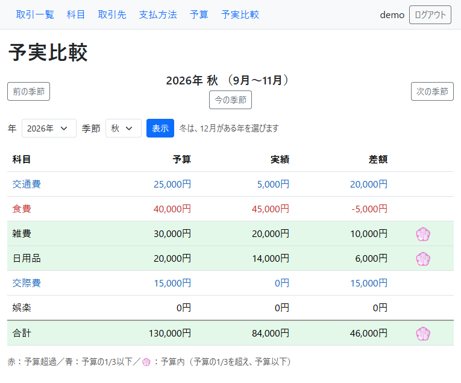
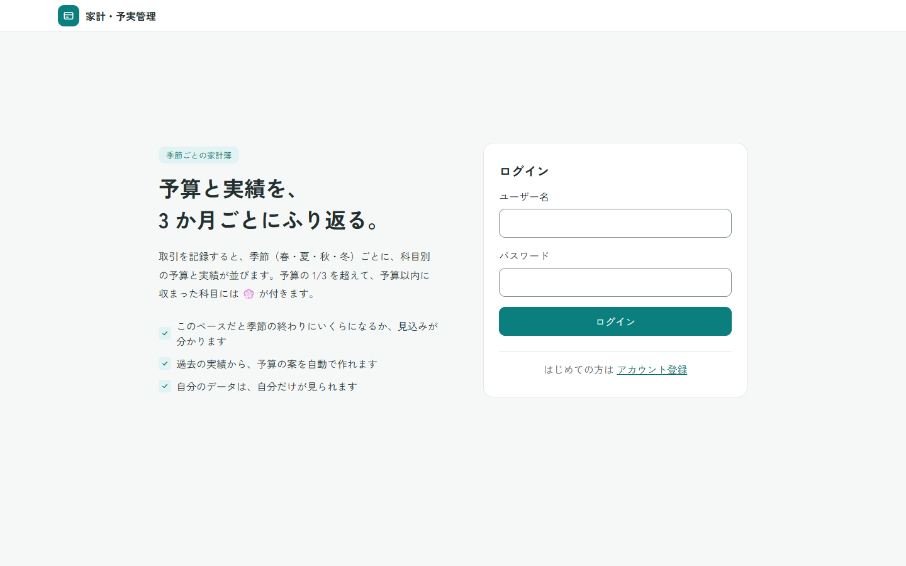
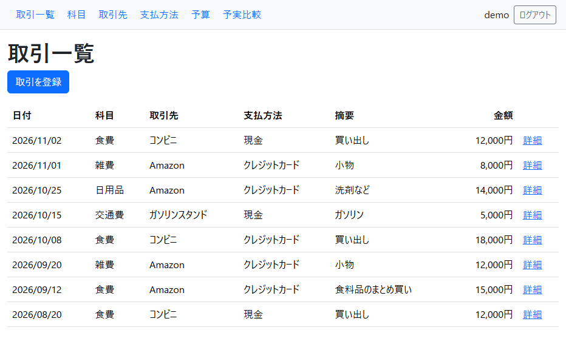
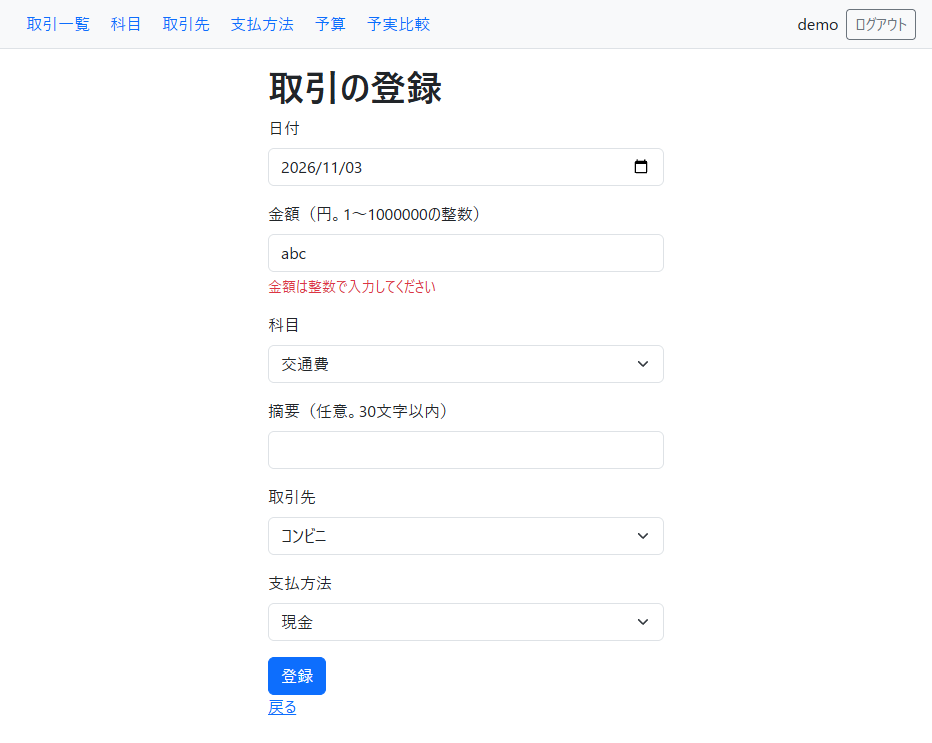
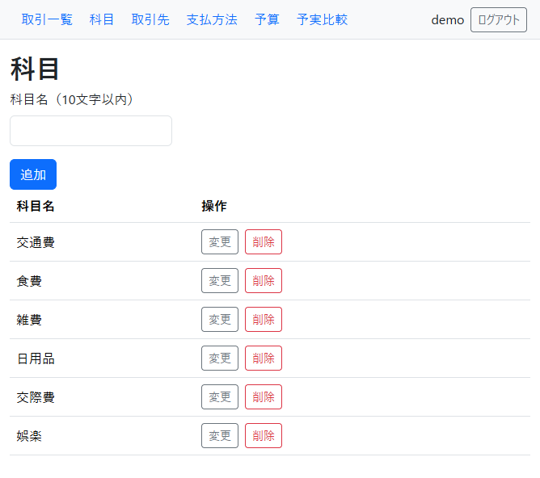
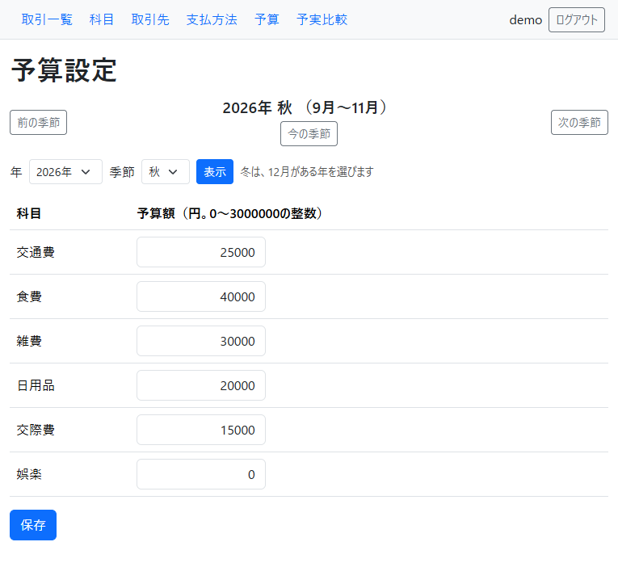
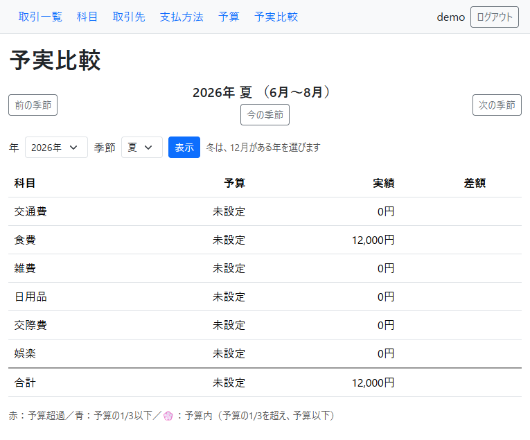
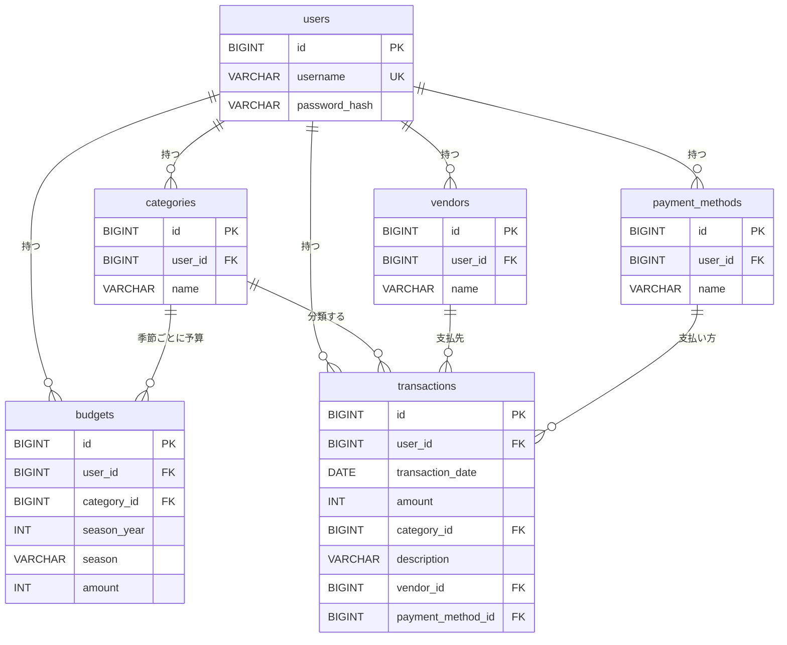

# HouseholdBudget-SpringBoot

家計・予実管理アプリ（Spring Boot版・仕様駆動開発）

<!-- 4.5a：骨組み（見出しと目次だけ）。各節の「書くこと」は、HTML のコメントに残してある（GitHub の画面には出ない）。本文は 4.5b 以降で書く。 -->
<!-- 画像：docs/images/06-comparison.png（予実比較。表示幅は HTML の width で指定する） -->

## 目次

1. [このアプリについて](#このアプリについて)
2. [作った目的](#作った目的)
3. [Eclipse 版との違い](#eclipse-版との違い)
4. [主な機能](#主な機能)
5. [画面の紹介](#画面の紹介)
6. [使用技術](#使用技術)
7. [設計と工夫](#設計と工夫)
8. [セキュリティ](#セキュリティ)
9. [テスト](#テスト)
10. [仕様駆動開発と AI の使い方](#仕様駆動開発と-ai-の使い方)
11. [既知の制限と今後の予定](#既知の制限と今後の予定)
12. [起動方法](#起動方法)
13. [ディレクトリと文書の案内](#ディレクトリと文書の案内)
14. [ライセンスと第三者のソフトウェア](#ライセンスと第三者のソフトウェア)

## このアプリについて

季節ごと（3 か月ごと）に、予算と実際に使った金額（実績）を比べる家計簿アプリです。科目（食費・交通費など）ごとに、予算・実績・差額を 1 つの表で見られます。予算を超えた科目は赤、予算の 1/3 以下に収まっている科目は青、予算の 1/3 を超えて予算内に収まった科目には 💮 が付くので、状況がひと目でわかります。

アカウントを作ってログインして使い、データは利用者ごとに分かれます。Java と Spring Boot で作りました。先に要件定義書と設計書を書いてからコードを書く「仕様駆動開発」で進め、AI（Claude Code）を活用しています。

<p></p>

<sub>予実比較の画面（2026 年秋）。画面の数字は、見せるために作ったデータです。</sub>

## 作った目的

前職では 9 年間、経理を中心としたバックオフィスの仕事をしていました。予算と実績を比べる資料づくり、経費の科目ごとの集計、月次・四半期ごとの数字のまとめ、業務のデジタル化・効率化に取り組んできました。

季節ごとに予算と実績を比べられる家計簿がほしくて作りました。月ごとほど細かいと、つけるのが面倒になります。逆に半年ごとなど広げすぎると、比較がしづらく、季節特有の増減もわかりにくくなります。その間の、3 か月ごとの季節にしました。四半期ごとに数字を見てきた経験からも、この長さがちょうどよいと感じています。

予実比較の画面は、わかりやすく、確認する楽しみがあるように考えました。予算を超えた科目は赤、予算の 1/3 以下に収まった科目は青、予算の 1/3 を超えて、予算内に収まった科目には 💮 を付けています。差額も表示するので、次の予算策定にも生かしやすくなっています。

このアプリは、以前 Eclipse（Servlet / JSP）で作ったものを、Spring Boot で作り直したものです。AI を活用しつつ、判断は自分がグリップを握る形にしたかったので、先に要件定義書と設計書で仕様を決めました。そのうえで、AI（Claude Code）が書いたコードを自分で仕様と照らして確かめる、仕様駆動開発で進めました。

## Eclipse 版との違い

このアプリは、以前 Eclipse（Servlet / JSP）で作った家計簿アプリを、Spring Boot で作り直したものです。Eclipse 版のリポジトリは [HouseholdBudget](https://github.com/yutaro081/HouseholdBudget) です。

作り直して、次の点が変わりました。

| 項目 | Eclipse 版 | この版（Spring Boot 版） |
|---|---|---|
| ログイン | ログイン機能がない | Spring Security でログインする。データは利用者ごとに分ける |
| CSRF 対策 | CSRF 対策がない | すべての POST（データを変える操作）で、CSRF 対策をしている |
| 画面のファイル | JSP を URL で直接開けてしまう | テンプレート（Thymeleaf）は、URL で直接開けない |
| 予算 | 1 つの季節分だけで、変更する画面がない（SQL で登録する） | 季節ごとに予算を保存でき、画面から設定できる |
| データベース | H2 | MySQL |
| 自動テスト | ない | 1348 件の自動テストがある |

進め方も変えました。先に要件定義書と設計書で仕様を決め、そのとおりにコードを書いて確かめる「仕様駆動開発」にしました（「[仕様駆動開発と AI の使い方](#仕様駆動開発と-ai-の使い方)」に書きます）。

## 主な機能

### 季節の考え方

予算も実績も、**季節**ごとに扱います。春は 3〜5 月、夏は 6〜8 月、秋は 9〜11 月、冬は 12〜2 月です。冬は 12 月がある年で数えます（例：2027 年 2 月は「2026 年の冬」）。表示できる範囲は、2000 年春から 2100 年冬までです。

### 機能の一覧

- **アカウント登録とログイン**：自分でアカウントを登録して、ログインして使います。ユーザー名は半角英数字で 10 文字以内、パスワードは半角の英数字と記号で 8〜30 文字です。ログインしていないと、ログイン画面と登録画面以外は開けません。
- **利用者ごとのデータ**：取引・科目・取引先・支払方法・予算は利用者ごとに持ちます。他の人のデータは、見ることも変更することもできません。
- **取引**：金額・日付・科目・摘要・取引先・支払方法を登録します。一覧（日付の新しい順）、詳細、編集、削除ができ、削除の前に確認が出ます。入力エラーのときは、入力した値を残したまま、同じ画面にエラーを出します。
- **科目・取引先・支払方法の管理**：追加・変更・削除ができます。それぞれ 1 人あたり 256 個までです。取引で使っているものと、0 円でない予算がある科目は、削除できません。新しくアカウントを作ると、科目（交通費・食費・雑費。今の季節の予算は各 30,000 円）、取引先（コンビニ・ガソリンスタンド・Amazon）、支払方法（現金・クレジットカード）が自動で用意されます。
- **予算**：季節ごとの予算を、全科目まとめて設定します。年と季節を選ぶ欄、「前の季節」「次の季節」、「今の季節」ボタンで、季節を移動できます。
- **予実比較**：季節ごとに、科目別の予算・実績・差額を表で比べます。最下行は合計行です。差額は「予算 − 実績」で、予算を超えるとマイナスになります。予算を設定していない季節は「未設定」と表示します。

### 予実比較の色と 💮

| 見え方 | 条件 |
|---|---|
| **赤い文字** | 実績が予算を超えている（予算が 0 円でも、実績があれば赤） |
| **青い文字** | 実績が予算の 1/3 以下（ちょうど 1/3 を含む。実績が 0 円も青） |
| **💮 と薄い緑の背景** | 赤でも青でもなく、予算が設定されていて、実績があり、予算以下（予算ちょうどを含む） |
| 色なし | 予算が未設定の行、予算が 0 円で実績も 0 円の行 |

合計行も、同じ決まりで色と 💮 が付きます（合計の予算は、予算が設定されている科目の合計。合計の実績は、全科目の合計）。

### 入力チェック

- 金額：1 円以上 1,000,000 円以下の整数（全角の数字も受け付けます）。予算額：0 円以上 3,000,000 円以下の整数。
- 日付：2000 年 3 月 1 日から 2100 年 12 月 31 日まで。
- 文字数：科目・支払方法は 10 文字以内、取引先は 20 文字以内、摘要は 30 文字以内（摘要は任意）。
- 同じ名前の科目・取引先・支払方法は、同じ利用者の中では登録できません（大文字・小文字、ひらがな・カタカナ、全角・半角の違いは、同じ名前として扱います）。

## 画面の紹介

画面の数字は、見せるために作ったデータです。

**ログイン**



初めての人は、「アカウント登録」から自分のアカウントを作ります。

**取引一覧**



日付の新しい順に並びます。「詳細」から、編集と削除ができます。

**取引の登録（入力エラー）**



入力エラーの例です。金額に数字以外を入れると、エラーを出します。入力した値は残ります。

**科目の管理**



科目の追加・変更・削除ができます。取引で使っている科目は、削除できません。

**予算設定**



季節ごとの予算を、全科目まとめて設定します。年と季節を選ぶ欄、「前の季節」「次の季節」、「今の季節」で、季節を移動できます。

**予実比較**


このアプリの中心の画面です。色と 💮 の決まりは、「[主な機能](#主な機能)」に書いてあります。

**予実比較（予算が未設定の季節）**



予算を設定していない季節は、予算が「未設定」と表示されます（実績は表示します）。

## 使用技術

版は、確認できたものだけを書いています。「Spring Boot が管理する版」は、Spring Boot の版を決めると自動で決まるものです。

| 種類 | 名前（版） | 何に使うか | 選んだ理由 |
|---|---|---|---|
| 言語 | Java 25 | プログラムを書く言語と、実行する環境 | 要件で指定 |
| 土台 | Spring Boot 4.1.2 | Web アプリの土台（組み込みの Web サーバー、設定、起動） | 要件で指定 |
| ビルド | Maven（付属の `mvnw`） | 部品の管理とビルド | 別にインストールせずに動かせる |
| 画面 | Thymeleaf（Spring Boot が管理する版） | 画面（HTML）を作る。表示する値は自動で無害化される | Spring Boot の標準的な画面の仕組みで、XSS 対策が標準で入っている |
| 見た目 | Bootstrap 5.3.8（CSS のみ） | 余白・ボタン・表・フォームの見た目をそろえる | 自作の CSS だけでは手間が大きい。JavaScript は使わず、アプリの中に置く（CDN は使わない）。MIT ライセンス |
| 認証 | Spring Security（Spring Boot が管理する版。BCrypt を含む） | ログイン・ログアウト、ログイン必須、CSRF 対策、パスワードのハッシュ化 | 自作せずに、要件 6 章のセキュリティを実現でき、実績がある |
| データの読み書き | Spring Data JPA（Hibernate。Spring Boot が管理する版） | データベースの読み書き | SQL を文字列でつなげずに書けるので、SQL インジェクション対策になる |
| 入力チェック | Bean Validation（Spring Boot が管理する版） | 必須・文字数・範囲のチェック | 項目に印を付けるだけで書け、エラーを画面に戻しやすい |
| データベース | MySQL 9.7 | データの保存 | 要件で指定 |
| テスト | JUnit など（Spring Boot が管理する版） | 自動テスト | Spring Boot の標準のテスト部品 |
| 開発の道具 | VS Code、Git / GitHub、Claude Code | 開発、版の管理、コードの生成 | 要件で指定 |

## 設計と工夫

### 季節の決まりを 1 か所にまとめた

「今日はどの季節か」「この季節は何月から何月までか」「前の季節・次の季節はどれか」という計算は、画面にも DB にも頼らない 1 つの部品にまとめ、予算設定と予実比較の両方で使っています。冬は 12 月がある年で数えるなど、ややこしい決まりを 2 画面で食い違わせないためです。範囲外の年や、存在しない季節を URL に入れると、「ページが見つかりません」の画面になります。

### 色の判定を 1 か所にまとめた

赤・青・💮 を決める判定も、画面とは別の 1 つの部品にあります。画面は、判定の結果を受け取って、色を付けるだけです。判定は、次の順番で行います（科目の行も合計行も同じです）。

1. 予算が未設定なら、色なし。
2. 実績が予算を超えていたら、赤（予算が 0 円でも、実績があれば赤）。
3. 予算が 0 円なら、色なし（実績も 0 円のとき。このとき青にならないよう、先に除きます）。
4. 実績の 3 倍が予算以下なら、青（ちょうど 1/3 も青）。
5. それ以外のうち、実績があって予算以下なら、💮。

境目になる金額（30,000 円の予算で 10,000 円と 10,001 円、30,000 円と 30,001 円など）は、自動テストで 1 つずつ確かめています。金額の合計は大きくなることがあるので、計算は大きい整数で行います。

### 他の人のデータが混ざらない作りにした

データを探すときは、必ず「ID」と「持ち主（`user_id`）」の両方で絞ります。見つからないときは、「他人のデータだから」「存在しないから」の区別をせず、同じ「ページが見つかりません」を返します（他人のデータがあるかどうかを教えないためです）。ログイン中のユーザーの ID は、ログインの情報（セッション）から取り出し、画面から送られた値は使いません。取引や予算を登録するときに、他人の科目の ID を混ぜて送られても、保存しません。確かめているテストは、「[データの分離を確かめているテスト](#データの分離を確かめているテスト)」に挙げています。

### 入力チェックの方針

- 金額は、全角の数字（１２３）も半角に直して受け付けます。`1,000`・`1.5`・`0x10`・`+5` のように、整数でないものはエラーにします。
- エラーのときは、入力した値を残したまま、同じ画面にエラーを出します（パスワードだけは残しません）。
- エラーメッセージの文は、1 つのファイルにまとめています。

### アプリと DB の二重の守り

入力チェックをすり抜けても、DB が止める作りにしています。金額・日付・季節の範囲（CHECK 制約）、同じ名前の科目を 2 つ作れない（一意制約）、同じ科目・同じ季節の予算を 2 つ作れない（一意制約）、持ち主のいないデータを作れない（外部キー）です。

### データの関係（ER 図）



すべての表が `user_id` を持ち、利用者ごとにデータが分かれます。予算は「科目・年・季節」ごとに 1 行です。

## セキュリティ

要件で求められた 5 つ（ハッシュ化、ログイン必須、SQL インジェクション対策、XSS 対策、CSRF 対策）に加えて、次の対策をしました。「確認した方法」は、自動テストと、ブラウザでの確認（Phase 8）です。

| 対策 | やったこと | 確認した方法 |
|---|---|---|
| パスワードの保存 | 元に戻せない形（BCrypt のハッシュ）に変えて保存する。同じパスワードでも、毎回違うハッシュになる | 自動テスト。DB を見て、元のパスワードが読めないことを確認 |
| ログイン必須 | ログイン画面・登録画面・画面の部品（CSS など）・エラー画面以外は、ログインしていないと開けず、ログイン画面へ移動する | 自動テスト。ログアウトした状態で、各 URL を開いて確認 |
| SQL インジェクション | SQL を文字列でつなげず、パラメータとして渡す（Spring Data JPA）。文字列連結の SQL を作っていない | コードの検索。`' OR '1'='1` などを入力して、影響がないことを確認 |
| XSS | 画面に出す値を自動で無害化する（Thymeleaf）。無害化しない出力は使わない | 自動テスト（全テンプレートの検査を含む）。`<script>alert(1)</script>` を入力して、ただの文字として表示されることを確認 |
| CSRF | データを変える操作は POST にし、すべてにトークンを付ける。トークンがないと 403 | 自動テスト。トークンを消して送信して、403 になることを確認 |
| データの分離 | 「ID」と「持ち主」の両方で探す。他人のデータは 404 | 自動テスト。2 人のユーザーで、別のユーザーの ID を URL に入れて確認 |
| セッションの Cookie | JavaScript から読めない設定（HttpOnly）と、他のサイトからの送信に付かない設定（SameSite=Lax）。セッション ID を URL に出さない。ログイン後に ID を新しくする | ブラウザの開発者ツールで確認 |
| エラー画面 | 詳しい中身（例外、SQL、ファイルの場所）を画面に出さない。404・403・400 番台・500 の画面を用意した | 自動テスト。DB を止めて 500 の画面を確認 |
| 応答のヘッダー | 画面の応答に、ブラウザが画面を覚えないよう求めるヘッダー（`Cache-Control: no-store`）が付く | 自動テスト |
| ログアウト後の「戻る」 | 「戻る」で前の画面が見えないよう、短い JavaScript で開き直す | PC のブラウザで確認 |
| 秘密情報 | パスワードや接続先は環境変数から読み、リポジトリに書かない。既定のアカウントは作らない | コードと履歴の検索 |

**限界**：このアプリは、自分のパソコンで動かす前提で、通信は HTTP です（暗号化していません）。インターネットに公開するときは、HTTPS などの対策が要ります（「[既知の制限と今後の予定](#既知の制限と今後の予定)」）。

## テスト

自動テストは **1348 件**で、すべて成功しています。`.\mvnw test` で実行します（MySQL と環境変数が要ります。各テストは、データベースの変更を最後に取り消すので、データは残りません）。

| 種類 | 件数 | 何を確かめるか |
|---|---|---|
| 画面（Controller） | 391 | 画面の表示、エラーのメッセージ、入力値が残ること、移動先、他人のデータが見えないこと |
| 入力チェックと値の変換 | 321 | 必須・文字数・範囲、全角の数字、整数でない入力 |
| 計算 | 251 | 季節の決まり（前後の季節、範囲、冬の年）、色の判定の境目 |
| 業務処理（Service） | 202 | 登録・更新・削除の決まり、初期データ、予実比較の集計、256 個の上限 |
| セキュリティ | 62 | ログイン必須、CSRF、ログイン・ログアウト、応答のヘッダー |
| データベース | 57 | 読み書き、制約、集計の SQL |
| そのほか | 64 | メッセージの文、テンプレートの検査、エラー処理、設定、起動 |

自動テストでは確かめにくいものは、ブラウザで確かめました（Phase 8）。全画面を開く、入力チェックの境界値、セキュリティ（ログイン前後のセッション ID の変化、Cookie、エラー画面）、2 人のユーザーでのデータ分離です。確認の記録は、[docs/plans/phase-8-polish.md](docs/plans/phase-8-polish.md) にあります。

### データの分離を確かめているテスト

「他の人のデータが見えない・変更できない」ことは、2 人のユーザーを作って、片方から他方のデータを開く・変更する・削除する・混ぜて送る、という形で確かめています。主なテスト（`クラス名.メソッド名`）は次のとおりです。

| 対象 | テスト | 確かめること |
|---|---|---|
| 取引 | `TransactionControllerTest.listShowsOwnTransactionsNewestDateFirstAndNotOthers` | 一覧に、自分の取引だけが出る |
| | `TransactionControllerTest.detailOfOtherUsersMissingAndNonNumericIdsAreTheSame404` | 他人の取引の詳細は、存在しない ID・数字でない ID と同じ 404 になる |
| | `TransactionControllerTest.updateOfOtherUsersTransactionIsNotFoundWhetherOrNotTheInputIsValid`<br>`TransactionControllerTest.deleteOfOtherUsersTransactionIsNotFoundAndKeepsIt` | 他人の取引は、変更も削除もできない（データは残る） |
| | `TransactionControllerTest.registerWithOtherUsersItemIsNotFound`<br>`TransactionServiceTest.registerWithOtherUsersItemsIsNotFoundAndSavesNothing` | 登録のとき、他人の科目・取引先・支払方法の ID を混ぜて送られても、保存しない |
| 科目・取引先・支払方法 | `CategoryControllerTest.listShowsOwnCategoriesInOrderAndNotOthers`<br>`CategoryControllerTest.otherUsersCategoryIsNotFoundForViewEditAndDelete` | 一覧は自分のものだけ。他人のものは、変更・削除の画面も操作も 404 |
| | `VendorControllerTest.otherUsersItemIsNotFoundForViewEditAndDelete`<br>`PaymentMethodControllerTest.otherUsersItemIsNotFoundForViewEditAndDelete` | 取引先・支払方法も同じ |
| | `CategoryControllerTest.addDuplicateIgnoresCaseAndOtherUsersNames`<br>`MasterLimitControllerTest.anotherUsersFullListDoesNotBlockMe` | 他のユーザーと同じ名前でも追加できる。256 個の上限は、ユーザーごとに数える |
| 予算 | `BudgetControllerTest.otherUsersCategoryIdIsNotFoundAndSavesNothingEvenIfOtherRowsAreValid`<br>`BudgetServiceTest.otherUsersCategoryIdMakesTheWholeSaveNotFound` | 他人の科目の ID が 1 つでも混ざっていたら、何も保存しない |
| | `BudgetControllerTest.twoUsersSaveTheSameSeasonSeparately`<br>`BudgetServiceTest.saveDoesNotTouchOtherSeasonsOrOtherUsers` | 2 人が同じ季節の予算を保存しても、別々に保存される。他人の予算は変わらない |
| 予実比較 | `ComparisonControllerTest.otherUsersDataIsNotShown`<br>`ComparisonServiceTest.otherUsersCategoriesBudgetsAndTransactionsAreNotIncluded`<br>`TransactionRepositorySumTest.otherUsersTransactionsAreNotCounted` | 他人の取引・予算が、実績・予算に混ざらない |
| アカウント登録 | `RegistrationServiceTest.eachUserGetsSeparateInitialData` | 初期データ（科目・取引先・支払方法・予算）は、ユーザーごとに別の行として作る |
| データベースの検索 | `TransactionRepositoryTest.findByIdAndUserIdFindsOnlyOwn` | 「ID」と「持ち主」の両方で探すと、自分の取引だけが見つかる |

ブラウザでも、2 人のユーザーで、別のユーザーの ID を URL に入れる・送信の内容を書き換える、という確認をしました（Phase 8）。

## 仕様駆動開発と AI の使い方

### 進め方

先に文書を書き、そのあとにコードを書きました。

1. **要件定義書**：何を作るか。
2. **設計書**：どう作るか（画面、テーブル、処理の流れ、入力チェック、セキュリティ、決めたことの理由）。
3. **実行計画書と、各 Phase の手順書**：進め方（Phase 0〜10）と、Phase ごとの手順・確認の方法・決めること。
4. **コード**：主な処理は、自動テストを先に書いてから実装しました。
5. **確認**：自動テストと、ブラウザでの確認。結果は手順書に記録しました。

仕様を変えるときも、先に文書を直してから、コードを直しました（要件定義書は、直す前と後の文を見せて確認してから直しました）。

### 役割分担

| 役割 | すること |
|---|---|
| 自分 | 要件と設計を決める。手順書の「決まっていない点」を決める。各手順の結果を確かめる（ブラウザ、SQL）。DB のパスワードを入力する作業。Git の操作（コミット、push、`main` への取り込み、タグ付け） |
| AI（Claude Code） | 手順書に沿って、ファイル（コード、テスト、文書）を作る・直す。読むだけの調査。テストとビルドの実行（`.\mvnw test`、`.\mvnw compile`） |

### 守った決まり

Claude Code に守らせた決まりは、リポジトリの直下の [CLAUDE.md](CLAUDE.md) に書いてあります。主なものは次のとおりです。

- 1 つの手順が終わったら止まって、確認を待つ（次の手順へ勝手に進まない）。
- 設計書で決まっていないことは、勝手に決めず、一覧にして、自分が決める。
- 変更は、先に文書、次にコード。頼まれていない変更や判断をしたときは、理由を添えて報告する。
- コミット、push、`main` への取り込み、タグ付けは、自分が行う。
- パスワードや接続先の値は、コード・文書・コミットメッセージのどこにも書かない。
- コードの決まり：データを探すときは、必ず「ID」と「持ち主」の両方で絞る（`findById` は使わない）。`th:utext` は使わない。CSRF 対策を無効にしない。

### よかったことと、難しかったこと

**よかったこと**

- AI が書いているもの、書いたものを、文書と見比べて確かめられた。
  - 例：要件に「年と季節を選べる」とあったのに、選ぶ欄がなかったこと。Phase 8 の 4.3 で、要件の文と画面を見比べて見つけて、直しました。
  - 例：取引の日付の範囲と、季節の範囲がずれていて、2000 年 1〜2 月の取引が予実比較に出なかったこと。Phase 7 の 4.4 で、予実比較の自動テストを書いているときに見つけて、直しました。
  - 例：ボタンに見た目の指定を足したら、「このボタンが無い」ことを確かめる自動テストが、条件が合わなくなって、必ず通る形になっていました。見直しで見つけて、直しました。文書に、接続先の値が書かれていたのも、確認で見つけて、伏せました。
- 今何をしているか、今後何をするのか、自分が理解できない点、直した方がいいと感じた点などが、わかりやすかった。
  - 例：手順書ごとに「決まっていない点」を一覧にして、選択肢とおすすめと理由を見ながら、1 つずつ決めました。決めた理由は文書に残るので、複合外部キーを採らなかった理由のように、レビューの指摘にも、その理由で答えられました。
- 事前に決めたルールどおりに制作してくれる安心感があった。
  - 例：1 つの手順が終わったら止まって確認を待つ。決まっていないことは勝手に決めず、一覧にして自分が決める。Git の操作は自分が行う。パスワードや接続先の値は書かない。（「[守った決まり](#守った決まり)」）

**難しかったこと**

- 思ったより時間がかかった。
  - 例：「決まっていない点」は、Phase 8 だけで 40 件以上ありました。
- AI の言っていることを理解するのにも、知識や慣れが必要だった。
- コマンドの入力に慣れず、大変だった。

### 別の AI によるレビュー

AI（Claude Code）が書いたコードを、別の AI にもレビューしてもらいました。ChatGPT に、Phase 6 のあと、Phase 7 のあとの 2 回、コードを見せて指摘を受けました。**指摘は、そのまま直さず、まずテストで本当に起きるかを確かめてから、直すかどうかを自分で決めました。**

#### Phase 6 のあと（1 回目）

最初の指摘は 2 つでした。

| 指摘 | 確かめたこと | 決めたこと |
|---|---|---|
| 予算設定で、行を送らない・null のとき、`NullPointerException`（500）になるのでは | 使い捨てのテストで、画面から送れる 14 通りと、Service を直接呼ぶ 9 通りを試した。画面からは再現せず（500 にならない）。Service を直接呼ぶと落ちた | **直した**。画面からは起きないが、Service の入口でも null を守る（二重の守り）。テストを 6 件足した |
| 予算・取引から科目への、複合外部キー（「科目 ID と `user_id` の組み合わせ」を外部キーにして、他人の科目を DB でも拒否する案） | すでに設計書 3.9 に、この案と、採用しない決定が書いてあった | **直さなかった**。設計書 3.9 の理由：Spring Data JPA での扱いが複雑になり、入門者には負担が大きいため。代わりに Service での確認と、Phase 8 の 2 ユーザーでのテストで守る |

そのあとの追加の質問で、次の 2 つを決めました。

| 指摘 | 確かめたこと | 決めたこと |
|---|---|---|
| 行の番号を書き換えるような、変な値の送信（`rows[-1]`・`rows[abc]` など）が、500 になる | 500 になることを再現した | **直した**。400（送信の形がおかしい）にした。500 は「サーバーの不具合」の意味なので、区別する |
| 科目が 257 個を超えると、予算設定で保存できなくなる（行の数は、Spring の標準で 256 行まで） | 科目が増えたとき、予算を保存できなくなる点を確かめた | **直した**。科目・取引先・支払方法は 1 人あたり 256 個までと、要件に足した（R14）。256 行は保存でき、257 行は 400、257 個目は追加できない、を自動テストで確かめた |

256 個の上限は、当初は「科目の数に上限がなくてもよい」と判断していました。レビューを受けて、見直しました。

#### Phase 7 のあと（2 回目）

不具合や食い違いの指摘は、ありませんでした。「データの分離を確かめたテストを案内できるとよい」という助言があり、「テスト」の節に、テストの名前を挙げて案内しました（「[データの分離を確かめているテスト](#データの分離を確かめているテスト)」）。

<!-- Codex によるレビューは、手順書 4.7 で受けてから、結果と扱いをここ（「別の AI によるレビュー」の最後）に足す。 -->


## 既知の制限と今後の予定

### 既知の制限

利用者に影響するものです。

- **通信は HTTP です（暗号化していません）。** 自分のパソコンで動かす前提です。インターネットに公開するときは、HTTPS などの対策が要ります（今後の予定を参照）。
- **ログアウトのあと、ブラウザの「戻る」で前の画面が見えないよう、短い JavaScript（`back-reload.js`）で開き直しています。** ただし、削除やログアウトのように「POST だけで開ける URL」のエラー画面を、ブラウザが覚えていて、「戻る」で開き直すと、別のエラー画面（405 など）になることがあります。データは表示されません。
- **ブラウザの JavaScript が無効だと、上の開き直しが働きません。** そのときは、ログアウトのあとに「戻る」で、前の画面が見えることがあります（その画面から操作すると、ログイン画面へ移動します）。
- **パスワードを忘れたときの再設定（忘れたときに、新しいパスワードを決め直すこと）は、ありません**（今回は作っていません）。
- **表示できる範囲は、2000 年春から 2100 年冬までです。** 取引の日付も、2000 年 3 月 1 日から 2100 年 12 月 31 日までです。
- **スマホ向けの画面は、作っていません。**

### 今後の予定

- 要件定義書 9 章にあるもの：予算を超えそうなときの事前の知らせ（アラート）、カロリー管理、インターネットへの公開、スマホ向けの画面、予算の自動設定。
- 要望として記録してあるもの（[docs/issues/](docs/issues/)）：**CSV 出力**（004）、**ユーザー名とパスワードの変更**（ログイン中に、自分のユーザー名やパスワードを変えること。006。忘れたときの再設定とは別です）、**ブラウザを自動で動かすテスト**（008）。
- **デプロイ（任意）**：インターネットに公開するかどうかを、あとで決めます（実行計画書の Phase 10）。

## 起動方法

<!-- 4.6（まっさらな環境での確認）で、この手順のとおりに動くかを確かめる。確かめたら、このコメントを消す。 -->

Windows の PowerShell で、次の手順を行います。

### 必要な環境

- JDK 25
- MySQL 9.7
- Git
- VS Code など（`mvnw` が付いているので、Maven の別のインストールは要りません）

### 1. リポジトリを取得する

```powershell
git clone https://github.com/yutaro081/HouseholdBudget-SpringBoot.git
cd HouseholdBudget-SpringBoot
```

### 2. データベースとユーザーを作る

MySQL に、管理者（`root`）でログインして、次を実行します。パスワードは、自分で決めたものにします（このリポジトリには書きません）。

```sql
CREATE DATABASE householdbudget CHARACTER SET utf8mb4 COLLATE utf8mb4_0900_as_ci;
CREATE USER 'hb_app'@'localhost' IDENTIFIED BY '（自分で決めたパスワード）';
GRANT SELECT, INSERT, UPDATE, DELETE, CREATE, INDEX, REFERENCES ON householdbudget.* TO 'hb_app'@'localhost';
```

アプリ専用のユーザー（`hb_app`）には、このデータベースだけに、必要な権限だけを与えています。テーブルは、アプリの起動時に、`schema.sql` が作ります（`root` はアプリでは使いません）。

### 3. 環境変数を設定する

DB に接続するための設定を、環境変数から読みます。**値は、各自のパソコンで設定してください。この README やリポジトリには書きません。**

| 環境変数の名前 | 用途 | 例 |
|---|---|---|
| `HB_DB_URL` | DB の接続先 | `jdbc:mysql://（ホスト）:（ポート）/householdbudget`（同じパソコンの MySQL なら、ホストは `localhost`、ポートは `3306`） |
| `HB_DB_USER` | アプリ専用の DB ユーザー名 | `hb_app` |
| `HB_DB_PASSWORD` | そのユーザーのパスワード | 手順 2 で決めたパスワード |

Windows の設定画面（「環境変数を編集」）で設定するか、次のように設定します。

```powershell
[Environment]::SetEnvironmentVariable("HB_DB_URL", "jdbc:mysql://（ホスト）:（ポート）/householdbudget", "User")
[Environment]::SetEnvironmentVariable("HB_DB_USER", "hb_app", "User")
[Environment]::SetEnvironmentVariable("HB_DB_PASSWORD", "（手順 2 で決めたパスワード）", "User")
```

設定したあとは、VS Code とターミナルを**開き直して**ください（開いたままだと、新しい値が読まれません）。

### 4. 起動する

MySQL のサービスが動いている状態で、リポジトリの直下で次を実行し、ブラウザで `http://localhost:8080/` を開きます。

```powershell
.\mvnw spring-boot:run
```

### 5. アカウントを登録して使う

- 最初に開くと、ログイン画面が出ます。「アカウント登録」から、**自分でアカウントを登録**してください（既定のアカウントは、ありません）。
  - ユーザー名：半角英数字のみ、10 文字以内（大文字・小文字は区別しません）。
  - パスワード：半角の英数字と記号のみ（空白は不可）、8 文字以上 30 文字以下。
- 登録すると、科目（交通費・食費・雑費）と今の季節の予算（各 30,000 円）、取引先（コンビニ・ガソリンスタンド・Amazon）、支払方法（現金・クレジットカード）が自動で用意されます。登録のあと、ログインして使います。

### テストを実行する

```powershell
.\mvnw test
```

MySQL と、上の環境変数が要ります。各テストは、データベースへの変更を最後に取り消すので、データは残りません。

<!-- 4.8 で、iPad など別の機器から開く手順のメモ（docs/）を作ったら、ここから 1 行でリンクする。 -->

## ディレクトリと文書の案内

先に文書を作り、そのあとにコードを書いたので、文書も、このリポジトリの大事な部分です。

| 場所 | 内容 |
|---|---|
| [docs/reviews/requirements.md](docs/reviews/requirements.md) | **要件定義書**：何を作るか |
| [docs/reviews/design.md](docs/reviews/design.md) | **設計書**：どう作るか（画面、テーブル、処理、入力チェック、セキュリティ、決めたことの理由） |
| [docs/plans/execution-plan.md](docs/plans/execution-plan.md) | **実行計画書**：進め方（Phase 0〜10） |
| `docs/plans/phase-N-….md` | **各 Phase の手順書**：手順、確認の方法、「決まっていない点」とその決定、確認の記録 |
| [docs/reviews/](docs/reviews/) | 要件定義書、設計書、Phase 1 のレビューの記録 |
| [docs/issues/](docs/issues/) | 不具合と要望の記録（書き方は [docs/issues/README.md](docs/issues/README.md)） |
| [docs/images/](docs/images/) | この README の画面の画像 |
| [CLAUDE.md](CLAUDE.md) | AI（Claude Code）に守らせた決まり |
| [THIRD-PARTY-NOTICES.md](THIRD-PARTY-NOTICES.md) | 使っている第三者のソフトウェアのライセンス |

コードは `src/main/java/io/github/yutaro081/householdbudget/` の下に、役割ごとに分けています。

| 場所 | 役割 |
|---|---|
| `controller` | 画面の URL を受けて、Service を呼び、画面を返す |
| `service` | 業務の処理（登録・更新・削除の決まり、予実比較の集計など） |
| `repository` | データベースの読み書き |
| `entity` | データベースの表に対応するクラス |
| `form`、`dto` | 画面の入力を受け取る・画面に渡す値を運ぶクラス |
| `domain` | 季節の決まり、色の判定（画面にも DB にも頼らない計算） |
| `security`、`config`、`exception` | ログインの設定、全体の設定、エラーの扱い |

画面（HTML）は `src/main/resources/templates/`、画面の部品（CSS、JavaScript）は `src/main/resources/static/`、テストは `src/test/` にあります。

## ライセンスと第三者のソフトウェア

- **Bootstrap 5.3.8**（CSS のみ）：MIT ライセンス。著作権表示とライセンスの全文は、[THIRD-PARTY-NOTICES.md](THIRD-PARTY-NOTICES.md) にあります。
- **このリポジトリのコード**：ポートフォリオとして公開しているものです。コードの利用（複製・再配布など）の許可は、別途お尋ねください。
