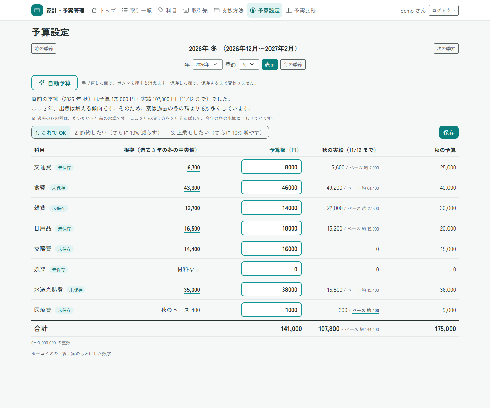

# HouseholdBudget-SpringBoot

家計・予実管理アプリ（Spring Boot 版・仕様駆動開発）

## このアプリについて

季節（3 か月）ごとに、予算と実績を比べる家計簿アプリです。

https://github.com/user-attachments/assets/209913d0-3e3b-4efa-a551-c16fede9e550

<sub>デモ動画（約 35 秒）：トップから予算設定に移り、2026 年冬で「自動予算」の「1. これで OK」を押して保存します。そのあと、予実比較で今の季節（秋）の見込みを見ます。</sub>

- **経験から作りました。** 前職で 9 年間、経理を中心としたバックオフィスの仕事をしました。予算と実績を比べる資料づくり、科目ごとの集計、月次・四半期の数字のまとめ、業務のデジタル化・効率化に取り組んできました。
- **目玉は「自動予算」と「着地見込み」です。** 過去の実績から予算の案を作ります。今のペースから、季節の終わりの額を見込みます。
- **仕様駆動開発で作りました。** AI（Claude Code）を使っても、判断は自分で握りたかったからです。先に要件定義書と設計書を書き、AI がそのとおりに作ったかを自分で確かめました。自動テストは 2,433 件です。

季節は、春（3〜5 月）・夏（6〜8 月）・秋（9〜11 月）・冬（12〜2 月）です。月ごとでは細かすぎ、半年では季節の増減が見えないので、3 か月にしました。前職で四半期ごとに数字を見てきて、この長さがちょうどよいと感じていたからでもあります。

## 目玉の機能

### 自動予算

- 「自動予算」を押すと、過去 3 年の同じ季節の実績から、予算の案が入ります。
- ここ 3 年の増え方・減り方（傾向）も、案に入れます。
- 科目ごとに、案の根拠が出ます。
- 「節約したい」（90%）、「上乗せしたい」（110%）も選べます。
- 押しただけでは保存しません。確かめて、直してから保存します。

<p></p>

<sub>「自動予算」の「1. これで OK」を押したあと。画面の数字は、見せるために作ったデータです。</sub>

### 着地見込み

- 今のペースだと、季節の終わりにいくらになるかを出します。
- 合計と、科目ごとに出します。
- 予算を超えそうな科目には、赤い字と「超える見込み」の印が付きます。
- 予算を超えた科目は赤、予算の 1/3 以下は青、予算内は 💮 で示します。見て楽しく、差額を次の予算に生かせるようにしました。

<p></p>

<sub>2026 年秋の予実比較。画面の数字は、見せるために作ったデータです。</sub>

## そのほかの機能

- **トップ**：季節のメーター、今週の円グラフ、今週の科目ごとの進み具合、きょうのひとこと（七十二候など）
- **取引**：登録・一覧・詳細・編集・削除。金額を足すボタンと税込のボタン、取引の複写
- **科目・取引先・支払方法**：追加・変更・削除
- **アカウント**：自分で登録してログインします。データは利用者ごとに分かれます

くわしい仕様と入力チェックは [docs/features.md](docs/features.md) にあります。

## 画面の紹介


トップ（ログイン後の最初の画面）です。季節と今週の使い方が、1 画面で分かります。

<details>
<summary>ほかの画面を見る（ログイン・取引一覧・取引の登録・科目・予算設定・予算が未設定の季節）</summary>

**ログイン**


**取引一覧**


**取引の登録（入力エラー）**


入力エラーのときも、入れた値は残ります。

**科目**


**予算設定**


**予実比較（予算が未設定の季節）**


</details>

## 工夫した点

1. **計算は 1 か所にまとめました。** 季節の決まり、色の判定、着地見込み、自動予算は、画面にも DB にも頼らない部品（`domain`）にあります。2 つの画面で食い違わず、テストもしやすくなります。
2. **他人のデータは見えません。** データは必ず「ID」と「持ち主」の両方で探します。他人のデータは、存在しないときと同じ 404 にします。
3. **アプリと DB の二重で守ります。** 入力チェックをすり抜けても、DB の制約（範囲、一意、外部キー）で止めます。
4. **AI の指摘は、確かめてから決めました。** 別の AI（ChatGPT・Codex・Gemini）に 12 回レビューしてもらいました。指摘は、本当に起きるかをテストで確かめてから、直すかを決めました。
5. **テストも疑いました。** わざと壊して、テストが失敗するかを確かめました。必ず通ってしまうテストを見つけて、直したこともあります。

## 使用技術

| 種類 | 名前（版） | 使い方 |
|---|---|---|
| 言語 | Java 25 | |
| 土台 | Spring Boot 4.1.2 | Web アプリの土台 |
| 画面 | Thymeleaf | 画面の HTML。表示する値は自動で無害化 |
| 見た目 | Bootstrap 5.3.8（CSS のみ） | アプリの中に置く。CDN は使わない |
| フォント | Zen Kaku Gothic New | アプリの中に置く。CDN は使わない |
| 認証 | Spring Security | ログイン、CSRF 対策、パスワードのハッシュ化（BCrypt） |
| DB の読み書き | Spring Data JPA | SQL を文字列でつながない |
| 入力チェック | Bean Validation | |
| DB | MySQL 9.7 | |
| テスト | JUnit など | |
| 開発 | VS Code、Git / GitHub、Claude Code | |

## セキュリティ

- パスワードは、元に戻せない形（BCrypt）で保存します。
- ログインしないと、ログイン画面と登録画面しか開けません。
- SQL インジェクション、XSS、CSRF の対策をしています。
- 他人のデータは 404 にします。
- パスワードや接続先は環境変数から読み、リポジトリには書きません。

**限界**：自分のパソコンで動かす前提で、通信は HTTP です。公開するときは HTTPS などが要ります。

対策と確かめた方法の一覧は [docs/security.md](docs/security.md) にあります。

## テスト

- 自動テストは **2,433 件**で、すべて成功しています（2026 年 11 月 12 日の時点）。
- 画面、計算、業務処理、入力チェック、セキュリティ、DB を確かめています。
- 自動テストで確かめにくい見た目や操作は、ブラウザで確かめました。

種類ごとの件数と、データの分離を確かめているテストの名前は [docs/testing.md](docs/testing.md) にあります。

## AI との役割分担

| 役割 | すること |
|---|---|
| 自分 | 要件と設計を決める。結果を確かめる。Git の操作（コミット、マージ、タグ） |
| AI（Claude Code） | 手順書に沿って、コード・テスト・文書を作る。テストを流す |

- AI に守らせた決まりは [CLAUDE.md](CLAUDE.md) にあります。
- 進め方と、別の AI のレビューの記録は [docs/ai-reviews.md](docs/ai-reviews.md) にあります。

## Eclipse 版との違い

以前 Eclipse（Servlet / JSP）で作ったアプリを、作り直しました。ログイン、CSRF 対策、季節ごとの予算、自動予算、着地見込み、自動テストを加えました。

元のリポジトリ：[HouseholdBudget](https://github.com/yutaro081/HouseholdBudget)

## 制限と今後の予定

- PC 向けです。スマホ向けの画面はありません。
- 通信は HTTP です（上の「セキュリティ」）。
- 自動予算の案は、記録の取り方で小さく出たり大きく出たりします。
- 着地見込みは、月ごとにまとめて払うものがあると、払う日で上下します。

くわしくは [docs/known-limitations.md](docs/known-limitations.md) にあります。今後やりたいことは [docs/issues/](docs/issues/) にあります（CSV の出力と取り込み、ユーザー名とパスワードの変更など）。

## 起動方法

Windows の PowerShell で行います。JDK 25、MySQL 9.7、Git が要ります（Maven は付属の `mvnw` を使います）。

<details>
<summary>手順を見る</summary>

### 1. リポジトリを取得する

```powershell
git clone https://github.com/yutaro081/HouseholdBudget-SpringBoot.git
cd HouseholdBudget-SpringBoot
```

### 2. データベースとユーザーを作る

MySQL に `root` でログインして実行します。パスワードは自分で決めます。

```sql
CREATE DATABASE householdbudget CHARACTER SET utf8mb4 COLLATE utf8mb4_0900_as_ci;
CREATE USER 'hb_app'@'localhost' IDENTIFIED BY '（自分で決めたパスワード）';
GRANT SELECT, INSERT, UPDATE, DELETE, CREATE, INDEX, REFERENCES ON householdbudget.* TO 'hb_app'@'localhost';
```

テーブルは、起動時に `schema.sql` が作ります。

### 3. 環境変数を設定する

```powershell
[Environment]::SetEnvironmentVariable("HB_DB_URL", "jdbc:mysql://（ホスト）:（ポート）/householdbudget", "User")
[Environment]::SetEnvironmentVariable("HB_DB_USER", "hb_app", "User")
[Environment]::SetEnvironmentVariable("HB_DB_PASSWORD", "（手順 2 で決めたパスワード）", "User")
```

設定したら、VS Code とターミナルを開き直します。

### 4. 起動する

```powershell
.\mvnw spring-boot:run
```

ブラウザで `http://localhost:8080/` を開き、「アカウント登録」から自分のアカウントを作ります。

### テストを実行する

```powershell
.\mvnw clean test
```

MySQL と環境変数が要ります。テストのデータは残りません。

</details>

## 文書の案内

| 場所 | 内容 |
|---|---|
| [docs/reviews/requirements.md](docs/reviews/requirements.md) | 要件定義書（何を作るか） |
| [docs/reviews/design.md](docs/reviews/design.md) | 設計書（どう作るか。ER 図も） |
| [docs/plans/execution-plan.md](docs/plans/execution-plan.md) | 実行計画書 |
| [docs/design-notes.md](docs/design-notes.md) | 設計と工夫のくわしい説明（ER 図も） |
| [docs/issues/](docs/issues/) | 不具合と要望の記録 |
| [docs/ipad-demo.md](docs/ipad-demo.md) | iPad など、別の機器から開く手順 |
| [docs/retrospective.md](docs/retrospective.md) | 振り返り |
| [THIRD-PARTY-NOTICES.md](THIRD-PARTY-NOTICES.md) | 第三者のソフトウェアのライセンス |

## ライセンス

- Bootstrap 5.3.8：MIT ライセンス
- Zen Kaku Gothic New：SIL Open Font License 1.1（全文は [src/main/resources/static/fonts/OFL.txt](src/main/resources/static/fonts/OFL.txt)）
- このリポジトリのコード：ポートフォリオとして公開しています。利用の許可は、別途お尋ねください。

## 振り返り

- **よかったこと**：AI が作ったものを、文書と見比べて確かめられました。
- **学んだこと**：テストが 2,000 件を超えても、ブラウザで見ないと分からないことがありました。AI は案を出しますが、決めるのは自分で、決めるには知識が要ります。
- **次にやりたいこと**：使いながら使いやすさを直すこと。CSV の出力と取り込みなどの機能。

くわしくは [docs/retrospective.md](docs/retrospective.md) にあります。
