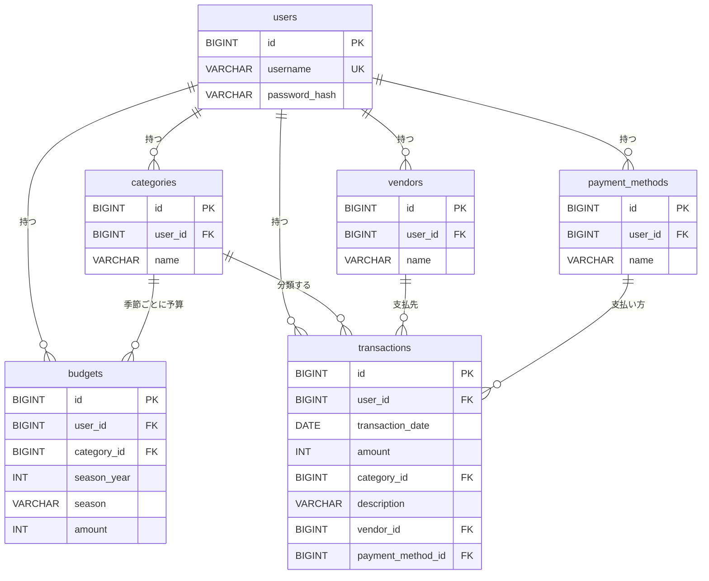

# 設計と工夫

[← README に戻る](../README.md)

## 季節の決まりを 1 か所にまとめた

「今日はどの季節か」「この季節は何月から何月までか」「前の季節・次の季節はどれか」という計算は、画面にも DB にも頼らない 1 つの部品にまとめ、予算設定と予実比較の両方で使っています。冬は 12 月がある年で数えるなど、ややこしい決まりを 2 画面で食い違わせないためです。範囲外の年や、存在しない季節を URL に入れると、「ページが見つかりません」の画面になります。

## 色の判定を 1 か所にまとめた

赤・青・💮 を決める判定も、画面とは別の 1 つの部品にあります。画面は、判定の結果を受け取って、色を付けるだけです。判定は、次の順番で行います（科目の行も合計行も同じです）。

1. 予算が未設定なら、色なし。
2. 実績が予算を超えていたら、赤（予算が 0 円でも、実績があれば赤）。
3. 予算が 0 円なら、色なし（実績も 0 円のとき。このとき青にならないよう、先に除きます）。
4. 実績の 3 倍が予算以下なら、青（ちょうど 1/3 も青）。
5. それ以外のうち、実績があって予算以下なら、💮。

境目になる金額（30,000 円の予算で 10,000 円と 10,001 円、30,000 円と 30,001 円など）は、自動テストで 1 つずつ確かめています。金額の合計は大きくなることがあるので、計算は大きい整数で行います。

## 他の人のデータが混ざらない作りにした

データを探すときは、必ず「ID」と「持ち主（`user_id`）」の両方で絞ります。見つからないときは、「他人のデータだから」「存在しないから」の区別をせず、同じ「ページが見つかりません」を返します（他人のデータがあるかどうかを教えないためです）。ログイン中のユーザーの ID は、ログインの情報（セッション）から取り出し、画面から送られた値は使いません。取引や予算を登録するときに、他人の科目の ID を混ぜて送られても、保存しません。確かめているテストは、「[データの分離を確かめているテスト](testing.md#データの分離を確かめているテスト)」に挙げています。

## 入力チェックの方針

- 金額は、全角の数字（１２３）も半角に直して受け付けます。`1,000`・`1.5`・`0x10`・`+5` のように、整数でないものはエラーにします。
- エラーのときは、入力した値を残したまま、同じ画面にエラーを出します（パスワードだけは残しません）。
- エラーメッセージの文は、1 つのファイルにまとめています。

## アプリと DB の二重の守り

入力チェックをすり抜けても、DB が止める作りにしています。金額・日付・季節の範囲（CHECK 制約）、同じ名前の科目を 2 つ作れない（一意制約）、同じ科目・同じ季節の予算を 2 つ作れない（一意制約）、持ち主のいないデータを作れない（外部キー）です。

## データの関係（ER 図）

すべての表が `user_id` を持ち、利用者ごとにデータが分かれます。予算は「科目・年・季節」ごとに 1 行です。
