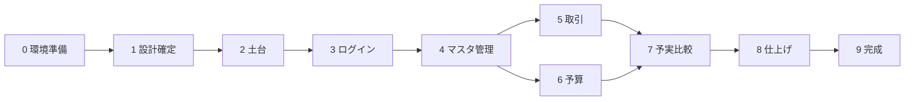

# 実行計画書：HouseholdBudget（Spring Boot版）

[要件定義書](../reviews/requirements.md) をもとに、プロジェクトの開始から完成までを Phase（段階）に分けた計画です。

- 要件定義書にない機能は含めません。9章「今後の予定」（アラート、カロリー管理、公開、スマホ画面、予算の自動設定）と、パスワード再設定は**対象外**です。
- 設計のために私が決めたことは **（提案）** と書いています。
- 日付は決まっていないので書いていません。各 Phase が終わったら「進捗表」にチェックを入れて管理します。

## 進め方のルール（提案）

1. Phase は**上から順に**進める。前の Phase の「完了条件」を満たしてから次へ進む。
2. 1つのタスクが終わるごとに Git でコミットする。Phase が終わったらタグ（例：`phase-3-done`）を付ける。
3. 各 Phase は GitHub の作業用ブランチ（例：`feature/phase-3-auth`）で行い、完了条件を確認してから `main` に取り込む。
4. 動く状態を保つ。毎 Phase の終わりに、アプリを起動して画面で確認する。
5. 分からないこと・決められないことは [設計書](../reviews/design.md) の「決まっていない点」に追記する。
6. `docs/reviews` には、要件定義書（requirements.md）と設計書（design.md）、各 Phase のレビュー記録（phase-N-review.md）を置く。各 Phase の確認結果は `plans` の Phase ファイルに書く。
7. 作業中に見つかった不具合や、追加したい要望は、`docs/issues/` に1件1ファイルで書く。

## 文書の分け方

- この**実行計画書**：全体の流れ、Phase の目的・概要、進捗管理、設計書の章との対応を書く。
- **Phase ごとの詳細ファイル**（`docs/plans/phase-N-○○.md`）：その Phase を進めるための細かい手順、確認方法、完了条件を書く。
- 重複を避けるため、**詳細ファイルを作った Phase は、この計画書にタスク・完了条件を書かず、概要とリンクだけにする**。
- 詳細ファイルは Phase の着手前に1つずつ作る。まだ無い Phase（1〜9）は、仮のタスクと完了条件をこの計画書に残してある。詳細ファイルを作るときに、そちらへ移して計画書側は概要に縮める。

## 進捗表

| Phase | 内容 | 詳細ファイル | 状態 |
|---|---|---|---|
| 0 | 開発環境の準備 | [phase-0-environment.md](phase-0-environment.md) | ☑ 完了 |
| 1 | 設計の確定 | 未作成 | ☐ 未着手 |
| 2 | プロジェクトの土台づくり | 未作成 | ☐ 未着手 |
| 3 | アカウント登録・ログイン | 未作成 | ☐ 未着手 |
| 4 | 科目・取引先・支払方法 | 未作成 | ☐ 未着手 |
| 5 | 取引 | 未作成 | ☐ 未着手 |
| 6 | 予算 | 未作成 | ☐ 未着手 |
| 7 | 予実比較 | 未作成 | ☐ 未着手 |
| 8 | 仕上げ（総合テスト・セキュリティ確認） | 未作成 | ☐ 未着手 |
| 9 | 完成・引き渡し | 未作成 | ☐ 未着手 |

状態の書き方：☐ 未着手 / ◐ 作業中 / ☑ 完了

## 設計書（docs/reviews/design.md）の章と、使う Phase

設計書は Phase 1 で作って確定します。各章の中身は設計書に書くので、ここには**章と使う Phase の対応だけ**を書きます。コードを書かず、入門者が読めるよう日本語で書くこと、要件にない機能を足さないこと、要件にない決定には「（提案）」、技術の選定には理由を1行書くことを、設計書の書き方のルールとします。

| 章 | 設計書の内容 | 主に使う Phase |
|---|---|---|
| 1 | 全体の構成（使う技術と役割、Controller・Service・Repository の分担） | 2（土台）、以降すべて |
| 2 | 画面とURLの一覧（画面名、URL、GET/POST、説明） | 3〜7（画面を作るとき） |
| 3 | テーブル設計（列・型・制約、外部キー、ユーザーごとのデータ分離、Mermaid ER図） | 2（テーブル作成）、3〜7 |
| 4 | パッケージとクラスの構成 | 2（パッケージ作成）、3〜7 |
| 5 | 主な処理の流れ（ログイン、アカウント登録時の初期データ作成、予実比較の集計） | 3（ログイン・初期データ）、7（予実比較） |
| 6 | 入力チェックの実現方法 | 3〜6、8（確認） |
| 7 | セキュリティ対策の実現方法 | 3（ログイン・ハッシュ化）、全体、8（確認） |
| 8 | 決まっていない点・確認したいこと | 1（決定して消す）、以降は新しく出たら追記 |

## Phase の依存関係

5（取引）と6（予算）は、4が終わればどちらを先にやってもかまいません。7は両方が必要です。

---

## Phase 0：開発環境の準備

**目的**：コードを書き始められる状態にする。

**詳細**：[phase-0-environment.md](phase-0-environment.md)（手順・確認方法・完了条件・つまずき対処）

**概要**：Java・MySQL・VS Code・Git/GitHub・Claude Code が動くことを確認し、記録を残す。

---

## Phase 1：設計の確定

**目的**：作る前に「何をどう作るか」を決めて、手戻りを減らす。

**タスク**
- [ ] 設計書 `docs/reviews/design.md` の下書きを作る（技術構成、画面とURL一覧、テーブル設計、クラス構成、処理の流れ、入力チェック、セキュリティ、未決事項）
- [ ] 設計書の「（提案）」と「決まっていない点」を確認し、決定する
- [ ] 決定内容を設計書に反映する
- [ ] 要件定義書と設計書の食い違いがないか見直す（必要なら要件定義書も更新）

**成果物**：`docs/reviews/design.md`（確定版）

**完了条件**
- 設計書の「決まっていない点」がすべて決定済みになっている
- 画面・テーブル・クラスの一覧が、要件の機能一覧を漏れなくカバーしている

---

## Phase 2：プロジェクトの土台づくり

**目的**：機能を載せるための「空のアプリ」を動かす。

**タスク**
- [ ] Spring Boot プロジェクトを作成する（Maven、Web、Thymeleaf、Spring Security、Spring Data JPA、Validation、MySQL ドライバを選ぶ。提案）
- [ ] パッケージ構成（controller / service / repository / entity / form / dto / security / exception）を作る
- [ ] MySQL にデータベースを作り、接続設定を書く（接続パスワードは環境変数から読む。提案）
- [ ] テーブル作成用のSQL（`schema.sql`。提案）を書き、6つのテーブルを作る
- [ ] 共通の画面の枠（ヘッダー、メニュー、エラーメッセージの表示場所）を作る
- [ ] エラーメッセージ用の `messages.properties` を作る
- [ ] `.gitignore` を整える（パスワードなどを含む設定ファイルを公開しない）
- [ ] README に起動方法を書く

**成果物**：起動するアプリの雛形、テーブルが作成された MySQL

**完了条件**
- アプリを起動してブラウザで画面（仮のページ）が表示される
- 6つのテーブルがMySQLに作成されていることを確認できる
- GitHub に push され、パスワード類が含まれていない

---

## Phase 3：アカウント登録・ログイン

**目的**：「ユーザーごとのデータ分離」の土台となる認証を完成させる。

**タスク**
- [ ] User エンティティと UserRepository を作る
- [ ] アカウント登録画面と登録処理を作る
  - [ ] ユーザー名：空欄不可、10文字以下、重複不可
  - [ ] パスワード：8文字以上30文字以下
  - [ ] 入力エラー時に入力値が残る
- [ ] パスワードをBCryptでハッシュ化して保存する
- [ ] 初期データ作成を作る（科目3つ＋予算各3万円、取引先3つ、支払方法2つ）。ユーザー作成と同じトランザクションにする
- [ ] ログイン画面・ログイン処理・ログアウトを作る（Spring Security）
- [ ] ログインしていない人は、ログイン画面と登録画面以外を開けないよう設定する
- [ ] ログイン中のユーザーIDを取り出す仕組みを作る（以降の Phase で全部使う）

**成果物**：登録・ログイン・ログアウトが動く状態

**完了条件**
- 新規登録すると、初期データ（科目3・予算3・取引先3・支払方法2）がMySQLに入っている
- DB上のパスワードがハッシュ化されている
- 未ログインで `/transactions` などを開くとログイン画面へ移動する
- 2人分のアカウントを作り、初期データがそれぞれ別々に入っている

---

## Phase 4：科目・取引先・支払方法

**目的**：取引の入力に必要なマスタ（選択肢）の管理を作る。3つとも同じ形なので、最初の1つ（科目）をていねいに作り、残りに応用する。

**タスク**
- [ ] 科目：一覧・追加・変更（Entity、Repository、Service、Controller、画面）
  - [ ] 名前は10文字以下
  - [ ] 検索・更新は必ずログイン中ユーザーの `user_id` で絞る
- [ ] 取引先：一覧・追加・変更（名前は20文字以下）
- [ ] 支払方法：一覧・追加・変更（名前は10文字以下）
- [ ] 削除の制限（要件4.3）。削除機能を作るかは Phase 1 の決定に従う
  - [ ] 入力済み（取引で使用中）の科目・取引先・支払方法は削除できない
  - [ ] 予算が0円でない科目は削除できない
- [ ] 科目を追加したときの予算の扱い（Phase 1 の決定に従う）
- [ ] 他人のIDをURLに直接入れても見えない・変更できないことを確認する

**成果物**：3つのマスタ管理画面

**完了条件**
- 3つとも追加・変更ができ、入力エラー時に入力値が残る
- 別ユーザーのデータが一覧にも出ず、URL直打ちでも開けない（404）
- 削除の制限が、画面のメッセージとして表示される（該当する場合）

---

## Phase 5：取引

**目的**：このアプリの中心機能である取引の一覧・登録・詳細・編集・削除を作る。

**タスク**
- [ ] Transaction エンティティと TransactionRepository を作る
- [ ] 取引登録画面と登録処理を作る（科目・取引先・支払方法はプルダウン）
- [ ] 入力チェックを付ける
  - [ ] 金額：1円以上1,000,000円以下
  - [ ] 日付：必須
  - [ ] 科目・取引先・支払方法：必須。**自分のものかServiceで確認する**
  - [ ] 摘要：30文字以下（任意）
- [ ] 取引一覧画面を作る（並び順は Phase 1 の決定に従う）
- [ ] 取引詳細画面を作る
- [ ] 取引編集画面と更新処理を作る（登録済みの値が入った状態で表示する）
- [ ] 取引削除を作る（削除前に確認ダイアログを表示する）
- [ ] 登録・更新・削除の成功後は一覧へリダイレクトする（二重登録の防止）

**成果物**：取引の一覧・登録・詳細・編集・削除

**完了条件**
- 5つの操作がすべて動く
- 境界値で正しく動く：金額 1,000,000円は登録可 / 1,000,001円・0円・-1円は不可 / 摘要30文字は可・31文字は不可
- 入力エラーで戻っても、入力値が残っている
- 他人の取引は一覧・詳細・編集・削除のどれでも触れない

---

## Phase 6：予算

**目的**：科目ごとの予算を設定できるようにする。

**タスク**
- [ ] Budget エンティティと BudgetRepository を作る
- [ ] 予算設定画面を作る（自分の科目ごとに現在の予算額を表示し、まとめて入力できる。提案）
- [ ] 予算更新処理を作る
- [ ] 入力チェックを付ける：0円以上3,000,000円以下（0円は可、マイナス不可）
- [ ] 1科目に予算は1つだけになっていることを確認する（UNIQUE制約）

**成果物**：予算設定画面

**完了条件**
- 初期ユーザーの予算が各30,000円で表示される
- 境界値で正しく動く：3,000,000円・0円は保存可 / 3,000,001円・-1円は不可
- 別ユーザーの予算が見えない・変更できない

---

## Phase 7：予実比較

**目的**：季節ごとの科目別「予算・実績・差額」を表示し、色分けする。このアプリの最大の特徴。

**タスク**
- [ ] Season（春・夏・秋・冬と月の対応）を作る
- [ ] 今日の日付から表示する季節と年を決める処理を作る（冬は12月起点）
- [ ] 季節の期間（開始日以上・終了日の翌日未満）の求め方を作る
- [ ] 科目ごとの実績（取引の合計）を取り出す検索を作る（取引がない科目は0円）
- [ ] 色の判定処理を作る（次の順番で判定する。合計行も同じ順番）
  - [ ] ① 実績 ＞ 予算 → 赤（予算が0円でも、実績があれば赤）
  - [ ] ② 予算が0円 → 色なし（実績も0円のとき）
  - [ ] ③ 実績 × 3 ≦ 予算 → 青（ちょうど1/3も青）
  - [ ] ④ それ以外 → 色なし
- [ ] 予実比較画面を作る（予算・実績・差額の列、季節の切り替え）
- [ ] 判定処理と季節の決定処理の**単体テスト**を書く（境界値を中心に）

**成果物**：予実比較画面、判定処理のテスト

**完了条件**
- 次のテストがすべて合格する

  | 確認すること | 期待する結果 |
  |---|---|
  | 予算30,000円・実績30,001円 | 赤 |
  | 予算30,000円・実績30,000円 | 色なし（超過ではない） |
  | 予算30,000円・実績10,000円（ちょうど1/3） | 青 |
  | 予算30,000円・実績10,001円 | 色なし |
  | 予算0円・実績あり（例：1円） | 赤 |
  | 予算0円・実績0円 | 色なし |
  | 合計行：合計の予算30,000円・合計の実績30,001円 | 赤（合計行も同じ順番で判定） |
  | 2月28日・1月15日・12月1日・11月30日・3月1日 の日付 | 冬 / 冬 / 冬 / 秋 / 春。冬の年は12月の年 |

- 初めて開くと、今日が属する季節が表示される
- 季節の境目（例：2月末日と3月1日、11月30日と12月1日）の取引が、正しい季節に集計される
- 自分の取引だけが集計される

---

## Phase 8：仕上げ（総合テスト・セキュリティ確認）

**目的**：要件を満たしているか、一通り確かめる。

**タスク**
- [ ] 要件定義書の機能一覧（3章）と見比べ、機能の漏れがないか確認する
- [ ] 入力チェック（5章）の全項目を、境界値で手動確認する
- [ ] セキュリティ（6章）を確認する

  | 項目 | 確認方法 |
  |---|---|
  | パスワードのハッシュ化 | DBを見て、元のパスワードが読めないこと |
  | ログイン必須 | ログアウト状態で各URLを開き、ログイン画面に移動すること |
  | SQLインジェクション | ユーザー名・摘要などに `' OR '1'='1` を入力しても影響がないこと。文字列連結のSQLがないかコードを検索 |
  | XSS | 摘要などに `` を入力しても、画面ではただの文字として表示されること。`th:utext` を使っていないか検索 |
  | CSRF | フォームにトークンが入っていること。トークンなしのPOSTが拒否されること |
  | データ分離 | 2ユーザーで、別ユーザーのIDをURLに入れても見えない・変更できないこと |

- [ ] 見つかった不具合を直し、直した内容を記録する
- [ ] 主要な処理の自動テストを整える（登録時の初期データ、データ分離、予実比較）
- [ ] コードの整理（使っていないコードの削除、分かりにくい名前の修正、コメント）

**成果物**：確認結果の記録（チェックリスト）、自動テスト

**完了条件**
- 確認項目がすべて合格している
- 自動テストが全部成功する（`mvn test`）
- 既知の不具合が残っていない（残る場合は理由を記録）

---

## Phase 9：完成・引き渡し

**目的**：他の人（採用担当者など）が見て、動かせる状態にする。

**タスク**
- [ ] README を仕上げる（アプリの概要、使用技術、必要な環境、セットアップ手順、起動方法、画面の紹介）
- [ ] 設計書・要件定義書が、実際に作ったものと合っているか見直す
- [ ] 動作確認用のアカウントの案内を書く（採用担当者は自分で登録して試せる）
- [ ] 画面のスクリーンショットを撮り、README に載せる
- [ ] `main` ブランチに取り込み、完成タグ（例：`v1.0.0`）を付けて GitHub に push する
- [ ] 振り返りを書く（学んだこと、苦労した点、AI活用で分かったこと、次にやりたいこと）

**成果物**：完成版のリポジトリ、README、振り返りメモ

**完了条件**
- まっさらな環境で、READMEの手順どおりに起動できる
- 要件定義書の機能一覧がすべて動く
- 秘密情報（パスワード等）がGitHub上にない

> 「インターネットへの公開」は要件定義書の9章（今後の予定）なので、この計画には含めません。

---

## リスクと対策（提案）

| リスク | 対策 |
|---|---|
| 初めての技術が多く、途中で止まる | Phase を小さく保つ。詰まったら Phase 1 に戻らず、未決事項に書いて先へ進めるものは進める |
| 作りながら仕様が変わる | 変更は先に要件定義書・設計書に書いてからコードを直す |
| 他人のデータが見えてしまう | Phase 4 で「ユーザーIDで絞る」型を最初に確立し、5・6・7 で同じ型をそのまま使う。Phase 8 で必ず2ユーザーで確認する |
| 季節の判定や色分けでのバグ（特に境界） | Phase 7 で境界値の単体テストを先に書く |
| 機能を足したくなる | 9章の項目は、Phase 9 が終わるまで手を付けない |
