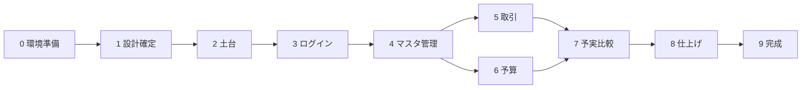

# 実行計画書：HouseholdBudget（Spring Boot版）

[要件定義書](../reviews/requirements.md) をもとに、プロジェクトの開始から完成までを Phase（段階）に分けた計画です。

- 要件定義書にない機能は含めません。9章「今後の予定」（アラート、カロリー管理、公開、スマホ画面、予算の自動設定）と、パスワード再設定は**対象外**です。
- 設計のために私が決めたことは **（提案）** と書いています。
- 日付は決まっていないので書いていません。各 Phase が終わったら「進捗表」にチェックを入れて管理します。

## 進め方のルール（提案）

1. Phase は**上から順に**進める。前の Phase の「完了条件」を満たしてから次へ進む。
2. 1つのタスクが終わるごとに Git でコミットする。Phase が終わったらタグ（例：`phase-3-done`）を付ける。
3. 各 Phase は GitHub の作業用ブランチ（例：`feature/phase-3-auth`）で行い、完了条件を確認してから `main` に取り込む。
4. 動く状態を保つ。毎 Phase の終わりに、アプリを起動して画面で確認する。
5. 分からないこと・決められないことは [設計書](../reviews/design.md) の「決まっていない点」に追記する。
6. `docs/reviews` には、要件定義書（requirements.md）と設計書（design.md）、各 Phase のレビュー記録（phase-N-review.md）を置く。各 Phase の確認結果は `plans` の Phase ファイルに書く。
7. 作業中に見つかった不具合や、追加したい要望は、`docs/issues/` に1件1ファイルで書く（書き方は [docs/issues/README.md](../issues/README.md)）。
8. Phase 2 で決まった共通事項（以降の Phase すべてに当てはまる）：
   - ベースパッケージは `io.github.yutaro081.householdbudget`（設計書 4.1）。
   - 照合順序は、データベース全体・すべてのテーブルで `utf8mb4_0900_as_ci`（設計書 3.12）。新しいテーブルを足すときも `COLLATE` を明記する。
   - DB の接続は環境変数 `HB_DB_URL`、`HB_DB_USER`、`HB_DB_PASSWORD` から読む（設計書 1.5）。アプリ専用の DB ユーザー `hb_app` で接続し、`root` は使わない。環境変数を設定したあとは VS Code を開き直す。環境変数が空だと、起動も `.\mvnw test` も失敗する。
   - `schema.sql` は `CREATE TABLE IF NOT EXISTS` で、既存のテーブルを変更しない。`schema.sql` を直したときは、`root` でデータベースを作り直す（Phase 3 以降は、データが消えることに注意）。
   - Spring Boot は 4.1.2（設計書 1.2）。
   - Phase 3 で決まった共通事項：
     - ログイン中のユーザーIDは、`LoginUser.getUserId()` から取り出して Service に渡す（設計書 3.9）。
     - エラー画面は 404 / 403 / その他の 4xx / 5xx の4つ（S3、S9）。セッションIDは Cookie だけで受け渡す（S8）。
     - 入力チェックの注釈は D4 の B：「必須」を他のエラーと重ねない（形式の正規表現は空文字を通す）。それ以外のエラーは、重なったら全部出す（G7、設計書 6.9）。
     - テンプレートの説明コメントは `<!--/* … */-->` で書く（ブラウザに送られる HTML に出さない、設計書 7.7）。
     - 自動テストは開発用の DB につなぐ。各テストはトランザクションで包み、終わると取り消される形にする（Q3-8）。テストのダミーのパスワードは、実在するアカウントのものを使わない。
   - Phase 4 で決まった共通事項（「ID と `user_id` の両方で絞る」型）：
     - Controller は `LoginUser.getUserId()` を Service に必ず渡す。Service のメソッドの最初の引数は `userId`。Repository のメソッドは、すべて `userId` を引数に取る（`users` を除く）。`findById` など、ID だけで探すメソッドは、アプリのコードで使わない（設計書 3.9）。
     - 存在しない・他人のID・数字でないIDは、すべて同じ 404（画面も状態コードも同じ）。**変更の POST は、入力が間違っていても、先に ID と `user_id` で探す**（他人のデータの有無が分かる差を作らないため、設計書 7.8）。
     - 前後の空白は、各 Form のセッターで `strip()` を使って取り除く（`trim()` と `StringTrimmerEditor` は全角の空白を取らないので使わない、設計書 6.4）。
     - 削除ボタンの確認ダイアログは、フォームの `onsubmit` 属性に固定の文言で書く（設計書 2.1）。
     - 成功メッセージの「追加しました」「変更しました」「削除しました」は共通のキー（`success.added`、`success.updated`、`success.deleted`）。
   - Phase 5 で決まった共通事項：
     - 金額（Phase 6 の予算額も）は、専用の変換クラス `StrictIntegerEditor` で読む。Controller の `@InitBinder` で、金額の項目にだけ登録する。Spring 標準の `Integer` の変換は、全角数字・途中の空白・16進（`0x10`）・先頭の `+` を通すため使わない（設計書 6.5、P9、Q5-1）。**ただし、Phase 6 で R13 により、全角の数字（０〜９）は半角に直して受け付けることにした**（日本語入力がオンのまま打つと全角になるため。`0x10`・`#10`、途中の空白、カンマ、小数、`+5`、全角のマイナスなどは、今までどおり型変換のエラー）。
     - `spring.jpa.open-in-view=false`（設計書 4.6、D5）。画面が読む関連は、Repository の `@EntityGraph` でまとめて読み込んで渡す。**自動テスト（MockMvc）は、読み込み忘れを見つけられない**（テストごとにトランザクションで包むため）ので、新しい画面を作ったら、ブラウザで開いて確かめる。
     - 金額・日付の表示の形（`30,000円`、`2026/10/19`）は、Thymeleaf の標準の書き方（`#numbers.formatInteger(値, 1, 'COMMA')`、`#temporals.format(日付, 'yyyy/MM/dd')`）を画面ごとに書く。整形のクラスは作らない（Q5-9）。
     - 日付の範囲のように、Bean Validation にない確認は、`form` パッケージに自作の注釈を置く（`TransactionDateRange`、P9）。
     - 摘要のように、空なら NULL にする項目は、Form のセッターで `strip()` し、空なら `null` にする（D6）。
     - Controller の自動テストで「今日」を固定するときは、`@TestConfiguration` で `@Primary` の固定の `Clock` を用意する（`TransactionControllerTest`）。
     - MockMvc の `param` は、同じ名前を置き換えず追加する。テストで項目を差し替えるときは、最初から差し替えた値で組み立てる。
   - Phase 6 で決まった共通事項：
     - 季節の指定（予算設定・予実比較に共通、設計書 2.4）：URL の `year` と `season` は**文字列**で受け取り、`SeasonPeriod.parse(year, season)` で判定する（年は半角の数字4桁だけで2000〜2100、季節は小文字の4つだけ。不正・片方だけ・空文字・範囲外は空 → Controller が `NotFoundException`）。両方とも指定なしのときだけ、今の季節（`Clock`）。予算設定の `BudgetController.resolve` が見本（Q6-2）だったが、Phase 7 で共有の部品 `SeasonPeriod.resolve(year, season, today)` に取り出した（下の Phase 7 の共通事項）。
     - 季節の古い新しいは、**期間の順**（`SeasonPeriod.isBefore`、`Season.earlierInYear`）で比べる。DB に保存する季節の文字の順（`AUTUMN` < `SPRING` < `SUMMER` < `WINTER`）は、期間の順と違うので、並べ替えや比べに使わない（設計書 5.8）。
     - 見出しと「前の季節」「次の季節」は、共有のフラグメント `fragments/season.html` の `nav(period, previous, next, path)`。範囲の端では、前・次を `null` にして、リンクを出さない。季節の名前は `messages.properties` の `season.*`（Q6-5、P10）。
     - 行の並びを送る Form（`BudgetForm.rows`）の金額の変換は、行の番号を除いた名前（`rows.amount`）で登録する。行の番号つき（`rows[0].amount`）で登録すると、その行にしか効かない。メッセージのキーも `rows.amount` の形でどの行にも当たる（Q6-1、Q6-7）。
     - 入力エラーで表示し直す画面の行は、先に ID を確かめてから作る（他人・存在しない・重複・なしの ID は、入力の正誤に関係なく 404。設計書 5.7、7.8、Q6-3）。
     - **R13：金額・予算額で、全角の数字（０〜９）は半角に直して受け付ける**（日本語入力がオンのまま打つと全角になるため）。`0x10`・`#10`、途中の空白、カンマ、小数、`+5`、全角のマイナスなどは、今までどおり型変換のエラー（設計書 6.5）。
     - 行の並び（`rows[0]`、`rows[1]`、…）は、Spring の標準で256行までしか組み立てられない（この標準は変えない）。**科目・取引先・支払方法は、それぞれ1人あたり256個まで**（要件定義書 5章、R14。`Limits`、`LimitExceededException`。257個目は「科目は256個までです」などのメッセージで追加させない）。256行なら、いつでも保存できる。257行以上を送る・行の番号を書き換える（`rows[-1]`、`rows[abc]` など）と、束縛に失敗するが（`InvalidPropertyException`）、**500 ではなく 400 にして `error/4xx.html` を出す**（`GlobalExceptionHandler`。500はサーバーの不具合、400は送信の形がおかしい、と区別するため）。当初（Q6-9 の A）は、上限なし・500のままとしていたが、見直した（issue 002）。

   - Phase 7 で決まった共通事項：
     - 季節の指定は、予算設定も予実比較も、共有の部品 `SeasonPeriod.resolve(year, season, today)` で決める（両方なしなら今の季節、それ以外は `parse`。空なら、Controller が `NotFoundException` にして 404。`domain` は例外の仕組みに頼らない。Q7-1）。
     - 色の判定は `BudgetColorJudge.judge(Long budget, long actual)` の1か所だけ（予算の `null` が未設定。計算は `long`）。画面は判定せず、判定済みの `BudgetColor` を CSS のクラス名（`row-over`、`row-low`）に置き換えるだけにする（Q7-2、F4）。
     - 期間内の科目ごとの合計は、`TransactionRepository.sumByCategory(userId, start, endExclusive)`。**このアプリで初めての `@Query`**（パラメータ付きの JPQL。文字列を連結しない。`@Query` を使うときも、`userId` で絞る。Q7-3、設計書 7.4）。
     - 予算の「未設定」は、その季節の `budgets` の行がないこと。前の季節の額は使わない（予算設定画面の初期値の規則とは別、R11）。
     - 画面の文言は、Phase 6 と同じにテンプレートに直接書く（季節の名前だけ `messages.properties`。Q7-5）。
     - 取引の日付の下限は 2000-03-01（R15、issue 003）。取引の季節の範囲とそろえたので、入力できる取引はすべて、どこかの季節に入る。
     - 値を持つだけの入れ物（`ComparisonRow`、`ComparisonResult`、`CategoryActual`）は `record`（Q7-4）。画面が読む値はすべて入れて渡す（`open-in-view=false`）。
## 文書の分け方

- この**実行計画書**：全体の流れ、Phase の目的・概要、進捗管理、設計書の章との対応を書く。
- **Phase ごとの詳細ファイル**（`docs/plans/phase-N-○○.md`）：その Phase を進めるための細かい手順、確認方法、完了条件を書く。
- 重複を避けるため、**詳細ファイルを作った Phase は、この計画書にタスク・完了条件を書かず、概要とリンクだけにする**。
- 詳細ファイルは Phase の着手前に1つずつ作る。まだ無い Phase（1〜9）は、仮のタスクと完了条件をこの計画書に残してある。詳細ファイルを作るときに、そちらへ移して計画書側は概要に縮める。

## 進捗表

| Phase | 内容 | 詳細ファイル | 状態 |
|---|---|---|---|
| 0 | 開発環境の準備 | [phase-0-environment.md](phase-0-environment.md) | ☑ 完了 |
| 1 | 設計の確定 | [phase-1-design.md](phase-1-design.md) | ☑ 完了 |
| 2 | プロジェクトの土台づくり | [phase-2-base.md](phase-2-base.md) | ☑ 完了 |
| 3 | アカウント登録・ログイン | [phase-3-auth.md](phase-3-auth.md) | ☑ 完了 |
| 4 | 科目・取引先・支払方法 | [phase-4-masters.md](phase-4-masters.md) | ☑ 完了 |
| 5 | 取引 | [phase-5-transactions.md](phase-5-transactions.md) | ☑ 完了 |
| 6 | 予算 | [phase-6-budgets.md](phase-6-budgets.md) | ☑ 完了 |
| 7 | 予実比較 | [phase-7-comparison.md](phase-7-comparison.md) | ☑ 完了 |
| 8 | 仕上げ（総合テスト・セキュリティ確認） | 未作成 | ☐ 未着手 |
| 9 | 完成・引き渡し | 未作成 | ☐ 未着手 |

状態の書き方：☐ 未着手 / ◐ 作業中 / ☑ 完了

## 設計書（docs/reviews/design.md）の章と、使う Phase

設計書は Phase 1 で作って確定します。各章の中身は設計書に書くので、ここには**章と使う Phase の対応だけ**を書きます。コードを書かず、入門者が読めるよう日本語で書くこと、要件にない機能を足さないこと、要件にない決定には「（提案）」、技術の選定には理由を1行書くことを、設計書の書き方のルールとします。

| 章 | 設計書の内容 | 主に使う Phase |
|---|---|---|
| 1 | 全体の構成（使う技術と役割、Controller・Service・Repository の分担） | 2（土台）、以降すべて |
| 2 | 画面とURLの一覧（画面名、URL、GET/POST、説明） | 3〜7（画面を作るとき） |
| 3 | テーブル設計（列・型・制約、外部キー、ユーザーごとのデータ分離、Mermaid ER図） | 2（テーブル作成）、3〜7 |
| 4 | パッケージとクラスの構成 | 2（パッケージ作成）、3〜7 |
| 5 | 主な処理の流れ（ログイン、アカウント登録時の初期データ作成、予実比較の集計） | 3（ログイン・初期データ）、7（予実比較） |
| 6 | 入力チェックの実現方法 | 3〜6、8（確認） |
| 7 | セキュリティ対策の実現方法 | 3（ログイン・ハッシュ化）、全体、8（確認） |
| 8 | 決まっていない点・確認したいこと | 1（決定して消す）、以降は新しく出たら追記 |

## Phase の依存関係

5（取引）と6（予算）は、4が終わればどちらを先にやってもかまいません。7は両方が必要です。

---

## Phase 0：開発環境の準備

**目的**：コードを書き始められる状態にする。

**詳細**：[phase-0-environment.md](phase-0-environment.md)（手順・確認方法・完了条件・つまずき対処）

**概要**：Java・MySQL・VS Code・Git/GitHub・Claude Code が動くことを確認し、記録を残す。

---

## Phase 1：設計の確定

**目的**：作る前に「何をどう作るか」を決めて、手戻りを減らす。

**詳細**：[phase-1-design.md](phase-1-design.md)（決まっていない点の一覧と決定、手順、完了条件）

**概要**：設計書 `docs/reviews/design.md` の章1〜8を作り、要件定義書との突き合わせを `docs/reviews/phase-1-review.md` に記録した。決定に合わせて、要件定義書を R1〜R12 で修正した。照合順序など Phase 2 で試して決める点は、章8に残して Phase 2 で決めた。

---

## Phase 2：プロジェクトの土台づくり

**目的**：機能を載せるための「空のアプリ」を動かす。

**詳細**：[phase-2-base.md](phase-2-base.md)（手順・確認方法・完了条件・つまずき対処）

**概要**：Spring Boot 4.1.2 のプロジェクトを作り、アプリ専用の DB とユーザーを用意し、照合順序（`utf8mb4_0900_as_ci`）を実験で決め、`schema.sql` で6つのテーブルを作った。`application.properties`（接続情報は環境変数から読む）、`messages.properties`（文字化けなしを確認）、`.gitignore`、README の起動方法も整えた。画面は Spring Security の標準のログイン画面と、仮のページだけ。

---

## Phase 3：アカウント登録・ログイン

**目的**：「ユーザーごとのデータ分離」の土台となる認証を完成させる。

**詳細**：[phase-3-auth.md](phase-3-auth.md)（手順・確認方法・完了条件・つまずき対処）

**概要**：アカウント登録（ユーザー名・パスワードの入力チェック、BCrypt でハッシュ化、初期データを同じトランザクションで作成）、ログイン・ログアウト（Spring Security、CSRF 対策は有効のまま）、ログイン必須の設定、`LoginUser` によるユーザーIDの取り出しを作った。あわせて、共通の画面の枠、404 / 403 / 4xx / 5xx の画面、セッション Cookie の設定（`HttpOnly`、`SameSite=Lax`、Cookie だけでの受け渡し）、季節の決定（`Season`、`SeasonPeriod` の「今日から季節を決める」部分）、日本時間の `Clock`、初期データ用の Entity・Repository、自動テストを作り、D4・C1 を決めて設計書に反映した。取引一覧は、仮の画面。

---

## Phase 4：科目・取引先・支払方法

**目的**：取引の入力に必要なマスタ（選択肢）の管理を作る。3つとも同じ形なので、最初の1つ（科目）をていねいに作り、残りに応用する。

**詳細**：[phase-4-masters.md](phase-4-masters.md)（手順・確認方法・完了条件・つまずき対処）

**概要**：科目・取引先・支払方法の一覧・追加・変更・削除を作った（取引先 20文字、科目と支払方法 10文字）。すべての検索・更新・削除を「ID と `user_id` の両方」で絞る型を確立し、他人のID・存在しないID・数字でないIDは同じ 404 になる（`NotFoundException`、`GlobalExceptionHandler`）。取引で使用中のものは削除できず、科目は、いずれかの季節に0円でない予算がある場合も削除できない（科目の削除では、予算の行を先にすべて消す）。科目を追加すると、今の季節の予算0円の行が同じトランザクションで作られる。使用中の確認のために、`Transaction` の Entity と `TransactionRepository`（使用中の確認の3メソッドだけ）を前倒しで作った。前後の空白は各 Form のセッターで `strip()`、削除の確認ダイアログは `onsubmit` に固定の文言で書いた。メニューに科目・取引先・支払方法を足した。自動テストを追加した。

---

## Phase 5：取引

**目的**：このアプリの中心機能である取引の一覧・登録・詳細・編集・削除を作る。

**詳細**：[phase-5-transactions.md](phase-5-transactions.md)（手順・確認方法・完了条件・つまずき対処）

**概要**：取引の一覧（日付の新しい順、同じ日は登録の新しい順）・登録・詳細・編集・削除を作り、仮の取引一覧（`TemporaryTransactionController`）を置き換えた。Phase 4 の型（「ID と `user_id` の両方で絞る」、変更の POST は先に ID を確かめる）をそのまま使い、登録・更新で選んだ科目・取引先・支払方法が自分のものかを、Phase 4 の各 Service の `get` で確かめる（他人のものは 404 で、何も保存しない）。金額は専用の変換クラス `StrictIntegerEditor`（半角の数字だけ。標準の変換が全角数字などを通したため。のちに Phase 6 の R13 で、全角の数字だけは半角に直して受け付けるよう変更）、日付の範囲は自作の注釈 `TransactionDateRange`、摘要は Form のセッターで `strip()` と空なら `null`（D6）。一覧・詳細で科目・取引先・支払方法を `@EntityGraph` でまとめて読み込み、`spring.jpa.open-in-view=false` にした（D5）。プルダウンが空のときは、足りない種類の案内とリンクを出してフォームは出さない。取引の画面から、使用中の科目などが削除できないことを確かめ直した（Q4-2 の C）。自動テストを追加した（Form、変換クラス、Repository（CHECK 制約、SQL の数）、Service、Controller）。

---

## Phase 6：予算

**目的**：科目ごと・季節ごとの予算を設定できるようにする。

**詳細**：[phase-6-budgets.md](phase-6-budgets.md)（手順・確認方法・完了条件・つまずき対処）

**概要**：予算設定画面（`/budgets?year=…&season=…`）を作った。URL に年と季節を持ち、指定しないときは今の季節。範囲は2000年春〜2100年冬で、端では範囲外へのリンクを出さず、範囲外・不正・片方だけの指定は404。入力欄の最初の値は、その季節の予算 → 直前に設定した季節の額（期間の順でいちばん近い季節。最後に保存した季節ではない）→ 0円。保存されていない行には「（この季節は未設定）」の印を付ける。画面を開いただけでは行を作らず、保存すると、その季節の全科目の行を作る・更新する（まとめて保存、1つでも入力エラーなら何も保存しない）。送られた科目IDが自分のものか、同じIDが2回ないかを、入力チェックの結果を見る前に確かめる（だめなら404）。予算額は `StrictIntegerEditor` を行ごとの金額（`rows.amount`）に登録して読む。`SeasonPeriod` に期間・前後の季節・範囲の判定・期間の順の比べ方・URLの値からの変換を足し、境界値の単体テストを先に書いた。見出しと前後リンクは共有のフラグメント `fragments/season.html`。メニューに「予算」を足した。途中で、R13（全角の数字は半角に直して受け付ける）を決めて、要件定義書・設計書に反映した。自動テストを追加した（季節の計算、Form、Repository、Service、Controller）。

---

## Phase 7：予実比較

**目的**：季節ごとの科目別「予算・実績・差額」を表示し、色分けする。このアプリの最大の特徴。

**詳細**：[phase-7-comparison.md](phase-7-comparison.md)（手順・確認方法・完了条件・つまずき対処）

**概要**：予実比較画面（`/comparison?year=…&season=…`）を作った。季節の指定は予算設定と同じ決まりで、共有の部品 `SeasonPeriod.resolve` に取り出し、`BudgetController` も使う形に直した（Phase 6 の `BudgetControllerTest` は変更なしで通る）。色の判定は `BudgetColorJudge` に、設計書 5.9 の表（9行）と境界値の単体テストを先に書いて作った（予算が未設定なら色なし。①超過は赤、②予算0円は色なし、③実績×3 ≦ 予算は青、④それ以外は色なし。計算は `long`）。期間内の科目ごとの合計は、`TransactionRepository.sumByCategory`（このアプリで初めての `@Query`。パラメータ付きで、`user_id` と「開始日以上、終了日の翌日未満」で絞る）。`ComparisonService` が、科目ごとの予算（その季節の行がなければ「未設定」。前の季節の額は使わない）・実績・差額・色と、合計行（合計の予算は設定済みの科目だけ、合計の実績は全科目）を作る。画面は、見出しと前後リンクに共有のフラグメント `fragments/season.html`、色は行の文字全体（赤 `row-over`、青 `row-low`）、表の下に色の意味の注記、科目が0件のときは案内だけ（表と合計行は出さない）。メニューに「予実比較」を足した。途中で、取引の日付の下限が季節の範囲（2000年春〜）とずれていて、2000年1月・2月の取引がどの季節にも出ないことが分かり（issue 003）、下限を 2000-03-01 に変えた（R15。要件定義書・設計書・README・`TransactionDateRange`・DB の CHECK 制約・テストを直した）。自動テストを追加した（色の判定、集計の検索、Service、Controller）。ブラウザで、残してあった取引と、一時的に作った取引（確認後に削除）で、色・未設定・季節の境目・404・別ユーザーを確かめた。

---

## Phase 8：仕上げ（総合テスト・セキュリティ確認）

**目的**：要件を満たしているか、一通り確かめる。

**タスク**
- [ ] 要件定義書の機能一覧（3章）と見比べ、機能の漏れがないか確認する
- [ ] 入力チェック（5章）の全項目を、境界値で手動確認する
- [ ] セキュリティ（6章）を確認する

  | 項目 | 確認方法 |
  |---|---|
  | パスワードのハッシュ化 | DBを見て、元のパスワードが読めないこと |
  | ログイン必須 | ログアウト状態で各URLを開き、ログイン画面に移動すること |
  | SQLインジェクション | ユーザー名・摘要などに `' OR '1'='1` を入力しても影響がないこと。文字列連結のSQLがないかコードを検索 |
  | XSS | 摘要などに `` を入力しても、画面ではただの文字として表示されること。`th:utext` を使っていないか検索 |
  | CSRF | フォームにトークンが入っていること。トークンなしのPOSTが拒否されること |
  | データ分離 | 2ユーザーで、別ユーザーのIDをURLに入れても見えない・変更できないこと |

- [ ] 見つかった不具合を直し、直した内容を記録する
- [ ] 主要な処理の自動テストを整える（登録時の初期データ、データ分離、予実比較）
- [ ] コードの整理（使っていないコードの削除、分かりにくい名前の修正、コメント）

**Phase 2 から引き継ぐこと**
- 自動テスト（`.\mvnw test`）は、DB につながる（`contextLoads`）。環境変数 `HB_DB_*` が設定された状態で実行する
- エラー画面の確認に、`application.properties` のエラー詳細を含めない設定（S2）を含める。状態コード（404 / 403 / 500）も確認する（設計書 7.11）

**Phase 3 から引き継ぐこと**
- ログイン後にセッションIDが新しくなること（C1）は、MockMvc の自動テストでは確かめられなかった。ブラウザの開発者ツールで確かめる（設計書 7.10、7.11）
- 状態コード（404 / 403 / 500）の確認に、その他の 4xx（400、405 など）の画面（`error/4xx.html`）も含める（S9）

**Phase 4 から引き継ぐこと**
- 2人のユーザーでのデータ分離の確認に、科目・取引先・支払方法の3つ（一覧、変更の画面、変更、削除）を含める。Phase 4 の自動テスト（`…ControllerTest`、`…ServiceTest`）で確かめている内容を、画面でもう一度確かめる
- 「ID と `user_id` の両方で絞る」型が守られているかを、コードを検索して確かめる：Repository のメソッドがすべて `userId` を引数に取っている（`users` を除く）、`findById` を使っていない

**Phase 5 から引き継ぐこと**
- 2人のユーザーでのデータ分離の確認に、取引（一覧、詳細、編集、削除。登録・更新で他人の科目・取引先・支払方法のIDを送ったとき）を含める。Phase 5 の自動テスト（`TransactionControllerTest`、`TransactionServiceTest`）で確かめている内容を、画面でもう一度確かめる
- `spring.jpa.open-in-view=false` のまま、**すべての画面を一通り開いて**、`LazyInitializationException`（500）が出ないことを確かめる（自動テストでは見つからない、設計書 4.6）。入力エラーで表示し直す画面も開く
- XSS の確認に、摘要の `` を、ブラウザで一覧・詳細・編集の画面で確かめる（Phase 5 では自動テストだけで確認し、ブラウザでの確認は行っていない）。プルダウンが空のとき（B2）の案内も、ブラウザで確かめる（同じく自動テストだけ）
- Phase 5 の手順書 4.9 のうち、ブラウザで確認していない項目（摘要の境界値、未選択のエラー、`test2` からの登録・編集・削除の送信の書き換え、SQL での NULL と空白の確認など）を、Phase 8 の確認表に含める
- Phase 6 の手順書 4.9 のうち、ブラウザで確認していない項目（予算設定の入力チェックの個別の入力、2100年冬の端、`test2` からの科目IDの書き換え、科目が0件の画面、`budgets` の SQL での確認など）を、確認表に含める。自動テスト（`BudgetControllerTest`、`BudgetServiceTest`、`BudgetRepositoryTest`、`BudgetFormTest`、`SeasonPeriodTest`）では確かめてある
- 予算設定の確認に、257行以上を送ったときの動き（400番台のエラー画面 `error/4xx.html`、何も保存されない。R14）、`rows[-1]`・`rows[abc]` のような行の番号の書き換え（同じく400。issue 002）、`rows=`（空）を送ったときの表示（行が空のまま表示される。直さないと決めた）と、科目・取引先・支払方法を256個まで追加できて257個目は追加できないこと（ブラウザでは未確認）、同時に追加が重なって257個になった場合（DB の制約にはしていない。まれ）、保存ボタンを素早く2回押したとき（同時保存で一意制約に拒否されると、500番台のエラー画面になり、二重には保存されない。Q6-6 の A）を含める
- 金額・予算額の欄に、`0x10`・`+5`・途中の空白・全角のマイナスを入れたときの型変換のエラーを、ブラウザで確かめる（`0x10` は Phase 5 で確認済み）。全角の数字（`１２３`）は、半角に直して受け付けられることを確かめる（R13）

- **Phase 7 から引き継ぐこと**（詳細は [phase-7-comparison.md](phase-7-comparison.md) の 8）：
  - 2人のユーザーでのデータ分離の確認に、予実比較（実績・予算が他人の分と混ざらないこと）を含める。自動テスト（`ComparisonControllerTest`、`ComparisonServiceTest`）で確かめてある内容を、画面でもう一度確かめる。
  - 範囲の端（2000年春・2100年冬）と 404 を、ブラウザで確かめる（予算設定と予実比較の両方。予実比較は Phase 7 で確認済み）。
  - **科目が0件のアカウントの予実比較**（「先に科目を追加してください」と科目の画面へのリンク、表と合計行が出ない）は、ブラウザでは未確認（自動テストでは確認済み）。
  - `findById` を使っていないこと、すべての Repository のメソッドが `userId` を引数に取っていることを、コードを検索して確かめる（`TransactionRepository.sumByCategory` を含む。Phase 7 の 4.8 で一度確認済み）。
  - 取引の日付の下限（R15）の確認：登録画面で `2000-02-29` がエラー（メッセージは「日付は2000年3月1日から2100年12月31日までで入力してください」）、`2000-03-01` と `2100-12-31` は登録できること。DB の CHECK 制約（`ck_transactions_date`）も、`schema.sql` と開発用の DB で同じ範囲になっている（付け替え済み）。
  - 開発用の DB には、Phase 7 の確認のあと、取引が0件、`budgets` が9行（`test1` の2026年 秋・冬、`test2` の2026年 秋）が残っている。データ分離の確認などで取引が要るときは、画面から登録する。

**成果物**：確認結果の記録（チェックリスト）、自動テスト

**完了条件**
- 確認項目がすべて合格している
- 自動テストが全部成功する（`mvn test`）
- 既知の不具合が残っていない（残る場合は理由を記録）

---

## Phase 9：完成・引き渡し

**目的**：他の人（採用担当者など）が見て、動かせる状態にする。

**タスク**
- [ ] README を仕上げる（アプリの概要、使用技術、必要な環境、セットアップ手順、起動方法、画面の紹介）
- [ ] 設計書・要件定義書が、実際に作ったものと合っているか見直す
- [ ] 動作確認用のアカウントの案内を書く（採用担当者は自分で登録して試せる）
- [ ] 画面のスクリーンショットを撮り、README に載せる
- [ ] `main` ブランチに取り込み、完成タグ（例：`v1.0.0`）を付けて GitHub に push する
- [ ] 振り返りを書く（学んだこと、苦労した点、AI活用で分かったこと、次にやりたいこと）

**成果物**：完成版のリポジトリ、README、振り返りメモ

**完了条件**
- まっさらな環境で、READMEの手順どおりに起動できる
- 要件定義書の機能一覧がすべて動く
- 秘密情報（パスワード等）がGitHub上にない

> 「インターネットへの公開」は要件定義書の9章（今後の予定）なので、この計画には含めません。

---

## リスクと対策（提案）

| リスク | 対策 |
|---|---|
| 初めての技術が多く、途中で止まる | Phase を小さく保つ。詰まったら Phase 1 に戻らず、未決事項に書いて先へ進めるものは進める |
| 作りながら仕様が変わる | 変更は先に要件定義書・設計書に書いてからコードを直す |
| 他人のデータが見えてしまう | Phase 4 で「ユーザーIDで絞る」型を最初に確立し、5・6・7 で同じ型をそのまま使う。Phase 8 で必ず2ユーザーで確認する |
| 季節の判定や色分けでのバグ（特に境界） | Phase 7 で境界値の単体テストを先に書く |
| 機能を足したくなる | 9章の項目は、Phase 9 が終わるまで手を付けない |
