# 設計書：HouseholdBudget（Spring Boot版）

[要件定義書](requirements.md) をもとに、何をどう作るかを決めた設計書です。作成の手順は [Phase 1 手順書](../plans/phase-1-design.md) にあります。

- 状態：章1〜8を記載。要件との突き合わせ済み（[phase-1-review.md](phase-1-review.md)）

## 書き方のルール

- 日本語で、入門者が読めるように書く。
- コードは書かない（表・図・文章だけ）。
- 要件定義書にない機能は足さない。
- 要件にない決定には **（提案）** と書く。
- 技術の選定には、理由を1行書く。
- 決まっていない点は、章8に書く。決まったら各章に反映して、章8から消す。

---

## 1. 全体の構成

### 1.1 方針

- 画面は**サーバー側で作る**（Thymeleaf が HTML を作ってブラウザへ返す）。画面を JavaScript で組み立てる作りにはしない。理由：要件の機能が「フォームを送って結果を表示する」形で足りるため。
- 確認ダイアログ（削除前）にだけ、少量の標準の JavaScript を使う（章2）。
- 利用者ごとのデータ分離は、**すべての検索を `user_id` で絞る**ことで守る（3.9、4.1）。
- 設定のうち、**パスワードなどの秘密は環境変数から読み、リポジトリに書かない**（1.5）。

### 1.2 使う技術と版

版は、**確認できたものだけ**を書く。Spring Boot が管理する部品は、版を書かずに「Spring Boot が管理する版」とする（Spring Boot の版を決めると自動で決まり、こちらで選ばないため）。

| 技術 | 版 | 役割 | 選んだ理由 |
|---|---|---|---|
| Java（JDK） | 25（Eclipse Temurin 25.0.2） | プログラムを書く言語と実行環境 | 要件で指定。導入済みの長期サポート版（Phase 0 で確認済み） |
| Spring Boot | 4.1.2 | アプリの土台。Web サーバー（組み込み）、設定、起動 | 要件で指定。4.1.1 が Java 17〜26 に対応していることは公式ドキュメントで確認済み（Q18）。4.1.2 は 4.1.1 の不具合修正版で、Spring Initializr で選べる安定版のため、こちらを使う |
| Maven（`mvnw`） | プロジェクト付属の Maven Wrapper が使う版 | 部品の管理とビルド | 別にインストールせず、`mvnw` で動かせる（Phase 0）。実行計画書の方針 |
| Thymeleaf | Spring Boot が管理する版 | 画面（HTML）の作成。表示する値は自動で無害化される | Spring Boot の標準的な画面の仕組み。入門者向けで、XSS 対策（章7）が標準で入っている |
| Thymeleaf Extras Spring Security（`thymeleaf-extras-springsecurity6`） | Spring Boot が管理する版 | 画面にログイン中のユーザー名を出す（ヘッダー、2.3） | Spring Security の情報を Thymeleaf から読める。Initializr が Spring Security と Thymeleaf の組み合わせで自動で足す部品で、ユーザー名を出すのに使うため残す（Phase 3 で決定） |
| Spring MVC | Spring Boot が管理する版 | URL を受けて Controller を呼ぶ | Web アプリの基本部品 |
| Spring Security | Spring Boot が管理する版 | ログイン・ログアウト、ログイン必須、CSRF 対策 | 要件6章のセキュリティを自作せずに実現でき、実績がある |
| BCrypt | Spring Security に含まれる | パスワードのハッシュ化 | 元に戻せない形で保存する要件（6章）。標準で使える |
| Spring Data JPA（と Hibernate） | Spring Boot が管理する版 | Entity と Repository によるデータベースの読み書き | SQL を文字列で連結せずに書け、SQL インジェクション対策（要件6章）になる |
| Bean Validation | Spring Boot が管理する版 | 入力チェック（必須・文字数・範囲） | 項目に印を付けるだけで書け、エラーメッセージを画面に戻しやすい（章6） |
| MySQL Server | 9.7（確認した版：9.7.2） | データベース | 要件で指定。導入済み（Phase 0） |
| MySQL 用ドライバ | Spring Boot が管理する版 | アプリから MySQL につなぐ | MySQL を使うために必要 |
| JUnit など（テスト） | Spring Boot が管理する版 | 単体テスト・自動テスト（Phase 7・8） | Spring Boot の標準のテスト部品 |
| VS Code / Git / GitHub / Claude Code | 最新版（Phase 0 で確認済み） | 開発の道具 | 要件で指定（7章） |

- パスワードの文字数（8〜30）はハッシュ化の前の入力で確認する（3.2）。
- 画面の見た目は、自作の CSS 1ファイル（`static/css/style.css`）で作る。CSS の部品集は使わない。（要件にないので、増やさない）

### 1.3 層の分担

詳しいクラスは 4.2〜4.7。ここでは役割だけを短く書く。

| 層・パッケージ | 分担 | 触ってよいもの |
|---|---|---|
| `controller` | URL を受け取り、入力を Form で受けて入力チェックの結果を確かめ、Service を呼び、画面を選ぶ。ログイン中のユーザーIDを Service に渡す | Form、Service、DTO |
| `service` | 処理の中身。持ち主の確認、重複・削除の可否の判断、トランザクション（途中で失敗したら全部取り消す） | Repository、`domain` |
| `repository` | データベースの読み書きだけ。すべての検索を `user_id` で絞る | Entity |
| `domain` | 季節の決定と色の判定。画面にもデータベースにも依存しない計算 | （ほかに頼らない） |
| `security` | ログイン・ログアウト・パスワードのハッシュ化・「ログインしていないと開けない」制限 | Spring Security の部品 |
| `exception` | 「見つからない」「重複」「削除不可」の例外と、404 画面への変換 | — |

- 守る決まり：Controller は Repository を直接呼ばない。Service は画面（テンプレート）のことを知らない。

### 1.4 リクエストの通る道すじ

どのリクエストも、先に **Spring Security の入口**を通る。ここでログインしているか（未ログインなら `/login` へ）と、POST の CSRF トークンを確かめる（章7）。

#### 例1：取引を登録する（`POST /transactions/new`）

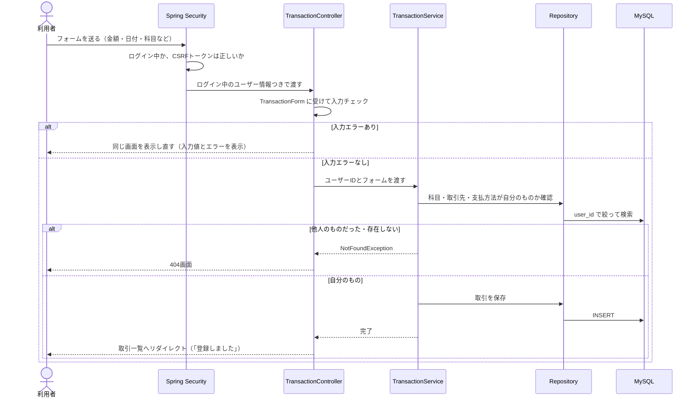

#### 例2：予実比較を開く（`GET /comparison?year=2026&season=spring`）

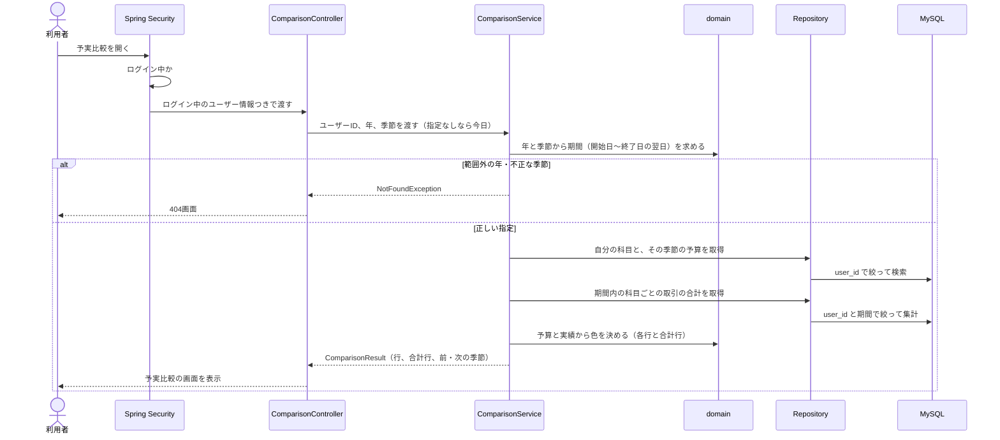

- 同じ道すじで、取引の更新・削除、科目などの追加・変更・削除、予算の保存も動く（POST はリダイレクトで戻る、GET は画面を返す）。

### 1.5 設定と秘密情報

- 設定ファイル（`application.properties`）は、リポジトリに入れる。ただし、**データベースのパスワードは書かず、環境変数から読む**。
- 接続先やユーザー名も、環境変数から読めるようにする（変えられる設定として）。環境変数の名前は次のとおり（Phase 2 で決めた）。値がないときは起動を失敗させる（既定値は付けない。設定漏れに気づけるため）。

| 用途 | 環境変数の名前 |
|---|---|
| DB の接続先 | `HB_DB_URL` |
| DB のユーザー名 | `HB_DB_USER` |
| DB のパスワード | `HB_DB_PASSWORD` |
- 環境変数は、各自のパソコンで設定する。READMEには「設定する環境変数の名前」だけを書き、値は書かない（Phase 9）。
- パスワードを含むファイルを作る場合は、`.gitignore` で除外する（Phase 2）。
- アプリ専用のDBユーザーを作り、このアプリのデータベースだけを操作できるようにする（Phase 2）。`root` はアプリから使わない。（Phase 0 で扱った `root` のパスワードは、リポジトリに書かない）

### 1.6 動かす環境

- 動かす場所は、自分のパソコンだけ（インターネットへの公開は要件9章で対象外）。
- 起動の流れ：MySQL のサービスが動いている状態で、`mvnw` からアプリを起動し、ブラウザで開く（Phase 2）。起動のたびに `schema.sql` が実行される（Q17、章3）。
- 日付の基準は日本時間（B6、`AppConfig`、4.5）。

---

## 2. 画面とURLの一覧

### 2.1 方針

- URL は英語の小文字とハイフン（B13）。取引・科目などの一覧は複数形（`/transactions`、`/categories`、`/vendors`、`/payment-methods`）。
- 画面を開く処理は **GET**、データを変える処理（登録・変更・削除・ログアウト）は **POST**。理由：HTML のフォームは GET と POST しか送れないため。また、POST にだけ CSRF 対策のトークンを付ける（章7）。
- 登録・変更の画面は、**表示（GET）と送信（POST）を同じ URL** にする（U1）。理由：入力エラーで同じ画面に戻るとき、URL が変わらず分かりやすいため。
- **入力エラーのとき**は、リダイレクトせずに同じ画面を表示し直す。入力した値を残し、エラーメッセージを項目の横に表示する（要件3章、章6）。
- **成功したとき**は、一覧などへ**リダイレクト**する（二重登録の防止）。画面の上に「登録しました」などの成功メッセージを1回だけ表示する。
- 他人のデータ、存在しないID、範囲外の年などを URL に入れたときは、**404**（B7）。専用の簡単なエラー画面（2.5）を表示する。他人のデータがあるかどうかは教えない。
- 取引の登録・変更では、科目・取引先・支払方法を**プルダウン**で選ぶ。並びは登録順（Q14）。
- 削除ボタンを押すと、**確認ダイアログ**（「削除しますか？」）を表示する。書き方は、削除ボタンのフォームの `onsubmit` 属性に固定の文言で書く（`return confirm('削除しますか？')`）。別の JavaScript のファイルは作らない（Phase 4 で決定。ファイルを増やさず、一番簡単なため。利用者の入力は埋め込まない、7.5）。取引（要件4.2）だけでなく、科目・取引先・支払方法の削除にも出す（B14）。

### 2.2 画面とURLの一覧

「ログイン」欄の ○ は、ログインが必要。× は、ログインしていなくても開ける。ログインしていない人が ○ の URL を開くと、ログイン画面へ移動する（要件6章）。

**ログイン・登録**

| 画面名 | URL | 方法 | ログイン | 説明 |
|---|---|---|---|---|
| トップ | `/` | GET | ○ | 取引一覧へ移動する（Q12） |
| ログイン | `/login` | GET | × | ログイン画面を表示する |
| ログイン処理 | `/login` | POST | × | ユーザー名とパスワードを確認する（Spring Security が処理）。成功したら取引一覧へ。失敗したらログイン画面に戻り、「ユーザー名またはパスワードが違います」と表示（B8） |
| ログアウト | `/logout` | POST | ○ | ログアウトして、ログイン画面へ移動する |
| アカウント登録 | `/register` | GET | × | 登録画面を表示する |
| アカウント登録処理 | `/register` | POST | × | ユーザーと初期データ（3.11）を作る。成功したらログイン画面へ（Q11） |

**取引**

| 画面名 | URL | 方法 | ログイン | 説明 |
|---|---|---|---|---|
| 取引一覧 | `/transactions` | GET | ○ | 自分の取引を、日付の新しい順（同じ日は登録の新しい順）で全件表示する（Q4・Q5） |
| 取引登録 | `/transactions/new` | GET | ○ | 登録フォームを表示する |
| 取引登録処理 | `/transactions/new` | POST | ○ | 入力チェックをして登録する |
| 取引詳細 | `/transactions/{id}` | GET | ○ | 1件の取引を表示する。編集・削除のボタンがある |
| 取引編集 | `/transactions/{id}/edit` | GET | ○ | 登録済みの値が入ったフォームを表示する |
| 取引編集処理 | `/transactions/{id}/edit` | POST | ○ | 入力チェックをして更新する |
| 取引削除処理 | `/transactions/{id}/delete` | POST | ○ | 取引を削除する（確認ダイアログあり） |

**科目・取引先・支払方法**（3つとも同じ形。Q13）

| 画面名 | URL | 方法 | ログイン | 説明 |
|---|---|---|---|---|
| 科目一覧 | `/categories` | GET | ○ | 自分の科目を登録順で表示する。上に追加フォームがある |
| 科目追加処理 | `/categories` | POST | ○ | 入力チェックをして追加する。同時に、今の季節の予算0円の行を作る（Q3、R11） |
| 科目変更 | `/categories/{id}/edit` | GET | ○ | 名前を変更するフォームを表示する |
| 科目変更処理 | `/categories/{id}/edit` | POST | ○ | 入力チェックをして名前を更新する |
| 科目削除処理 | `/categories/{id}/delete` | POST | ○ | 取引で使われておらず、すべての季節の予算が0円または未設定のときだけ削除する（確認ダイアログあり） |
| 取引先一覧・追加処理 | `/vendors` | GET / POST | ○ | 科目一覧・追加処理と同じ形 |
| 取引先変更・変更処理 | `/vendors/{id}/edit` | GET / POST | ○ | 科目変更・変更処理と同じ形 |
| 取引先削除処理 | `/vendors/{id}/delete` | POST | ○ | 使用中でないときだけ削除する（確認ダイアログあり） |
| 支払方法一覧・追加処理 | `/payment-methods` | GET / POST | ○ | 科目一覧・追加処理と同じ形 |
| 支払方法変更・変更処理 | `/payment-methods/{id}/edit` | GET / POST | ○ | 科目変更・変更処理と同じ形 |
| 支払方法削除処理 | `/payment-methods/{id}/delete` | POST | ○ | 使用中でないときだけ削除する（確認ダイアログあり） |

**予算・予実比較**

| 画面名 | URL | 方法 | ログイン | 説明 |
|---|---|---|---|---|
| 予算設定 | `/budgets`（例：`/budgets?year=2026&season=spring`） | GET | ○ | 指定した季節の、自分の全科目の予算額を、まとめて入力できる形で表示する。季節を指定しないときは今の季節（Q8、R11、2.4） |
| 予算設定処理 | `/budgets?year=…&season=…`（画面と同じ URL） | POST | ○ | 指定した季節の全科目の予算額を入力チェックして、まとめて保存する（Q27 の c） |
| 予実比較 | `/comparison`（例：`/comparison?year=2026&season=spring`） | GET | ○ | 季節ごとの科目別の予算・実績・差額を表示する。予算が未設定の科目は「未設定」（2.4） |

- 画面を表示するための CSS や画像（`/css/**` など）も、ログイン前から読めるようにする（章7）。
- 詳細は、取引にだけ作る。科目・取引先・支払方法には詳細画面を作らない（一覧で足りるため）。

### 2.3 画面ごとの表示項目と入力項目

入力項目の制限（文字数・範囲）は要件5章のとおり。チェックの方法は章6。

**共通（ヘッダー・メッセージ・表示の形）**

- ヘッダー（ログイン後の全画面）：メニュー（取引一覧、科目、取引先、支払方法、予算、予実比較）、ログイン中のユーザー名、ログアウトボタン。
- 成功メッセージ、エラーメッセージの表示場所を、画面の上部に決めておく。
- ログイン前の画面（ログイン、アカウント登録）には、メニューは出さない。
- **金額の表示の形**：3桁ごとにカンマで区切り、末尾に「円」を付ける。例：`30,000円`。マイナスは `-5,000円`（予実比較の差額など）。
- **日付の表示の形**：`2026/10/19`（年/月/日）。
- 表示の形にする方法は、Thymeleaf の標準の書き方（`#numbers.formatInteger(値, 1, 'COMMA')` と `#temporals.format(日付, 'yyyy/MM/dd')`）を、画面ごとに書く。整形のためのクラスは作らない（Phase 5、Q5-9 の A）。
- 上の表示の形は、**一覧・詳細・予実比較など、表示するときだけ**に使う。**入力欄には使わず、数字だけを入力する**（金額は `30000`、日付は日付入力の標準の形）。理由：カンマや「円」を入力させると、入力エラーが増えるため（B5：小数・カンマ・全角数字は入力エラー）。

**ログイン `/login`**

| 種類 | 項目 |
|---|---|
| 入力 | ユーザー名、パスワード |
| 表示 | 「アカウント登録」へのリンク。登録成功後は「登録しました。ログインしてください」、ログアウト後は「ログアウトしました」、失敗後は「ユーザー名またはパスワードが違います」 |

- 失敗してもユーザー名は残し、パスワードは残さない。

**アカウント登録 `/register`**

| 種類 | 項目 | 制限 |
|---|---|---|
| 入力 | ユーザー名 | 必須、半角英数字のみ、10文字以下、重複不可 |
| 入力 | パスワード | 半角の英数字と記号のみ（空白は不可）、8文字以上30文字以下 |
| 表示 | 「ログイン」へのリンク | |

- 入力エラーのときは、ユーザー名を残し、パスワードは残さない。理由：パスワードを画面に再表示しないため。

**取引一覧 `/transactions`**

| 種類 | 項目 |
|---|---|
| 表示 | 一覧の列：日付、科目、取引先、支払方法、摘要、金額。行ごとに「詳細」へのリンク |
| 表示 | 「取引を登録」ボタン（`/transactions/new` へ） |
| 表示 | 取引が0件のときは「取引はまだありません」 |

- 編集・削除のボタンは、一覧には置かない（U3）。

**取引登録 `/transactions/new`、取引編集 `/transactions/{id}/edit`**（同じ形）

| 種類 | 項目 | 制限 |
|---|---|---|
| 入力 | 日付 | 必須。**2000年1月1日から2100年12月31日まで**（R12）。登録画面では今日の日付を最初に入れておく（U7） |
| 入力 | 金額 | 必須。1円以上1,000,000円以下の整数 |
| 入力 | 科目 | 必須。プルダウン（自分の科目） |
| 入力 | 摘要 | 任意。30文字以下 |
| 入力 | 取引先 | 必須。プルダウン（自分の取引先） |
| 入力 | 支払方法 | 必須。プルダウン（自分の支払方法） |
| 表示 | 「戻る」リンク（取引一覧へ） | |

- 編集画面では、登録済みの値が入った状態で表示する。
- プルダウンが空のとき（B2）は、「先に科目を追加してください」のように、足りない種類を知らせてそのマスタの画面へのリンクを出す。**足りない種類が複数あるときは、すべて並べる。このとき、フォームと「登録」ボタンは出さない**（Phase 5、Q5-7 の A。足りないまま送っても、必ず入力エラーになるため）。空になるのは登録画面だけで、編集画面では、使用中の科目などは削除できないので空にならない。

**取引詳細 `/transactions/{id}`**

| 種類 | 項目 |
|---|---|
| 表示 | 日付、科目、取引先、支払方法、摘要（なければ空欄）、金額 |
| 操作 | 「編集」ボタン（編集画面へ）、「削除」ボタン（確認ダイアログ → 削除処理）、「一覧に戻る」リンク |

**科目一覧 `/categories`**（取引先 `/vendors`、支払方法 `/payment-methods` も同じ形）

| 種類 | 項目 | 制限 |
|---|---|---|
| 入力（上のフォーム） | 名前 | 必須。科目は10文字以下、取引先は20文字以下、支払方法は10文字以下。同じ人の中で重複不可 |
| 表示（一覧） | 名前（登録順）。行ごとに「変更」リンクと「削除」ボタン | |
| 表示 | 0件のときは「まだありません」 | |

- 削除ボタンは、使用中のものにも表示する。押したときに確認ダイアログの後、削除できない理由をメッセージで表示する（一覧に戻る）。理由：「使用中」「予算が0円ではない季節がある」を、画面のメッセージとして示すため（Phase 4 の完了条件）。
  - 科目：「取引で使われているため削除できません」「予算が0円ではない季節があるため削除できません」
  - 取引先・支払方法：「取引で使われているため削除できません」
- 入力エラー（空欄、文字数超過、重複）のときは、一覧を再表示し、フォームに入力値を残してエラーを表示する。

**科目変更 `/categories/{id}/edit`**（取引先・支払方法も同じ形）

| 種類 | 項目 | 制限 |
|---|---|---|
| 入力 | 名前（今の名前が入った状態） | 追加と同じ。ただし、自分自身の今の名前は重複とみなさない |
| 表示 | 「戻る」リンク（一覧へ） | |

**予算設定 `/budgets`**

| 種類 | 項目 | 制限 |
|---|---|---|
| 表示 | 見出し（年と季節、期間。例：「2026年 春（3月〜5月）」）、「前の季節」「次の季節」のリンク（2.4） | |
| 表示 | 科目名（登録順）。初期値が未設定の行には「（この季節は未設定）」の印（Q26） | |
| 入力 | 科目ごとの予算額（初期値は下の規則） | 必須。0円以上3,000,000円以下の整数。0円は可、マイナスは不可 |
| 操作 | 「保存」ボタン（その季節の全科目をまとめて保存） | |

- **季節の指定**：予実比較と同じく、URL に年と季節を持つ（`/budgets?year=2026&season=spring`）。季節を指定せずに開いたときは、今の季節を表示する。範囲は2000年春〜2100年冬で、端のリンクの扱いと404も予実比較と同じ（2.4）。
- **入力欄の最初の値**（Q23・Q24）：
  1. その季節の予算が保存されていれば、その額。
  2. なければ、表示している季節より前の季節のうち、その科目で予算が設定されている、いちばん近い季節の額。
  3. それもなければ、0円。
- **保存するまで行は作らない**。画面を開いて表示するだけでは、データベースに予算の行は増えない。「保存」を押すと、その季節の**全科目**の行を、表示どおりに作る・更新する（Q25）。初期値のまま変えなかった行も、その額で保存される。
- 1つでも入力エラーがあれば、**何も保存せず**、入力値を残して画面を表示し直す。理由：一部だけ保存されると分かりにくいため。
- 保存していない入力は、「前の季節」「次の季節」で移動したときに、確認なしで捨てられる（Q27 の d）。
- 科目が0件のときは、「先に科目を追加してください」と表示する。

**予実比較 `/comparison`**（2.4 で詳しく書く）

| 種類 | 項目 |
|---|---|
| 表示 | 見出し（年と季節、期間）、表（科目、予算、実績、差額。最下行に合計行）、「前の季節」「次の季節」のリンク |
| 表示 | 予算が未設定の科目は、予算の欄に「未設定」、差額は空欄、色なし（要件4.4、R11） |
| 表示 | 赤字・青字の色分け（要件4.4） |

### 2.4 季節の URL と切り替え（予実比較・予算設定に共通、Q7・B15・R11）

予実比較（`/comparison`）と予算設定（`/budgets`）は、**同じ決まり**で季節を指定する。以降の「画面」は、この2つを指す。

**URL の形**：`/comparison?year=2026&season=spring`、`/budgets?year=2026&season=spring`

| パラメータ | 値 | 意味 |
|---|---|---|
| `year` | 2000〜2100 の整数 | 季節の「年」。**冬は12月がある年**（例：`year=2026&season=winter` は2026年12月〜2027年2月） |
| `season` | `spring`（春）、`summer`（夏）、`autumn`（秋）、`winter`（冬） | 季節 |

- **パラメータなしで開いたとき**（メニューから開いたとき）は、**今日（日本時間）が属する季節**を、どちらの画面でも表示する。冬は12月を起点に年を判定する（要件4.4）。
- 見出しには年・季節・期間を書く。例：「2026年 春（3月〜5月）」「2026年 冬（2026年12月〜2027年2月）」。
- **切り替え**は、見出しの両脇の「前の季節」「次の季節」のリンクで行う。リンクの先は、年と季節を含む URL。

| 今の季節 | 前の季節 | 次の季節 |
|---|---|---|
| 春（Y年） | 冬（Y−1年） | 夏（Y年） |
| 夏（Y年） | 春（Y年） | 秋（Y年） |
| 秋（Y年） | 夏（Y年） | 冬（Y年） |
| 冬（Y年） | 秋（Y年） | 春（Y＋1年） |

- **表示できる範囲**は、**2000年春から2100年冬まで**。範囲の端では、範囲外へのリンクを出さない（B15）。
  - 2000年春では、「前の季節」を出さない。
  - 2100年冬では、「次の季節」を出さない。
- **404 になる場合**（B15）：`year` が2000〜2100以外、数字でない／`season` が上の4つ以外／`year` と `season` の**片方だけ**を指定した。
- 予実比較の表の中身：科目ごとに、予算、実績（その季節の取引の合計。なければ0円）、差額（予算 − 実績。超過するとマイナス）。最下行に合計行。色は、各行と合計行に同じルール（要件4.4）。金額の表示の形は 2.3 のとおり。
  - **その季節の予算が未設定の科目**：予算の欄は「未設定」、差額は空欄、色なし（R11）。実績は表示する。
  - **合計行**（Q22 の C）：合計の予算は**予算が設定されている科目の予算の合計**、合計の実績は**すべての科目の実績の合計**、差額はその差（合計の予算 − 合計の実績）。色は①〜④の順番（5.9）。**すべての科目が未設定のときだけ**、合計行も予算「未設定」・差額は空欄・色なし。
- 未来の季節も表示できる（実績は0円になる）。
- 取引の日付は 2000年1月1日から2100年12月31日までしか入力できない（6.6、R12）。**2000年1月・2月の取引は1999年の冬に入るため、予実比較には出ない**（1999年の冬は表示範囲の外）。
- 今の季節が範囲外（2101年以降）になる場合は考えない。取引の日付は2100年12月31日までしか入力できないので、2101年以降の取引はそもそも登録できない。アプリを2101年以降に使うときは、この範囲を見直す。
- 予算は季節ごとに持つので、過去の季節は、その季節に設定した予算で比べる。設定していない季節は「未設定」になる（R11）。

### 2.5 エラー画面（404）

- 次のとき、404 の専用画面（B7）を表示する：存在しないURL、存在しないID、他人のデータのID、予実比較・予算設定の範囲外の年・不正な季節。
- 表示：「ページが見つかりません」と、取引一覧へ戻るリンク。ログイン前でも表示できるようにする。
- 404 以外のエラー画面（予期しないエラーなど）は、章7で扱いを決める。

### 2.6 操作のあと、どの画面に戻るか

| 操作 | 成功したとき | 失敗したとき |
|---|---|---|
| アカウント登録 | ログイン画面へ。「登録しました。ログインしてください」（Q11） | 登録画面を表示し直す（ユーザー名を残す） |
| ログイン | 取引一覧へ（Q12、U5） | ログイン画面へ。「ユーザー名またはパスワードが違います」 |
| ログアウト | ログイン画面へ。「ログアウトしました」 | — |
| 取引の登録 | 取引一覧へ。「登録しました」 | 登録画面を表示し直す（入力値を残す） |
| 取引の更新 | 取引一覧へ。「更新しました」（U2） | 編集画面を表示し直す（入力値を残す） |
| 取引の削除 | 取引一覧へ。「削除しました」 | 存在しない・他人の取引は404 |
| 科目・取引先・支払方法の追加 | それぞれの一覧へ。「追加しました」 | 一覧を表示し直す（入力値を残す） |
| 〃 変更 | それぞれの一覧へ。「変更しました」 | 変更画面を表示し直す（入力値を残す） |
| 〃 削除 | それぞれの一覧へ。「削除しました」 | 削除できない理由を表示して、一覧へ（2.3） |
| 予算の保存 | 同じ季節の予算設定画面へ。「保存しました」（U4） | 予算設定画面を表示し直す（入力値を残す。何も保存しない） |
| 予実比較の切り替え | （画面を開くだけ） | 範囲外・不正な指定は404 |

### 2.7 要件3章の機能と、画面・URLの対応

| 要件3章の機能 | 実現する画面・URL |
|---|---|
| ログイン機能（4.1：アカウント登録、ログイン、ログアウト、ユーザーごとのデータ分離） | `/register`（GET・POST）、`/login`（GET・POST）、`/logout`（POST）。データ分離は全画面で `user_id` で絞る（3.9） |
| 取引の一覧表示 | `/transactions`（GET） |
| 取引の登録 | `/transactions/new`（GET・POST） |
| 取引の詳細表示 | `/transactions/{id}`（GET） |
| 取引の編集 | `/transactions/{id}/edit`（GET・POST） |
| 取引の削除（確認ダイアログあり） | `/transactions/{id}/delete`（POST）。ボタンは詳細画面 |
| 入力チェック（必須・文字数・金額の範囲、入力値の保持） | 入力のあるすべての画面（2.3）。方法は章6 |
| 科目の追加・変更・削除 | `/categories`（GET・POST）、`/categories/{id}/edit`（GET・POST）、`/categories/{id}/delete`（POST） |
| 取引先の追加・変更・削除 | `/vendors`、`/vendors/{id}/edit`、`/vendors/{id}/delete` |
| 支払方法の追加・変更・削除 | `/payment-methods`、`/payment-methods/{id}/edit`、`/payment-methods/{id}/delete` |
| 予算の設定（季節ごと） | `/budgets`（GET・POST）。`year` と `season` で季節を指定 |
| 予実比較（季節ごと、色分け、合計行） | `/comparison`（GET）。`year` と `season` で季節を指定 |
| 初期データ（4.3）、ログインしていない人は開けない（6章） | `/register` の処理で作成（3.11）。ログイン前に開けるのは `/login`、`/register`、CSS などと404画面だけ |

### 2.8 追加で決めた点（確定）

要件にもそれまでの決定にもなかった点を、確認のうえで決めたものです。

| 番号 | 決めたこと | 理由 |
|---|---|---|
| U1 | 登録・編集の送信先は、表示と同じ URL にする（`/transactions/new`、`/transactions/{id}/edit` へ POST） | 入力エラーのとき URL が変わらない |
| U2 | 取引の更新が成功したら、詳細ではなく取引一覧へ戻る | 実行計画書の Phase 5 のとおり |
| U3 | 取引の「編集」「削除」ボタンは詳細画面にだけ置き、一覧には「詳細」リンクだけ置く | 一覧を簡単にし、誤って削除するのを防ぐ |
| U4 | 予算を保存したら、同じ季節の予算設定画面に戻り「保存しました」を表示する | 続けて直しやすい |
| U5 | ログイン成功後は、開こうとしていたURLに関係なく、いつも取引一覧へ移動する | 簡単で、Q12 と合う |
| U6 | ログイン済みの人が `/login`・`/register` を開いたときの特別な動きは作らない（そのまま表示する） | 要件にないため |
| U7 | 取引登録画面の日付の初期値を、今日にする | 入力の手間を減らす |

---

## 3. テーブル設計

### 3.1 方針

- テーブルは **6つ**：`users`（利用者）、`categories`（科目）、`vendors`（取引先）、`payment_methods`（支払方法）、`budgets`（予算）、`transactions`（取引）。
- 予算は科目の列にせず、**別テーブル（`budgets`）にする**。理由：予算を季節ごとに持つ（科目・年・季節ごとに1つ、R11）ため、科目の列では表せないため。
- 季節（春・夏・秋・冬）はテーブルにせず、プログラムの中で月から求める（Phase 7）。理由：4つで変わらず、月との対応が決まっているため。
- データベースは MySQL（InnoDB、文字コード `utf8mb4`）。理由：要件で指定されており、日本語を保存できるため。
- 照合順序は、すべてのテーブルで `utf8mb4_0900_as_ci`（3.12）。
- 主キー（`id`）は、すべて `BIGINT` の自動採番（`AUTO_INCREMENT`）。理由：件数の上限を気にしなくてよく、全テーブルで同じ形にできるため。
- 並び順の「登録順」は **`id` の順**とする。作成日時の列を持たないため。自動採番の `id` は登録順に増える。これが、取引一覧の「同じ日は登録の新しい順」（Q4）と、科目・取引先・支払方法の「登録順」（Q14）の根拠になる。
- 金額は円単位の整数で、`INT`。理由：円に小数がなく、最大でも300万円で収まるため。季節ごとの合計は `INT` を超えることがあるので、プログラム側では `Long` で扱う（章5）。
- 作成日時・更新日時の列は持たない（B4）。
- 名前の文字数は、`VARCHAR(n)` の `n` 文字として数える。全角も半角も1文字。
- テーブル作成は `schema.sql` に `CREATE TABLE IF NOT EXISTS` で書く。`DROP TABLE` は入れない（Phase 2）。
- テーブル名・列名の英語名は **確定**（3.8）。

### 3.2 `users`（利用者）

| 列名 | 型 | NULL | 制約 | 説明 |
|---|---|---|---|---|
| `id` | BIGINT | 不可 | 主キー、自動採番 | 利用者ID |
| `username` | VARCHAR(10) | 不可 | **一意（UNIQUE）** | ユーザー名。半角英数字のみ・10文字以下（要件5章）。大文字・小文字は区別しない（3.12 参照） |
| `password_hash` | VARCHAR(100) | 不可 | | BCrypt でハッシュ化したパスワード。元のパスワードは保存しない。100桁にしているのは、ハッシュの前に付く方式名の分の余裕のため |

- パスワードの文字数チェック（8〜30文字）は、ハッシュ化する前に画面の入力で行う。ハッシュは長さが変わるため、この列では確認しない。
- 半角英数字のみという制限は、プログラムの入力チェックで行う（章6）。DBでは制限しない。

### 3.3 `categories`（科目）

| 列名 | 型 | NULL | 制約 | 説明 |
|---|---|---|---|---|
| `id` | BIGINT | 不可 | 主キー、自動採番 | 科目ID |
| `user_id` | BIGINT | 不可 | 外部キー → `users.id` | 持ち主 |
| `name` | VARCHAR(10) | 不可 | `(user_id, name)` で**一意** | 科目名。10文字以下 |

### 3.4 `vendors`（取引先）

| 列名 | 型 | NULL | 制約 | 説明 |
|---|---|---|---|---|
| `id` | BIGINT | 不可 | 主キー、自動採番 | 取引先ID |
| `user_id` | BIGINT | 不可 | 外部キー → `users.id` | 持ち主 |
| `name` | VARCHAR(20) | 不可 | `(user_id, name)` で**一意** | 取引先名。20文字以下 |

### 3.5 `payment_methods`（支払方法）

| 列名 | 型 | NULL | 制約 | 説明 |
|---|---|---|---|---|
| `id` | BIGINT | 不可 | 主キー、自動採番 | 支払方法ID |
| `user_id` | BIGINT | 不可 | 外部キー → `users.id` | 持ち主 |
| `name` | VARCHAR(10) | 不可 | `(user_id, name)` で**一意** | 支払方法名。10文字以下 |

### 3.6 `budgets`（予算）と `transactions`（取引）

**`budgets`**

| 列名 | 型 | NULL | 制約 | 説明 |
|---|---|---|---|---|
| `id` | BIGINT | 不可 | 主キー、自動採番 | 予算ID |
| `user_id` | BIGINT | 不可 | 外部キー → `users.id` | 持ち主 |
| `category_id` | BIGINT | 不可 | 外部キー → `categories.id` | 科目 |
| `season_year` | INT | 不可 | 2000以上2100以下（CHECK） | 季節の年。**冬は12月がある年**（2.4、5.8）。範囲は予実比較・予算設定の表示範囲（2000年春〜2100年冬）と同じ |
| `season` | VARCHAR(6) | 不可 | `SPRING`、`SUMMER`、`AUTUMN`、`WINTER` のいずれか（CHECK） | 季節。プログラムの `Season` の名前を文字で保存する（Q27 の a） |
| `amount` | INT | 不可 | 0以上3,000,000以下（CHECK） | その季節の予算額。0円も可 |

- **予算は「科目・年・季節」ごとに1つ**。`(category_id, season_year, season)` を**一意**にする（要件4.3、R11）。
- 予算の行は、**今の季節の分だけ**を科目と一緒に作る（初期の科目は30,000円、追加した科目は0円）。ほかの季節の行は、予算設定画面で保存したときに作る。したがって、**行がない季節は「未設定」**になる（予実比較は「未設定」と表示、2.4）。
- 「未設定」と「0円」は別である。0円は設定済みで、実績があれば赤になる。未設定は色なし（5.9）。
- 検索を速くする索引（インデックス）：`(user_id, season_year, season)`。予算設定と予実比較は、どちらも「自分の、ある季節の予算」を探すため。

**`transactions`**

| 列名 | 型 | NULL | 制約 | 説明 |
|---|---|---|---|---|
| `id` | BIGINT | 不可 | 主キー、自動採番 | 取引ID |
| `user_id` | BIGINT | 不可 | 外部キー → `users.id` | 持ち主 |
| `transaction_date` | DATE | 不可 | 2000-01-01以上2100-12-31以下（CHECK） | 取引の日付。2000年1月1日から2100年12月31日まで（章6の入力チェックに加えて、DB の CHECK 制約でも守る、R12） |
| `amount` | INT | 不可 | 1以上1,000,000以下（CHECK） | 金額 |
| `category_id` | BIGINT | 不可 | 外部キー → `categories.id` | 科目 |
| `description` | VARCHAR(30) | **可** | | 摘要。30文字以下。**入力が任意なのは摘要のみ**（要件4.2） |
| `vendor_id` | BIGINT | 不可 | 外部キー → `vendors.id` | 取引先 |
| `payment_method_id` | BIGINT | 不可 | 外部キー → `payment_methods.id` | 支払方法 |

- 日付の列名を `date` にしないのは、MySQL の予約語に近く紛らわしいため。
- 摘要が空欄のときは、空文字ではなく NULL で保存する。
- 検索を速くする索引（インデックス）：`(user_id, transaction_date)`。一覧と予実比較の集計は、どちらも「自分の取引を日付で絞る」ため。
- 金額・予算額の範囲と、取引の日付の範囲は、画面での入力チェック（章6）に加えて、DB の CHECK 制約でも守る。理由：入力チェックをすり抜けても、おかしな値を保存させないため。

### 3.7 外部キーと、削除したときの動き

| 外部キー | 削除したときの動き | 理由 |
|---|---|---|
| `categories.user_id` / `vendors.user_id` / `payment_methods.user_id` / `budgets.user_id` / `transactions.user_id` → `users` | 拒否（RESTRICT） | 利用者を削除する機能は要件にないため、DBが拒否すれば十分 |
| `transactions.category_id` → `categories` | 拒否（RESTRICT） | 取引で使用中の科目は削除できない（要件4.3）。DBでも守る |
| `transactions.vendor_id` → `vendors` | 拒否（RESTRICT） | 同上（取引先） |
| `transactions.payment_method_id` → `payment_methods` | 拒否（RESTRICT） | 同上（支払方法） |
| `budgets.category_id` → `categories` | 拒否（RESTRICT） | すべての季節の予算が0円（または未設定）の科目だけ削除できる。削除するときは、プログラムが**先にその科目の予算の行をすべて削除し、続けて科目を削除する**（同じトランザクション、章5）。理由：0円でない予算がある科目を、DBが黙って消す事故を防ぐため |

- **取引の削除**：行そのものをDBから消す（物理削除、Q2）。他のテーブルが取引を参照していないので、制約なし。
- **科目・取引先・支払方法の削除**：行をDBから消す（Q1）。削除できる条件（使用中でない、すべての季節の予算が0円または未設定）はプログラムで先に確認し、メッセージを表示する（章5・6）。外部キーは、確認をすり抜けた場合の最後の守りとして働く。
- **予算の削除**：科目の削除と同時のみ（その科目の予算の行をすべて消す）。予算だけを消す機能はない。予算設定画面で保存した行は、後から「未設定」には戻せない（0円にする）。

### 3.8 テーブル名・列名の英語名（確定）

| 日本語 | テーブル名 | 主な列名 | 補足 |
|---|---|---|---|
| 利用者 | `users` | `username`、`password_hash` | `password` ではなく `password_hash` にして、ハッシュであると分かるようにした |
| 科目 | `categories` | `name` | |
| 取引先 | `vendors` | `name` | ほかの案：`partners`、`payees`。「お金の支払先」を指す一般的な語として `vendors` にした |
| 支払方法 | `payment_methods` | `name` | |
| 予算 | `budgets` | `amount`、`category_id`、`season_year`、`season` | `season_year` は季節の年（冬は12月がある年）、`season` は `Season` の名前（`SPRING` など） |
| 取引 | `transactions` | `transaction_date`、`amount`、`description`、`category_id`、`vendor_id`、`payment_method_id` | `description` は摘要。`date` を避けて `transaction_date` にした |

規則：英語の小文字とアンダースコア（`snake_case`）。テーブル名は複数形。外部キーの列は「相手の単数形 + `_id`」。

### 3.9 `user_id` によるデータの分け方

要件4.1：他のユーザーのデータは、見ることも変更することもできない。

- `users` 以外の5つのテーブルは、すべて `user_id` を持つ。`NOT NULL` で `users` への外部キーを付け、持ち主のいないデータを作れないようにする。
- **ログイン中のユーザーのIDは、ログインの情報（セッション）から取り出す。画面から送られてきた値は使わない。** 画面の値を使うと、書き換えられて他人のIDにされるため。
- 検索・更新・削除は、必ず **「ID と `user_id` の両方」** で絞る。例：取引の詳細は「取引ID が○○で、かつ `user_id` が自分」。見つからなければ404（B7）。他人のデータがあるかどうかを教えないため。
- 一覧・集計（取引一覧、予算設定、予実比較）も、`user_id` で絞る。
- 取引・予算の登録や更新のとき、画面から送られた科目・取引先・支払方法のIDが**自分のものか**を、Serviceで確認する（章5）。他人のIDを混ぜて送られても保存しない。
- `(科目ID, user_id)` の組み合わせをDBの外部キーにして、他人の科目をDBでも拒否する案もあるが、**採用しない**。理由：Spring Data JPA での扱いが複雑になり、入門者には負担が大きいため。代わりに Service での確認と、Phase 8 の2ユーザーでのテストで守る。

### 3.10 ER図

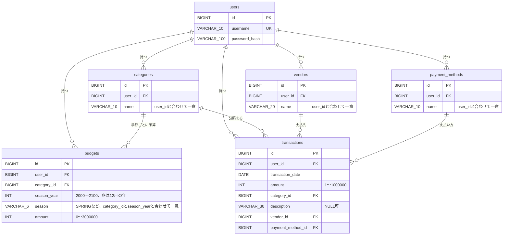

### 3.11 新しいユーザーの初期データ

アカウントを登録したとき、次のデータを**ユーザーの作成と同じトランザクション**で作る（要件4.3）。途中で失敗したら、ユーザーも含めてすべて取り消す。

| 種類 | 内容 |
|---|---|
| 科目と予算 | 交通費・食費・雑費。予算は、**登録した日の季節の分**だけを、それぞれ 30,000円で作る（ほかの季節は未設定） |
| 取引先 | コンビニ、ガソリンスタンド、Amazon |
| 支払方法 | 現金、クレジットカード |

- 上の順番で作る。一覧とプルダウンは登録順（`id` の順）に並ぶため、この順で表示される（Q14）。
- 取引は作らない。
- 初期データは、ユーザーごとに別々の行として作る（他のユーザーと共有しない）。

### 3.12 照合順序（確定。Phase 2 で試して決めた）

**照合順序**とは、文字列を比べるときの決まりです。同じ名前かどうかの判定（`UNIQUE` 制約）や、検索に使われます。MySQL の標準（`utf8mb4_0900_ai_ci`）は、「濁点の有無」まで同じとみなすため、日本語の科目名などで、別の名前なのに「すでにあります」となる（誤動作する）おそれがありました。

**決定**：データベース全体の照合順序を **`utf8mb4_0900_as_ci`** にする。`schema.sql` では、**各テーブルに `COLLATE utf8mb4_0900_as_ci` を明記する**（データベースの既定に頼らない）。

| 項目 | 内容 |
|---|---|
| 選んだ照合順序 | `utf8mb4_0900_as_ci`（データベース全体、すべてのテーブルで同じ） |
| 同じとみなす | 大文字と小文字（`A` と `a`）、ひらがなとカタカナ（`ひ` と `ヒ`）、全角と半角（`ｱ` と `ア`、`コンビニ` と `ｺﾝﾋﾞﾆ`） |
| 別の名前とする | 濁点の有無（`カ` と `ガ`） |
| `username` | 大文字・小文字を同じとみなす（Q10）を満たす |
| 科目・取引先・支払方法の名前 | 打ち方（かな・全角半角）が違うだけの同じ名前の重複を防ぎ、濁点の違う別の名前（例：`カ` と `ガ`）は別として登録できる |

**理由（1行ずつ）**
- 標準の `utf8mb4_0900_ai_ci` は、`カ` と `ガ` を同じとみなすため使えない。
- `utf8mb4_0900_as_ci` は、濁点の違いは別の名前とし、Q10（ユーザー名の大文字・小文字を区別しない）を満たし、打ち方だけが違う同じ名前の重複も防げる。
- 1つの照合順序にそろえられるので、列ごとに照合順序を変える設計（案2）より簡単で、アプリでの追加の判定（案3）も要らない。
- `utf8mb4_ja_0900_as_cs` は `ｱ` と `ア` を同じとみなすのに `コンビニ` と `ｺﾝﾋﾞﾆ` は別とみなし、結果がそろわないため使わない。
- `utf8mb4_0900_as_cs`、`utf8mb4_ja_0900_as_cs_ks`、`utf8mb4_bin` は、`A` と `a` を別とみなす（Q10 を満たさない）ため使わない。

**実験の結果**（2026-10-27、MySQL 9.7.2。アプリ用ユーザーで `'A' = 'a' COLLATE 照合順序` のように比べた。1＝同じとみなされる（`UNIQUE` なら重複エラー）、0＝別の名前）

| 照合順序 | `A` と `a` | `カ` と `ガ` | `ひ` と `ヒ` | `ｱ` と `ア` | `コンビニ` と `ｺﾝﾋﾞﾆ` |
|---|---|---|---|---|---|
| `utf8mb4_0900_ai_ci`（MySQL の標準） | 1 | 1 | 1 | 1 | 1 |
| **`utf8mb4_0900_as_ci`（選んだ）** | 1 | 0 | 1 | 1 | 1 |
| `utf8mb4_0900_as_cs` | 0 | 0 | 0 | 0 | 0 |
| `utf8mb4_ja_0900_as_cs` | 0 | 0 | 1 | 1 | 0 |
| `utf8mb4_ja_0900_as_cs_ks` | 0 | 0 | 0 | 1 | 0 |
| `utf8mb4_bin` | 0 | 0 | 0 | 0 | 0 |

- 文字が正しく届いていることは、`HEX('カ')` が `E382AB`、`HEX('ｱ')` が `EFBDB1` であることで確かめた。
- 当初の候補（案1：標準のまま、案2：名前の列だけ区別する、案3：アプリで判定）のどれでもなく、**データベース全体を標準以外の1つの照合順序にそろえる**案になった。

---

## 4. パッケージとクラスの構成

### 4.1 方針

- ベースパッケージは `io.github.yutaro081.householdbudget`（Q19）。以降のパッケージ名は、この下の名前だけを書く。
- 層の分け方は **Controller → Service → Repository** の3層（章1で詳しく書く）。
  - **Controller**：URL を受け取り、入力を Form で受け、Service を呼び、画面（テンプレート）を選ぶ。データベースには直接触らない。
  - **Service**：処理の中身（入力以外のチェック、持ち主の確認、トランザクション）を行う。
  - **Repository**：データベースの読み書きだけを行う。
- **持ち主の確認**（3.9）：Controller は、ログイン中のユーザーのID（`LoginUser` から取り出す）を、Service のメソッドに**必ず渡す**。Service と Repository のメソッドは、すべて `user_id` を受け取って絞る。画面から送られたユーザーIDは使わない。
- **Entity は 1テーブル 1クラス**（6つ）。入力は Form、画面専用の表示データは DTO で受け渡し、Entity をそのまま入力の受け皿にしない（書き換えさせたくない `user_id` などを守るため）。
- 要件にないクラスは作らない（4.8）。要件にはないが作るもの（P1〜P8）は、理由とともに 4.9 にまとめた。

### 4.2 パッケージの一覧

| パッケージ | 役割 | 主な置き場所 |
|---|---|---|
| （ベース直下） | アプリの起動クラス | `HouseholdBudgetApplication` |
| `controller` | URL を受け取り、画面を選ぶ | 4.4 |
| `service` | 処理の中身（登録・変更・削除・集計） | 4.5 |
| `repository` | データベースの読み書き | 4.6 |
| `entity` | テーブルに対応するクラス | 4.6 |
| `form` | 画面の入力を受け取るクラス（入力チェックの印を付ける） | 4.7 |
| `dto` | 画面に表示するためのデータ（予実比較など） | 4.7 |
| `security` | ログイン・ログアウト・パスワードのハッシュ化・アクセス制限 | 4.5 |
| `exception` | 「見つからない」「重複」などの例外と、404 画面への変換 | 4.5 |
| `domain` | 季節と色の判定など、画面にもデータベースにも依存しない計算（P1） | 4.5 |
| `config` | アプリ全体の設定（日本時間の「今日」）（P2） | 4.5 |

- `domain` を分ける理由：季節の決定と色の判定は、Phase 7 で単体テストを先に書く対象で、Spring に依存しない純粋な Java にするとテストしやすいため。
- `config` を分ける理由：日本時間（B6）の「今日」を1か所で決め、テストで日付を固定できるようにするため。

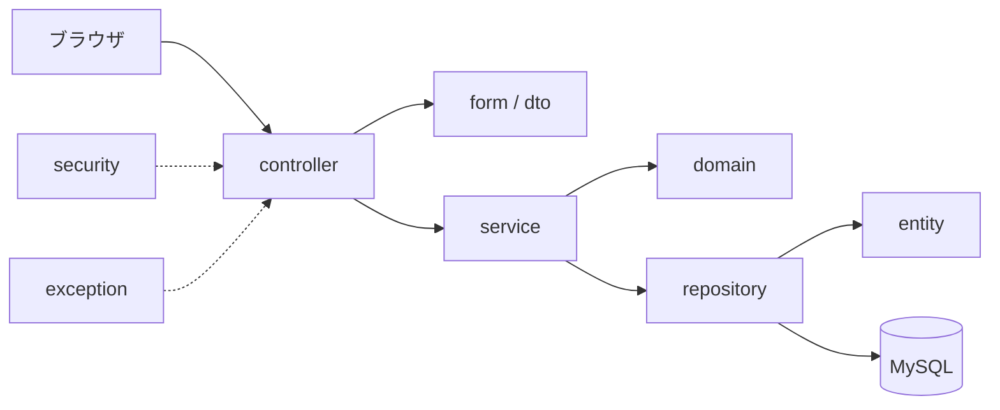

### 4.3 リソース（`src/main/resources`）の置き場所

| 場所 | 内容 |
|---|---|
| `application.properties` | 設定。DB のパスワードは環境変数から読む（Phase 2） |
| `schema.sql` | テーブル作成の SQL（`CREATE TABLE IF NOT EXISTS`、Q17、章3） |
| `messages.properties` | エラーメッセージ・画面の文言（章6） |
| `templates/` | 画面のファイル（Thymeleaf）。4.4.2 に一覧 |
| `static/css/style.css` | 画面の見た目（CSS）。ログイン前から読める（章2） |

### 4.4 controller と、画面（テンプレート）

#### 4.4.1 Controller と受け持つ URL

| クラス | 役割 | 受け持つ URL（章2） |
|---|---|---|
| `HomeController` | トップを取引一覧へ移動する | `GET /` |
| `AuthController` | ログイン画面と、アカウント登録の画面・処理 | `GET /login`、`GET /register`、`POST /register` |
| `TransactionController` | 取引の一覧・登録・詳細・編集・削除 | `/transactions`、`/transactions/new`（GET・POST）、`/transactions/{id}`、`/transactions/{id}/edit`（GET・POST）、`/transactions/{id}/delete`（POST） |
| `CategoryController` | 科目の一覧・追加・変更・削除 | `/categories`（GET・POST）、`/categories/{id}/edit`（GET・POST）、`/categories/{id}/delete`（POST） |
| `VendorController` | 取引先の一覧・追加・変更・削除 | `/vendors`（GET・POST）、`/vendors/{id}/edit`（GET・POST）、`/vendors/{id}/delete`（POST） |
| `PaymentMethodController` | 支払方法の一覧・追加・変更・削除 | `/payment-methods`（GET・POST）、`/payment-methods/{id}/edit`（GET・POST）、`/payment-methods/{id}/delete`（POST） |
| `BudgetController` | 予算設定の表示と保存 | `/budgets`（GET・POST） |
| `ComparisonController` | 予実比較の表示 | `/comparison`（GET） |

- `POST /login` と `POST /logout` は、Controller を作らず **Spring Security** が処理する（`security`、4.5）。
- 科目・取引先・支払方法の Controller は、形が同じだが**3つに分ける**。理由：文字数の制限や削除の条件が違い、入門者には3つの独立した同じ形のほうが読みやすいため。

#### 4.4.2 テンプレート（`templates/`）の一覧

| ファイル | 画面（章2） | 使う Controller |
|---|---|---|
| `fragments/common.html` | 共通部品：ヘッダー（メニュー、ユーザー名、ログアウト）、成功・エラーメッセージの表示場所 | 全画面 |
| `login.html` | ログイン | `AuthController` |
| `register.html` | アカウント登録 | `AuthController` |
| `transactions/list.html` | 取引一覧 | `TransactionController` |
| `transactions/form.html` | 取引の登録・編集（共用） | `TransactionController` |
| `transactions/detail.html` | 取引詳細 | `TransactionController` |
| `categories/list.html` | 科目一覧（追加フォームを含む） | `CategoryController` |
| `categories/edit.html` | 科目変更 | `CategoryController` |
| `vendors/list.html`、`vendors/edit.html` | 取引先の一覧・変更 | `VendorController` |
| `payment-methods/list.html`、`payment-methods/edit.html` | 支払方法の一覧・変更 | `PaymentMethodController` |
| `budgets/form.html` | 予算設定 | `BudgetController` |
| `comparison/index.html` | 予実比較 | `ComparisonController` |
| `error/404.html` | 404 画面（B7、章2） | Spring Boot が 404 のときに自動で使う。`GlobalExceptionHandler` からも使う |
| `error/403.html` | 403 画面（CSRF のトークン不正など、7.7、S3） | Spring Boot が 403 のときに自動で使う |
| `error/4xx.html` | 400 番台のその他のエラー画面（400、405 など。404・403 を除く、7.7、S9） | Spring Boot が 400 番台で、404・403 の専用画面がないときに自動で使う |
| `error/5xx.html` | 500 番台の予期しないエラー画面（7.7、S3、S9） | Spring Boot が 500 番台のときに自動で使う |

- 共通部品は Thymeleaf の「フラグメント」（部品の読み込み）で共有する（P5）。理由：追加のライブラリが要らず、標準の機能だけで済むため。
- 取引の登録と編集は、入力項目が同じなので `form.html` を共用する（章2 の U1：同じ URL に GET・POST）。
- 科目・取引先・支払方法には、詳細画面を作らない（章2）。

### 4.5 service、security、exception、domain、config

#### service

| クラス | 役割（1行） | 主に扱うテーブル |
|---|---|---|
| `RegistrationService` | アカウント登録。ユーザー名の重複確認、パスワードのハッシュ化、ユーザーと初期データ（3.11）を**同じトランザクション**で作る | `users`、`categories`、`budgets`、`vendors`、`payment_methods` |
| `CategoryService` | 科目の一覧・追加・変更・削除。追加時に、**今の季節**の予算0円の行を作る（Q3、R11）。削除は「取引で使用中でない」「すべての季節の予算が0円または未設定」を確認し、その科目の予算の行をすべて先に消してから科目を消す（3.7） | `categories`、`budgets` |
| `VendorService` | 取引先の一覧・追加・変更・削除（使用中は削除不可） | `vendors` |
| `PaymentMethodService` | 支払方法の一覧・追加・変更・削除（使用中は削除不可） | `payment_methods` |
| `BudgetService` | 指定した季節の、自分の全科目の予算の取得（保存済みの額がなければ、直前の設定のある季節の額、それもなければ0円を初期値にする、Q23・Q24）と、その季節の全科目のまとめての保存（作る・更新する、Q25） | `budgets`、`categories` |
| `TransactionService` | 取引の一覧・詳細・登録・更新・削除。登録・更新のとき、選んだ科目・取引先・支払方法が**自分のものか**を確認する（3.9） | `transactions` |
| `ComparisonService` | 季節の期間の取引を科目ごとに集計し、予算（未設定なら「未設定」）・実績・差額（未設定なら空欄）・色・合計行を作る（`ComparisonResult` を返す、5.9） | `categories`、`budgets`、`transactions` |

- 各 Service には、更新を行うメソッドに **トランザクション**（途中で失敗したら全部取り消す）を付ける。
- 名前の重複や「削除できない」は、Service が下の例外を投げ、Controller がメッセージに変える。

#### security

| クラス | 役割（1行） |
|---|---|
| `SecurityConfig` | ログイン必須、`/login`・`/register`・CSS 以外は未ログインで開けない、CSRF 対策、BCrypt のパスワード変換、ログイン成功後は取引一覧、`POST /logout` の設定 |
| `CustomUserDetailsService` | ログイン時に、ユーザー名から `users` を探して Spring Security に渡す |
| `LoginUser` | ログイン中のユーザーの情報（ユーザーID、ユーザー名）を持つ。Controller は、ここからユーザーIDを取り出す（P3。理由：毎回データベースを引かずに、安全にユーザーIDを取り出せるため） |

#### exception

| クラス | 役割（1行） |
|---|---|
| `NotFoundException` | 存在しない、または他人のデータ。404 にする（B7） |
| `DuplicateException` | ユーザー名、または科目・取引先・支払方法の名前が重複。入力エラーとして画面に戻す（Q9・Q10） |
| `DeletionNotAllowedException` | 使用中、またはいずれかの季節に0円でない予算があるため削除できない（要件4.3）。理由のメッセージを持つ |
| `GlobalExceptionHandler`（Phase 4 で作成） | `NotFoundException` と、ID が数字でない URL（例：`/transactions/abc`）を `error/404.html` に変換する。**状態コードも 404 にする**（B7、7.7、S4） |

#### domain

| クラス | 役割（1行） |
|---|---|
| `Season` | 春・夏・秋・冬と月の対応、URL で使う名前（`spring` など） |
| `SeasonPeriod` | 年と季節の組み合わせ。今日の日付から季節と年を決める（冬は12月起点）、期間の開始日と終了日の翌日、前の季節・次の季節、2000年春〜2100年冬の範囲の判定（Q7・B15）。**予実比較と予算設定の両方**で使う。アカウント登録と科目の追加で「今の季節」を求めるのにも使う（R11） |
| `BudgetColor` | 色の種類：赤・青・色なし |
| `BudgetColorJudge` | 予算と実績から色を決める。**予算が未設定なら、色なし**。設定されていれば、次の**順番**で判定する（要件4.4）。①実績 ＞ 予算なら赤（予算が0円でも、実績があれば赤）。②予算が0円なら色なし（実績も0円のとき）。③実績 × 3 ≦ 予算なら青（ちょうど1/3も青）。④それ以外は色なし。合計行にも同じ順番で使う（Q21、Q22） |

#### config

| クラス | 役割（1行） |
|---|---|
| `AppConfig` | 日本時間の「今日」を返す部品（`Clock`）を用意する（B6） |

### 4.6 entity と repository

#### テーブルとの対応

| テーブル（章3） | Entity | Repository | 主な検索（すべて `user_id` で絞る） |
|---|---|---|---|
| `users` | `User` | `UserRepository` | ユーザー名で1件（ログインと重複確認） |
| `categories` | `Category` | `CategoryRepository` | 自分の科目を `id` 順で全件、ID＋`user_id` で1件、同じ名前があるか |
| `vendors` | `Vendor` | `VendorRepository` | 同上（取引先） |
| `payment_methods` | `PaymentMethod` | `PaymentMethodRepository` | 同上（支払方法） |
| `budgets` | `Budget` | `BudgetRepository` | 指定した季節の自分の予算を全件、科目ごとの、表示季節より前で設定のある最も近い季節の予算（初期値用）、科目に0円でない予算がある季節があるか、科目の予算をすべて削除、科目・年・季節で1件（保存の作成・更新用） |
| `transactions` | `Transaction` | `TransactionRepository` | 自分の取引を日付の新しい順（同じ日は `id` の新しい順）で全件、ID＋`user_id` で1件、科目／取引先／支払方法が使われているか、期間内の科目ごとの合計 |

- **Phase 4 で前倒しで作ったもの**：`Transaction` の Entity（3.6 の全列、P7 の関連つき）と、`TransactionRepository` の「使用中の確認」の3メソッド（`existsByUserIdAndCategoryId`、`existsByUserIdAndVendorId`、`existsByUserIdAndPaymentMethodId`。科目・取引先・支払方法の削除の判定に使う、5.5）。一覧・1件取得・集計などの検索は、Phase 5・7 で足す。

- **Phase 5 で `TransactionRepository` に足したもの**：`findByUserIdOrderByTransactionDateDescIdDesc(userId)`（一覧。日付の新しい順、同じ日は `id` の新しい順）と、`findByIdAndUserId(id, userId)`（詳細・編集・更新・削除）。期間内の科目ごとの合計は、Phase 7 で足す。`Transaction` には、値を入れ替える `update(...)` を足した（`user_id` と `id` を変えるメソッドは作らない）。
- 検索は、**名前付きの検索（Spring Data JPA のメソッド）またはパラメータ付きの検索**で書き、文字列を連結した SQL は使わない（SQL インジェクション対策、章7）。
- **取引一覧・詳細の検索では、科目・取引先・支払方法もまとめて読み込む**（取引1件ごとに別々に読み込まない）。理由：一覧の件数分だけ追加の検索が走る無駄を避けるため。**方法は、Repository のメソッドに `@EntityGraph`（読み込む関連の名前を指定）を付けること**（Phase 5、Q5-5 の A）。メソッド名の検索のまま、SQL を書かずに済み、`@Query` を使わない状態を保てる。取引の件数が増えても、一覧の SQL が 1 回で済むことを、自動テストで確かめた（`TransactionRepositoryFetchTest`）。
- **D5：`spring.jpa.open-in-view` は `false` にする**（Phase 5 で決定。`application.properties` に書いた）。画面（テンプレート）を作っている間は、データベースの接続（Hibernate のセッション）を持たない。理由：`true`（標準）だと、画面の中で読み込み忘れた関連を、画面を作りながら読みにいけてしまうため、読み込み忘れに気づきにくい。`false` にすると、読み込み忘れは `LazyInitializationException` という失敗として見つかる。Service が必要な関連をすべて読み込んで返す作りと合う。
  - 比べた結果（ブラウザ、`false` で起動）：起動ログに `open-in-view` の警告が出ず、取引の一覧・詳細・登録・編集の画面と、登録の入力エラー（金額に `abc`）の表示し直しが、エラーなく表示された。一覧と詳細の SQL（`select`）は、それぞれ 1 回だった。
  - **注意**：自動テスト（MockMvc）は、各テストをトランザクションで包むため、`false` でも読み込み忘れの失敗を見つけられない（セッションが閉じない）。読み込み忘れの確認は、ブラウザで行う（Phase 8 でも、画面を一通り開いて確かめる）。
- Entity のつなぎ方（P7）：`Transaction` は科目・取引先・支払方法を関連（`ManyToOne`）として持ち、一覧にそのまま名前を表示できるようにする。`Budget` も科目を関連として持つ。`user_id` は、ユーザーの `Entity` ではなく**数値のID**として持つ。理由：持ち主での絞り込みが簡単で、毎回ユーザーを読み込まずに済むため。
- 期間内の科目ごとの合計は、Repository が「科目ID と合計」の組（`CategoryActual`、P4）で返す。`dto` に置く。

### 4.7 form と dto

#### form（入力を受け取る）

| クラス | 使う画面 | 入力項目（制限は要件5章、章6） |
|---|---|---|
| `RegisterForm` | アカウント登録 | ユーザー名、パスワード |
| `TransactionForm` | 取引の登録・編集 | 日付、金額、科目ID、摘要、取引先ID、支払方法ID |
| `CategoryForm` | 科目の追加・変更 | 名前（10文字以下） |
| `VendorForm` | 取引先の追加・変更 | 名前（20文字以下） |
| `PaymentMethodForm` | 支払方法の追加・変更 | 名前（10文字以下） |
| `BudgetForm` | 予算設定 | 科目ごとの予算額の並び（科目IDと金額を1行分とする）。年と季節は URL で受け取る（2.4）。1つでもエラーなら全部保存しない（章2） |

- ログインの入力は、Spring Security が受け取るので Form を作らない。
- 金額は整数で受け取る（B5）。数字でない入力は入力エラーにする。

#### dto（表示のためのデータ）

| クラス | 役割（1行） |
|---|---|
| `ComparisonRow` | 予実比較の1行分：科目名、予算（**未設定のときは空**）、実績、差額（**予算が空なら空**）、色。合計行にも使う |
| `ComparisonResult` | 予実比較の画面全体：見出し（年・季節・期間）、行の並び、合計行、前・次の季節のリンク先（範囲の端では「なし」） |
| `CategoryActual` | 科目ごとの実績（科目IDと合計）。Repository の集計結果（P4） |
| `BudgetEditView` | 予算設定画面の表示データ：見出し（年・季節・期間）、前・次の季節のリンク先、各行（科目、初期値の額、「未設定」の印の有無）（Q26） |

- 取引一覧・詳細は、Entity をそのまま画面に渡して表示する（P6）。理由：項目が Entity とほぼ同じで、専用のクラスを作ると増えるだけなため。画面が読む科目・取引先・支払方法は、Repository が一緒に読み込んで渡す（4.6、D5 で `open-in-view=false`）。
- 取引の登録・編集の入力は `TransactionForm` で受ける。金額は、専用の変換クラス `StrictIntegerEditor` で読み（6.5）、日付の範囲は自作の注釈 `TransactionDateRange` で確かめる（6.6）。どちらも `form` パッケージに置いた（P9）。

### 4.8 作らないもの

要件にない・今回やらないため、クラスを作らない。

- ユーザーの削除・パスワード再設定・ユーザー情報の変更（要件8章）
- 季節のテーブルと Entity（季節はプログラムの `Season`、3.1）
- 権限（管理者など）を表すクラス
- 取引の検索・絞り込み・ページ分けのクラス（Q5）
- カロリー管理、アラート、予算の自動設定（要件9章）
- データを JSON で返す API 用の Controller

### 4.9 要件にはないが作るもの（確定）

| 番号 | 決めたこと | 理由 |
|---|---|---|
| P1 | `domain` パッケージを作る（`Season`、`SeasonPeriod`、`BudgetColor`、`BudgetColorJudge`） | 計算だけの部分を単体テストしやすくするため |
| P2 | `config` パッケージに `AppConfig`（日本時間の「今日」）を置く | 日本時間を1か所で決め、テストで日付を固定するため |
| P3 | `LoginUser` を作る | ユーザーIDを安全に取り出すため |
| P4 | `CategoryActual`（集計結果の入れ物）を `dto` に置く | 集計結果を受け取るため |
| P5 | 共通部品は Thymeleaf のフラグメントで共有する | 追加のライブラリが要らないため |
| P6 | 取引一覧・詳細は Entity をそのまま画面に渡す | 専用のクラスを増やさないため |
| P7 | `user_id` は数値で持ち、科目などは関連として持つ | 絞り込みが簡単で、名前を表示しやすいため |
| P8 | 例外を 3 種類（`NotFoundException`、`DuplicateException`、`DeletionNotAllowedException`）に分ける | 404・入力エラー・削除不可で画面の動きが違うため |
| P9 | `form` パッケージに、金額（予算額）を整数に読む専用の変換クラス `StrictIntegerEditor` と、取引の日付の範囲の注釈 `TransactionDateRange`（と、その確認クラス）を置く（Phase 5、Q5-1 の C、Q5-2 の A） | Spring 標準の変換が全角数字・途中の空白・16 進を通すため（6.5）。Bean Validation に日付の範囲の注釈がないため（6.6） |

---

## 5. 主な処理の流れ

取引の登録と予実比較の大まかな道すじは 1.4 にある。ここでは、それ以外の主な処理の中身を書く。

### 5.1 共通の決まり

- Controller は、ログイン中のユーザーのID（`LoginUser` から取り出す）を Service に必ず渡す（4.1）。以降の図では、この受け渡しを省く。
- Service の「更新する処理」は、**1つのトランザクション**にする。途中で例外が起きたら、その処理で行った変更をすべて取り消す。
- Service が投げる例外を、Controller は次のように画面の動きに変える（4.5）。

| 例外 | 画面の動き |
|---|---|
| `NotFoundException` | 404 画面（B7） |
| `DuplicateException` | 同じ画面を表示し直し、名前の項目の横に「すでにあります」と表示（入力値は残す） |
| `DeletionNotAllowedException` | 一覧へ戻り、削除できない理由を表示（章2） |

- 入力チェックの結果（必須・文字数・範囲）は、Service を呼ぶ前に Controller で確かめる（章6）。この章は、それより後の処理を書く。

### 5.2 ログイン

ログインの確認は、Controller を作らず Spring Security が行う。`CustomUserDetailsService` が、ユーザー名から `users` を探して渡す（4.5）。

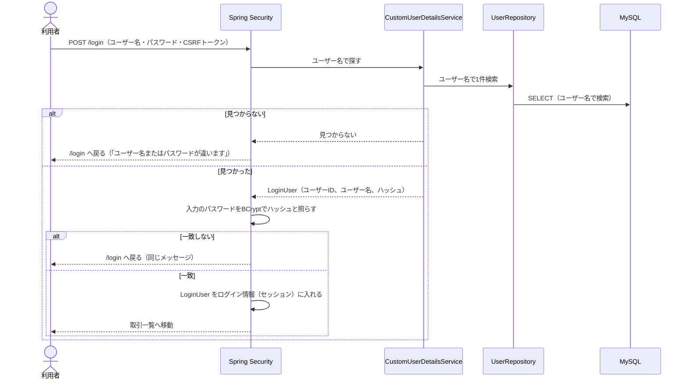

- 「ユーザー名がない」と「パスワードが違う」は、同じメッセージにする（B8）。
- ログイン後の各リクエストでは、Controller が `LoginUser` から**ユーザーIDを取り出して** Service に渡す（画面からのユーザーIDは使わない、3.9）。毎回データベースを引かない（P3）。
- ユーザー名を探すときの大文字・小文字の扱いは、照合順序で決まる（Q10、3.12）。
- ログアウト（`POST /logout`）は、Spring Security がログイン情報を捨て、`/login` へ移動する。

### 5.3 アカウント登録と初期データの作成

`RegistrationService` が、ユーザーと初期データ（3.11）を**同じトランザクション**で作る。途中で失敗したら、ユーザーも含めてすべて取り消す。

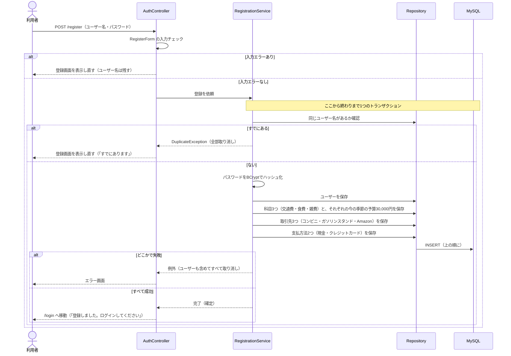

- 初期データの作成は、`CategoryService` ではなく `RegistrationService` が Repository を使って直接行う。理由：`CategoryService` の追加は予算を0円で作るが、初期の科目は30,000円で作るため。
- 同時に同じユーザー名で登録され、確認をすり抜けた場合は、DB の一意制約（3.2）が最後の守りになる。そのエラーも `DuplicateException` として扱う。
- 作る順番は、科目・取引先・支払方法とも 3.11 のとおり（`id` の順＝表示の順、Q14）。

### 5.4 科目・取引先・支払方法の追加

`POST /categories`（取引先は `/vendors`、支払方法は `/payment-methods`）。

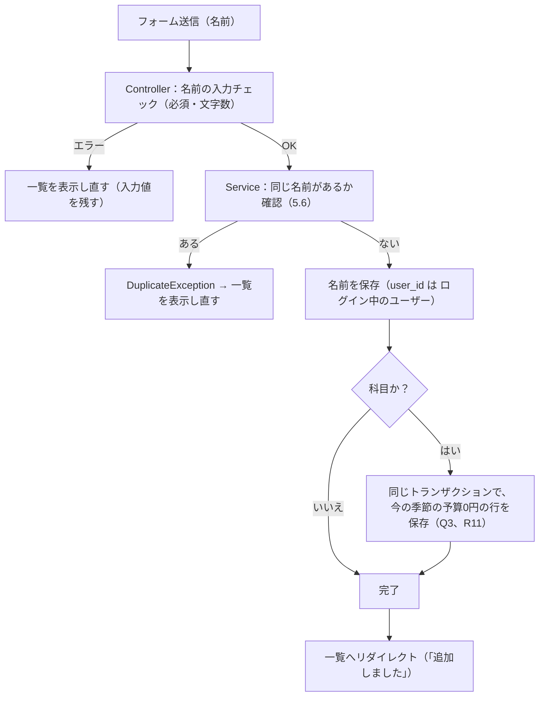

- 科目の追加では、名前の保存と、**今の季節**（5.8）の予算0円の行の保存を**同じトランザクション**にする。ほかの季節の予算は作らない（未設定）。どちらかが失敗したら、両方取り消す。
- 取引先・支払方法の追加は、予算の行を作らない以外は同じ。

### 5.5 科目・取引先・支払方法の削除

`POST /categories/{id}/delete` など。削除前の確認ダイアログは画面（ブラウザ）で行い、Service は「削除してよいか」を判定する。

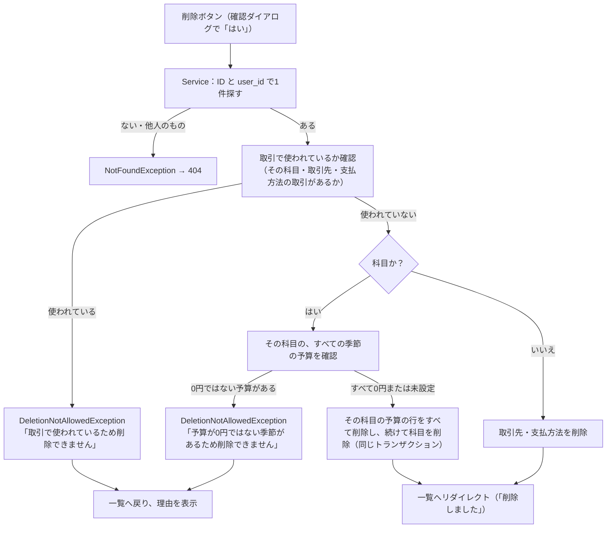

- 科目の削除は、**その科目の予算の行（どの季節のものも）をすべて先に消してから科目を消す**（3.7）。予算の行を残したまま科目を消そうとすると、DB の外部キーが拒否するため。
- 予算が「未設定」の季節は0円として扱うので、予算の行がない季節は削除をさまたげない（要件4.3）。
- 削除できない理由が2つ重なるときは、「取引で使われている」を先に判定し、**そのメッセージだけ**を表示する（F1）。
- 判定をすり抜けて DB の外部キーに拒否された場合（同時操作など）も、`DeletionNotAllowedException`（「取引で使われているため削除できません」）として扱う。
- 取引の削除（`POST /transactions/{id}/delete`）は、ID と `user_id` で探して見つかれば削除するだけ（見つからなければ 404）。

### 5.6 名前の重複チェック

科目・取引先・支払方法の名前は、同じユーザーの中で重複不可（Q9）。ユーザー名はシステム全体で重複不可（Q10）。

| 場面 | 確認すること |
|---|---|
| 科目・取引先・支払方法の**追加** | 自分の中に、同じ名前がすでにあるか |
| 科目・取引先・支払方法の**変更** | 自分の中に、**この行以外で**同じ名前があるか。**自分自身の今の名前は重複とみなさない**（名前を変えずに保存しても、エラーにしない） |
| **アカウント登録** | 同じユーザー名がすでにあるか（持ち主の区別はない） |

- 名前は、前後の空白を取り除いてから比べる（B9）。
- 比べ方（大文字・小文字、かな、全角半角を同じとみなすか）は、DB の照合順序で決まる。`utf8mb4_0900_as_ci` に決めた（3.12）。アプリ側の確認も、DB に問い合わせて同じ基準で行う。
- アプリ側の確認をすり抜けた場合（同時操作など）は、DB の一意制約（3.2〜3.5）が拒否する。そのエラーも `DuplicateException` として扱う。

### 5.7 予算の表示とまとめての保存（季節ごと）

予算は「科目・年・季節」ごとに1つ（3.6）。`GET /budgets?year=…&season=…` で、指定した季節の、自分の全科目の予算額を並べて表示する。`POST /budgets?year=…&season=…` で、その季節の全科目の予算額をまとめて保存する（Q8、R11）。年と季節の指定と404は、予実比較と同じ（2.4、5.8）。

**表示（`GET`）：入力欄の最初の値を決める**

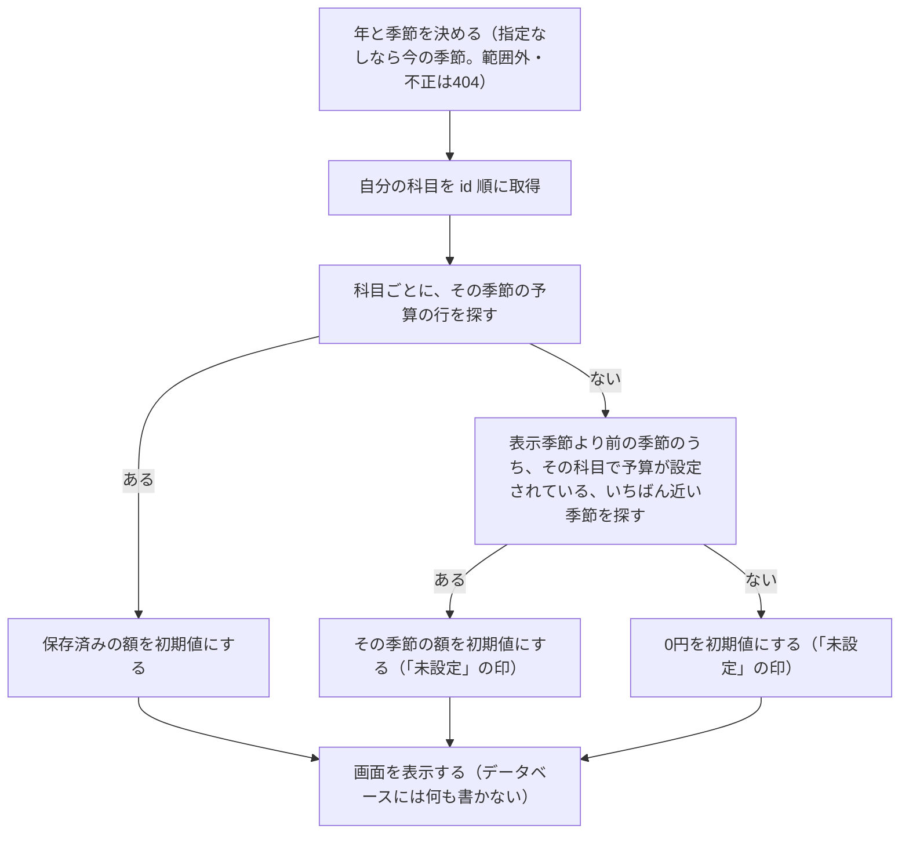

- 「直前」は、**期間の順**で、表示している季節より前の季節のうち、いちばん近いもの（Q23）。最後に保存した季節ではない。
- **画面を開いただけでは、行は作らない**。データベースに書くのは、保存したときだけ。

**保存（`POST`）**

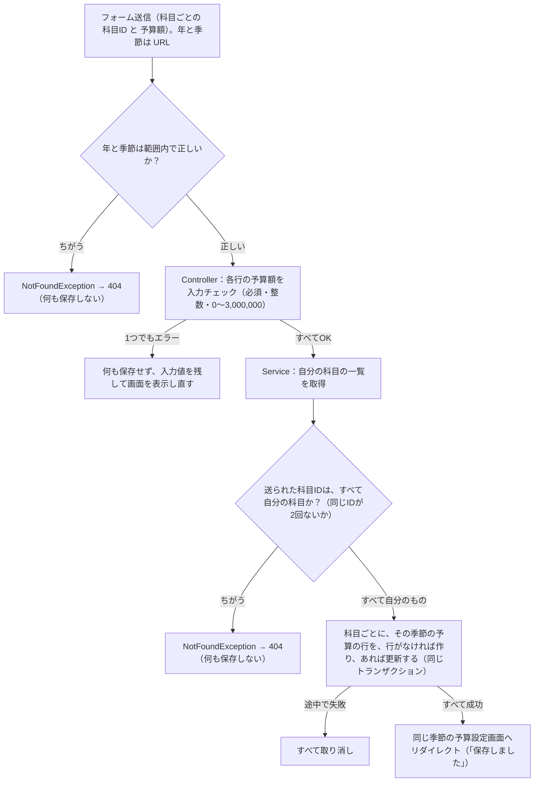

- 保存すると、その季節の**全科目の行**が、画面に表示されていた額で作られる・更新される（Q25）。前の季節から引き継いだ初期値のまま変えなかった行も、その額で保存され、「未設定」の印は消える。
- 画面から送られる科目IDは書き換えられるため、**必ず自分の科目か確認する**（3.9）。他人の科目IDが1つでも混ざれば、404 で、ほかの行も含めて何も保存しない。
- 同じ科目IDが2回送られたときも不正として 404 にして、何も保存しない（F3）。
- 送られなかった科目の、その季節の予算は変えない（F2）。
- 一意制約 `(category_id, season_year, season)`（3.6）が、同時操作で同じ行が2つできるのを防ぐ最後の守りになる。
- 別の季節へ移動するリンクを押したとき、保存していない入力は確認なしで捨てられる（Q27 の d）。

### 5.8 季節の決定と期間

`domain` の `SeasonPeriod` が行う。画面にもデータベースにも依存しない計算なので、単体テストで確かめる（Phase 7）。「今の季節」は、予実比較と予算設定を季節の指定なしで開いたとき、アカウント登録の初期の予算、科目の追加で作る予算（0円）の、4つで使う（R11）。

**季節と月**

| 季節 | 月 | 年の決め方 |
|---|---|---|
| 春 | 3〜5月 | その月の年 |
| 夏 | 6〜8月 | その月の年 |
| 秋 | 9〜11月 | その月の年 |
| 冬 | 12〜2月 | **12月がある年**。12月はその年、**1月・2月は前の年** |

**今日の日付から季節と年を決める**（`season` と `year` を指定せずに開いたとき。「今日」は日本時間、B6）

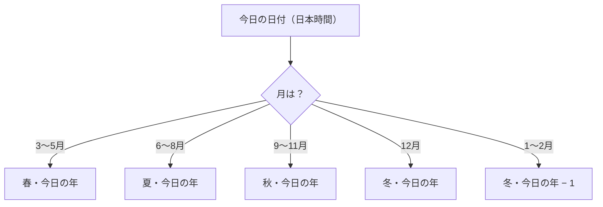

| 今日 | 季節と年 |
|---|---|
| 2027年2月28日（うるう年は29日） | 2026年の冬 |
| 2027年1月15日 | 2026年の冬 |
| 2026年12月1日 | 2026年の冬 |
| 2026年11月30日 | 2026年の秋 |
| 2027年3月1日 | 2027年の春 |

**期間（開始日以上、終了日の翌日未満）**

| 季節（Y年） | 開始日（含む） | 終了日の翌日（含まない） |
|---|---|---|
| 春 | Y年3月1日 | Y年6月1日 |
| 夏 | Y年6月1日 | Y年9月1日 |
| 秋 | Y年9月1日 | Y年12月1日 |
| 冬 | Y年12月1日 | **Y＋1年3月1日** |

- 取引は「日付 ≧ 開始日 かつ 日付 ＜ 終了日の翌日」で選ぶ。理由：2月の最終日（28日か29日か）を数えなくても、3月1日を境にきれいに分けられるため。
- 例：2026年の冬は 2026年12月1日 ≦ 日付 ＜ 2027年3月1日。2027年2月28日の取引は冬、3月1日の取引は春に入る。
- `year` と `season` が URL で指定されたとき（予実比較・予算設定）の確認（2000〜2100、季節の名前、片方だけは不可）と、前・次の季節の求め方は 2.4 のとおり。不正なら `NotFoundException`（404）。

### 5.9 予実比較の集計と色の判定

`ComparisonService` が、期間内の科目ごとの予算・実績・差額・色を作る。全体の道すじは 1.4（例2）。ここでは中身を書く。予算は季節ごとに持つ（3.6）ので、**表示する季節の予算**を使う。

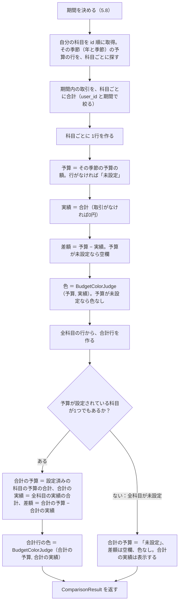

**色の判定の順番**（`BudgetColorJudge`。要件4.4、各行も合計行も同じ）

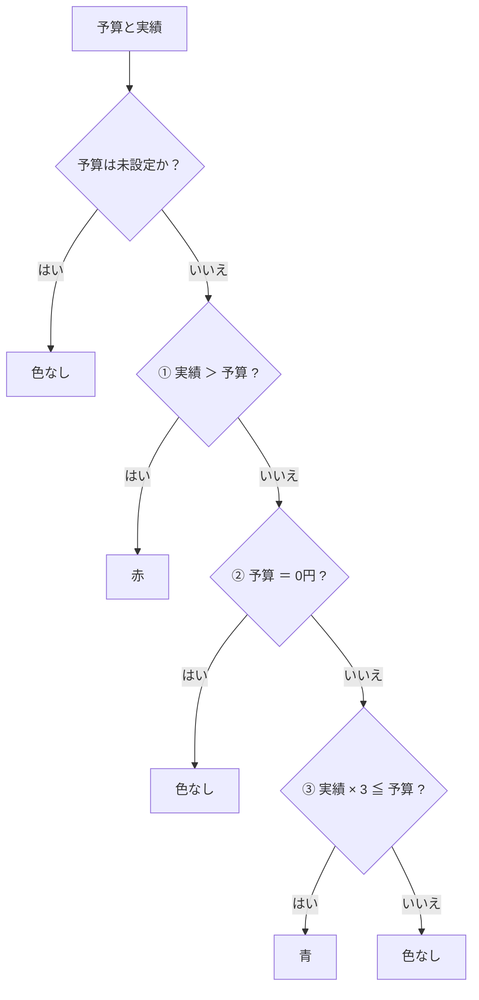

| 予算 | 実績 | 色 | 理由 |
|---|---|---|---|
| 30,000円 | 30,001円 | 赤 | ① 超過 |
| 30,000円 | 30,000円 | 色なし | 超過ではない。③ 90,000 ≦ 30,000 は成り立たない |
| 30,000円 | 10,000円 | 青 | ③ 30,000 ≦ 30,000（ちょうど1/3も青） |
| 30,000円 | 10,001円 | 色なし | ③ 30,003 ≦ 30,000 は成り立たない |
| 30,000円 | 0円 | 青 | ③ 0 ≦ 30,000 |
| 0円 | 1円 | 赤 | ① 予算が0円でも、実績があれば赤 |
| 0円 | 0円 | 色なし | ② 予算が0円（③ を通すと 0 ≦ 0 で青になってしまうので、先に除く） |
| 未設定 | 5,000円 | 色なし | 予算が未設定。比べる予算がない（差額も空欄） |
| 未設定 | 0円 | 色なし | 同上 |

- 「予算が未設定」と「予算が0円」は別。0円は設定済みなので、実績があれば①で赤になる。未設定は①〜④の判定をせず、色なし（要件4.4）。
- ①②③の順番は変えない。②を③より先に置くことで、「予算0円・実績0円」が青にならない。
- 金額の合計と「実績 × 3」の計算は、`INT` ではなく大きい整数（`Long`）で行う（3.1）。
- **合計行**（Q22 の C）：合計の予算は**設定済みの科目の予算だけ**を足し、合計の実績は**全科目の実績**を足す。予算が未設定の科目の実績も、合計の実績に入る。これは「予算0円でも実績があれば赤」と同じ考え方で、予算のない科目の支出も全体に含める。
  - 例：交通費 10,000円（予算 30,000円）、食費 5,000円（予算 未設定）→ 合計の予算 30,000円、合計の実績 15,000円、差額 15,000円。
  - 科目を追加する前の季節では、追加した科目の実績は0円なので、合計に影響しない。
  - 全科目が未設定のときだけ、合計行も予算「未設定」・差額は空欄・色なし。
- 合計行の実績は、全科目の実績を足したもの。取引はすべて自分の科目に属する（外部キー、3.7）ので、取り漏れはない。
- 色を付ける場所は、その行の文字全体（F4）。
- 予算は季節ごとに持つので、過去の季節は、その季節に設定した予算で比べる。設定していない季節は「未設定」になる（R11）。

### 5.10 追加で決めた点（確定）

要件にもそれまでの決定にもなかった点を、確認のうえで決めたものです。

| 番号 | 決めたこと | 理由 |
|---|---|---|
| F1 | 科目の削除で「使用中」と「いずれかの季節に0円でない予算がある」が重なるときは、「取引で使われている」のメッセージだけを出す | 取引を消さないと進めないので、先に知らせたほうが分かりやすい |
| F2 | 予算のまとめて保存で、送られなかった科目の予算は変えない | 画面は全科目を送るため通常は起きない。想定外の送信で、勝手に書き換えない |
| F3 | 予算のまとめて保存で、同じ科目IDが2回送られたときも、不正として 404 にして何も保存しない | 書き換えられた送信を受け付けないため |
| F4 | 予実比較で色を付ける場所は、**その行の文字全体**（科目名・予算・実績・差額）。数字だけには付けない。合計行も同じ | 要件の「赤字／青字で表示する」を、行ごとに分かりやすく見せるため |

---

## 6. 入力チェックの実現方法

### 6.1 方針

- チェックは**サーバー側で必ず行う**。画面（ブラウザ）の制限は、書き換えたり飛ばしたりして送れるため、チェックの代わりにしない。
- 入力値だけを見て分かるものは **Form の注釈（Bean Validation）**、データベースの状態が必要なものは **Service** でチェックする（6.3）。最後の守りとして、DB の制約（一意・外部キー・CHECK、章3）もある。
- エラーのとき、画面は**リダイレクトせずに同じ画面を表示し直し**、項目の横にエラーメッセージを出し、**入力値を残す**（要件3章、章2）。パスワードだけは残さない（章2）。
- Form には `user_id` の入力項目を作らない。画面から持ち主を指定できないようにするため（3.9）。
- 画面（HTML）側では、必須や文字数の制限を**付けない**（G1）。理由：入力エラーの表示と入力値の保持を、実際の画面で確かめられるようにするため（Phase 8 の境界値の確認）。ただし日付は日付入力の標準の部品を使う（章2）。金額は文字として受け付けて、サーバーで整数かを確かめる（6.5）。

### 6.2 入力項目とチェックの一覧

「場所」は、F＝Form の注釈（Bean Validation）、S＝Service、D＝DB の制約（最後の守り）。画面に出す文は、6.8 のメッセージのとおり。

**アカウント登録（`RegisterForm`）**

| 項目 | ルール | 出どころ | 場所 | エラーメッセージ |
|---|---|---|---|---|
| ユーザー名 | 必須（前後の空白を取り除いて空欄でない） | 要件5章 | F | ユーザー名を入力してください |
| ユーザー名 | **半角英数字のみ**（`A-Z`、`a-z`、`0-9`。全角の英数字・記号・途中の空白は不可） | Q20 | F | ユーザー名は半角英数字で入力してください |
| ユーザー名 | 10文字以下 | 要件5章 | F | ユーザー名は10文字以内で入力してください |
| ユーザー名 | **同じユーザー名は登録不可** | 要件5章、Q10 | S（最後は D） | このユーザー名はすでに使われています |
| パスワード | 必須 | 要件5章 | F | パスワードを入力してください |
| パスワード | **半角の英数字と記号のみ**（空白は不可。全角・日本語は不可）。使える文字は、半角英数字と、半角の記号（`!` から `~` までの印字できる文字） | 要件5章（R10、H1） | F | パスワードは半角の英数字と記号で入力してください |
| パスワード | 8文字以上30文字以下 | 要件5章 | F | パスワードは8文字以上30文字以内で入力してください |

**取引（`TransactionForm`）**

| 項目 | ルール | 出どころ | 場所 | エラーメッセージ |
|---|---|---|---|---|
| 日付 | 必須 | 要件4.2 | F | 日付を入力してください |
| 日付 | 正しい日付の形（6.6） | — | F（型変換） | 日付を正しく入力してください |
| 日付 | **2000年1月1日から2100年12月31日まで**（6.6） | R12 | F（D の CHECK も） | 日付は2000年1月1日から2100年12月31日までで入力してください |
| 金額 | 必須 | 要件4.2 | F | 金額を入力してください |
| 金額 | 整数（6.5） | B5 | F（型変換） | 金額は整数で入力してください |
| 金額 | **1円以上1,000,000円以下**（0円・マイナスは不可。1,000,000円ちょうどは可） | 要件5章 | F（D の CHECK も） | 金額は1円以上1,000,000円以下で入力してください |
| 科目 | 必須（未選択は不可） | 要件4.2 | F | 科目を選択してください |
| 科目 | 自分の科目であること（6.7） | 3.9 | S | （404 画面） |
| 取引先 | 必須 | 要件4.2 | F | 取引先を選択してください |
| 取引先 | 自分の取引先であること | 3.9 | S | （404 画面） |
| 支払方法 | 必須 | 要件4.2 | F | 支払方法を選択してください |
| 支払方法 | 自分の支払方法であること | 3.9 | S | （404 画面） |
| 摘要 | **任意**（空欄可。空欄は NULL で保存、3.6）。30文字以下 | 要件4.2、5章 | F | 摘要は30文字以内で入力してください |

**科目・取引先・支払方法（`CategoryForm`、`VendorForm`、`PaymentMethodForm`）**

| 項目 | ルール | 出どころ | 場所 | エラーメッセージ |
|---|---|---|---|---|
| 科目名 | 必須 | Q9 | F | 科目名を入力してください |
| 科目名 | 10文字以下 | 要件5章 | F | 科目名は10文字以内で入力してください |
| 科目名 | **同じユーザーの中で重複不可**（変更のとき、自分自身の今の名前は重複としない、5.6） | R8 | S（最後は D） | その科目名はすでにあります |
| 取引先名 | 必須 | Q9 | F | 取引先名を入力してください |
| 取引先名 | 20文字以下 | 要件5章 | F | 取引先名は20文字以内で入力してください |
| 取引先名 | 同じユーザーの中で重複不可 | R8 | S（最後は D） | その取引先名はすでにあります |
| 支払方法名 | 必須 | Q9 | F | 支払方法名を入力してください |
| 支払方法名 | 10文字以下 | 要件5章 | F | 支払方法名は10文字以内で入力してください |
| 支払方法名 | 同じユーザーの中で重複不可 | R8 | S（最後は D） | その支払方法名はすでにあります |

**予算（`BudgetForm`。科目ごとの1行に対して）**

| 項目 | ルール | 出どころ | 場所 | エラーメッセージ |
|---|---|---|---|---|
| 予算額 | 必須 | 要件4.3 | F | 予算額を入力してください |
| 予算額 | 整数（6.5） | B5 | F（型変換） | 予算額は整数で入力してください |
| 予算額 | **0円以上3,000,000円以下**（0円は可、マイナスは不可） | 要件5章 | F（D の CHECK も） | 予算額は0円以上3,000,000円以下で入力してください |
| 科目ID | 自分の科目であること。同じIDが2回ないこと（5.7） | 3.9、F3 | S | （404 画面） |
| 年・季節（URL） | 年は2000〜2100の整数、季節は `spring`・`summer`・`autumn`・`winter`。どちらか片方だけの指定は不可（2.4）。指定なしは今の季節 | R11、B15 | S（またはController） | （404 画面） |

**削除・ログイン（入力値ではなく、状態の確認）**

| 場面 | ルール | 出どころ | 場所 | メッセージ |
|---|---|---|---|---|
| 科目・取引先・支払方法の削除 | 取引で使用中は不可 | 要件4.3 | S（最後は D の外部キー） | 取引で使われているため削除できません |
| 科目の削除 | いずれかの季節に0円でない予算があるときは不可（未設定の季節は0円として扱う） | 要件4.3、R11 | S | 予算が0円ではない季節があるため削除できません |
| ログイン | ユーザー名・パスワードの一致 | 要件4.1 | Spring Security | ユーザー名またはパスワードが違います（B8） |

- 要件5章の「科目、支払方法は10文字以下」「取引先名は20文字以下」「摘要は30文字以下」は、**全角も半角も1文字**として数える（B10）。DB の列の大きさ（3章）と同じ。
- ログインの入力（ユーザー名・パスワード）は、Form のチェックをしない。空欄などでも、一致しないものとして同じメッセージを出す。
- 取引先名・支払方法名・科目名の「必須」は、要件の入力必須の趣旨にそろえた。（要件5章に直接の記載はない）
- パスワードを半角の英数字と記号のみにする理由（H1）：BCrypt（ハッシュ化の方式）が扱える長さには上限（72バイトとされる）があり、全角文字を30文字入れるとバイト数で超えるおそれがあるため。半角なら30文字は30バイトで収まる。

### 6.3 Form でチェックするものと、Service でチェックするもの

| 区分 | 判断の基準 | 例 | 使う仕組み |
|---|---|---|---|
| **Form（Bean Validation）** | 入力された値**だけ**を見れば分かる | 必須、文字数、半角英数字のみ、パスワードの文字の種類、数値の範囲、数字・日付の形 | 項目に付ける注釈（必須：`@NotBlank`／`@NotNull`、文字数：`@Size`、形式：`@Pattern`、範囲：`@Min`／`@Max`）と、型変換のエラー |
| **Service** | **データベースの状態**を見ないと分からない | 名前の重複、自分のものか（持ち主）、削除してよいか、ユーザー名の重複 | Repository で調べ、例外を投げる（`DuplicateException`、`NotFoundException`、`DeletionNotAllowedException`、5.1） |
| **DB の制約** | 最後の守り（アプリの確認をすり抜けた場合） | 一意（UNIQUE）、外部キー、金額・予算額・取引の日付の CHECK | エラーを例外に変えて、上の Service の例外と同じ扱いにする（5.3、5.5、5.6） |

- 順番：Controller が Form のチェックを先に行い、**エラーがなければ**Service を呼ぶ。Form にエラーがあるときは、Service を呼ばない（重複や持ち主の確認は、入力が正しい形のときだけ行う）。
- 使う注釈の組み合わせは、Phase 3〜6 でそれぞれの Form を作るときに決める。この章では、どの項目に何のルールがあるかを決める。
- **エラーの重なりの扱い（D4、Phase 3 で決定。6.9 と G7）**：Bean Validation は注釈のチェックの順番を保証しないため、1つの項目に複数のエラーが重なることがある。`RegisterForm` で4つの方法（注釈を並べるだけ、形式の正規表現が空文字を通すようにする、グループで順番を付ける、自作の注釈）を試し、**「形式の正規表現が空文字を通すようにして、『必須』を他のエラーと重ねない」方法（B）**にした。それ以外のエラー（型変換・形式・文字数・範囲）は、重なったら全部出す。
  - 理由：1項目1つを守るには自作の仕組みが要り、Phase 4〜6 の Form すべてに広がるため。形式と文字数の両方が違うときは、両方見えたほうが1回で直せるため。グループで順番を付ける方法は、他の項目のエラーが隠れるので使わない。
  - Phase 4〜6 の Form でも同じ方法を使う：「必須」の注釈（`@NotBlank`／`@NotEmpty`／`@NotNull`）、形式の注釈（`@Pattern`。空文字を通す正規表現）、文字数・範囲の注釈（`@Size`／`@Min`／`@Max`）を、項目ごとに並べる。
  - 受け入れる点：パスワードが空のとき「入力してください」と「8文字以上30文字以内で」の2つが出る。重なったときの表示の順番が一定ではない。
  - 各方法の実験の結果は、Phase 3 の手順書（4.5）に残してある。

### 6.4 前後の空白

- 文字列の入力は、**前後の空白（全角の空白を含む）を取り除いてから**判定し、保存する（B9）。例：「 食費 」→「食費」。
- 取り除いた結果が空なら、必須の項目は「必須」エラー。摘要は空欄とみなして NULL で保存する（3.6）。
- ユーザー名は、取り除いたあとに半角英数字だけなら可。途中に空白があれば形式エラー（Q20）。
- 取り除く方法は、Java の `String.strip()` を使う（Phase 3 で決定）。`String.trim()` は半角の空白などしか取らず、全角の空白（U+3000）を取らないため使わない。Spring 標準の `StringTrimmerEditor` も `trim()` と同じ動きなので、そのままでは使えない。
- **取り除く場所（Phase 4 で決定）**：**各 Form の値を受け取る部分（セッター）で `strip()` を使う**。`RegisterForm`（ユーザー名）、`CategoryForm`、`VendorForm`、`PaymentMethodForm` の4つが、同じ形。共通の仕組み（`@InitBinder` など）は作らない。理由：Form が少なく、1項目ずつで、単体テストで確かめやすいため。Phase 5 の摘要（空なら NULL、3.6）は、D6 として次のように決めた。
- **摘要（D6、Phase 5 で決定）**：`TransactionForm` の摘要のセッターで、`strip()` で前後の空白（全角を含む）を取り除き、**取り除いて空なら `null` にする**（Q5-6 の A）。共通の仕組みは作らない。理由：空を NULL にする項目は摘要だけで、Form の 1 か所で足りるため。文字数（30文字以下）は、取り除いたあとの長さで数える（例：30文字の前後に空白があってもエラーにならない）。単体テスト（`TransactionFormTest`）で確かめた。
- **パスワードは前後の空白を取り除かない**（G2）。理由：入力したとおりの文字列を、ハッシュ化して照合する必要があるため。空白は使えない文字なので、前後であっても途中であっても、空白が1つでもあれば「半角の英数字と記号」の形式エラーになる（H1）。

### 6.5 数字でない値が金額に入ったとき

対象：取引の金額、予算の予算額（B5：円単位の整数のみ）。

**整数として読む規則**（Q5-1 の C。Phase 5 で決定。下の「実験の結果」のとおり、Spring 標準の変換では足りなかったため）：

1. 前後の空白（全角の空白を含む）を `strip()` で取り除く（6.4）。取り除いて空なら、値なし（`null`）として扱い、必須エラーにする。
2. 取り除いた文字列が、**半角の数字だけ**、または**先頭の `-` と半角の数字だけ**なら、整数として読む（`010` は 10 になる。8 進数としては読まない）。
3. それ以外は、すべて型変換のエラーにする。例：全角数字、途中の空白、`0x10`・`#10`、カンマ、小数、`10円`、先頭の `+`（`+5`）、`1e3`。
4. 整数に収まらない大きな数も、型変換のエラーにする。

| 入力 | 扱い | メッセージ |
|---|---|---|
| 空欄（空白だけも含む） | 必須エラー | 金額を入力してください／予算額を入力してください |
| `abc`、`1,000`（カンマ）、`１２３`（全角数字）、`1 000`（途中に空白）、`1.5`（小数）、`10円`、`0x10`、`+5` | 整数に変換できない。型変換のエラー | 金額は整数で入力してください／予算額は整数で入力してください |
| 整数に収まらない大きな数（例：`99999999999`） | 同じく型変換のエラー | 同上 |
| `0`、`-5`、`1000001`（取引） | 整数だが範囲外。範囲のエラー | 金額は1円以上1,000,000円以下で入力してください |
| `-1`、`3000001`（予算） | 整数だが範囲外 | 予算額は0円以上3,000,000円以下で入力してください |
| ` 100 `（前後の空白） | 空白を取り除いて 100 として扱う（6.4） | （エラーなし） |

- エラーのとき、入力した文字（`abc` など）は**そのまま画面に残す**。直すのが簡単になるため。
- 型変換のエラーのとき、範囲のチェックは行わない（片方のメッセージだけ出す、G3）。
- この規則は、**金額の項目だけ**に使う専用の変換クラス（`StrictIntegerEditor`、P9）で行う。Controller の `@InitBinder` で、金額（Phase 6 では予算額）の項目にだけ付ける。他の整数の項目（科目ID など）には使わない。

**実験の結果**（2026-10-29、Phase 5。MVC が使うのと同じ変換サービスで、`Integer` の項目に束縛した）

Spring 標準の変換（`Integer` の項目に何も足さない場合）は、次のとおりだった。

| 入力 | 標準の変換の結果 | 6.5 の期待との違い |
|---|---|---|
| 空、半角の空白だけ、全角の空白だけ | `null`（必須エラーになる） | なし |
| `123`、` 123 ` | 123 | なし |
| `１２３`（全角数字） | **123 として通った** | あり（型変換のエラーのはず） |
| `1 000`（途中に空白） | **1000 として通った** | あり（同上） |
| `0x10`、`#10` | **16 として通った** | あり（16 進として読まれた） |
| `+5` | **5 として通った** | あり（上の規則 3 で型変換のエラーにする） |
| `010` | 10 | なし（8 進数にはならない） |
| `-5` | -5（範囲エラーになる） | なし |
| `1,000`、`1.5`、`10円`、`1e3`、`99999999999` | 型変換のエラー | なし |

- 全角数字・途中の空白・16 進を通すと、「全角数字は入力エラー」（B5）に反し、意図しない金額が保存されるため、専用の変換にした。

### 6.6 日付が正しくない形で送られたとき

- 画面の日付入力は、`2026-10-19` の形で送る（標準の日付入力の部品）。
- 次のときは、型変換のエラー「日付を正しく入力してください」にする。
  - 空欄（→ 必須のエラー「日付を入力してください」）
  - 日付の形でない文字（書き換えて送られた場合）
  - 存在しない日付（例：`2026-02-30`）
- **取引の日付は、2000年1月1日から2100年12月31日まで**（R12）。形が正しくても、この範囲の外（例：`0226-05-01`、`1999-12-31`、`2101-01-01`）はエラー「日付は2000年1月1日から2100年12月31日までで入力してください」にする（G4）。**5桁の年（例：`20026-05-01`）は、日付の形として読めないので、上の型変換のエラー「日付を正しく入力してください」になる**（Q5-3 の A。どちらも入力エラーで止まるので、G4 の目的は果たせる）。理由：年の打ち間違いを入力エラーで止めるため。範囲外の日付が登録されると、予実比較に出ず、間違いに気づけないため。この範囲は、予実比較・予算設定で見られる季節の範囲（2000年春〜2100年冬、2.4）に合わせた。
- 表示（`2026/10/19`）と入力（`2026-10-19`）の形が違うのは、入力欄には標準の入力部品を使うため（章2）。

### 6.7 プルダウンの値（科目ID・取引先ID・支払方法ID）が空・不正なとき

プルダウンの先頭には「選択してください」（値は空）を置く。

| 送られた値 | 扱い | 画面 |
|---|---|---|
| 空（未選択） | 必須エラー | 項目の横に「科目を選択してください」など。入力値を残して同じ画面 |
| 数字に変換できない文字（書き換え） | 未選択と同じ扱い（型変換のエラーを、必須と同じメッセージにする、G5） | 同上 |
| 数字だが、存在しない・他人のID | Service が `NotFoundException` | 404 画面（B7）。保存しない |
| 数字で、自分のもの | 正常 | — |

- 他人のIDを送られても、他人のデータの有無は教えない（B7）。
- 画面を開いたまま別の画面で科目を削除し、その科目を選んで送ったときも、同じく 404 になる（存在しないIDのため）。通常の操作では起きにくいので、特別な画面は作らない。
- プルダウンの選択肢は、ログイン中のユーザー自身のものだけを並べる（Q14、登録順）。エラーで同じ画面に戻るときも、選択肢を取り直して、**選んでいた値を残す**。

### 6.8 エラーメッセージの置き場所

- すべてのメッセージを、`src/main/resources/messages.properties` の**1か所**に日本語で書く（4.3）。注釈や Service には文章を直接書かず、メッセージの名前（キー）だけを書く。理由：文言の直しが1か所で済むため。
- キーの付け方（G6）：
  - Form の入力チェック：`項目の種類.フォーム名.項目名`（例：金額の必須のキー、金額の範囲のキー、金額の型変換のキー）。Spring の標準の探し方に合わせて、項目ごとに書き分ける。
  - Service の結果：`error.duplicate.category`（科目名の重複）、`error.delete.inUse`（使用中）、`error.delete.budgetNotZero`（いずれかの季節に0円でない予算がある）のように、`error.` から始める。
  - ログイン失敗：`error.login.failed`。
- 6.2 の「エラーメッセージ」の列の文を、そのまま `messages.properties` に書く。文末は、ていねいな言い方に統一する（「〜してください」「〜できません」「〜があります」）。
- 文字コードは UTF-8 とし、日本語をそのまま書く。`application.properties` に `spring.messages.encoding=UTF-8` を書き、ファイルも UTF-8 で保存する。日本語が文字化けせずに画面に表示されることを、Phase 2 で確かめた（C2）。
- 成功メッセージ（「登録しました」など、2.6）も、同じファイルに書く。科目・取引先・支払方法の「追加しました」「変更しました」「削除しました」は、3つで共通のキー（`success.added`、`success.updated`、`success.deleted`）を使う（Phase 4 で決定）。取引など、文言が違うものは別のキーを足す。取引は、登録が `success.registered`（登録しました）、更新が `success.transactionUpdated`（更新しました、U2）で、削除は `success.deleted` を使う（Phase 5、Q5-8 の A）。

### 6.9 画面でのエラー表示と入力値の保持

- **項目の横**：その項目のエラーを、入力欄の近く（真下）に赤い文字で表示する。「必須」エラーは、他のエラーと重ならないようにする（形式の正規表現は空文字を通す、G7）。必須以外のエラー（型変換・形式・文字数・範囲）が重なったときは、**全部表示する**（形式と文字数の両方が違うときは、どちらも直す必要があるため）。重なったときの表示の順番は一定ではない。
- **画面の上部**：成功メッセージと、削除できない理由などの「項目に結び付かないエラー」を表示する（2.1、2.3 の共通部分）。
- **入力値の保持**：入力エラーで同じ画面を表示し直すとき、入力した値をそのまま入力欄に入れる。数字でない金額も、そのまま残す（6.5）。プルダウンは選んでいた値、日付は入力した日付を残す。**パスワードは残さない**（章2）。
- **予算設定**：エラーのある行の横にエラーを表示し、**全行の入力値を残す**（1つでもエラーなら何も保存しない、5.7）。
- **一覧画面の追加フォーム**（科目・取引先・支払方法）：エラーのときは、一覧と一緒に画面を表示し直す。フォームには入力値とエラーが入り、一覧は取り直して最新にする（章2）。
- 重複のエラー（Service）も、入力チェックのエラーと同じように、名前の項目の横に表示し、入力値を残す。

### 6.10 追加で決めた点（確定）

要件にもそれまでの決定にもなかった点を、確認のうえで決めたものです。

| 番号 | 決めたこと | 理由 |
|---|---|---|
| G1 | 画面（HTML）側では、必須・文字数の制限を付けない。金額は文字として受け付ける | サーバー側のエラー表示と入力値の保持を、実際の画面で確かめられるようにするため |
| G2 | 前後の空白は全角の空白も含めて取り除く。ただしパスワードは取り除かない | B9 の具体化。パスワードは入力どおりに照合する必要があるため |
| G3 | 型変換のエラーのときは、範囲のメッセージを出さない（1項目に1つ） | 「整数で入力してください」と「範囲」の両方が出ると混乱するため |
| G4 | 取引の日付は、2000年1月1日〜2100年12月31日の範囲外ならエラーにする（Q15 の変更、R12） | 年の打ち間違い（`0226` や `20026` など）を入力エラーで止めるため。範囲外が登録されると、予実比較に出ず、間違いに気づけないため |
| G5 | プルダウンの値が数字に変換できないときは、未選択と同じメッセージにする | 書き換えられた送信にも、利用者向けの簡単な表示で済ませるため |
| G6 | メッセージのキーは、Form は Spring の標準の付け方、Service と認証は `error.` から始める | 文言の置き場所を1か所にしつつ、探しやすくするため |
| G7 | 「必須」エラーが、他のエラーと重ならないようにする（形式の正規表現は空文字を通す）。それ以外のエラー（型変換・形式・文字数・範囲）は、重なったら全部出す。**見直し**：当初は「1つの項目に表示するエラーは1つだけ。優先順は 必須 → 型変換 → 形式 → 文字数・範囲」とした。Phase 3 で試して見直した（Bean Validation は注釈のチェックの順番を保証しないため）。**受け入れる点**：パスワードが空のとき「入力してください」と「8文字以上30文字以内で」の2つが出る。重なったときの表示の順番が一定ではない | 1項目1つを守るには自作の仕組みが要り、Phase 4〜6 の Form すべてに広がるため。形式と文字数の両方が違うときは、どちらも直す必要があるので、両方見えたほうが1回で直せるため。グループで順番を付ける方法は、他の項目のエラーが隠れるので使わない（Phase 3 の手順書 4.5 に実験の結果） |
| H1 | パスワードは**半角の英数字と記号のみ**（空白は不可）、8文字以上30文字以下。要件5章に足した（R10） | BCrypt が扱える長さの上限（72バイトとされる）に収めるため。ユーザー名も半角英数字のみ（Q20）で、そろう |

---

## 7. セキュリティ対策の実現方法

### 7.1 方針

- 要件6章の6つの対策を、**Spring Security と Thymeleaf、Spring Data JPA の標準の仕組み**で実現する。自分で暗号やチェックの仕組みを作らない。理由：実績のある標準の仕組みのほうが安全で、入門者にも確かめやすいため。
- 標準の守りを**外さない**（CSRF 対策を無効にしない、`th:utext` を使わない、文字列連結の SQL を書かない）。
- 要件にない対策は、理由とともに 7.12（S1〜S7）にまとめた。
- 確認の方法は Phase 8 で行う（実行計画書の確認表、7.11）。

### 7.2 要件6章の対策と、実現方法

| 要件6章の対策 | どうやって実現するか | 関係する章 |
|---|---|---|
| パスワードはハッシュ化して保存する | 登録のとき、`RegistrationService` が BCrypt（Spring Security の `PasswordEncoder`）でハッシュ化し、`users.password_hash` に保存する。元のパスワードは保存しない・画面に出さない・ログに出さない。ログインでは、入力をハッシュと照らして確かめる（元に戻さない）。`PasswordEncoder` は `SecurityConfig` で1つだけ用意する | 3.2、5.2、5.3、6（H1） |
| ログインしていない人は、ログイン画面とアカウント登録画面以外を開けない | `SecurityConfig` で「すべての URL はログイン必須」を基本にし、例外を `/login`、`/register`、`/css/**`、`/error` だけにする（7.3）。未ログインは `/login` へ移動する | 2.2、4.5、5.2 |
| SQL インジェクション対策 | 検索・保存はすべて Spring Data JPA の**パラメータ付き**の方法で行い、入力値を文字列でつなげた SQL を**書かない**（7.4） | 4.6 |
| XSS 対策 | 画面に出す値は `th:text`（または `[[...]]`）で表示し、**`th:utext` は使わない**（7.5） | 2、4.4 |
| CSRF 対策 | Spring Security の CSRF 対策を**有効のまま**使う。データを変えるリクエストはすべて POST にし、フォームにトークンを入れる（7.6） | 2.1、2.2 |
| ユーザーごとのデータ分離（要件4.1） | すべての検索を `user_id` で絞る。ユーザーIDは `LoginUser` から取り、画面からの値を使わない。取引・予算で選ぶ科目などは、Service で自分のものか確認する。他人のデータは 404 で、有無を教えない（7.8） | 3.9、4.1、5.1、6.7 |

### 7.3 ログイン必須の設定

- 基本：すべての URL でログインを必須にする。
- ログインなしで開けるもの（これだけ）：

| URL | 理由 |
|---|---|
| `/login`（GET・POST） | ログインのため |
| `/register`（GET・POST） | アカウント登録のため（R2） |
| `/css/**` | 画面の見た目の CSS。ログイン画面と登録画面にも使うため |
| `/error` | Spring Boot がエラー画面を出すときに使う URL。ログイン前でもエラー画面を表示できるようにするため（2.5、7.7） |

- 未ログインでそれ以外を開いたら、`/login` へ移動する。ログイン成功後は、開こうとしていた URL に関係なく取引一覧へ移動する（U5）。
- ログアウト（`POST /logout`）：ログイン情報（セッション）を捨てて、`/login` へ移動する。POST にして CSRF のトークンを必須にする（7.6）。
- ログイン失敗は、「ユーザー名またはパスワードが違います」だけを表示する（B8）。失敗の回数制限は付けない（B12）。
- 画面のボタンを隠すだけにせず、**サーバー側で必ず確認する**。URL を直接開かれても、同じ確認が働く。

### 7.4 SQL インジェクション対策

- Repository の検索は、**名前付きの検索（Spring Data JPA のメソッド）またはパラメータ付きの検索**で書く（4.6）。入力値は「値」として渡し、SQL の文字列に連結しない。
- `schema.sql` は固定の文章で、入力値を含まない。
- 守りの確認（Phase 8）：コードの中で、SQL を文字列でつなげている箇所がないかを検索する。ユーザー名・摘要などに `' OR '1'='1` を入力しても影響がないことを確かめる。

### 7.5 XSS 対策

- Thymeleaf の `th:text` は、表示する値に含まれる `<` `>` `&` などの記号を無害な文字に変えてから出力する。摘要・科目名・取引先名・支払方法名・ユーザー名など、**利用者が入力した値はすべて `th:text` で表示する**。
- **`th:utext` は使わない。** `th:utext` は無害化せずにそのまま出力するため、`` を入力しても、画面にただの文字として表示されること。コードの中で `th:utext` を検索して、使っていないこと。

### 7.6 CSRF 対策

- Spring Security の CSRF 対策を有効のまま使う（無効にしない）。
- データを変える操作（登録・変更・削除・ログアウト、`/login`・`/register` の送信も含む）は、すべて **POST** にする。GET ではデータを変えない（2.1）。
- フォームは、Thymeleaf の `th:action` で書く。トークン（隠し項目）が自動で入る。
- トークンがない、または違う POST は、403 として拒否する。このときの画面は 7.7 のとおり。
- 守りの確認（Phase 8）：フォームにトークンが入っていること。トークンなしの POST が拒否されること。

### 7.7 予期しないエラーの画面

エラーの画面は、種類ごとに用意する。**どの画面にも、エラーの詳しい中身（スタックトレース、例外の名前・メッセージ、SQL、ファイルのパス、DB の情報）を出さない。**

| 種類 | 例 | 状態コード | 画面に出す文 | テンプレート |
|---|---|---|---|---|
| 404 | 存在しない URL、存在しない・他人のID、予実比較・予算設定の範囲外の年（B7） | 404 | 「ページが見つかりません」と、取引一覧へのリンク | `error/404.html`（章2） |
| 403 | CSRF のトークンがない・違う、アクセスが許されない操作 | 403 | 「操作を完了できませんでした。もう一度やり直してください」と、取引一覧へのリンク | `error/403.html`（S3） |
| その他の 400 番台 | 不正な形の URL・リクエスト（400）、許されない方法（405）など | 400、405 など | 「操作を完了できませんでした。もう一度やり直してください」と、取引一覧へのリンク | `error/4xx.html`（S9） |
| 500 番台の予期しないエラー | DB が止まっている、プログラムの不具合 | 500 など | 「エラーが発生しました。しばらくしてからもう一度お試しください」と、取引一覧へのリンク | `error/5xx.html`（S3、S9） |

- **エラー画面を出すときは、HTTP の状態コードも 404・403・500 にそろえる。** 画面だけ「見つかりません」で、状態コードが 200（成功）にならないようにする。`NotFoundException` や ID が数字でない URL を `GlobalExceptionHandler` で画面に変えるときも、状態コードを 404 に設定する（4.5）。
- エラーの詳しい中身は、**サーバーのログ（開発中はコンソール）にだけ**出す。画面には出さない。
- Spring Boot がエラーの詳細を画面に含める設定（スタックトレース、例外のメッセージ、入力エラーの詳細）は、すべて**含めない**に明示する（S2）。
- Spring Boot 標準の英語のエラーページ（Whitelabel）が出ないよう、上の4種類の画面（404、403、その他の 400 番台、500 番台）を必ず用意する（S3、S9）。Spring Boot は、状態コードごとの専用の画面（`404.html`、`403.html`）を先に探し、なければ `4xx.html`、`5xx.html` を使う。
- 画面のテンプレートの説明コメントは、ブラウザに送られる HTML に出ないよう、Thymeleaf の出力されないコメント（`<!--/* … */-->`）で書く（Phase 3 で決定）。エラー画面の説明が、利用者に見えてしまわないようにするため。
- ID が数字でない URL（例：`/transactions/abc`）も、404 画面にする（S4）。
- ログイン前でも表示できる（`/error`、7.3）。表示のリンク先は取引一覧で、未ログインならログイン画面へ移動する。

### 7.8 他人のデータの有無を教えない

- 次のとき、**同じ 404 画面**にする（B7）：存在しないID、他人のID、予実比較・予算設定の範囲外の年・不正な季節（B15）、ID が数字でない URL。
- 「存在しないが他人のもの」と「そもそも存在しない」を区別して見せない。メッセージも、画面も、状態コードも、同じ。
- 他人のIDを書き換えて送った場合（取引の科目ID、予算の科目ID、削除・編集の URL）も、同じ 404（6.7、5.7）。
- **変更の送信（`POST …/edit`）は、入力が間違っていても、先に ID と `user_id` で探す**（Phase 4 で決定）。他人・存在しないIDなら、入力の正誤に関係なく 404 にする。理由：先に入力チェックの結果で画面を返すと、他人のIDには 200（フォームの表示し直し）、存在しないIDには 404 と、差が出て、他人のデータの有無が分かるため。
- ID が数字でない URL、数値の範囲を超える ID も、同じ 404（画面も状態コードも同じ、S4）。
- ログイン失敗も、ユーザー名の有無を教えない同じメッセージにする（B8）。
- 例外：アカウント登録のときの「このユーザー名はすでに使われています」は、ユーザー名の有無が分かってしまうが、登録のために必要なので表示する（要件5章）。ログイン画面でユーザー名の有無を調べられないことで、最小限に抑える。

### 7.9 秘密情報の扱い

秘密情報＝DB のパスワード、`root` のパスワード、パスワードのハッシュを含むデータ。リポジトリ（GitHub）に**入れない**。

| 対象 | 扱い |
|---|---|
| DB のパスワード | 環境変数から読む。設定ファイル（`application.properties`）には書かない（1.5） |
| DB の接続先・ユーザー名 | 環境変数から読めるようにする（1.5）。名前は `HB_DB_URL`、`HB_DB_USER`（パスワードは `HB_DB_PASSWORD`）。値は設定ファイルに書かない |
| アプリが使う DB ユーザー | **アプリ専用のユーザー**を作り、このアプリのデータベースだけを操作できるようにする。`root` はアプリから使わない（1.5、Phase 2）。データベース名は `householdbudget`、ユーザー名は `hb_app`（接続元は `localhost` のみ）。権限は必要最小限で、`householdbudget` だけに `SELECT, INSERT, UPDATE, DELETE, CREATE, INDEX, REFERENCES` を与える（Phase 2 で、`schema.sql` の実行に不足がないことを確かめた）。`DROP`・`ALTER`・`GRANT OPTION` は与えない |
| `root` のパスワード | 自分だけが分かる場所に控える。リポジトリにも、README にも書かない（Phase 0） |
| バックアップ、ダンプの `.sql` ファイル | データベースの中身（`users` のパスワードのハッシュを含む）が入るので、**コミットしない**。置き場所はリポジトリの外が望ましい。リポジトリの中に置くときは、決まったフォルダ（`backup/`）に置き、`.gitignore` で除外する（S7） |
| 秘密を書いた設定ファイル | 作る場合は、`.gitignore` で除外する（S7） |
| 初期のアカウント | 既定のアカウントや、決まったパスワードは**作らない**（S6）。採用担当者などは、自分で登録して試す（要件2章） |

- `.gitignore` に入れるもの（S7）：`backup/`、`*.dump`、`*.dump.sql`、`*.bak`、`.env`、`application-local.properties`。ただし **`schema.sql`（テーブル作成）は、秘密を含まないのでコミットする**。`.sql` という拡張子全体は除外しない。
- コミットの前に `git status` で、含めたくないファイルが入っていないことを確かめる。
- もしコミットしてしまったら、ファイルを消すだけでは履歴に残る。そのパスワードを**変更**してから、相談して対処する。
- 画面のスクリーンショット（Phase 9）に、パスワードや接続情報が写っていないことを確かめる。
- ログに、パスワードやそのハッシュを出さない。SQL の値（パラメータ）を表示するログの設定は、オンにしない（S5）。

### 7.10 セッションと Cookie

- ログイン状態は、Spring Security の標準の**セッション**で保つ（B12：ログイン状態の維持の機能は付けない）。
- **ログイン後にセッションIDを新しくする**ことは、Spring Security の標準の動き（セッション固定攻撃への対策）で行う。この設定を**無効にしない**。標準の動きで足りるかを Phase 3 で確かめた（C1）：**ブラウザの開発者ツールで、ログイン前後でセッションの Cookie（`JSESSIONID`）の値が変わった**。標準の動きで足りるので、設定は変えていない。
  - 自動テスト（MockMvc）では、セッションIDが変わらなかった（本物のサーバーと動きが違う）ため、この確認はテストに入れていない。Phase 8 でも、ブラウザで確かめる。
  - 同じ確認で、`JSESSIONID` に `HttpOnly` が付き、`SameSite` が `Lax` になっていることも確かめた（S1）。
- ログアウトでは、セッションを捨てる。
- セッションの Cookie には、`HttpOnly`（JavaScript から読めない）と `SameSite=Lax`（他のサイトからの POST に付かない）を明示的に設定する（S1）。
- セッションIDの受け渡しは、**Cookie だけ**にする。URL に付ける方式（`;jsessionid=…`）は使わない（S8）。
- `Secure`（HTTPS のときだけ送る）は、今は自分のパソコンの HTTP なので付けない。インターネットへの公開（要件9章）をするときに必要になる。
- 画面を返すときの HTTP のヘッダー（クリックジャッキング対策など、Spring Security が標準で付けるもの）は、**そのまま使い、外さない**。

### 7.11 守りの確認（Phase 8）

実行計画書の確認表のとおり。この章との対応：

| 対策 | 確認方法 | この章 |
|---|---|---|
| パスワードのハッシュ化 | DB を見て、元のパスワードが読めないこと | 7.2 |
| ログイン必須 | ログアウト状態で各 URL を開き、ログイン画面に移動すること | 7.3 |
| SQL インジェクション | `' OR '1'='1` を入力しても影響がないこと。文字列連結の SQL がないかコードを検索 | 7.4 |
| XSS | `` を入力しても、ただの文字として表示されること。`th:utext` を検索 | 7.5 |
| CSRF | フォームにトークンが入っていること。トークンなしの POST が拒否されること（403） | 7.6 |
| データ分離 | 2ユーザーで、別ユーザーのIDを URL に入れても見えない・変更できないこと（404） | 7.8 |
| エラーの詳細を出さない | DB を止めた状態で画面を開き、詳しい中身が出ないこと | 7.7 |
| **状態コード** | 存在しない URL・他人のID・数字でない ID は **404**、トークンなしの POST は **403**、DB を止めたときは **500** になっていること。ブラウザの開発者ツールの「ネットワーク」で状態コードを見る（画面だけ 404 で、状態コードが 200 になっていないこと） | 7.7 |
| 秘密情報 | `git status` と履歴を見て、パスワード・ダンプが含まれていないこと | 7.9 |
| セッションID | ログイン前後で Cookie の値が変わること | 7.10 |

### 7.12 追加で決めた点（確定）

要件にはない対策を、確認のうえで決めたものです。

| 番号 | 決めたこと | 理由 |
|---|---|---|
| S1 | セッションの Cookie に `HttpOnly` と `SameSite=Lax` を明示的に設定する | JavaScript から盗まれにくくし、他のサイトからの送信に Cookie が付くのを防ぐため |
| S2 | エラーの詳細（スタックトレース・例外のメッセージ・入力エラーの詳細）を画面に含めない設定を、標準任せにせず明示する | 標準の動きが変わっても、中身が画面に出ないようにするため |
| S3 | 403 画面（`error/403.html`）と 500 番台の画面を用意する。4.4.2 のテンプレート一覧にも足した（500 番台の画面は、S9 で `error/500.html` から `error/5xx.html` に変えた） | 英語の標準ページや詳細が出るのを防ぐため |
| S4 | ID が数字でない URL（例：`/transactions/abc`）も 404 にする。`GlobalExceptionHandler` で変換する（4.5 に追記した） | 「不正な指定は 404」でそろえ、400 のエラー画面を増やさないため |
| S5 | SQL の値（パラメータ）を表示するログの設定は、オンにしない | パスワードのハッシュなどがログに残るのを防ぐため |
| S6 | 既定のアカウントや決まったパスワードを作らない | 誰でも入れるアカウントをなくすため |
| S7 | `.gitignore` に `backup/`、`*.dump`、`*.dump.sql`、`*.bak`、`.env`、`application-local.properties` を入れる。`schema.sql` は除外しない | 秘密情報を含むファイルを、うっかりコミットしないため |
| S8 | セッションIDの受け渡しを Cookie だけにする。`application.properties` に `server.servlet.session.tracking-modes=cookie` を書く（7.10） | セッションIDを URL に出さないため。URL に出ると、履歴や画面のコピーから漏れるおそれがある。実際に、Cookie がまだ無いときの 403 画面で、CSS の URL に `;jsessionid=…` が付き、Spring Security が拒否して（400）CSS が読めなくなった |
| S9 | 400 番台のその他の画面（`error/4xx.html`）を足し、500 の画面は `error/500.html` から `error/5xx.html` に置き換える。404・403 はそのまま。4.4.2 と 7.7 に書いた | 400（不正な形の URL）や 405 で、英語の標準ページ（Whitelabel）が出るのを防ぐため。500 番台の全部を覆うため |

---

## 8. 決まっていない点

### 8.1 この章の決まり

- Phase 1 の間に決めた点（Q1〜Q27、B1〜B15、要件定義書の修正 R1〜R12、U1〜U7、P1〜P8、F1〜F4、G1〜G7、H1、S1〜S7）は、すべて章1〜7に反映した。ここには**書かない**。
- ここに残すのは、**Phase 1 では決めず、後の Phase で決める（または確かめる）と決めた点だけ**。決めたら、結果を該当する章に書き、この章から消す。
- 「いつまでに」の Phase に着手する前に、その Phase の手順書へ移す。

### 8.2 後の Phase で決める点

（今は、ありません。D5 と D6 は、Phase 5 で決めて、4.6 と 6.4 に書いた。）

### 8.3 後の Phase で確かめる点

決めるのではなく、実際に動かして確かめる点。

（今は、確かめる点はありません。C1 は Phase 3 で確かめて、7.10 に書いた。）

### 8.4 決める必要がなくなった点

- **BCrypt が扱える長さ（72バイト）を超えたときの動き**：H1 で、パスワードを半角の英数字と記号のみ（8〜30文字）にしたため、30文字でも30バイトに収まる。決める必要はない（6.2）。
