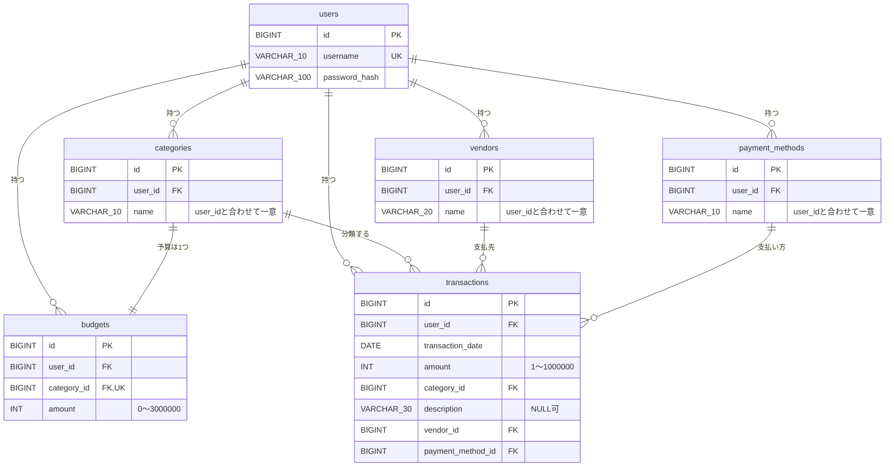

# 設計書：HouseholdBudget（Spring Boot版）

[要件定義書](requirements.md) をもとに、何をどう作るかを決めた設計書です。作成の手順は [Phase 1 手順書](../plans/phase-1-design.md) にあります。

- 状態：作成中（章2・章3を記載。章2は確認待ち。他の章は未作成）

## 書き方のルール

- 日本語で、入門者が読めるように書く。
- コードは書かない（表・図・文章だけ）。
- 要件定義書にない機能は足さない。
- 要件にない決定には **（提案）** と書く。
- 技術の選定には、理由を1行書く。
- 決まっていない点は、章8に書く。決まったら各章に反映して、章8から消す。

---

## 1. 全体の構成

（未作成）

---

## 2. 画面とURLの一覧

### 2.1 方針

- URL は英語の小文字とハイフン（B13）。取引・科目などの一覧は複数形（`/transactions`、`/categories`、`/vendors`、`/payment-methods`）。
- 画面を開く処理は **GET**、データを変える処理（登録・変更・削除・ログアウト）は **POST**。理由：HTML のフォームは GET と POST しか送れないため。また、POST にだけ CSRF 対策のトークンを付ける（章7）。
- 登録・変更の画面は、**表示（GET）と送信（POST）を同じ URL** にする（U1）。理由：入力エラーで同じ画面に戻るとき、URL が変わらず分かりやすいため。
- **入力エラーのとき**は、リダイレクトせずに同じ画面を表示し直す。入力した値を残し、エラーメッセージを項目の横に表示する（要件3章、章6）。
- **成功したとき**は、一覧などへ**リダイレクト**する（二重登録の防止）。画面の上に「登録しました」などの成功メッセージを1回だけ表示する。
- 他人のデータ、存在しないID、範囲外の年などを URL に入れたときは、**404**（B7）。専用の簡単なエラー画面（2.5）を表示する。他人のデータがあるかどうかは教えない。
- 取引の登録・変更では、科目・取引先・支払方法を**プルダウン**で選ぶ。並びは登録順（Q14）。
- 削除ボタンを押すと、**確認ダイアログ**（「削除しますか？」）を表示する。取引（要件4.2）だけでなく、科目・取引先・支払方法の削除にも出す（B14）。

### 2.2 画面とURLの一覧

「ログイン」欄の ○ は、ログインが必要。× は、ログインしていなくても開ける。ログインしていない人が ○ の URL を開くと、ログイン画面へ移動する（要件6章）。

**ログイン・登録**

| 画面名 | URL | 方法 | ログイン | 説明 |
|---|---|---|---|---|
| トップ | `/` | GET | ○ | 取引一覧へ移動する（Q12） |
| ログイン | `/login` | GET | × | ログイン画面を表示する |
| ログイン処理 | `/login` | POST | × | ユーザー名とパスワードを確認する（Spring Security が処理）。成功したら取引一覧へ。失敗したらログイン画面に戻り、「ユーザー名またはパスワードが違います」と表示（B8） |
| ログアウト | `/logout` | POST | ○ | ログアウトして、ログイン画面へ移動する |
| アカウント登録 | `/register` | GET | × | 登録画面を表示する |
| アカウント登録処理 | `/register` | POST | × | ユーザーと初期データ（3.11）を作る。成功したらログイン画面へ（Q11） |

**取引**

| 画面名 | URL | 方法 | ログイン | 説明 |
|---|---|---|---|---|
| 取引一覧 | `/transactions` | GET | ○ | 自分の取引を、日付の新しい順（同じ日は登録の新しい順）で全件表示する（Q4・Q5） |
| 取引登録 | `/transactions/new` | GET | ○ | 登録フォームを表示する |
| 取引登録処理 | `/transactions/new` | POST | ○ | 入力チェックをして登録する |
| 取引詳細 | `/transactions/{id}` | GET | ○ | 1件の取引を表示する。編集・削除のボタンがある |
| 取引編集 | `/transactions/{id}/edit` | GET | ○ | 登録済みの値が入ったフォームを表示する |
| 取引編集処理 | `/transactions/{id}/edit` | POST | ○ | 入力チェックをして更新する |
| 取引削除処理 | `/transactions/{id}/delete` | POST | ○ | 取引を削除する（確認ダイアログあり） |

**科目・取引先・支払方法**（3つとも同じ形。Q13）

| 画面名 | URL | 方法 | ログイン | 説明 |
|---|---|---|---|---|
| 科目一覧 | `/categories` | GET | ○ | 自分の科目を登録順で表示する。上に追加フォームがある |
| 科目追加処理 | `/categories` | POST | ○ | 入力チェックをして追加する。同時に予算0円の行を作る（Q3） |
| 科目変更 | `/categories/{id}/edit` | GET | ○ | 名前を変更するフォームを表示する |
| 科目変更処理 | `/categories/{id}/edit` | POST | ○ | 入力チェックをして名前を更新する |
| 科目削除処理 | `/categories/{id}/delete` | POST | ○ | 使用中でなく、予算が0円のときだけ削除する（確認ダイアログあり） |
| 取引先一覧・追加処理 | `/vendors` | GET / POST | ○ | 科目一覧・追加処理と同じ形 |
| 取引先変更・変更処理 | `/vendors/{id}/edit` | GET / POST | ○ | 科目変更・変更処理と同じ形 |
| 取引先削除処理 | `/vendors/{id}/delete` | POST | ○ | 使用中でないときだけ削除する（確認ダイアログあり） |
| 支払方法一覧・追加処理 | `/payment-methods` | GET / POST | ○ | 科目一覧・追加処理と同じ形 |
| 支払方法変更・変更処理 | `/payment-methods/{id}/edit` | GET / POST | ○ | 科目変更・変更処理と同じ形 |
| 支払方法削除処理 | `/payment-methods/{id}/delete` | POST | ○ | 使用中でないときだけ削除する（確認ダイアログあり） |

**予算・予実比較**

| 画面名 | URL | 方法 | ログイン | 説明 |
|---|---|---|---|---|
| 予算設定 | `/budgets` | GET | ○ | 自分の全科目の予算額を、まとめて入力できる形で表示する（Q8） |
| 予算設定処理 | `/budgets` | POST | ○ | 全科目の予算額を入力チェックして、まとめて保存する |
| 予実比較 | `/comparison` | GET | ○ | 季節ごとの科目別の予算・実績・差額を表示する（2.4） |

- 画面を表示するための CSS や画像（`/css/**` など）も、ログイン前から読めるようにする（章7）。
- 詳細は、取引にだけ作る。科目・取引先・支払方法には詳細画面を作らない（一覧で足りるため）。

### 2.3 画面ごとの表示項目と入力項目

入力項目の制限（文字数・範囲）は要件5章のとおり。チェックの方法は章6。

**共通（ヘッダー・メッセージ・表示の形）**

- ヘッダー（ログイン後の全画面）：メニュー（取引一覧、科目、取引先、支払方法、予算、予実比較）、ログイン中のユーザー名、ログアウトボタン。
- 成功メッセージ、エラーメッセージの表示場所を、画面の上部に決めておく。
- ログイン前の画面（ログイン、アカウント登録）には、メニューは出さない。
- **金額の表示の形**：3桁ごとにカンマで区切り、末尾に「円」を付ける。例：`30,000円`。マイナスは `-5,000円`（予実比較の差額など）。
- **日付の表示の形**：`2026/10/19`（年/月/日）。
- 上の表示の形は、**一覧・詳細・予実比較など、表示するときだけ**に使う。**入力欄には使わず、数字だけを入力する**（金額は `30000`、日付は日付入力の標準の形）。理由：カンマや「円」を入力させると、入力エラーが増えるため（B5：小数・カンマ・全角数字は入力エラー）。

**ログイン `/login`**

| 種類 | 項目 |
|---|---|
| 入力 | ユーザー名、パスワード |
| 表示 | 「アカウント登録」へのリンク。登録成功後は「登録しました。ログインしてください」、ログアウト後は「ログアウトしました」、失敗後は「ユーザー名またはパスワードが違います」 |

- 失敗してもユーザー名は残し、パスワードは残さない。

**アカウント登録 `/register`**

| 種類 | 項目 | 制限 |
|---|---|---|
| 入力 | ユーザー名 | 必須、半角英数字のみ、10文字以下、重複不可 |
| 入力 | パスワード | 8文字以上30文字以下 |
| 表示 | 「ログイン」へのリンク | |

- 入力エラーのときは、ユーザー名を残し、パスワードは残さない。理由：パスワードを画面に再表示しないため。

**取引一覧 `/transactions`**

| 種類 | 項目 |
|---|---|
| 表示 | 一覧の列：日付、科目、取引先、支払方法、摘要、金額。行ごとに「詳細」へのリンク |
| 表示 | 「取引を登録」ボタン（`/transactions/new` へ） |
| 表示 | 取引が0件のときは「取引はまだありません」 |

- 編集・削除のボタンは、一覧には置かない（U3）。

**取引登録 `/transactions/new`、取引編集 `/transactions/{id}/edit`**（同じ形）

| 種類 | 項目 | 制限 |
|---|---|---|
| 入力 | 日付 | 必須。範囲の制限なし（Q15）。登録画面では今日の日付を最初に入れておく（U7） |
| 入力 | 金額 | 必須。1円以上1,000,000円以下の整数 |
| 入力 | 科目 | 必須。プルダウン（自分の科目） |
| 入力 | 摘要 | 任意。30文字以下 |
| 入力 | 取引先 | 必須。プルダウン（自分の取引先） |
| 入力 | 支払方法 | 必須。プルダウン（自分の支払方法） |
| 表示 | 「戻る」リンク（取引一覧へ） | |

- 編集画面では、登録済みの値が入った状態で表示する。
- プルダウンが空のとき（B2）は、「先に科目を追加してください」のように、足りない種類を知らせてそのマスタの画面へのリンクを出す。

**取引詳細 `/transactions/{id}`**

| 種類 | 項目 |
|---|---|
| 表示 | 日付、科目、取引先、支払方法、摘要（なければ空欄）、金額 |
| 操作 | 「編集」ボタン（編集画面へ）、「削除」ボタン（確認ダイアログ → 削除処理）、「一覧に戻る」リンク |

**科目一覧 `/categories`**（取引先 `/vendors`、支払方法 `/payment-methods` も同じ形）

| 種類 | 項目 | 制限 |
|---|---|---|
| 入力（上のフォーム） | 名前 | 必須。科目は10文字以下、取引先は20文字以下、支払方法は10文字以下。同じ人の中で重複不可 |
| 表示（一覧） | 名前（登録順）。行ごとに「変更」リンクと「削除」ボタン | |
| 表示 | 0件のときは「まだありません」 | |

- 削除ボタンは、使用中のものにも表示する。押したときに確認ダイアログの後、削除できない理由をメッセージで表示する（一覧に戻る）。理由：「使用中」「予算が0円でない」を、画面のメッセージとして示すため（Phase 4 の完了条件）。
  - 科目：「取引で使われているため削除できません」「予算が0円ではないため削除できません」
  - 取引先・支払方法：「取引で使われているため削除できません」
- 入力エラー（空欄、文字数超過、重複）のときは、一覧を再表示し、フォームに入力値を残してエラーを表示する。

**科目変更 `/categories/{id}/edit`**（取引先・支払方法も同じ形）

| 種類 | 項目 | 制限 |
|---|---|---|
| 入力 | 名前（今の名前が入った状態） | 追加と同じ。ただし、自分自身の今の名前は重複とみなさない |
| 表示 | 「戻る」リンク（一覧へ） | |

**予算設定 `/budgets`**

| 種類 | 項目 | 制限 |
|---|---|---|
| 表示 | 科目名（登録順） | |
| 入力 | 科目ごとの予算額（今の額が入った状態） | 必須。0円以上3,000,000円以下の整数。0円は可、マイナスは不可 |
| 操作 | 「保存」ボタン（全科目をまとめて保存） | |

- 1つでも入力エラーがあれば、**何も保存せず**、入力値を残して画面を表示し直す。理由：一部だけ保存されると分かりにくいため。
- 科目が0件のときは、「先に科目を追加してください」と表示する。

**予実比較 `/comparison`**（2.4 で詳しく書く）

| 種類 | 項目 |
|---|---|
| 表示 | 見出し（年と季節、期間）、表（科目、予算、実績、差額。最下行に合計行）、「前の季節」「次の季節」のリンク |
| 表示 | 赤字・青字の色分け（要件4.4） |

### 2.4 予実比較の URL と季節の切り替え（Q7・B15）

**URL の形**：`/comparison?year=2026&season=spring`

| パラメータ | 値 | 意味 |
|---|---|---|
| `year` | 2000〜2100 の整数 | 季節の「年」。**冬は12月がある年**（例：`year=2026&season=winter` は2026年12月〜2027年2月） |
| `season` | `spring`（春）、`summer`（夏）、`autumn`（秋）、`winter`（冬） | 季節 |

- **パラメータなしで開いたとき**（メニューから開いたとき）は、**今日（日本時間）が属する季節**を表示する。冬は12月を起点に年を判定する（要件4.4）。
- 見出しには年・季節・期間を書く。例：「2026年 春（3月〜5月）」「2026年 冬（2026年12月〜2027年2月）」。
- **切り替え**は、見出しの両脇の「前の季節」「次の季節」のリンクで行う。リンクの先は、年と季節を含む URL。

| 今の季節 | 前の季節 | 次の季節 |
|---|---|---|
| 春（Y年） | 冬（Y−1年） | 夏（Y年） |
| 夏（Y年） | 春（Y年） | 秋（Y年） |
| 秋（Y年） | 夏（Y年） | 冬（Y年） |
| 冬（Y年） | 秋（Y年） | 春（Y＋1年） |

- **表示できる範囲**は、**2000年春から2100年冬まで**。範囲の端では、範囲外へのリンクを出さない（B15）。
  - 2000年春では、「前の季節」を出さない。
  - 2100年冬では、「次の季節」を出さない。
- **404 になる場合**（B15）：`year` が2000〜2100以外、数字でない／`season` が上の4つ以外／`year` と `season` の**片方だけ**を指定した。
- 表の中身：科目ごとに、予算、実績（その季節の取引の合計。なければ0円）、差額（予算 − 実績。超過するとマイナス）。最下行に合計行（予算・実績・差額の合計）。色は、各行と合計行に同じルール（要件4.4）。金額の表示の形は 2.3 のとおり。
- 未来の季節も表示できる（実績は0円になる）。

### 2.5 エラー画面（404）

- 次のとき、404 の専用画面（B7）を表示する：存在しないURL、存在しないID、他人のデータのID、予実比較の範囲外の年・不正な季節。
- 表示：「ページが見つかりません」と、取引一覧へ戻るリンク。ログイン前でも表示できるようにする。
- 404 以外のエラー画面（予期しないエラーなど）は、章7で扱いを決める。

### 2.6 操作のあと、どの画面に戻るか

| 操作 | 成功したとき | 失敗したとき |
|---|---|---|
| アカウント登録 | ログイン画面へ。「登録しました。ログインしてください」（Q11） | 登録画面を表示し直す（ユーザー名を残す） |
| ログイン | 取引一覧へ（Q12、U5） | ログイン画面へ。「ユーザー名またはパスワードが違います」 |
| ログアウト | ログイン画面へ。「ログアウトしました」 | — |
| 取引の登録 | 取引一覧へ。「登録しました」 | 登録画面を表示し直す（入力値を残す） |
| 取引の更新 | 取引一覧へ。「更新しました」（U2） | 編集画面を表示し直す（入力値を残す） |
| 取引の削除 | 取引一覧へ。「削除しました」 | 存在しない・他人の取引は404 |
| 科目・取引先・支払方法の追加 | それぞれの一覧へ。「追加しました」 | 一覧を表示し直す（入力値を残す） |
| 〃 変更 | それぞれの一覧へ。「変更しました」 | 変更画面を表示し直す（入力値を残す） |
| 〃 削除 | それぞれの一覧へ。「削除しました」 | 削除できない理由を表示して、一覧へ（2.3） |
| 予算の保存 | 予算設定画面へ。「保存しました」（U4） | 予算設定画面を表示し直す（入力値を残す。何も保存しない） |
| 予実比較の切り替え | （画面を開くだけ） | 範囲外・不正な指定は404 |

### 2.7 要件3章の機能と、画面・URLの対応

| 要件3章の機能 | 実現する画面・URL |
|---|---|
| ログイン機能（4.1：アカウント登録、ログイン、ログアウト、ユーザーごとのデータ分離） | `/register`（GET・POST）、`/login`（GET・POST）、`/logout`（POST）。データ分離は全画面で `user_id` で絞る（3.9） |
| 取引の一覧表示 | `/transactions`（GET） |
| 取引の登録 | `/transactions/new`（GET・POST） |
| 取引の詳細表示 | `/transactions/{id}`（GET） |
| 取引の編集 | `/transactions/{id}/edit`（GET・POST） |
| 取引の削除（確認ダイアログあり） | `/transactions/{id}/delete`（POST）。ボタンは詳細画面 |
| 入力チェック（必須・文字数・金額の範囲、入力値の保持） | 入力のあるすべての画面（2.3）。方法は章6 |
| 科目の追加・変更・削除 | `/categories`（GET・POST）、`/categories/{id}/edit`（GET・POST）、`/categories/{id}/delete`（POST） |
| 取引先の追加・変更・削除 | `/vendors`、`/vendors/{id}/edit`、`/vendors/{id}/delete` |
| 支払方法の追加・変更・削除 | `/payment-methods`、`/payment-methods/{id}/edit`、`/payment-methods/{id}/delete` |
| 予算の設定 | `/budgets`（GET・POST） |
| 予実比較（季節ごと、色分け、合計行） | `/comparison`（GET）。`year` と `season` で季節を指定 |
| 初期データ（4.3）、ログインしていない人は開けない（6章） | `/register` の処理で作成（3.11）。ログイン前に開けるのは `/login`、`/register`、CSS などと404画面だけ |

### 2.8 追加で決めた点（確定）

要件にもそれまでの決定にもなかった点を、確認のうえで決めたものです。

| 番号 | 決めたこと | 理由 |
|---|---|---|
| U1 | 登録・編集の送信先は、表示と同じ URL にする（`/transactions/new`、`/transactions/{id}/edit` へ POST） | 入力エラーのとき URL が変わらない |
| U2 | 取引の更新が成功したら、詳細ではなく取引一覧へ戻る | 実行計画書の Phase 5 のとおり |
| U3 | 取引の「編集」「削除」ボタンは詳細画面にだけ置き、一覧には「詳細」リンクだけ置く | 一覧を簡単にし、誤って削除するのを防ぐ |
| U4 | 予算を保存したら、予算設定画面に戻り「保存しました」を表示する | 続けて直しやすい |
| U5 | ログイン成功後は、開こうとしていたURLに関係なく、いつも取引一覧へ移動する | 簡単で、Q12 と合う |
| U6 | ログイン済みの人が `/login`・`/register` を開いたときの特別な動きは作らない（そのまま表示する） | 要件にないため |
| U7 | 取引登録画面の日付の初期値を、今日にする | 入力の手間を減らす |

---

## 3. テーブル設計

### 3.1 方針

- テーブルは **6つ**：`users`（利用者）、`categories`（科目）、`vendors`（取引先）、`payment_methods`（支払方法）、`budgets`（予算）、`transactions`（取引）。
- 予算は科目の列にせず、**別テーブル（`budgets`）にする**。理由：予算という考え方をはっきり分けるため。将来、季節ごとの予算などに広げやすいため。
- 季節（春・夏・秋・冬）はテーブルにせず、プログラムの中で月から求める（Phase 7）。理由：4つで変わらず、月との対応が決まっているため。
- データベースは MySQL（InnoDB、文字コード `utf8mb4`）。理由：要件で指定されており、日本語を保存できるため。
- 主キー（`id`）は、すべて `BIGINT` の自動採番（`AUTO_INCREMENT`）。（提案）理由：件数の上限を気にしなくてよく、全テーブルで同じ形にできるため。
- 並び順の「登録順」は **`id` の順**とする。作成日時の列を持たないため。自動採番の `id` は登録順に増える。これが、取引一覧の「同じ日は登録の新しい順」（Q4）と、科目・取引先・支払方法の「登録順」（Q14）の根拠になる。
- 金額は円単位の整数で、`INT`。（提案）理由：円に小数がなく、最大でも300万円で収まるため。季節ごとの合計は `INT` を超えることがあるので、プログラム側では `Long` で扱う（章5）。
- 作成日時・更新日時の列は持たない（B4）。
- 名前の文字数は、`VARCHAR(n)` の `n` 文字として数える。全角も半角も1文字。
- テーブル作成は `schema.sql` に `CREATE TABLE IF NOT EXISTS` で書く。`DROP TABLE` は入れない（Phase 2）。
- テーブル名・列名の英語名は **確定**（3.8）。

### 3.2 `users`（利用者）

| 列名 | 型 | NULL | 制約 | 説明 |
|---|---|---|---|---|
| `id` | BIGINT | 不可 | 主キー、自動採番 | 利用者ID |
| `username` | VARCHAR(10) | 不可 | **一意（UNIQUE）** | ユーザー名。半角英数字のみ・10文字以下（要件5章）。大文字・小文字は区別しない（3.12 参照） |
| `password_hash` | VARCHAR(100) | 不可 | | BCrypt でハッシュ化したパスワード。元のパスワードは保存しない。（提案）100桁にしているのは、ハッシュの前に付く方式名の分の余裕のため |

- パスワードの文字数チェック（8〜30文字）は、ハッシュ化する前に画面の入力で行う。ハッシュは長さが変わるため、この列では確認しない。
- 半角英数字のみという制限は、プログラムの入力チェックで行う（章6）。DBでは制限しない。

### 3.3 `categories`（科目）

| 列名 | 型 | NULL | 制約 | 説明 |
|---|---|---|---|---|
| `id` | BIGINT | 不可 | 主キー、自動採番 | 科目ID |
| `user_id` | BIGINT | 不可 | 外部キー → `users.id` | 持ち主 |
| `name` | VARCHAR(10) | 不可 | `(user_id, name)` で**一意** | 科目名。10文字以下 |

### 3.4 `vendors`（取引先）

| 列名 | 型 | NULL | 制約 | 説明 |
|---|---|---|---|---|
| `id` | BIGINT | 不可 | 主キー、自動採番 | 取引先ID |
| `user_id` | BIGINT | 不可 | 外部キー → `users.id` | 持ち主 |
| `name` | VARCHAR(20) | 不可 | `(user_id, name)` で**一意** | 取引先名。20文字以下 |

### 3.5 `payment_methods`（支払方法）

| 列名 | 型 | NULL | 制約 | 説明 |
|---|---|---|---|---|
| `id` | BIGINT | 不可 | 主キー、自動採番 | 支払方法ID |
| `user_id` | BIGINT | 不可 | 外部キー → `users.id` | 持ち主 |
| `name` | VARCHAR(10) | 不可 | `(user_id, name)` で**一意** | 支払方法名。10文字以下 |

### 3.6 `budgets`（予算）と `transactions`（取引）

**`budgets`**

| 列名 | 型 | NULL | 制約 | 説明 |
|---|---|---|---|---|
| `id` | BIGINT | 不可 | 主キー、自動採番 | 予算ID |
| `user_id` | BIGINT | 不可 | 外部キー → `users.id` | 持ち主 |
| `category_id` | BIGINT | 不可 | 外部キー → `categories.id`、**一意** | 科目。**1科目に予算は1つ**（要件4.3） |
| `amount` | INT | 不可 | 0以上3,000,000以下（CHECK） | 1つの季節分の予算額。0円も可 |

- 予算の行は、科目を作るときに必ず一緒に作る（初期の科目は30,000円、追加した科目は0円）。したがって「予算未設定」の状態は通常起こらない。

**`transactions`**

| 列名 | 型 | NULL | 制約 | 説明 |
|---|---|---|---|---|
| `id` | BIGINT | 不可 | 主キー、自動採番 | 取引ID |
| `user_id` | BIGINT | 不可 | 外部キー → `users.id` | 持ち主 |
| `transaction_date` | DATE | 不可 | | 取引の日付。範囲の制限なし |
| `amount` | INT | 不可 | 1以上1,000,000以下（CHECK） | 金額 |
| `category_id` | BIGINT | 不可 | 外部キー → `categories.id` | 科目 |
| `description` | VARCHAR(30) | **可** | | 摘要。30文字以下。**入力が任意なのは摘要のみ**（要件4.2） |
| `vendor_id` | BIGINT | 不可 | 外部キー → `vendors.id` | 取引先 |
| `payment_method_id` | BIGINT | 不可 | 外部キー → `payment_methods.id` | 支払方法 |

- 日付の列名を `date` にしないのは、MySQL の予約語に近く紛らわしいため。（提案）
- 摘要が空欄のときは、空文字ではなく NULL で保存する。（提案）
- 検索を速くする索引（インデックス）：`(user_id, transaction_date)`。一覧と予実比較の集計は、どちらも「自分の取引を日付で絞る」ため。（提案）
- 金額・予算額の範囲は、画面での入力チェック（章6）に加えて、DB の CHECK 制約でも守る。（提案）理由：入力チェックをすり抜けても、おかしな値を保存させないため。

### 3.7 外部キーと、削除したときの動き

| 外部キー | 削除したときの動き | 理由 |
|---|---|---|
| `categories.user_id` / `vendors.user_id` / `payment_methods.user_id` / `budgets.user_id` / `transactions.user_id` → `users` | 拒否（RESTRICT） | 利用者を削除する機能は要件にないため、DBが拒否すれば十分 |
| `transactions.category_id` → `categories` | 拒否（RESTRICT） | 取引で使用中の科目は削除できない（要件4.3）。DBでも守る |
| `transactions.vendor_id` → `vendors` | 拒否（RESTRICT） | 同上（取引先） |
| `transactions.payment_method_id` → `payment_methods` | 拒否（RESTRICT） | 同上（支払方法） |
| `budgets.category_id` → `categories` | 拒否（RESTRICT） | 予算が0円の科目だけ削除できる。削除するときは、プログラムが**先に予算の行を削除し、続けて科目を削除する**（同じトランザクション、章5）。（提案）理由：予算が0円でない科目を、DBが黙って消す事故を防ぐため |

- **取引の削除**：行そのものをDBから消す（物理削除、Q2）。他のテーブルが取引を参照していないので、制約なし。
- **科目・取引先・支払方法の削除**：行をDBから消す（Q1）。削除できる条件（使用中でない、予算が0円）はプログラムで先に確認し、メッセージを表示する（章5・6）。外部キーは、確認をすり抜けた場合の最後の守りとして働く。
- **予算の削除**：科目の削除と同時のみ。予算だけを消す機能はない。

### 3.8 テーブル名・列名の英語名（確定）

| 日本語 | テーブル名 | 主な列名 | 補足 |
|---|---|---|---|
| 利用者 | `users` | `username`、`password_hash` | `password` ではなく `password_hash` にして、ハッシュであると分かるようにした |
| 科目 | `categories` | `name` | |
| 取引先 | `vendors` | `name` | ほかの案：`partners`、`payees`。「お金の支払先」を指す一般的な語として `vendors` にした |
| 支払方法 | `payment_methods` | `name` | |
| 予算 | `budgets` | `amount`、`category_id` | |
| 取引 | `transactions` | `transaction_date`、`amount`、`description`、`category_id`、`vendor_id`、`payment_method_id` | `description` は摘要。`date` を避けて `transaction_date` にした |

規則：英語の小文字とアンダースコア（`snake_case`）。テーブル名は複数形。外部キーの列は「相手の単数形 + `_id`」。

### 3.9 `user_id` によるデータの分け方

要件4.1：他のユーザーのデータは、見ることも変更することもできない。

- `users` 以外の5つのテーブルは、すべて `user_id` を持つ。`NOT NULL` で `users` への外部キーを付け、持ち主のいないデータを作れないようにする。
- **ログイン中のユーザーのIDは、ログインの情報（セッション）から取り出す。画面から送られてきた値は使わない。** 画面の値を使うと、書き換えられて他人のIDにされるため。
- 検索・更新・削除は、必ず **「ID と `user_id` の両方」** で絞る。例：取引の詳細は「取引ID が○○で、かつ `user_id` が自分」。見つからなければ404（B7）。他人のデータがあるかどうかを教えないため。
- 一覧・集計（取引一覧、予算設定、予実比較）も、`user_id` で絞る。
- 取引・予算の登録や更新のとき、画面から送られた科目・取引先・支払方法のIDが**自分のものか**を、Serviceで確認する（章5）。他人のIDを混ぜて送られても保存しない。
- （提案）`(科目ID, user_id)` の組み合わせをDBの外部キーにして、他人の科目をDBでも拒否する案もあるが、**採用しない**。理由：Spring Data JPA での扱いが複雑になり、入門者には負担が大きいため。代わりに Service での確認と、Phase 8 の2ユーザーでのテストで守る。

### 3.10 ER図

### 3.11 新しいユーザーの初期データ

アカウントを登録したとき、次のデータを**ユーザーの作成と同じトランザクション**で作る（要件4.3）。途中で失敗したら、ユーザーも含めてすべて取り消す。

| 種類 | 内容 |
|---|---|
| 科目と予算 | 交通費（予算 30,000円）、食費（予算 30,000円）、雑費（予算 30,000円） |
| 取引先 | コンビニ、ガソリンスタンド、Amazon |
| 支払方法 | 現金、クレジットカード |

- 上の順番で作る。一覧とプルダウンは登録順（`id` の順）に並ぶため、この順で表示される（Q14）。
- 取引は作らない。
- 初期データは、ユーザーごとに別々の行として作る（他のユーザーと共有しない）。

### 3.12 照合順序の検討項目（Phase 2 で試して決める）

**照合順序**とは、文字列を比べるときの決まりです。同じ名前かどうかの判定（`UNIQUE` 制約）や、検索に使われます。MySQL の標準（`utf8mb4_0900_ai_ci`）は、次を**同じとみなす可能性**があります。

- 大文字と小文字（`A` と `a`）
- 濁点の有無（`カ` と `ガ`）
- ひらがなとカタカナ（`ひ` と `ヒ`）
- 全角と半角（`ｱ` と `ア`）

日本語の科目名などで、別の名前なのに「すでにあります」となる（誤動作する）おそれがあります。

**決めること**

| 項目 | 決め方 |
|---|---|
| `username`（半角英数字のみ） | 大文字・小文字は同じとみなす（Q10）。この方針を実現できる照合順序かを確認する |
| `categories.name`、`vendors.name`、`payment_methods.name`（日本語を含む） | 上の4種類のうち、どれを同じとみなすか（同じ名前として重複不可にするか）を決める |

**候補**

| 案 | 内容 | 気になる点 |
|---|---|---|
| 1 | 標準のまま | 日本語の名前で、別の名前が重複扱いになるおそれ |
| 2 | 名前の列だけ、文字を区別する照合順序にする（例：大文字小文字・濁点・かな・幅を区別するもの） | `username` は区別しないままにするため、列ごとに照合順序が違う設計になる |
| 3 | DBの `UNIQUE` は区別する照合順序にして、「同じとみなす」判定はアプリで行う | 処理が増える |

**Phase 2 での確かめ方**

- MySQL に試しの表を作り、次の組み合わせを登録して、重複扱い（エラー）になるかを確認する：`A` と `a`、`カ` と `ガ`、`ひ` と `ヒ`、`ｱ` と `ア`、`コンビニ` と `ｺﾝﾋﾞﾆ`。
- 結果をこの節に書き足し、選んだ案とその理由を1行で記録する。決まるまで、この節は章8にも未決事項として残す。

---

## 4. パッケージとクラスの構成

（未作成）

---

## 5. 主な処理の流れ

（未作成）

---

## 6. 入力チェックの実現方法

（未作成）

---

## 7. セキュリティ対策の実現方法

（未作成）

---

## 8. 決まっていない点

（未作成。照合順序（3.12）を、最後にここへまとめる）
