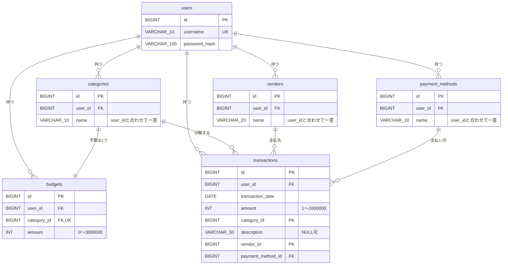

# 設計書：HouseholdBudget（Spring Boot版）

[要件定義書](requirements.md) をもとに、何をどう作るかを決めた設計書です。作成の手順は [Phase 1 手順書](../plans/phase-1-design.md) にあります。

- 状態：作成中（章3のみ記載。他の章は未作成）

## 書き方のルール

- 日本語で、入門者が読めるように書く。
- コードは書かない（表・図・文章だけ）。
- 要件定義書にない機能は足さない。
- 要件にない決定には **（提案）** と書く。
- 技術の選定には、理由を1行書く。
- 決まっていない点は、章8に書く。決まったら各章に反映して、章8から消す。

---

## 1. 全体の構成

（未作成）

---

## 2. 画面とURLの一覧

（未作成）

---

## 3. テーブル設計

### 3.1 方針

- テーブルは **6つ**：`users`（利用者）、`categories`（科目）、`vendors`（取引先）、`payment_methods`（支払方法）、`budgets`（予算）、`transactions`（取引）。
- 予算は科目の列にせず、**別テーブル（`budgets`）にする**。理由：予算という考え方をはっきり分けるため。将来、季節ごとの予算などに広げやすいため。
- 季節（春・夏・秋・冬）はテーブルにせず、プログラムの中で月から求める（Phase 7）。理由：4つで変わらず、月との対応が決まっているため。
- データベースは MySQL（InnoDB、文字コード `utf8mb4`）。理由：要件で指定されており、日本語を保存できるため。
- 主キー（`id`）は、すべて `BIGINT` の自動採番（`AUTO_INCREMENT`）。（提案）理由：件数の上限を気にしなくてよく、全テーブルで同じ形にできるため。
- 並び順の「登録順」は **`id` の順**とする。作成日時の列を持たないため。自動採番の `id` は登録順に増える。これが、取引一覧の「同じ日は登録の新しい順」（Q4）と、科目・取引先・支払方法の「登録順」（Q14）の根拠になる。
- 金額は円単位の整数で、`INT`。（提案）理由：円に小数がなく、最大でも300万円で収まるため。季節ごとの合計は `INT` を超えることがあるので、プログラム側では `Long` で扱う（章5）。
- 作成日時・更新日時の列は持たない（B4）。
- 名前の文字数は、`VARCHAR(n)` の `n` 文字として数える。全角も半角も1文字。
- テーブル作成は `schema.sql` に `CREATE TABLE IF NOT EXISTS` で書く。`DROP TABLE` は入れない（Phase 2）。
- テーブル名・列名の英語名は **確定**（3.8）。

### 3.2 `users`（利用者）

| 列名 | 型 | NULL | 制約 | 説明 |
|---|---|---|---|---|
| `id` | BIGINT | 不可 | 主キー、自動採番 | 利用者ID |
| `username` | VARCHAR(10) | 不可 | **一意（UNIQUE）** | ユーザー名。半角英数字のみ・10文字以下（要件5章）。大文字・小文字は区別しない（3.12 参照） |
| `password_hash` | VARCHAR(100) | 不可 | | BCrypt でハッシュ化したパスワード。元のパスワードは保存しない。（提案）100桁にしているのは、ハッシュの前に付く方式名の分の余裕のため |

- パスワードの文字数チェック（8〜30文字）は、ハッシュ化する前に画面の入力で行う。ハッシュは長さが変わるため、この列では確認しない。
- 半角英数字のみという制限は、プログラムの入力チェックで行う（章6）。DBでは制限しない。

### 3.3 `categories`（科目）

| 列名 | 型 | NULL | 制約 | 説明 |
|---|---|---|---|---|
| `id` | BIGINT | 不可 | 主キー、自動採番 | 科目ID |
| `user_id` | BIGINT | 不可 | 外部キー → `users.id` | 持ち主 |
| `name` | VARCHAR(10) | 不可 | `(user_id, name)` で**一意** | 科目名。10文字以下 |

### 3.4 `vendors`（取引先）

| 列名 | 型 | NULL | 制約 | 説明 |
|---|---|---|---|---|
| `id` | BIGINT | 不可 | 主キー、自動採番 | 取引先ID |
| `user_id` | BIGINT | 不可 | 外部キー → `users.id` | 持ち主 |
| `name` | VARCHAR(20) | 不可 | `(user_id, name)` で**一意** | 取引先名。20文字以下 |

### 3.5 `payment_methods`（支払方法）

| 列名 | 型 | NULL | 制約 | 説明 |
|---|---|---|---|---|
| `id` | BIGINT | 不可 | 主キー、自動採番 | 支払方法ID |
| `user_id` | BIGINT | 不可 | 外部キー → `users.id` | 持ち主 |
| `name` | VARCHAR(10) | 不可 | `(user_id, name)` で**一意** | 支払方法名。10文字以下 |

### 3.6 `budgets`（予算）と `transactions`（取引）

**`budgets`**

| 列名 | 型 | NULL | 制約 | 説明 |
|---|---|---|---|---|
| `id` | BIGINT | 不可 | 主キー、自動採番 | 予算ID |
| `user_id` | BIGINT | 不可 | 外部キー → `users.id` | 持ち主 |
| `category_id` | BIGINT | 不可 | 外部キー → `categories.id`、**一意** | 科目。**1科目に予算は1つ**（要件4.3） |
| `amount` | INT | 不可 | 0以上3,000,000以下（CHECK） | 1つの季節分の予算額。0円も可 |

- 予算の行は、科目を作るときに必ず一緒に作る（初期の科目は30,000円、追加した科目は0円）。したがって「予算未設定」の状態は通常起こらない。

**`transactions`**

| 列名 | 型 | NULL | 制約 | 説明 |
|---|---|---|---|---|
| `id` | BIGINT | 不可 | 主キー、自動採番 | 取引ID |
| `user_id` | BIGINT | 不可 | 外部キー → `users.id` | 持ち主 |
| `transaction_date` | DATE | 不可 | | 取引の日付。範囲の制限なし |
| `amount` | INT | 不可 | 1以上1,000,000以下（CHECK） | 金額 |
| `category_id` | BIGINT | 不可 | 外部キー → `categories.id` | 科目 |
| `description` | VARCHAR(30) | **可** | | 摘要。30文字以下。**入力が任意なのは摘要のみ**（要件4.2） |
| `vendor_id` | BIGINT | 不可 | 外部キー → `vendors.id` | 取引先 |
| `payment_method_id` | BIGINT | 不可 | 外部キー → `payment_methods.id` | 支払方法 |

- 日付の列名を `date` にしないのは、MySQL の予約語に近く紛らわしいため。（提案）
- 摘要が空欄のときは、空文字ではなく NULL で保存する。（提案）
- 検索を速くする索引（インデックス）：`(user_id, transaction_date)`。一覧と予実比較の集計は、どちらも「自分の取引を日付で絞る」ため。（提案）
- 金額・予算額の範囲は、画面での入力チェック（章6）に加えて、DB の CHECK 制約でも守る。（提案）理由：入力チェックをすり抜けても、おかしな値を保存させないため。

### 3.7 外部キーと、削除したときの動き

| 外部キー | 削除したときの動き | 理由 |
|---|---|---|
| `categories.user_id` / `vendors.user_id` / `payment_methods.user_id` / `budgets.user_id` / `transactions.user_id` → `users` | 拒否（RESTRICT） | 利用者を削除する機能は要件にないため、DBが拒否すれば十分 |
| `transactions.category_id` → `categories` | 拒否（RESTRICT） | 取引で使用中の科目は削除できない（要件4.3）。DBでも守る |
| `transactions.vendor_id` → `vendors` | 拒否（RESTRICT） | 同上（取引先） |
| `transactions.payment_method_id` → `payment_methods` | 拒否（RESTRICT） | 同上（支払方法） |
| `budgets.category_id` → `categories` | 拒否（RESTRICT） | 予算が0円の科目だけ削除できる。削除するときは、プログラムが**先に予算の行を削除し、続けて科目を削除する**（同じトランザクション、章5）。（提案）理由：予算が0円でない科目を、DBが黙って消す事故を防ぐため |

- **取引の削除**：行そのものをDBから消す（物理削除、Q2）。他のテーブルが取引を参照していないので、制約なし。
- **科目・取引先・支払方法の削除**：行をDBから消す（Q1）。削除できる条件（使用中でない、予算が0円）はプログラムで先に確認し、メッセージを表示する（章5・6）。外部キーは、確認をすり抜けた場合の最後の守りとして働く。
- **予算の削除**：科目の削除と同時のみ。予算だけを消す機能はない。

### 3.8 テーブル名・列名の英語名（確定）

| 日本語 | テーブル名 | 主な列名 | 補足 |
|---|---|---|---|
| 利用者 | `users` | `username`、`password_hash` | `password` ではなく `password_hash` にして、ハッシュであると分かるようにした |
| 科目 | `categories` | `name` | |
| 取引先 | `vendors` | `name` | ほかの案：`partners`、`payees`。「お金の支払先」を指す一般的な語として `vendors` にした |
| 支払方法 | `payment_methods` | `name` | |
| 予算 | `budgets` | `amount`、`category_id` | |
| 取引 | `transactions` | `transaction_date`、`amount`、`description`、`category_id`、`vendor_id`、`payment_method_id` | `description` は摘要。`date` を避けて `transaction_date` にした |

規則：英語の小文字とアンダースコア（`snake_case`）。テーブル名は複数形。外部キーの列は「相手の単数形 + `_id`」。

### 3.9 `user_id` によるデータの分け方

要件4.1：他のユーザーのデータは、見ることも変更することもできない。

- `users` 以外の5つのテーブルは、すべて `user_id` を持つ。`NOT NULL` で `users` への外部キーを付け、持ち主のいないデータを作れないようにする。
- **ログイン中のユーザーのIDは、ログインの情報（セッション）から取り出す。画面から送られてきた値は使わない。** 画面の値を使うと、書き換えられて他人のIDにされるため。
- 検索・更新・削除は、必ず **「ID と `user_id` の両方」** で絞る。例：取引の詳細は「取引ID が○○で、かつ `user_id` が自分」。見つからなければ404（B7）。他人のデータがあるかどうかを教えないため。
- 一覧・集計（取引一覧、予算設定、予実比較）も、`user_id` で絞る。
- 取引・予算の登録や更新のとき、画面から送られた科目・取引先・支払方法のIDが**自分のものか**を、Serviceで確認する（章5）。他人のIDを混ぜて送られても保存しない。
- （提案）`(科目ID, user_id)` の組み合わせをDBの外部キーにして、他人の科目をDBでも拒否する案もあるが、**採用しない**。理由：Spring Data JPA での扱いが複雑になり、入門者には負担が大きいため。代わりに Service での確認と、Phase 8 の2ユーザーでのテストで守る。

### 3.10 ER図

### 3.11 新しいユーザーの初期データ

アカウントを登録したとき、次のデータを**ユーザーの作成と同じトランザクション**で作る（要件4.3）。途中で失敗したら、ユーザーも含めてすべて取り消す。

| 種類 | 内容 |
|---|---|
| 科目と予算 | 交通費（予算 30,000円）、食費（予算 30,000円）、雑費（予算 30,000円） |
| 取引先 | コンビニ、ガソリンスタンド、Amazon |
| 支払方法 | 現金、クレジットカード |

- 上の順番で作る。一覧とプルダウンは登録順（`id` の順）に並ぶため、この順で表示される（Q14）。
- 取引は作らない。
- 初期データは、ユーザーごとに別々の行として作る（他のユーザーと共有しない）。

### 3.12 照合順序の検討項目（Phase 2 で試して決める）

**照合順序**とは、文字列を比べるときの決まりです。同じ名前かどうかの判定（`UNIQUE` 制約）や、検索に使われます。MySQL の標準（`utf8mb4_0900_ai_ci`）は、次を**同じとみなす可能性**があります。

- 大文字と小文字（`A` と `a`）
- 濁点の有無（`カ` と `ガ`）
- ひらがなとカタカナ（`ひ` と `ヒ`）
- 全角と半角（`ｱ` と `ア`）

日本語の科目名などで、別の名前なのに「すでにあります」となる（誤動作する）おそれがあります。

**決めること**

| 項目 | 決め方 |
|---|---|
| `username`（半角英数字のみ） | 大文字・小文字は同じとみなす（Q10）。この方針を実現できる照合順序かを確認する |
| `categories.name`、`vendors.name`、`payment_methods.name`（日本語を含む） | 上の4種類のうち、どれを同じとみなすか（同じ名前として重複不可にするか）を決める |

**候補**

| 案 | 内容 | 気になる点 |
|---|---|---|
| 1 | 標準のまま | 日本語の名前で、別の名前が重複扱いになるおそれ |
| 2 | 名前の列だけ、文字を区別する照合順序にする（例：大文字小文字・濁点・かな・幅を区別するもの） | `username` は区別しないままにするため、列ごとに照合順序が違う設計になる |
| 3 | DBの `UNIQUE` は区別する照合順序にして、「同じとみなす」判定はアプリで行う | 処理が増える |

**Phase 2 での確かめ方**

- MySQL に試しの表を作り、次の組み合わせを登録して、重複扱い（エラー）になるかを確認する：`A` と `a`、`カ` と `ガ`、`ひ` と `ヒ`、`ｱ` と `ア`、`コンビニ` と `ｺﾝﾋﾞﾆ`。
- 結果をこの節に書き足し、選んだ案とその理由を1行で記録する。決まるまで、この節は章8にも未決事項として残す。

---

## 4. パッケージとクラスの構成

（未作成）

---

## 5. 主な処理の流れ

（未作成）

---

## 6. 入力チェックの実現方法

（未作成）

---

## 7. セキュリティ対策の実現方法

（未作成）

---

## 8. 決まっていない点

（未作成。照合順序（3.12）を、最後にここへまとめる）
