# 設計書：HouseholdBudget（Spring Boot版）

[要件定義書](requirements.md) をもとに、何をどう作るかを決めた設計書です。作成の手順は [Phase 1 手順書](../plans/phase-1-design.md) にあります。

- 状態：章1〜8を記載。要件との突き合わせ済み（[phase-1-review.md](phase-1-review.md)）

## 書き方のルール

- 日本語で、入門者が読めるように書く。
- コードは書かない（表・図・文章だけ）。
- 要件定義書にない機能は足さない。
- 要件にない決定には **（提案）** と書く。
- 技術の選定には、理由を1行書く。
- 決まっていない点は、章8に書く。決まったら各章に反映して、章8から消す。

---

## 1. 全体の構成

### 1.1 方針

- 画面は**サーバー側で作る**（Thymeleaf が HTML を作ってブラウザへ返す）。画面を JavaScript で組み立てる作りにはしない。理由：要件の機能が「フォームを送って結果を表示する」形で足りるため。
- JavaScript は、少量だけ使う。①削除前の確認ダイアログ（章2）。②ブラウザの「戻る」で覚えていた画面を見せたとき、画面を読み直す短い処理（7.10。Phase 8 の Q8-25）。③取引の登録・編集画面の、金額の入力を助けるボタン（2.3、issue 009）。④予算設定画面の、予算額の合計を、欄を書き換えるたびに計算し直す処理（2.3、issue 019）。いずれも自分で書いた短いもので、**Bootstrap の JavaScript は入れない**。
  - JavaScript を使う決まりは、本人の判断でゆるめてよい（よい機能は入れていく）。ただし、決まりを変えるのは、JavaScript を使う機能を実際に作るときで、要件定義書・設計書から先に直す。そのとき、ブラウザで動きを確かめる方法（issue 008 の自動テストを先に入れるかなど）も一緒に決める（issue 008・009）。
  - **④の確かめ方（issue 019）**：issue 008 の自動テストは入れない。**合計の計算を Console に貼るケースの表で、本人が確かめる**（issue 009 と同じ。案 A）。**MockMvc で HTML の印**（合計の入れ物、固定の文、`hidden`、`<script>` の読み込みの有無）を確かめる（案 C）。このファイルは、**サーバーへの通信をしない**（欄の値を読んで、合計を書くだけ）。
  - **変えない決まり**：利用者の入力を JavaScript の中に埋め込まない（7.5）、画面を JavaScript で組み立てない、CSRF 対策を無効にしない（7.6）、`th:utext` を使わない（7.5）、ライブラリ（jQuery など）や CDN を使わない。
- 利用者ごとのデータ分離は、**すべての検索を `user_id` で絞る**ことで守る（3.9、4.1）。
- 設定のうち、**パスワードなどの秘密は環境変数から読み、リポジトリに書かない**（1.5）。

### 1.2 使う技術と版

版は、**確認できたものだけ**を書く。Spring Boot が管理する部品は、版を書かずに「Spring Boot が管理する版」とする（Spring Boot の版を決めると自動で決まり、こちらで選ばないため）。

| 技術 | 版 | 役割 | 選んだ理由 |
|---|---|---|---|
| Java（JDK） | 25（Eclipse Temurin 25.0.2） | プログラムを書く言語と実行環境 | 要件で指定。導入済みの長期サポート版（Phase 0 で確認済み） |
| Spring Boot | 4.1.2 | アプリの土台。Web サーバー（組み込み）、設定、起動 | 要件で指定。4.1.1 が Java 17〜26 に対応していることは公式ドキュメントで確認済み（Q18）。4.1.2 は 4.1.1 の不具合修正版で、Spring Initializr で選べる安定版のため、こちらを使う |
| Maven（`mvnw`） | プロジェクト付属の Maven Wrapper が使う版 | 部品の管理とビルド | 別にインストールせず、`mvnw` で動かせる（Phase 0）。実行計画書の方針 |
| Thymeleaf | Spring Boot が管理する版 | 画面（HTML）の作成。表示する値は自動で無害化される | Spring Boot の標準的な画面の仕組み。入門者向けで、XSS 対策（章7）が標準で入っている |
| Thymeleaf Extras Spring Security（`thymeleaf-extras-springsecurity6`） | Spring Boot が管理する版 | 画面にログイン中のユーザー名を出す（ヘッダー、2.3） | Spring Security の情報を Thymeleaf から読める。Initializr が Spring Security と Thymeleaf の組み合わせで自動で足す部品で、ユーザー名を出すのに使うため残す（Phase 3 で決定） |
| Bootstrap（CSS のみ） | 5.3.8（Phase 8 で確認。MIT ライセンス） | 画面の見た目を整える。iPad でも見やすくする（Phase 8、Q8-12） | 自作の CSS だけでは、余白・ボタン・表・フォームの見た目をそろえる手間が大きい。CSS だけを使い、Bootstrap の JavaScript は入れない（ハンバーガーメニューなどは使わない。自作の短い JavaScript は別。1.1）。アプリの中に1ファイルで置き（CDN なし）、面接会場でインターネットにつながらなくても崩れない。ライセンスの表示は `THIRD-PARTY-NOTICES.md` |
| Zen Kaku Gothic New（フォント） | 1.002（もとの配布元 `googlefonts/zen-kakugothic` の commit `2705757e17e42954f3acbdf921ac0ae24d1270cd`。SIL OFL 1.1） | 画面の文字のフォント。太さ 400 と 700 の woff2 を 1 ファイルずつ（`static/fonts/`） | 本人が選んだ（issue 015）。アプリの中に置き（CDN なし）、面接会場でインターネットにつながらなくても同じ見た目になる。ライセンスの表示は `THIRD-PARTY-NOTICES.md` と `static/fonts/OFL.txt` |
| Spring MVC | Spring Boot が管理する版 | URL を受けて Controller を呼ぶ | Web アプリの基本部品 |
| Spring Security | Spring Boot が管理する版 | ログイン・ログアウト、ログイン必須、CSRF 対策 | 要件6章のセキュリティを自作せずに実現でき、実績がある |
| BCrypt | Spring Security に含まれる | パスワードのハッシュ化 | 元に戻せない形で保存する要件（6章）。標準で使える |
| Spring Data JPA（と Hibernate） | Spring Boot が管理する版 | Entity と Repository によるデータベースの読み書き | SQL を文字列で連結せずに書け、SQL インジェクション対策（要件6章）になる |
| Bean Validation | Spring Boot が管理する版 | 入力チェック（必須・文字数・範囲） | 項目に印を付けるだけで書け、エラーメッセージを画面に戻しやすい（章6） |
| MySQL Server | 9.7（確認した版：9.7.2） | データベース | 要件で指定。導入済み（Phase 0） |
| MySQL 用ドライバ | Spring Boot が管理する版 | アプリから MySQL につなぐ | MySQL を使うために必要 |
| JUnit など（テスト） | Spring Boot が管理する版 | 単体テスト・自動テスト（Phase 7・8） | Spring Boot の標準のテスト部品 |
| VS Code / Git / GitHub / Claude Code | 最新版（Phase 0 で確認済み） | 開発の道具 | 要件で指定（7章） |

- パスワードの文字数（8〜30）はハッシュ化の前の入力で確認する（3.2）。
- 画面の見た目は、**Bootstrap の CSS**（`static/css/bootstrap.min.css`。アプリの中に置き、CDN は使わない。**Bootstrap の JavaScript は入れない**）と、自作の CSS（`static/css/style.css`。色・文字・余白・角の丸みの決まりと、取引の登録・編集画面の 2 列の幅の規則、トップの円・棒・「今日」の線の規則、Bootstrap にないもの、テストが確かめるクラス）で作る。画面の文字は Zen Kaku Gothic New で、フォントのファイルは `static/fonts/` に置く（CDN は使わない）。（Phase 8、Q8-17〜Q8-21）

### 1.3 層の分担

詳しいクラスは 4.2〜4.7。ここでは役割だけを短く書く。

| 層・パッケージ | 分担 | 触ってよいもの |
|---|---|---|
| `controller` | URL を受け取り、入力を Form で受けて入力チェックの結果を確かめ、Service を呼び、画面を選ぶ。ログイン中のユーザーIDを Service に渡す | Form、Service、DTO |
| `service` | 処理の中身。持ち主の確認、重複・削除の可否の判断、トランザクション（途中で失敗したら全部取り消す） | Repository、`domain` |
| `repository` | データベースの読み書きだけ。すべての検索を `user_id` で絞る | Entity |
| `domain` | 季節の決定と色の判定。画面にもデータベースにも依存しない計算 | （ほかに頼らない） |
| `security` | ログイン・ログアウト・パスワードのハッシュ化・「ログインしていないと開けない」制限 | Spring Security の部品 |
| `exception` | 「見つからない」「重複」「削除不可」の例外と、404 画面への変換 | — |

- 守る決まり：Controller は Repository を直接呼ばない。Service は画面（テンプレート）のことを知らない。

### 1.4 リクエストの通る道すじ

どのリクエストも、先に **Spring Security の入口**を通る。ここでログインしているか（未ログインなら `/login` へ）と、POST の CSRF トークンを確かめる（章7）。

#### 例1：取引を登録する（`POST /transactions/new`）

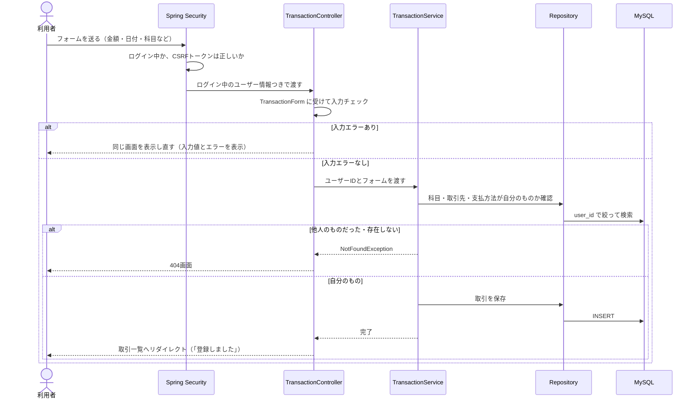

#### 例2：予実比較を開く（`GET /comparison?year=2026&season=spring`）

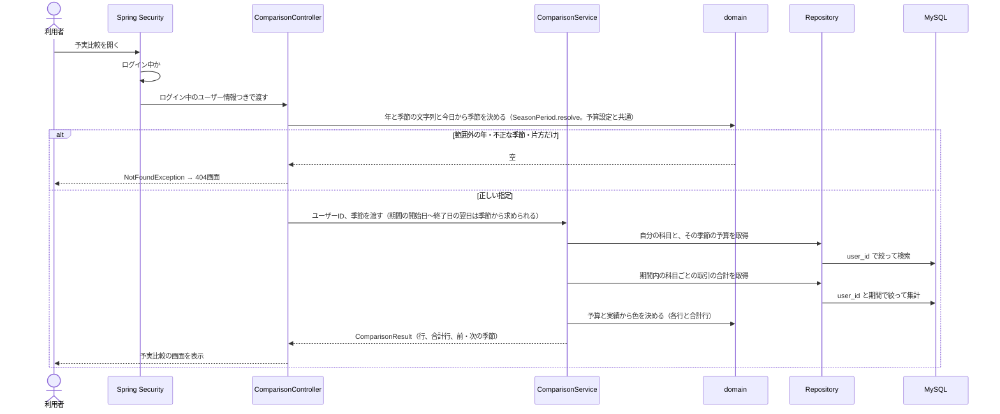

- 同じ道すじで、取引の更新・削除、科目などの追加・変更・削除、予算の保存も動く（POST はリダイレクトで戻る、GET は画面を返す）。

### 1.5 設定と秘密情報

- 設定ファイル（`application.properties`）は、リポジトリに入れる。ただし、**データベースのパスワードは書かず、環境変数から読む**。
- 接続先やユーザー名も、環境変数から読めるようにする（変えられる設定として）。環境変数の名前は次のとおり（Phase 2 で決めた）。値がないときは起動を失敗させる（既定値は付けない。設定漏れに気づけるため）。

| 用途 | 環境変数の名前 |
|---|---|
| DB の接続先 | `HB_DB_URL` |
| DB のユーザー名 | `HB_DB_USER` |
| DB のパスワード | `HB_DB_PASSWORD` |
- 環境変数は、各自のパソコンで設定する。READMEには「設定する環境変数の名前」だけを書き、値は書かない（Phase 9）。
- パスワードを含むファイルを作る場合は、`.gitignore` で除外する（Phase 2）。
- アプリ専用のDBユーザーを作り、このアプリのデータベースだけを操作できるようにする（Phase 2）。`root` はアプリから使わない。（Phase 0 で扱った `root` のパスワードは、リポジトリに書かない）

### 1.6 動かす環境

- 動かす場所は、自分のパソコンだけ（インターネットへの公開は要件9章で対象外）。
- 起動の流れ：MySQL のサービスが動いている状態で、`mvnw` からアプリを起動し、ブラウザで開く（Phase 2）。起動のたびに `schema.sql` が実行される（Q17、章3）。
- 日付の基準は日本時間（B6、`AppConfig`、4.5）。

---

## 2. 画面とURLの一覧

### 2.1 方針

- URL は英語の小文字とハイフン（B13）。取引・科目などの一覧は複数形（`/transactions`、`/categories`、`/vendors`、`/payment-methods`）。
- 画面を開く処理は **GET**、データを変える処理（登録・変更・削除・ログアウト）は **POST**。理由：HTML のフォームは GET と POST しか送れないため。また、POST にだけ CSRF 対策のトークンを付ける（章7）。
- 登録・変更の画面は、**表示（GET）と送信（POST）を同じ URL** にする（U1）。理由：入力エラーで同じ画面に戻るとき、URL が変わらず分かりやすいため。
- **入力エラーのとき**は、リダイレクトせずに同じ画面を表示し直す。入力した値を残し、エラーメッセージを項目の横に表示する（要件3章、章6）。
- **成功したとき**は、一覧などへ**リダイレクト**する（二重登録の防止）。画面の上に「登録しました」などの成功メッセージを1回だけ表示する。
- 他人のデータ、存在しないID、範囲外の年などを URL に入れたときは、**404**（B7）。専用の簡単なエラー画面（2.5）を表示する。他人のデータがあるかどうかは教えない。
- 取引の登録・変更では、科目・取引先・支払方法を**プルダウン**で選ぶ。並びは登録順（Q14）。
- 削除ボタンを押すと、**確認ダイアログ**（「削除しますか？」）を表示する。書き方は、削除ボタンのフォームの `onsubmit` 属性に固定の文言で書く（`return confirm('削除しますか？')`）。この確認のための JavaScript のファイルは作らない（Phase 4 で決定。ファイルを増やさず、一番簡単なため。利用者の入力は埋め込まない、7.5）。なお、「戻る」の処理（7.10）と金額の入力を助けるボタン（2.3）は、別のファイル（`static/js/back-reload.js`、`static/js/amount-buttons.js`）にする。取引（要件4.2）だけでなく、科目・取引先・支払方法の削除にも出す（B14）。

### 2.2 画面とURLの一覧

「ログイン」欄の ○ は、ログインが必要。× は、ログインしていなくても開ける。ログインしていない人が ○ の URL を開くと、ログイン画面へ移動する（要件6章）。

**ログイン・登録**

| 画面名 | URL | 方法 | ログイン | 説明 |
|---|---|---|---|---|
| トップ | `/` | GET | ○ | 今の季節のメーター、今週の円グラフ、今週の科目ごとのメーターを表示する。ログイン後の最初の画面（issue 010、Q010-1） |
| ログイン | `/login` | GET | × | ログイン画面を表示する |
| ログイン処理 | `/login` | POST | × | ユーザー名とパスワードを確認する（Spring Security が処理）。成功したらトップへ。失敗したらログイン画面に戻り、「ユーザー名またはパスワードが違います」と表示（B8） |
| ログアウト | `/logout` | POST | ○ | ログアウトして、ログイン画面へ移動する |
| アカウント登録 | `/register` | GET | × | 登録画面を表示する |
| アカウント登録処理 | `/register` | POST | × | ユーザーと初期データ（3.11）を作る。成功したらログイン画面へ（Q11） |

**取引**

| 画面名 | URL | 方法 | ログイン | 説明 |
|---|---|---|---|---|
| 取引一覧 | `/transactions` | GET | ○ | 自分の取引を、日付の新しい順（同じ日は登録の新しい順）で全件表示する（Q4・Q5） |
| 取引登録 | `/transactions/new` | GET | ○ | 登録フォームを表示する。`copyFrom`（写す元の取引ID）を付けると、その取引の値（日付は今日）が入った状態で表示する（複写。保存はしない。U8） |
| 取引登録処理 | `/transactions/new` | POST | ○ | 入力チェックをして登録する |
| 取引詳細 | `/transactions/{id}` | GET | ○ | 1件の取引を表示する。編集・削除・「この取引を写して登録」のボタンがある |
| 取引編集 | `/transactions/{id}/edit` | GET | ○ | 登録済みの値が入ったフォームを表示する |
| 取引編集処理 | `/transactions/{id}/edit` | POST | ○ | 入力チェックをして更新する |
| 取引削除処理 | `/transactions/{id}/delete` | POST | ○ | 取引を削除する（確認ダイアログあり） |

**科目・取引先・支払方法**（3つとも同じ形。Q13）

| 画面名 | URL | 方法 | ログイン | 説明 |
|---|---|---|---|---|
| 科目一覧 | `/categories` | GET | ○ | 自分の科目を登録順で表示する。上に追加フォームがある |
| 科目追加処理 | `/categories` | POST | ○ | 入力チェックをして追加する。同時に、今の季節の予算0円の行を作る（Q3、R11） |
| 科目変更 | `/categories/{id}/edit` | GET | ○ | 名前を変更するフォームを表示する |
| 科目変更処理 | `/categories/{id}/edit` | POST | ○ | 入力チェックをして名前を更新する |
| 科目削除処理 | `/categories/{id}/delete` | POST | ○ | 取引で使われておらず、すべての季節の予算が0円または未設定のときだけ削除する（確認ダイアログあり） |
| 取引先一覧・追加処理 | `/vendors` | GET / POST | ○ | 科目一覧・追加処理と同じ形 |
| 取引先変更・変更処理 | `/vendors/{id}/edit` | GET / POST | ○ | 科目変更・変更処理と同じ形 |
| 取引先削除処理 | `/vendors/{id}/delete` | POST | ○ | 使用中でないときだけ削除する（確認ダイアログあり） |
| 支払方法一覧・追加処理 | `/payment-methods` | GET / POST | ○ | 科目一覧・追加処理と同じ形 |
| 支払方法変更・変更処理 | `/payment-methods/{id}/edit` | GET / POST | ○ | 科目変更・変更処理と同じ形 |
| 支払方法削除処理 | `/payment-methods/{id}/delete` | POST | ○ | 使用中でないときだけ削除する（確認ダイアログあり） |

**予算・予実比較**

| 画面名 | URL | 方法 | ログイン | 説明 |
|---|---|---|---|---|
| 予算設定 | `/budgets`（例：`/budgets?year=2026&season=spring`。自動予算：`/budgets?year=2026&season=winter&auto=1`） | GET | ○ | 指定した季節の、自分の全科目の予算額を、まとめて入力できる形で表示する。季節を指定しないときは今の季節（Q8、R11、2.4）。**任意の `auto`（1・2・3のどれか）があるときは、自動予算の案を入力欄に入れて表示する**（保存はしない。5.14、issue 019）。`auto` が 1〜3 以外（空・`0`・`4`・`abc`・`01` など）なら 404（7.8） |
| 予算設定処理 | `/budgets?year=…&season=…`（画面と同じ URL） | POST | ○ | 指定した季節の全科目の予算額を入力チェックして、まとめて保存する（Q27 の c） |
| 予実比較 | `/comparison`（例：`/comparison?year=2026&season=spring`） | GET | ○ | 季節ごとの科目別の予算・実績・差額を表示する。予算が未設定の科目は「未設定」（2.4） |

- 画面を表示するための CSS や画像（`/css/**`、`/js/**`、`/fonts/**` など）も、ログイン前から読めるようにする（章7）。
- 詳細は、取引にだけ作る。科目・取引先・支払方法には詳細画面を作らない（一覧で足りるため）。

### 2.3 画面ごとの表示項目と入力項目

入力項目の制限（文字数・範囲）は要件5章のとおり。チェックの方法は章6。

**共通（ヘッダー・メッセージ・表示の形）**

- ヘッダー（ログイン後の全画面）：**左にロゴ（34px の角丸の四角に白い線のアイコン。地は主ボタンの地 `#0B7F7E`）と「家計・予実管理」（太さ 700。押すとトップへ）**、**真ん中にメニュー（トップ、取引一覧、科目、取引先、支払方法、予算、予実比較。各項目に線のアイコンと文字。高さ 44px、角 10px。ほかの項目の文字は補足の文字の色）**、**右にログイン中のユーザー名＋「さん」と、ログアウトボタン（白地に枠）**。帯は全幅の白で、中身は最大 1120px（トップの本体と同じ幅）で中央にそろえる。幅がせまいときは、メニューが折り返す（JavaScript は使わない）。**今開いている画面の項目**は、`aria-current="page"` で示し、薄いターコイズの背景と `#0B6E6B` の文字、**太さ 700**（文字の決まりの例外。下の「文字の決まり」）で見せる（クラスは付けない）。取引の登録・編集・詳細の画面は、「取引一覧」の項目を示す。トップの画面は、「トップ」の項目を示す。どの項目かは、各画面がヘッダーの部品に、決まった文字（`top`、`transactions`、`categories`、`vendors`、`payment-methods`、`budgets`、`comparison`）で渡す（利用者の入力は使わない）。
- 成功メッセージ、エラーメッセージの表示場所を、画面の上部に決めておく。
- ログイン前の画面（ログイン、アカウント登録）には、**メニュー・ユーザー名・ログアウトは出さない。ヘッダーは、ログイン後と同じ白い帯・同じ中身の幅（最大 1120px）に、ロゴと「家計・予実管理」だけを置く**（ロゴはログイン後と同じ部品。押すと `/` へ。未ログインは `/login` へ移動する）。
- **金額の表示の形**：3桁ごとにカンマで区切り、末尾に「円」を付ける。例：`30,000円`。マイナスは `-5,000円`（予実比較の差額など）。
- **日付の表示の形**：`2026/10/19`（年/月/日）。
- 表示の形にする方法は、Thymeleaf の標準の書き方（`#numbers.formatInteger(値, 1, 'COMMA')` と `#temporals.format(日付, 'yyyy/MM/dd')`）を、画面ごとに書く。整形のためのクラスは作らない（Phase 5、Q5-9 の A）。
- 上の表示の形は、**一覧・詳細・予実比較など、表示するときだけ**に使う。**入力欄には使わず、数字だけを入力する**（金額は `30000`、日付は日付入力の標準の形）。理由：カンマや「円」を入力させると、入力エラーが増えるため（B5：小数・カンマは入力エラー。全角の数字だけは、半角に直して受け付ける、R13）。

**色の決まり**（issue 015 の 1 回目）

画面の色は、次の表のとおりにする。`style.css` の変数（`--hb-…`）にまとめ、Bootstrap の変数を `style.css` で上書きする（`bootstrap.min.css` は書き換えない）。

| 用途 | 色 | 決まり |
|---|---|---|
| 基本の色（ターコイズ） | `#0E9594` | **枠の線（`border`）だけ**に使う。**取引の登録・編集画面の金額の欄の枠**がその例。文字・背景・棒・円には使わない（`ColorSchemeStyleSheetTest` が、`var(--hb-teal)` を `border` の宣言にだけ許している）。白い文字を乗せると 3.66 対 1 で足りない。枠は、白との比 3.66 対 1 で、部品の目安 3 対 1 を満たす |
| トップの円グラフ・棒（ターコイズの濃淡と灰色） | `--hb-chart-1`〜`--hb-chart-5`（濃い→薄いターコイズ）、`--hb-chart-6`（灰色） | 値（2026年11月8日に測り直して決めた。棒は棒の地との比 3.17。結果は手順書 issue-010-top.md の 5.6）：`#0B6E6B`、`#0F8F8E`、`#3FAAA9`、`#78C2C1`、`#A5D8D7`、`#8A9694`。トップの円グラフに使う。**赤・青・💮 の色は、円と色の四角には使わない。一覧の金額の文字（赤・青）と科目名の横の 💮 には使う**（意味の色。今週の判定。issue 017 の見直し）。棒は `--hb-chart-2`。基本の色（`#0E9594`）とは別の変数で、値も変える（棒・円に基本の色の変数を使わないため） |
| 薄い色（ターコイズ） | `#E1F3F2` | **今開いている画面のメニュー項目**と、小さな印（チップ・アイコンの背景。**きょうのひとことのアイコンの四角、ログイン・登録の紹介のチップとチェックの四角**を含む）だけに使う。**大きな面の背景には使わない** |
| 文字（ターコイズ） | `#0B6E6B` | リンクの文字と、薄いターコイズの上の文字。**季節のメーターの見込みの一文**（issue 018。太さ 700） |
| 本文の文字 | `#24302F` | |
| 補足の文字 | `#56625F` | |
| 背景 | `#F6F8F8` | ページの背景 |
| 主ボタンの地 | `#0B7F7E` | 白い文字を乗せる（4.83 対 1）。**ヘッダーのロゴの四角の地にも使う（白い線のアイコン。比は同じ）。****マウスを載せたとき `#09706F`、押したとき `#085A59`**（白い文字との比は 5.90、8.02）。リンクにマウスを載せたときの色は `#085A59` |
| 入力欄の枠 | `#849290` | 白との比 3.23 対 1、背景 `#F6F8F8` との比 3.03 対 1 |
| **入力欄の地** | **白 `#FFFFFF`** | **入力欄の枠の色は、地が白であることを前提に決めた値**。地の色を変えるときは、枠の色も測り直す |
| ヘッダーの帯 | 白 `#FFFFFF` | ページの背景（`#F6F8F8`）と区切るため。下の線は `#E2E8E8` |
| 区切り線・表の線・ヘッダーの下の線 | `#E2E8E8` | 入力欄の枠は、上の `#849290`。合計行の上の線（予実比較）は、はっきりさせるため `#999` のまま |
| 副ボタン（灰色の枠）の文字と枠 | `#56625F` | 補足の文字と同じ色（背景の上で 5.96 対 1）。Bootstrap の標準 `#6C757D` は、背景の上で 4.40 対 1 で足りなかったため |
| 入力エラーの文字・削除ボタン（赤い枠）の赤 | `#B02A37` | 背景の上で 6.09 対 1、白の上で 6.50 対 1。Bootstrap の標準 `#DC3545` は、背景の上で 4.25 対 1 で足りなかったため。**予実比較の赤（`#c62828`）とは、別の値**（意味が違う：エラーと、予算超過） |
| 予算内の行（💮）の背景 | `#FFF2E5` | 薄いアプリコット。薄いターコイズと区別するため、緑から変えた |
| 赤・青 | `#c62828`・`#1565c0` | 予実比較の**意味の色**。**飾りに使わない**。💮 の背景も意味の色 |
| メッセージの帯（成功・エラー・案内） | Bootstrap の緑・赤・黄 | **そのまま使う**（意味の色）。エラーの帯の文字も Bootstrap のまま（入力エラーの文字 `.field-error` だけ、上の `#B02A37`） |

- 表の見出し行や、行にマウスを載せたときの色には、薄いターコイズを使わない（Bootstrap の標準のまま）。
- 色の値は、実装のあとに、明るさの比を測り直した結果を手順書に記録する。

**文字の決まり**（issue 015 の 2 回目）

画面の文字は、次のとおりにする。`style.css` の変数にまとめ、Bootstrap の変数を `style.css` で上書きする。

| 用途 | 決まり |
|---|---|
| フォント | `"Zen Kaku Gothic New"`。読み込めない間と、フォントにない文字は、`"Hiragino Sans"`、`"Yu Gothic"`、`Meiryo`、`sans-serif` の順に使う（`font-display: swap`）。ファイルはアプリの中（`/fonts/…`）から読み、外のサーバーは使わない |
| 太さ | 本文・**ボタンは 400**。見出し・表の見出し・太字（**取引の登録・編集画面のフォームのラベルを含む**。issue 017）は 700（500 のフォントは置かないので、見出しの標準の 500 は使わない）。**例外：ヘッダーのメニューの、今開いている項目は 700**（issue 017 の 1 回目。ボタンを 400 にしたのは、小さいボタンの 700 の線がつぶれたため。メニューの文字は本文の大きさ〔1rem〕で、それより大きいので 700 にする。ブラウザで確かめて、にじむようなら 400 に戻す）。ロゴの文字も 700 |
| 大きさ（4 段） | 見出し 1.75rem／見出し 2 1.25rem／本文 1rem／補足 0.8125rem |

- 取引の登録・編集画面の金額の欄の文字は、見出しの 1.75rem を使う（5 つ目の大きさは作らない）。
- **例外（issue 017 の 2 回目の見直し。案に合わせた）**：**ログイン・登録の紹介の大きな見出しだけ、34px（2.125rem。変数 `--hb-font-size-intro-title`）、行の間 1.45**。4 段の外の大きさは、ここだけ。ほかの文字は 4 段のまま。説明の文の行の間は 1.85。

- **見直し（2026年11月8日）**：最初の決まりは「見出し・**ボタン**・表の見出し・太字は 700」だった。ブラウザで確かめたところ、「変更」「削除」などの小さいボタンの文字が、700 だと線がつぶれて、にじんだように読みにくかった（小さい日本語の文字を太字（700）にすると、画数の多い字の線がつぶれて、にじんだように読みにくくなる）。**ボタンの文字だけ 400 に戻した**（Bootstrap の標準と同じ）。見出しと表の見出しは、大きさがあるので 700 のまま。
**アイコン**（issue 017）

- 自作の線の SVG（ライブラリは使わない）。12 個：`logo`（ロゴ）、メニューの 7 つ（`top`、`transactions`、`categories`、`vendors`、`payment-methods`、`budgets`、`comparison`）、`plus`（「＋」。線の太さ 2.4）、`sun`（暦のひとこと）、`pie`（グラフへのひとこと）、`check`（チェックの印。ログイン・登録の紹介。`M5 12l5 5 9-10`、線の太さ 2.6）。形は、案（`docs/design/top-mockup-spec.md` の 4 節）のとおり。
- 書き方：`viewBox="0 0 24 24"`、`fill="none"`、`stroke="currentColor"`（文字の色に合わせる）、`stroke-linecap`・`stroke-linejoin` は `round`、`aria-hidden="true"`、`focusable="false"`。大きさは 18px（`sun`・`pie` は 20px）。`xmlns`・`style` 属性・`<script>`・`<image>`・`<use>`・外部の URL は書かない。CSS の `url(`・`mask` は使わない。
- 置き場所は `fragments/icons.html`（部品）。名前は固定の文字だけで渡す（利用者の入力は使わない）。知らない名前では、何も出さない。

- 大きさは **px ではなく rem で書く**。ブラウザの文字の大きさの設定に合わせて、画面全体が変わるようにするため。標準（1rem ＝ 16px）のときは、見出し 28px・見出し 2 20px・本文 16px・補足 13px と同じ見た目になる。

**余白と角の丸み**（issue 015 の 3 回目）

| 用途 | 決まり |
|---|---|
| 余白 | 4・8・12・16・24・32・48px の目盛り。**rem で書く**（0.25・0.5・0.75・1・1.5・2・3rem。文字と同じく、ブラウザの文字の大きさの設定に合わせて変わる）。**例外（issue 017 の 2 回目の見直し。案に合わせた）**：ログイン・登録の紹介の、チップの下 14px（0.875rem）、見出しと説明の間 20px（1.25rem）、紹介とカードの間 72px（4.5rem。2 列のとき）、取引一覧の表のマスの左右 20px（1.25rem）。ほかの余白〔チェックの 2 行の上 24px、2 行の間 12px〕は目盛りの中 |
| 角の丸み | 入力欄・ボタン・メッセージの帯 10px／カード 16px |

- `style.css` の変数（`--hb-space-…`、`--hb-radius-…`）にまとめる。Bootstrap の `--bs-border-radius` を `style.css` の `:root` で 10px に上書きし、**全画面の入力欄・ボタン・メッセージの帯に当てる**（`bootstrap.min.css` は書き換えない）。
- カード（白。背景 `#F6F8F8` の上に置く。枠 `#E2E8E8`）にするのは、**取引の登録・編集画面のフォーム、トップのカード（issue 017 の 1 回目）、ログイン・登録のカード、取引一覧の表（2 回目）**。ほかの画面のカード化と、今の余白（目盛りに合わない `6px` や `4px 10px`）の統一は、この回でもしない。**影は付けない**（issue 017 の Q017-15）。余白の変数を使うのは、この画面の新しい規則だけ。

**ログイン `/login`**

| 種類 | 項目 |
|---|---|
| 入力 | ユーザー名、パスワード |
| 表示 | 「アカウント登録」へのリンク。登録成功後は「登録しました。ログインしてください」、ログアウト後は「ログアウトしました」、失敗後は「ユーザー名またはパスワードが違います」 |

- **並び（issue 017 の 2 回目）**：ヘッダーはロゴだけ。**左に紹介**（小さなチップ「季節ごとの家計簿」、大きな見出し「予算と実績を、3 か月ごとにふり返る。」、説明文、チェックの印つきの 2 行「自分のデータは、自分だけが見られます」「科目・取引先・支払方法は、自由に追加できます」）、**右に白いカード**（見出し「ログイン」、ユーザー名・パスワード、幅いっぱいの主ボタン「ログイン」、区切り線、「はじめての方は アカウント登録」）。**幅 768px 以上で 2 列。せまいときは縦 1 列で、カードが上、紹介が下**（HTML の順は紹介 → カードのまま。CSS の `order` で入れ替える。Q017-10）。本体の最大幅は 960px（`main.container`）。**紹介のゆとり（案に合わせた）**：チップの下 14px、大きな見出しと説明の間 20px、説明の行の間 1.85、説明の下（チェックの 2 行の上）24px、チェックの 2 行の間 12px、紹介とカードの間 72px（2 列のとき）。
- 説明文：「取引を記録すると、季節（春・夏・秋・冬）ごとに、科目別の予算と実績が並びます。予算の 1/3 を超えて、予算以内に収まった科目には 💮 が付きます。」（予実比較の決まりと同じ言い方。Q017-11。テンプレートに直接書く）。
- 大きな見出しは `<h1>`（**34px、行の間 1.45、700**。4 段の例外。下の「文字の決まり」）、カードの見出しは `<h2>`（1.25rem、700）。カードの角は 16px、影は付けない。入力欄の高さは 46px（このカードの中だけ）。チップとチェックの四角は薄いターコイズ（小さな印）。メッセージ（登録成功・ログアウト・失敗）は、カードの中に出す。
- 失敗してもユーザー名は残し、パスワードは残さない。

**アカウント登録 `/register`**

| 種類 | 項目 | 制限 |
|---|---|---|
| 入力 | ユーザー名 | 必須、半角英数字のみ、10文字以下、重複不可 |
| 入力 | パスワード | 半角の英数字と記号のみ（空白は不可）、8文字以上30文字以下 |
| 表示 | 「ログイン」へのリンク | |

- **並び（issue 017 の 2 回目）**：ログインと同じ形。ロゴだけのヘッダー、左に**ログインと同じ紹介**（`fragments/auth-intro.html`）、右に白いカード（見出し「アカウント登録」、ユーザー名・パスワード、主ボタン「登録」、区切り線、「アカウントをお持ちの方は ログイン」）。項目のラベル・入力チェック・エラーの出る場所は今のまま。

- 入力エラーのときは、ユーザー名を残し、パスワードは残さない。理由：パスワードを画面に再表示しないため。

**取引一覧 `/transactions`**

| 種類 | 項目 |
|---|---|
| 表示 | 見出しの行：左に「取引一覧」と、小さく「日付の新しい順に、〇 件を表示しています。」（件数はカンマ付き。数と「件」の間は半角の空白。0 件のときは出さない）。右に「＋ 取引を登録」（主ボタン。`/transactions/new` へ）。幅がせまいときは、ボタンが見出しの下に折り返す |
| 表示 | 本体の最大幅は 1120px（トップと同じ。`main.list-wide`。ほかの画面は 960px のまま）。表は白いカード（角 16px）の中。マスの左右の余白は 20px（見出しの行のマスも同じ）。列：日付、科目、取引先、支払方法、摘要、金額、操作。見出しの行は小さめの灰色の文字、日付・支払方法・摘要は灰色、金額は太字・右寄せ（桁をそろえる）、操作は「詳細」のリンク（行ごと）。幅がせまいときは、表がカードの中で横にスクロールする |
| 表示 | 取引が0件のときは「取引はまだありません」（表・カード・件数の文は出さない。「＋ 取引を登録」は出す） |

- 件数は、画面に渡した取引の数（全件表示なので、全件数と同じ。SQL は増やさない）。ページ分け・絞り込みを作るときは、この文の意味を見直す。
- カードの見た目は、取引一覧だけの目印のクラスで付ける（`table.list` は、ほかの表も使うため）。

- 編集・削除のボタンは、一覧には置かない（U3）。

**取引登録 `/transactions/new`、取引編集 `/transactions/{id}/edit`**（同じ形）

| 種類 | 項目 | 制限 |
|---|---|---|
| 入力 | 日付 | 必須。**2000年3月1日から2100年12月31日まで**（R12、R15）。登録画面では今日の日付を最初に入れておく（U7） |
| 入力 | 金額 | 必須。1円以上1,000,000円以下の整数 |
| 入力 | 科目 | 必須。プルダウン（自分の科目） |
| 入力 | 摘要 | 任意。30文字以下 |
| 入力 | 取引先 | 必須。プルダウン（自分の取引先） |
| 入力 | 支払方法 | 必須。プルダウン（自分の支払方法） |
| 表示 | 上に「← 取引一覧に戻る」リンク（取引一覧へ）。右下に「キャンセル」（取引一覧へ）と送信ボタン（登録画面は「登録する」、編集画面は「更新」） | |

- **2 列の並び**（issue 015 の 3 回目）：画面の幅が 992px 以上（Bootstrap の `lg`）のときは 2 列にする。**左**：日付・科目・取引先・支払方法。**右**：金額（大きめ、ターコイズの枠、数字は右寄せ）、その下に金額を助けるボタン、その下に摘要。**項目のラベル（日付・科目・取引先・支払方法・金額・摘要）は太字（700）**（issue 017 の見直し。この画面のフォームのラベルだけ。ほかの画面のラベルは今のまま。ブラウザでにじむようなら 400 に戻す）。金額のラベルは「金額（円）」。ラベルの横に、必須の項目（日付・金額・科目・取引先・支払方法）は「必須」、摘要は「任意・30 文字以内」の**灰色の小さな文字（補足の文字の色、0.8125rem、400。背景も枠もなし）**を出す（表示だけで、`required`・`maxlength` は付けない、G1。issue 015 では薄いターコイズのチップだったが、issue 017 で文字だけにした）。金額の範囲の補足は、金額の欄の下に補足の文字で出す。文は「1〜1,000,000 の整数」（issue 017 の見直し。ラベルが「金額（円）」になったので、頭の「円。」をなくし、カンマを付けた。入力する欄には、カンマを使わない）。992px より小さいときは 1 列で、本体の幅は 420px まで。**日付の欄の幅は、992px 以上のとき、列の半分（最大 220px）**（1 列のときは今のまま、列いっぱい）。**992px 以上では、左の列の項目の間隔を広げ（`2rem`）、左の列の終わり（支払方法の欄の下）が、右の列の摘要の欄の下より少し下に来るようにする**（右の列は金額のボタンと説明で長いため。値はブラウザで見て調整してよい）。1 列のときの項目の順は、左の列、右の列の順（日付・科目・取引先・支払方法・金額・摘要）。複写の固定の 1 行と、案内（先に科目を追加してください…）は、2 列の外、フォームの上に全幅で出す。2 列は CSS だけで作る（JavaScript は足さない）。
- 編集画面では、登録済みの値が入った状態で表示する。
- **取引の複写**（issue 012。U8）：詳細画面の「この取引を写して登録」から `GET /transactions/new?copyFrom={取引ID}` で開くと、登録画面が、その取引の科目・取引先・支払方法・金額・摘要が入った状態で表示される。**日付は今日**（U7）。**開いただけでは、何も保存しない**（GET。データベースに書かない）。「登録する」を押すと、`POST /transactions/new` で、通常の登録と同じ入力チェックをして保存する。写す元の取引は変わらない。
  - 写す元は、**ID とログイン中のユーザーの ID の両方で探す**（3.9。既存の取引の取得と同じ処理を使う）。他人の取引、存在しない ID、数字でない・範囲外の `copyFrom` は、**404**（2.5、7.8）。`copyFrom` が空のとき（`?copyFrom=`）は、指定がないものとして、ふつうの登録画面を表示する。
  - 複写した画面には、固定の 1 行「この取引を写しています。日付は今日にしてあります。「登録する」を押すまで、保存されません。」を出す（HTML に書いてある文で、利用者の入力は入れない）。入力エラーで表示し直した画面には出さない（`copyFrom` は送られないため）。
  - 金額の欄に値が入っているので、金額ボタンの規則（上の「画面を開いたとき、金額の欄に値が入っていれば…」）により、**税込のボタンは最初から押せない**。足すボタンとクリアは使える。複写のための JavaScript は足さない。
- **金額の入力を助けるボタン**（issue 009。Q009-1〜Q009-15）。金額の欄の**すぐ下に、2行**で並べる（2 列のときは、右の列の、金額の欄の下）。1行目：足すボタン（+1・+10・+100・+1,000・+10,000）。2行目：税込（10%）、税込（8%）、**そのすぐ右**に「クリア」（押し間違いを防ぐため、税込のボタンとの間に、ほかのボタンの間より少し広いすき間を空ける。Bootstrap の余白のクラスで）。狭い画面では折り返す（クリアは、税込のボタンのすぐ右に並び、一緒に折り返す）。Bootstrap のボタン（`btn`）を使い、`btn-sm` にしない。**取引の登録・編集の画面だけ**に置く（予算設定には置かない）。
  - ボタンは `type="button"`（送信しない）。どの欄に効くかは、ボタンの `data-` 属性で指す。
  - **足すボタン**：欄の数に足す。欄が空なら 0 として足す。ボタンの**文字**は、3桁ごとにカンマを付ける（+1,000、+10,000）。`data-amount-add` の値と、金額の欄の中の数字は、カンマなしの数字だけ（1000、10000）。**税込のボタン**：欄の数（税抜）を、1.1倍（10%）または1.08倍（8%）に置き換える。**端数は切り捨て**。計算は整数だけで行う（小数の誤差を避ける）。**クリアのボタン**：欄を空にする（0 ではなく空。空のまま送信ボタン（「登録する」または「更新」）を押すと、サーバーが今までどおり「金額を入力してください」のエラーを出す）。ボタンは `type="button"`。
  - **欄へのカーソル（フォーカス）**：**クリアのときだけ**、押したあとに欄へカーソルを戻す（`focus()`）。理由：クリアのあとは、新しい数字を打つことがほとんどで、すぐ打てるほうがよい。**足すボタンと税込のボタンは、戻さない**。足すボタンは続けて押すことが多く、iPad などで数字のキーボードが出ると、ボタンが隠れて邪魔になるため。
  - **欄の読み方**：サーバーの `StrictIntegerEditor` と同じ形（前後の空白を取る。全角の数字を半角に直す。半角の数字だけなら計算する）。数字以外（`1,200`、`12円`、小数、マイナス）や、桁が多すぎる値（**先頭のゼロを除いて10桁以上**。例：`0000000001` は、ゼロを除くと1桁なので計算する。`1234567890` は10桁なので何もしない）は、**何もしない**（メッセージも出さない。サーバーが今までどおりエラーにする）。計算のあとの欄は、数字だけ（カンマを付けない）。
  - **空白の取り方の違い**：「前後の空白を取る」は、JavaScript の `trim()` が行う。`trim()` は、サーバー（Java の `strip()`）より少し広い種類の空白（ノーブレークスペースなど）を取り除く。ボタンを押した結果は、きれいな数字だけになるので、害はない。そろえることはしない。
  - **範囲は JavaScript で判断しない**。上限（1,000,000円）を超えても、そのまま欄に入れる。送信ボタン（「登録する」または「更新」）を押すと、サーバーが今までどおり入力チェックを行い、エラーと入力値を表示する（入力チェックの決まりは、サーバーの1か所にそろえる。章6）。
  - **税込のボタンは、続けて押せない**（税込みの金額にもう一度税を掛けないため）。税込のボタンを押すと、税込の2つのボタンを押せなくする。**足すボタンで金額を変えても、押せないまま**。押せるようになるのは、**欄を手で書き換えたとき**（`input` イベント）と、**欄を空にしたとき**だけ。**クリアのボタンは、欄を空にするので、税込のボタンを押せるようにする（金額が入った状態で開いた画面でも）。ボタンが値を書き換えても `input` イベントは起きないので、クリアのボタンの処理の中で、押せるようにする処理を直接呼ぶ**。クリア以外のボタンが書き換えた値は、「手で書き換えた」ことにしない。
  - **画面を開いたとき、金額の欄に値が入っていれば、最初から税込のボタンを押せない**（その金額が、すでに税込みかもしれないため）。**欄が空なら、最初は押せる**。この決まり一つで、編集画面（保存した金額が入っている）と、入力エラーで表示し直した登録画面（入力した金額が残っている）の両方を扱う。サーバーからの特別な印（`data-tax-locked`）は使わない。欄に入った値かどうかは、JavaScript が、画面を開いたときに欄の値を見て決める（空かどうか。前後の空白は無視）。押せるようになる条件（手で書き換える・空にする・クリア）は、変えない。
  - **税込のボタンが押せないときは、固定の文を表示する**：「この金額には、もう税をかけられません。税抜きの金額を入れ直すと、押せるようになります。」（HTML に書いてある文で、JavaScript は、見せる・隠すだけ。文を JavaScript で作らない。他の画面の文言と同じく、`messages.properties` ではなくテンプレートに書く）。
  - **JavaScript が無効のとき**：ボタンと上の文は、HTML に `hidden` で書いてあり、JavaScript が動いたときだけ、ボタンを表示する。無効のときは、今までどおり、欄に手で数字を入力して使える。
  - **8%と10%が混ざったレシート**は、ボタンでは計算できない。税率ごとに取引を2件に分けて登録する（要件定義書 8章）。画面の近くに、その旨の1行を出す。
- プルダウンが空のとき（B2）は、「先に科目を追加してください」のように、足りない種類を知らせてそのマスタの画面へのリンクを出す。**足りない種類が複数あるときは、すべて並べる。このとき、フォームと「登録」ボタンは出さない**（Phase 5、Q5-7 の A。足りないまま送っても、必ず入力エラーになるため）。空になるのは登録画面だけで、編集画面では、使用中の科目などは削除できないので空にならない。

**取引詳細 `/transactions/{id}`**

| 種類 | 項目 |
|---|---|
| 表示 | 日付、科目、取引先、支払方法、摘要（なければ空欄）、金額 |
| 操作 | 「編集」ボタン（編集画面へ）、「この取引を写して登録」ボタン（登録画面へ。`/transactions/new?copyFrom={id}`）、「削除」ボタン（確認ダイアログ → 削除処理）、「一覧に戻る」リンク |

**科目一覧 `/categories`**（取引先 `/vendors`、支払方法 `/payment-methods` も同じ形）

| 種類 | 項目 | 制限 |
|---|---|---|
| 入力（上のフォーム） | 名前 | 必須。科目は10文字以下、取引先は20文字以下、支払方法は10文字以下。同じ人の中で重複不可 |
| 表示（一覧） | 名前（登録順）。行ごとに「変更」リンクと「削除」ボタン | |
| 表示 | 0件のときは「まだありません」 | |

- 削除ボタンは、使用中のものにも表示する。押したときに確認ダイアログの後、削除できない理由をメッセージで表示する（一覧に戻る）。理由：「使用中」「予算が0円ではない季節がある」を、画面のメッセージとして示すため（Phase 4 の完了条件）。
  - 科目：「取引で使われているため削除できません」「予算が0円ではない季節があるため削除できません」
  - 取引先・支払方法：「取引で使われているため削除できません」
- 入力エラー（空欄、文字数超過、重複）のときは、一覧を再表示し、フォームに入力値を残してエラーを表示する。

**科目変更 `/categories/{id}/edit`**（取引先・支払方法も同じ形）

| 種類 | 項目 | 制限 |
|---|---|---|
| 入力 | 名前（今の名前が入った状態） | 追加と同じ。ただし、自分自身の今の名前は重複とみなさない |
| 表示 | 「戻る」リンク（一覧へ） | |

**予算設定 `/budgets`**

| 種類 | 項目 | 制限 |
|---|---|---|
| 表示 | 見出し（年と季節、期間。例：「2026年 春（3月〜5月）」）、「前の季節」「次の季節」のリンクと、同じ行の真ん中の「今の季節」ボタン（2.4、Phase 8 の issue 007） | |
| 入力 | 年と季節を選ぶ欄（年は2000〜2100、季節は春・夏・秋・冬。最初の値は今表示している季節）と「表示」ボタン（2.4、Phase 8 の G1、Q8-15、Q8-16） | 選ぶだけで、何も保存しない（GET）。送る URL は `/budgets?year=…&season=…` |
| 表示 | 科目名（登録順）。初期値が未設定の行には「（この季節は未設定）」の印（Q26） | |
| 入力 | 科目ごとの予算額（初期値は下の規則。「自動予算」を押したあとは案が入る） | 必須。0円以上3,000,000円以下の整数。0円は可、マイナスは不可 |
| 操作 | 「自動予算」ボタンと、ボタンの横の一言「手で直した額は、ボタンを押すと消えます。保存した額は、保存するまで変わりません。」（issue 019） | `GET /budgets?year=…&season=…&auto=1` へのリンク（`<a>` をボタンの見た目にする）。押しても保存しない。**過去の同じ季節が範囲（2000年春より前）の外しかないときは、ボタンも一言も出さない** |
| 操作 | 選ぶ欄〔案を入れたあとだけ〕：「1. これで OK」「2. 節約したい（さらに 10% 減らす）」「3. 上乗せしたい（さらに 10% 増やす）」 | GET のリンク 3 つ（`auto=1`・`2`・`3`）。いま選んでいるものを太字にする。選び直すたびに、もとから計算し直す |
| 表示 | 案を入れたあとだけ：最初の文（3 行。傾向の文の下に小さな注記）と、5 列の表（5.14） | 文はすべて `messages.properties` の固定の文。科目名は `th:text` |
| 表示 | 表の最後の合計行（ふだんの画面にも出す）。予算額の合計と、「数字でない欄があります」「空の欄があります」の固定の文（ふだんは `hidden`） | 合計は、JavaScript が欄を書き換えるたびに計算し直す（下） |
| 操作 | 「保存」ボタン（その季節の全科目をまとめて保存） | |

- **季節の指定**：予実比較と同じく、URL に年と季節を持つ（`/budgets?year=2026&season=spring`）。季節を指定せずに開いたときは、今の季節を表示する。範囲は2000年春〜2100年冬で、端のリンクの扱いと404も予実比較と同じ（2.4）。
- **入力欄の最初の値**（Q23・Q24。**issue 019 で変えた**）：
  1. その季節の予算が保存されていれば、その額。
  2. なければ、**0円**（「未設定」の印）。〔前は「直前の設定のある季節の額」だった（Q6-4）。自動予算を入れたので、やめた。「自動予算」の案は、ボタンを押したときだけ入る。〕
- **保存するまで行は作らない**。画面を開いて表示するだけでは、データベースに予算の行は増えない。「保存」を押すと、その季節の**全科目**の行を、表示どおりに作る・更新する（Q25）。初期値の 0 円や自動予算の案のまま変えなかった行も、その額で保存される。
- **自動予算の表**（issue 019。5.14）：「自動予算」を押したあとだけ、表が 5 列になる。「科目／直前の季節の予算／直前の季節の実績／案の根拠／予算額（案が入る）」。真ん中の 3 列は、押したあとだけ。ふだんの画面は、今の 2 列（科目／予算額）のまま。
  - **実績のセル**：直前の季節が今日を含むときは「12,400（11/11 まで）」。**直前の季節が今日を含み、過ぎた日数（今日を含む）が 14 日以上のときだけ**、その下に小さく「このペースなら 約 45,500」を出す（100 円単位に切り上げ。「見込み」という言葉は使わない）。直前の季節が終わっているとき、14 日未満のときは、実績だけ。実績が 0 円の科目には、「このペースなら」を出さない。
  - **案の根拠のセル**：ルール①〜④のどれで決めたかを、固定の文で示す（5.14 の表）。
  - **合計行**：直前の季節の予算の合計（設定済みの科目だけ。1 つもなければ「未設定」）、実績の合計（全科目）とその下の「このペースなら」（**全科目の実績の合計**から同じ式で出す。018 の値は使わない。科目ごとの額の足し算とは、100 円単位の切り上げのため、少しちがうことがある）、予算額の合計。
- **予算額の合計（JavaScript。issue 019）**：`static/js/budget-total.js` が、予算額の入力欄の値を読んで足し、合計行に書く。**開いたとき**と、**欄を書き換えるたび**（`input` の出来事）に計算し直す。欄の読み方は、サーバーの `StrictIntegerEditor`（R13、6.5）と同じ決まりにそろえる（`amount-buttons.js` の読み方と同じ）。前後の空白を取る。**全角の数字（０〜９）は半角に直して、数字として足す**。半角の数字だけが数字。**ほかの文字は「数字でない」**（途中の空白、カンマ、マイナス、小数、16 進〔0x10・#10〕、先頭の +、「円」、全角のマイナスなど。サーバーが通さないものと同じ）。10 桁以上も数字でない扱い（サーバーでも範囲のエラー）。範囲（0〜3,000,000）は JavaScript では判断しない（サーバーが入力チェックする）。**空の欄は、サーバーが入力エラー（必須。`StrictIntegerEditor` が空を `null` にし、`BudgetForm.Row.amount` の `@NotNull` が拒否する）にするので、合計に入れない**。**数字でない欄と空の欄は合計に入れず**、合計の横の固定の文「数字でない欄があります」「空の欄があります」を、それぞれ見せる（`hidden` を外す。両方あれば両方）。JavaScript は、文を作らず、合計の数字を `textContent` に書くだけ（桁区切りのカンマを付ける）。サーバーとは通信しない。この画面だけで読み込む。
  - **JavaScript が無効のとき**：サーバーが、開いたときの合計（欄の最初の値の足し算）を HTML に書いておく。書き換えても、合計は変わらない。**入力エラーで表示し直した画面**は、欄の値が送られた文字なので、サーバーは合計を出さず「—」にする（JavaScript が有効なら、開いたときに計算する）。
- 1つでも入力エラーがあれば、**何も保存せず**、入力値を残して画面を表示し直す。理由：一部だけ保存されると分かりにくいため。
- 保存していない入力は、「前の季節」「今の季節」「次の季節」で移動したとき、および年と季節を選んで「表示」を押したときに、確認なしで捨てられる（Q27 の d）。
- 科目が0件のときは、「先に科目を追加してください」と表示する。

**予実比較 `/comparison`**（2.4 で詳しく書く）

| 種類 | 項目 |
|---|---|
| 表示 | 見出し（年と季節、期間）、表（科目、予算、実績、差額、右端に 💮 の列。最下行に合計行）、「前の季節」「次の季節」のリンクと、同じ行の真ん中の「今の季節」ボタン、年と季節を選ぶ欄と「表示」ボタン（2.4） |
| 表示 | **着地見込み**（issue 018。要件4.4）：今日が属する季節を開いているときだけ、**年と季節を選ぶ欄の下、表の上**に 1 行：「このペースだと、季節の終わりには、合計で約 ○円（予算 ○円）の見込みです。」。見込みの額（100円単位に切り上げた後）が予算を超えるときだけ、その下に「見込みは、予算を上回ります。」を 1 行（超えるかどうかは金額で決め、％では決めない）。その下に、小さい補足「月ごとにまとめて払うものは、払う日で見込みが上下します。」。文字は本文の色（意味の色〔赤・青〕は使わない。印も付けない）。予算が未設定・0 円、過去・未来の季節、科目が0件のときは出さない。式と端数、桁あふれは 5.13 |
| 表示 | 予算が未設定の科目は、予算の欄に「未設定」、差額は空欄、色なし（要件4.4、R11） |
| 表示 | 赤字・青字の色分け（要件4.4）。色は行の文字全体に付ける（F4）。表の下に、色の意味の注記を出す（「赤：予算超過／青：予算の1/3以下／💮：予算内（予算の1/3を超え、予算以下）」、Q7-6、Phase 8 の Q8-32） |
| 表示 | 予算内の行の右端に 💮（要件4.4、Phase 8 の issue 005）。対象は、赤でも青でもなく、予算が設定されていて、実績が0円より大きく、予算の1/3を超え、予算以下の行（予算ちょうども含む。Q8-28、Q8-29）。予算が未設定の行、実績が0円の行、赤・青の行には付けない。**合計行にも同じ判定で付ける**（Q8-27）。新しい右端の列に出す（Q8-30）。**その行（合計行も）の背景を薄いアプリコットにする**（薄いアプリコット `#FFF2E5`。文字の色は変えない。Q8-36、Q8-37。issue 015 で、薄いターコイズとほぼ同じに見えるため、緑から変えた）。**💮 は文字の 1.5 倍の大きさ**にする（Q8-38）。読み上げ用に、絵文字は飾りとして読ませず（`aria-hidden`）、「予算内」を画面に出さない文字（`visually-hidden`）で添える。列の見出しも同じ方法で「評価」とだけ添える（Q8-31） |
| 表示 | 科目が0件のときは、「先に科目を追加してください」と科目の画面へのリンクを出し、表と合計行は出さない（Q7-7。取引の登録、予算設定の画面と同じ）。見出しと前後リンクは出す |

**トップ `/`**（issue 010。要件 4.5）

| 種類 | 項目 |
|---|---|
| 表示 | **見出しの行**（issue 017）：左に、小さい補足「今日は ○月○日（季節の終わりまで、あと ○ 日）」（日数は今日を含めて数える。季節の最後の日は「あと 1 日」）と、見出し（`h1`）「○年 ○（○月〜○月）」（例：「2026年 秋（9月〜11月）」）。右に「予実比較を見る」（`/comparison` へ。副ボタン）と「＋ 取引を登録」（`/transactions/new` へ。主ボタン。文字の左に「＋」のアイコン）。幅がせまいときは見出しの下に折り返す。画面のタブの名前（`<title>`）とメニューの項目は「トップ」のまま |
| 表示 | **季節のメーター**（白いカード、全幅。中を左右に分ける。せまいときは上下）：左に、小さい見出し「この季節に使った合計」、使った額（1.75rem）、「/ 予算 ○円」、「残り ○円」（1円単位。予実比較の合計行と同じ値）。右に、棒の上に「予算のうち ○% を使った」と「縦の線は『今日』（季節の ○%）」、その下に棒（16px）と「今日」の縦線。棒＝予算に対する使った割合（100％で止める）。縦の線＝今日を含めた日数 ÷ 季節の日数。**%は四捨五入した整数**（使った額 × 100 ÷ 予算、今日を含めた日数 × 100 ÷ 季節の日数）。予算を超えたときは、100% をこえた値のまま出す（棒は100%で止める）。予算が未設定のときは、棒と割合の文を出さない。予算が0円のときは、「予算のうち ○% を使った」を出さない。**棒のすぐ下（右の列の中）に、見込みの一文を 1 行**（issue 018。issue 017 のペースの一言を置きかえた。5.11、5.13）：「季節は ○% 過ぎて、予算は ○% 使いました。このペースだと、季節の終わりには約 ○円（予算の ○%）の見込みです。」（最初の2つの○％は、メーターの数字と同じ四捨五入した整数。見込みは予実比較の合計と同じ式・同じ値で、100円単位に切り上げる。「予算の ○%」は、表示する見込みの額 ÷ 予算の四捨五入した整数％〔「予算は ○% 使いました」と同じ決まり。見込みが予算をわずかに上回るときも 100% と出ることがある。5.13〕）。予算が未設定・0円のときは出さない。**文字は濃いターコイズ（`#0B6E6B`、リンクと同じ色）の太字（700）。赤・青の意味の色は使わない**。**5 ポイントの判定（ゆっくりめ・ほぼ予定どおり・速め）は、なくした**。「残り ○円」は、「残り」を補足の灰色のまま、金額だけを本文の色（`#24302F`）の太字（700）にして、少し目立たせる。左右に分けるときは、左は中身の幅だけ（`flex: 0 0 auto`）、右の棒が残りの幅を全部使う（`flex: 1 1 auto`）。左右の間は40px |
| 表示 | **「今週 何に使ったか」**（左の列の上のカード）：**見出しの右に、小さい文字で今週の期間（例：「11月8日（日）〜 11月14日（土）」）を横に並べる（せまくて入りきらないときだけ、見出しの下に回る）**。真ん中に円（ドーナツ。直径220px）。円の中に「今週の合計」と金額。円の下に、色の四角・科目名・金額・割合（整数％）の一覧（**頭の行〔科目・金額・割合〕は出さない。行の上下の余白は今の半分（0.5rem → 0.25rem）。行の間の区切り線はない**）。**各行に、その科目の今週の判定を出す**（判定は「今週の進み具合」と同じ：週の予算に対して、赤＝超過、青＝1/3以下、💮＝1/3を超えて予算以下、色なし＝予算が未設定、または予算0円で実績なし）。**赤・青は金額の文字の色、💮 は科目名の横**（予実比較の表と同じ見せ方。💮 には読み上げ用の「予算内」を添える）。**「その他」の行は、判定を出さない。行の背景（薄いアプリコット）は付けない**（左の色の四角と並ぶと見づらいため）。表には、頭の行の代わりに、読み上げ用の名前（`aria-label`「今週の科目ごとの金額と割合」）を付ける。7科目以上のときは、上位5科目と「その他（○科目）」。いちばん下に小さく「金額は 100円単位で切り上げ。今週まだ使っていない科目は出ません。」 |
| 表示 | **きょうのひとこと**（issue 016、017）：**左の列の、円グラフの下**（せまいときは、円グラフと今週の進み具合の間）。見出し（`h2`「きょうのひとこと」。1rem、`#0B6E6B` の文字）の下に、白地・左だけターコイズの線（4px）・角16px の枠。枠の中は、行ごとに「左にアイコンの四角（36px、角10px、薄いターコイズの地、`#0B6E6B` の線のアイコン）＋右に文」。①**暦のひとこと**（1〜2項目。各項目が1行。アイコンは太陽。小さい題「七十二候（立冬の初候）」「二十四節気（立冬）」「年中行事」、太字の名前と読み、文。行事の日は行事を先、その下に節気）。最後の暦の項目の文の下に、小さい文字で**次の節気の補足**（「次の節気：立冬まであと3日」。節気の当日と、日付の表がない年は出さない）。②**グラフへのひとこと**（0〜1個。1行。アイコンは円グラフ）。何も出すものがなければ、枠ごと出さない。薄いターコイズの大きな面は使わない（アイコンの四角だけ）。赤・青・💮 の色は使わない |
| 表示 | **「今週の進み具合」**（右の列のカード）：見出しの右に小さく「縦の線は『今日』（週の ○ 日目）」。その下に小さく「週の予算＝今日が入っている季節の予算 ÷ 13（100円単位で切り上げ）」（Q010-6）。いちばん上に「合計」の行（棒14px）、区切り線、そのあと科目の登録順に全科目。各行は2行：1行目に、科目名（700）＋状態の短い文（赤：○円オーバー／青：1/3以下／💮 予算内／予算なし）、右に「今週の実績 / 週の予算」（円）。2行目に、棒（10px）と縦の線「今日」（週の何日目 ÷ 7。日曜＝1日目）。週の予算が未設定の科目は「未設定」と出し、棒は出さず、色なし、状態の文は「予算なし」。💮 の行は背景 `#FFF2E5`、角10px |
| 表示 | 色：週の科目ごとのメーターの色は、予実比較と同じ決まり（赤＝超過、青＝1/3以下、💮＝1/3を超えて予算以下、予算0円は色なし）を、**週の予算と切り上げた実績**に当てはめる。行の文字と背景で示す（赤・青の文字、💮 の行の背景は `#FFF2E5`）。判定は `BudgetColorJudge`。棒の色は、いつもターコイズ（`--hb-chart-2`）。実績0円で週の予算がある行は、予実比較と同じく青（Q010-13）。カードの下に、色の意味の注記（予実比較と同じ文）を出す |
| 表示 | 言葉：予実比較と混ざらないよう、「今週の」「週の予算」と書く |
| 空のとき | 科目が0件：季節のメーター・2列の部分（円グラフ・今週の進み具合）は出さず、「先に科目を追加してください」と科目の画面へのリンクを出す（右上のボタンは残す）。その下に、きょうのひとことの枠を、暦のひとことだけで出す（グラフへのひとことは出さない。Q016-8）。今週の取引が0件：円グラフの場所に「今週はまだ使っていません」（円と一覧は出さない）。科目ごとのメーターは出す（実績0円）。今の季節の取引が0件：季節のメーターは出す（使った額0円、棒0％）。今の季節の予算がすべて未設定：季節のメーターの棒は出さず、「今の季節の予算がまだありません。予算の画面で設定してください」と予算の画面へのリンクを出す（使った額は出す）（Q010-4、Q010-7） |

- **レイアウト**（issue 017）：トップの本体は**最大 1120px**（`main.top-wide`）。**992px 以上**（Bootstrap の lg）で、季節のメーターの下を2列にする（左の列 440px 固定、右の列は残り全部。CSS Grid。issue 017 の見直しで 360px から広げた：ひとことの文が細かく折り返して縦に長くなり、右の「今週の進み具合」とのバランスが悪かったため）。左の列に「今週 何に使ったか」→「きょうのひとこと」、右の列に「今週の進み具合」。992px より小さいときは縦1列（円グラフ → ひとこと → 進み具合の順）。HTML の順も、この順。
- 円グラフ・棒・「今日」の線は、HTML と CSS だけで描く（JavaScript・ライブラリは使わない）。円は `conic-gradient`。値は `style` 属性に数字だけを入れて渡す（7.5、Q010-10）。
- 円や棒は、読み上げには使わない（飾り）。数字と科目名は、文字として画面に出す。色だけに頼らない。
- 季節をまたぐ週：前の季節の取引もそのまま今週に入れる。週の予算は、今日が入っている季節の予算を使うので、日付が変わると週の予算も変わる（要件 4.5）。

### 2.4 季節の URL と切り替え（予実比較・予算設定に共通、Q7・B15・R11）

予実比較（`/comparison`）と予算設定（`/budgets`）は、**同じ決まり**で季節を指定する。以降の「画面」は、この2つを指す。

**URL の形**：`/comparison?year=2026&season=spring`、`/budgets?year=2026&season=spring`

| パラメータ | 値 | 意味 |
|---|---|---|
| `year` | 2000〜2100 の整数 | 季節の「年」。**冬は12月がある年**（例：`year=2026&season=winter` は2026年12月〜2027年2月） |
| `season` | `spring`（春）、`summer`（夏）、`autumn`（秋）、`winter`（冬） | 季節 |

- **パラメータなしで開いたとき**（メニューから開いたとき）は、**今日（日本時間）が属する季節**を、どちらの画面でも表示する。冬は12月を起点に年を判定する（要件4.4）。
- 見出しには年・季節・期間を書く。例：「2026年 春（3月〜5月）」「2026年 冬（2026年12月〜2027年2月）」。
- **切り替え**は、見出しの両脇の「前の季節」「次の季節」のリンクと、同じ行の真ん中の「今の季節」ボタンと、**年と季節を選ぶ欄**で行う（要件4.3「設定する年と季節を選べる」。Phase 8 の G1、Q8-15、Q8-16）。リンクの先は、年と季節を含む URL。
  - 選ぶ欄は、見出しのすぐ下の1行。年の選択肢は2000〜2100、季節の選択肢は春・夏・秋・冬。最初に選ばれているのは、今表示している季節。「表示」ボタンで送る（JavaScript は使わない）。
  - フォームは **GET** で、送る先は、リンクと同じ形の URL（`?year=…&season=…`、2.4 の表）。何も変えないので、CSRF のトークンは要らない。受け取りと 404 の判定（B15）は、リンクのときと**同じ**（`SeasonPeriod.resolve`）。
  - 冬は「12月がある年」を選ぶ。選ぶ欄の横に「冬は、12月がある年を選びます」と書く（見出しの期間で、選んだ結果が分かる）。
  - 範囲の端でも、選ぶ欄は出す（リンクだけが、範囲外を指さないように出ない）。
  - **「今の季節」ボタン**（Phase 8 の issue 007）：「前の季節」「次の季節」と同じ行の真ん中に出す。見た目は前後のリンクと同じボタン。行き先は、**季節を指定しない URL**（`/budgets`、`/comparison`）で、開くと今日が属する季節が表示される（上の「パラメータなしで開いたとき」）。**今の季節を見ているときも出す**（隠さない）。範囲の端でも出す。Controller・Service・`SeasonPeriod.resolve` は変えない。

| 今の季節 | 前の季節 | 次の季節 |
|---|---|---|
| 春（Y年） | 冬（Y−1年） | 夏（Y年） |
| 夏（Y年） | 春（Y年） | 秋（Y年） |
| 秋（Y年） | 夏（Y年） | 冬（Y年） |
| 冬（Y年） | 秋（Y年） | 春（Y＋1年） |

- **表示できる範囲**は、**2000年春から2100年冬まで**。範囲の端では、範囲外へのリンクを出さない（B15）。
  - 2000年春では、「前の季節」を出さない。
  - 2100年冬では、「次の季節」を出さない。
- **404 になる場合**（B15）：`year` が2000〜2100以外、数字でない／`season` が上の4つ以外／`year` と `season` の**片方だけ**を指定した。
- 予実比較の表の中身：科目ごとに、予算、実績（その季節の取引の合計。なければ0円）、差額（予算 − 実績。超過するとマイナス）。最下行に合計行。色は、各行と合計行に同じルール（要件4.4）。金額の表示の形は 2.3 のとおり。
  - **その季節の予算が未設定の科目**：予算の欄は「未設定」、差額は空欄、色なし（R11）。実績は表示する。
  - **合計行**（Q22 の C）：合計の予算は**予算が設定されている科目の予算の合計**、合計の実績は**すべての科目の実績の合計**、差額はその差（合計の予算 − 合計の実績）。色は①〜④の順番（5.9）。**すべての科目が未設定のときだけ**、合計行も予算「未設定」・差額は空欄・色なし。
- 未来の季節も表示できる（実績は0円になる）。
- 取引の日付は 2000年3月1日から2100年12月31日までしか入力できない（6.6、R12、R15）。**下限を 2000年3月1日（2000年春の初日）にしたので、入力できる取引はすべて、どこかの季節に入る。** 以前の下限（2000年1月1日）では、2000年1月・2月の取引が1999年の冬に入り、表示範囲（2000年春〜）の外になって予実比較に出なかった（issue 003）。上限の 2100年12月31日は、2100年冬の最後の日の前（2100年冬は2101年2月末まで）なので、取りこぼしはない。
- 今の季節が範囲外（2101年以降）になる場合は考えない。取引の日付は2100年12月31日までしか入力できないので、2101年以降の取引はそもそも登録できない。アプリを2101年以降に使うときは、この範囲を見直す。
- 予算は季節ごとに持つので、過去の季節は、その季節に設定した予算で比べる。設定していない季節は「未設定」になる（R11）。

### 2.5 エラー画面（404）

- 次のとき、404 の専用画面（B7）を表示する：存在しないURL、存在しないID、他人のデータのID、予実比較・予算設定の範囲外の年・不正な季節。
- 表示：「ページが見つかりません」と、取引一覧へ戻るリンク。ログイン前でも表示できるようにする。
- 404 以外のエラー画面（予期しないエラーなど）は、章7で扱いを決める。

### 2.6 操作のあと、どの画面に戻るか

| 操作 | 成功したとき | 失敗したとき |
|---|---|---|
| アカウント登録 | ログイン画面へ。「登録しました。ログインしてください」（Q11） | 登録画面を表示し直す（ユーザー名を残す） |
| ログイン | トップへ（U5、issue 010） | ログイン画面へ。「ユーザー名またはパスワードが違います」 |
| ログアウト | ログイン画面へ。「ログアウトしました」 | — |
| 取引の登録 | 取引一覧へ。「登録しました」 | 登録画面を表示し直す（入力値を残す） |
| 取引の複写（詳細 → 登録画面） | 値の入った登録画面を開く（保存しない） | 存在しない・他人の取引・数字でない ID は404 |
| 取引の更新 | 取引一覧へ。「更新しました」（U2） | 編集画面を表示し直す（入力値を残す） |
| 取引の削除 | 取引一覧へ。「削除しました」 | 存在しない・他人の取引は404 |
| 科目・取引先・支払方法の追加 | それぞれの一覧へ。「追加しました」 | 一覧を表示し直す（入力値を残す） |
| 〃 変更 | それぞれの一覧へ。「変更しました」 | 変更画面を表示し直す（入力値を残す） |
| 〃 削除 | それぞれの一覧へ。「削除しました」 | 削除できない理由を表示して、一覧へ（2.3） |
| 予算の保存 | 同じ季節の予算設定画面へ。「保存しました」（U4） | 予算設定画面を表示し直す（入力値を残す。何も保存しない） |
| 予実比較の切り替え | （画面を開くだけ） | 範囲外・不正な指定は404 |

### 2.7 要件3章の機能と、画面・URLの対応

| 要件3章の機能 | 実現する画面・URL |
|---|---|
| ログイン機能（4.1：アカウント登録、ログイン、ログアウト、ユーザーごとのデータ分離） | `/register`（GET・POST）、`/login`（GET・POST）、`/logout`（POST）。データ分離は全画面で `user_id` で絞る（3.9） |
| 取引の一覧表示 | `/transactions`（GET） |
| 取引の登録 | `/transactions/new`（GET・POST）。詳細画面の「この取引を写して登録」は `/transactions/new?copyFrom={id}`（GET） |
| 取引の詳細表示 | `/transactions/{id}`（GET） |
| 取引の編集 | `/transactions/{id}/edit`（GET・POST） |
| 取引の削除（確認ダイアログあり） | `/transactions/{id}/delete`（POST）。ボタンは詳細画面 |
| 入力チェック（必須・文字数・金額の範囲、入力値の保持） | 入力のあるすべての画面（2.3）。方法は章6 |
| 科目の追加・変更・削除 | `/categories`（GET・POST）、`/categories/{id}/edit`（GET・POST）、`/categories/{id}/delete`（POST） |
| 取引先の追加・変更・削除 | `/vendors`、`/vendors/{id}/edit`、`/vendors/{id}/delete` |
| 支払方法の追加・変更・削除 | `/payment-methods`、`/payment-methods/{id}/edit`、`/payment-methods/{id}/delete` |
| 予算の設定（季節ごと） | `/budgets`（GET・POST）。`year` と `season` で季節を指定。GET には任意の `auto`（1〜3）で、自動予算（issue 019） |
| 予実比較（季節ごと、色分け、合計行） | `/comparison`（GET）。`year` と `season` で季節を指定 |
| トップ（要件 4.5。ログイン後の最初の画面） | `/`（GET） |
| 初期データ（4.3）、ログインしていない人は開けない（6章） | `/register` の処理で作成（3.11）。ログイン前に開けるのは `/login`、`/register`、CSS などと404画面だけ |

### 2.8 追加で決めた点（確定）

要件にもそれまでの決定にもなかった点を、確認のうえで決めたものです。

| 番号 | 決めたこと | 理由 |
|---|---|---|
| U1 | 登録・編集の送信先は、表示と同じ URL にする（`/transactions/new`、`/transactions/{id}/edit` へ POST） | 入力エラーのとき URL が変わらない |
| U2 | 取引の更新が成功したら、詳細ではなく取引一覧へ戻る | 実行計画書の Phase 5 のとおり |
| U3 | 取引の「編集」「削除」ボタンは詳細画面にだけ置き、一覧には「詳細」リンクだけ置く | 一覧を簡単にし、誤って削除するのを防ぐ |
| U4 | 予算を保存したら、同じ季節の予算設定画面に戻り「保存しました」を表示する | 続けて直しやすい |
| U5 | ログイン成功後は、開こうとしていたURLに関係なく、いつもトップへ移動する（はじめは取引一覧。issue 010 でトップを作り、変えた） | 簡単。いつも同じ移り先 |
| U6 | ログイン済みの人が `/login`・`/register` を開いたときの特別な動きは作らない（そのまま表示する） | 要件にないため |
| U7 | 取引登録画面の日付の初期値を、今日にする | 入力の手間を減らす |
| U8 | 取引の複写は、詳細画面のボタンから `GET /transactions/new?copyFrom={id}` で登録画面を開くだけにする（保存しない。日付は今日）。送信先は U1 のとおり `POST /transactions/new`。JavaScript は使わない（issue 012） | 登録画面と処理を共有でき、U1 とも合う。間違って取引が増えない |

---

## 3. テーブル設計

### 3.1 方針

- テーブルは **6つ**：`users`（利用者）、`categories`（科目）、`vendors`（取引先）、`payment_methods`（支払方法）、`budgets`（予算）、`transactions`（取引）。
- 予算は科目の列にせず、**別テーブル（`budgets`）にする**。理由：予算を季節ごとに持つ（科目・年・季節ごとに1つ、R11）ため、科目の列では表せないため。
- 季節（春・夏・秋・冬）はテーブルにせず、プログラムの中で月から求める（Phase 7）。理由：4つで変わらず、月との対応が決まっているため。
- データベースは MySQL（InnoDB、文字コード `utf8mb4`）。理由：要件で指定されており、日本語を保存できるため。
- 照合順序は、すべてのテーブルで `utf8mb4_0900_as_ci`（3.12）。
- 主キー（`id`）は、すべて `BIGINT` の自動採番（`AUTO_INCREMENT`）。理由：件数の上限を気にしなくてよく、全テーブルで同じ形にできるため。
- 並び順の「登録順」は **`id` の順**とする。作成日時の列を持たないため。自動採番の `id` は登録順に増える。これが、取引一覧の「同じ日は登録の新しい順」（Q4）と、科目・取引先・支払方法の「登録順」（Q14）の根拠になる。
- 金額は円単位の整数で、`INT`。理由：円に小数がなく、最大でも300万円で収まるため。季節ごとの合計は `INT` を超えることがあるので、プログラム側では `Long` で扱う（章5）。
- 作成日時・更新日時の列は持たない（B4）。
- 名前の文字数は、`VARCHAR(n)` の `n` 文字として数える。全角も半角も1文字。
- テーブル作成は `schema.sql` に `CREATE TABLE IF NOT EXISTS` で書く。`DROP TABLE` は入れない（Phase 2）。
- テーブル名・列名の英語名は **確定**（3.8）。

### 3.2 `users`（利用者）

| 列名 | 型 | NULL | 制約 | 説明 |
|---|---|---|---|---|
| `id` | BIGINT | 不可 | 主キー、自動採番 | 利用者ID |
| `username` | VARCHAR(10) | 不可 | **一意（UNIQUE）** | ユーザー名。半角英数字のみ・10文字以下（要件5章）。大文字・小文字は区別しない（3.12 参照） |
| `password_hash` | VARCHAR(100) | 不可 | | BCrypt でハッシュ化したパスワード。元のパスワードは保存しない。100桁にしているのは、ハッシュの前に付く方式名の分の余裕のため |

- パスワードの文字数チェック（8〜30文字）は、ハッシュ化する前に画面の入力で行う。ハッシュは長さが変わるため、この列では確認しない。
- 半角英数字のみという制限は、プログラムの入力チェックで行う（章6）。DBでは制限しない。

### 3.3 `categories`（科目）

| 列名 | 型 | NULL | 制約 | 説明 |
|---|---|---|---|---|
| `id` | BIGINT | 不可 | 主キー、自動採番 | 科目ID |
| `user_id` | BIGINT | 不可 | 外部キー → `users.id` | 持ち主 |
| `name` | VARCHAR(10) | 不可 | `(user_id, name)` で**一意** | 科目名。10文字以下 |

### 3.4 `vendors`（取引先）

| 列名 | 型 | NULL | 制約 | 説明 |
|---|---|---|---|---|
| `id` | BIGINT | 不可 | 主キー、自動採番 | 取引先ID |
| `user_id` | BIGINT | 不可 | 外部キー → `users.id` | 持ち主 |
| `name` | VARCHAR(20) | 不可 | `(user_id, name)` で**一意** | 取引先名。20文字以下 |

### 3.5 `payment_methods`（支払方法）

| 列名 | 型 | NULL | 制約 | 説明 |
|---|---|---|---|---|
| `id` | BIGINT | 不可 | 主キー、自動採番 | 支払方法ID |
| `user_id` | BIGINT | 不可 | 外部キー → `users.id` | 持ち主 |
| `name` | VARCHAR(10) | 不可 | `(user_id, name)` で**一意** | 支払方法名。10文字以下 |

### 3.6 `budgets`（予算）と `transactions`（取引）

**`budgets`**

| 列名 | 型 | NULL | 制約 | 説明 |
|---|---|---|---|---|
| `id` | BIGINT | 不可 | 主キー、自動採番 | 予算ID |
| `user_id` | BIGINT | 不可 | 外部キー → `users.id` | 持ち主 |
| `category_id` | BIGINT | 不可 | 外部キー → `categories.id` | 科目 |
| `season_year` | INT | 不可 | 2000以上2100以下（CHECK） | 季節の年。**冬は12月がある年**（2.4、5.8）。範囲は予実比較・予算設定の表示範囲（2000年春〜2100年冬）と同じ |
| `season` | VARCHAR(6) | 不可 | `SPRING`、`SUMMER`、`AUTUMN`、`WINTER` のいずれか（CHECK） | 季節。プログラムの `Season` の名前を文字で保存する（Q27 の a） |
| `amount` | INT | 不可 | 0以上3,000,000以下（CHECK） | その季節の予算額。0円も可 |

- **予算は「科目・年・季節」ごとに1つ**。`(category_id, season_year, season)` を**一意**にする（要件4.3、R11）。
- 予算の行は、**今の季節の分だけ**を科目と一緒に作る（初期の科目は30,000円、追加した科目は0円）。ほかの季節の行は、予算設定画面で保存したときに作る。したがって、**行がない季節は「未設定」**になる（予実比較は「未設定」と表示、2.4）。
- 「未設定」と「0円」は別である。0円は設定済みで、実績があれば赤になる。未設定は色なし（5.9）。
- 検索を速くする索引（インデックス）：`(user_id, season_year, season)`。予算設定と予実比較は、どちらも「自分の、ある季節の予算」を探すため。

**`transactions`**

| 列名 | 型 | NULL | 制約 | 説明 |
|---|---|---|---|---|
| `id` | BIGINT | 不可 | 主キー、自動採番 | 取引ID |
| `user_id` | BIGINT | 不可 | 外部キー → `users.id` | 持ち主 |
| `transaction_date` | DATE | 不可 | 2000-03-01以上2100-12-31以下（CHECK） | 取引の日付。2000年3月1日から2100年12月31日まで（章6の入力チェックに加えて、DB の CHECK 制約でも守る、R12、R15） |
| `amount` | INT | 不可 | 1以上1,000,000以下（CHECK） | 金額 |
| `category_id` | BIGINT | 不可 | 外部キー → `categories.id` | 科目 |
| `description` | VARCHAR(30) | **可** | | 摘要。30文字以下。**入力が任意なのは摘要のみ**（要件4.2） |
| `vendor_id` | BIGINT | 不可 | 外部キー → `vendors.id` | 取引先 |
| `payment_method_id` | BIGINT | 不可 | 外部キー → `payment_methods.id` | 支払方法 |

- 日付の列名を `date` にしないのは、MySQL の予約語に近く紛らわしいため。
- 摘要が空欄のときは、空文字ではなく NULL で保存する。
- 検索を速くする索引（インデックス）：`(user_id, transaction_date)`。一覧と予実比較の集計は、どちらも「自分の取引を日付で絞る」ため。
- 金額・予算額の範囲と、取引の日付の範囲は、画面での入力チェック（章6）に加えて、DB の CHECK 制約でも守る。理由：入力チェックをすり抜けても、おかしな値を保存させないため。

### 3.7 外部キーと、削除したときの動き

| 外部キー | 削除したときの動き | 理由 |
|---|---|---|
| `categories.user_id` / `vendors.user_id` / `payment_methods.user_id` / `budgets.user_id` / `transactions.user_id` → `users` | 拒否（RESTRICT） | 利用者を削除する機能は要件にないため、DBが拒否すれば十分 |
| `transactions.category_id` → `categories` | 拒否（RESTRICT） | 取引で使用中の科目は削除できない（要件4.3）。DBでも守る |
| `transactions.vendor_id` → `vendors` | 拒否（RESTRICT） | 同上（取引先） |
| `transactions.payment_method_id` → `payment_methods` | 拒否（RESTRICT） | 同上（支払方法） |
| `budgets.category_id` → `categories` | 拒否（RESTRICT） | すべての季節の予算が0円（または未設定）の科目だけ削除できる。削除するときは、プログラムが**先にその科目の予算の行をすべて削除し、続けて科目を削除する**（同じトランザクション、章5）。理由：0円でない予算がある科目を、DBが黙って消す事故を防ぐため |

- **取引の削除**：行そのものをDBから消す（物理削除、Q2）。他のテーブルが取引を参照していないので、制約なし。
- **科目・取引先・支払方法の削除**：行をDBから消す（Q1）。削除できる条件（使用中でない、すべての季節の予算が0円または未設定）はプログラムで先に確認し、メッセージを表示する（章5・6）。外部キーは、確認をすり抜けた場合の最後の守りとして働く。
- **予算の削除**：科目の削除と同時のみ（その科目の予算の行をすべて消す）。予算だけを消す機能はない。予算設定画面で保存した行は、後から「未設定」には戻せない（0円にする）。

### 3.8 テーブル名・列名の英語名（確定）

| 日本語 | テーブル名 | 主な列名 | 補足 |
|---|---|---|---|
| 利用者 | `users` | `username`、`password_hash` | `password` ではなく `password_hash` にして、ハッシュであると分かるようにした |
| 科目 | `categories` | `name` | |
| 取引先 | `vendors` | `name` | ほかの案：`partners`、`payees`。「お金の支払先」を指す一般的な語として `vendors` にした |
| 支払方法 | `payment_methods` | `name` | |
| 予算 | `budgets` | `amount`、`category_id`、`season_year`、`season` | `season_year` は季節の年（冬は12月がある年）、`season` は `Season` の名前（`SPRING` など） |
| 取引 | `transactions` | `transaction_date`、`amount`、`description`、`category_id`、`vendor_id`、`payment_method_id` | `description` は摘要。`date` を避けて `transaction_date` にした |

規則：英語の小文字とアンダースコア（`snake_case`）。テーブル名は複数形。外部キーの列は「相手の単数形 + `_id`」。

### 3.9 `user_id` によるデータの分け方

要件4.1：他のユーザーのデータは、見ることも変更することもできない。

- `users` 以外の5つのテーブルは、すべて `user_id` を持つ。`NOT NULL` で `users` への外部キーを付け、持ち主のいないデータを作れないようにする。
- **ログイン中のユーザーのIDは、ログインの情報（セッション）から取り出す。画面から送られてきた値は使わない。** 画面の値を使うと、書き換えられて他人のIDにされるため。
- 検索・更新・削除は、必ず **「ID と `user_id` の両方」** で絞る。例：取引の詳細は「取引ID が○○で、かつ `user_id` が自分」。見つからなければ404（B7）。他人のデータがあるかどうかを教えないため。
- 一覧・集計（取引一覧、予算設定、予実比較）も、`user_id` で絞る。
- **自動予算（issue 019）**：過去の取引の集計（`sumByCategoryAndMonth`）と、直前の季節の予算の検索も、`user_id` で絞る。`findById` は使わない。
- 取引・予算の登録や更新のとき、画面から送られた科目・取引先・支払方法のIDが**自分のものか**を、Serviceで確認する（章5）。他人のIDを混ぜて送られても保存しない。
- `(科目ID, user_id)` の組み合わせをDBの外部キーにして、他人の科目をDBでも拒否する案もあるが、**採用しない**。理由：Spring Data JPA での扱いが複雑になり、入門者には負担が大きいため。代わりに Service での確認と、Phase 8 の2ユーザーでのテストで守る。

### 3.10 ER図

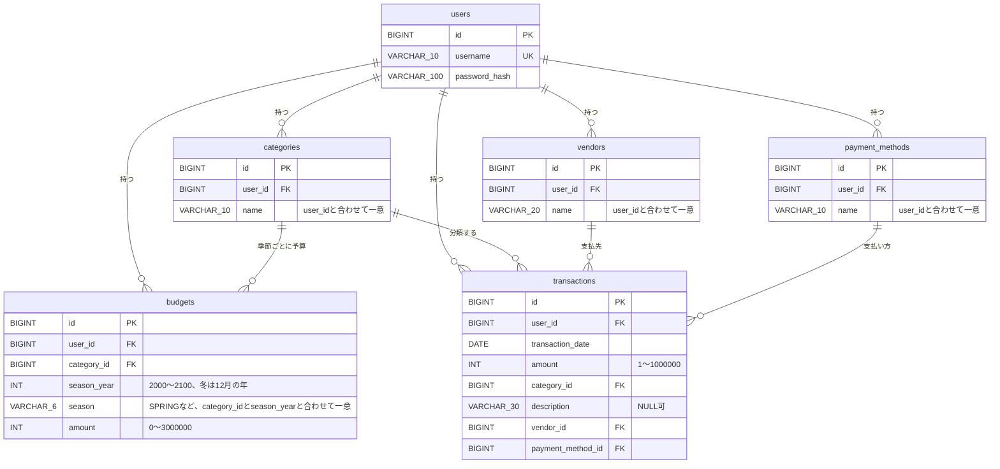

### 3.11 新しいユーザーの初期データ

アカウントを登録したとき、次のデータを**ユーザーの作成と同じトランザクション**で作る（要件4.3）。途中で失敗したら、ユーザーも含めてすべて取り消す。

| 種類 | 内容 |
|---|---|
| 科目と予算 | 交通費・食費・雑費。予算は、**登録した日の季節の分**だけを、それぞれ 30,000円で作る（ほかの季節は未設定） |
| 取引先 | コンビニ、ガソリンスタンド、Amazon |
| 支払方法 | 現金、クレジットカード |

- 上の順番で作る。一覧とプルダウンは登録順（`id` の順）に並ぶため、この順で表示される（Q14）。
- 取引は作らない。
- 初期データは、ユーザーごとに別々の行として作る（他のユーザーと共有しない）。

### 3.12 照合順序（確定。Phase 2 で試して決めた）

**照合順序**とは、文字列を比べるときの決まりです。同じ名前かどうかの判定（`UNIQUE` 制約）や、検索に使われます。MySQL の標準（`utf8mb4_0900_ai_ci`）は、「濁点の有無」まで同じとみなすため、日本語の科目名などで、別の名前なのに「すでにあります」となる（誤動作する）おそれがありました。

**決定**：データベース全体の照合順序を **`utf8mb4_0900_as_ci`** にする。`schema.sql` では、**各テーブルに `COLLATE utf8mb4_0900_as_ci` を明記する**（データベースの既定に頼らない）。

| 項目 | 内容 |
|---|---|
| 選んだ照合順序 | `utf8mb4_0900_as_ci`（データベース全体、すべてのテーブルで同じ） |
| 同じとみなす | 大文字と小文字（`A` と `a`）、ひらがなとカタカナ（`ひ` と `ヒ`）、全角と半角（`ｱ` と `ア`、`コンビニ` と `ｺﾝﾋﾞﾆ`） |
| 別の名前とする | 濁点の有無（`カ` と `ガ`） |
| `username` | 大文字・小文字を同じとみなす（Q10）を満たす |
| 科目・取引先・支払方法の名前 | 打ち方（かな・全角半角）が違うだけの同じ名前の重複を防ぎ、濁点の違う別の名前（例：`カ` と `ガ`）は別として登録できる |

**理由（1行ずつ）**
- 標準の `utf8mb4_0900_ai_ci` は、`カ` と `ガ` を同じとみなすため使えない。
- `utf8mb4_0900_as_ci` は、濁点の違いは別の名前とし、Q10（ユーザー名の大文字・小文字を区別しない）を満たし、打ち方だけが違う同じ名前の重複も防げる。
- 1つの照合順序にそろえられるので、列ごとに照合順序を変える設計（案2）より簡単で、アプリでの追加の判定（案3）も要らない。
- `utf8mb4_ja_0900_as_cs` は `ｱ` と `ア` を同じとみなすのに `コンビニ` と `ｺﾝﾋﾞﾆ` は別とみなし、結果がそろわないため使わない。
- `utf8mb4_0900_as_cs`、`utf8mb4_ja_0900_as_cs_ks`、`utf8mb4_bin` は、`A` と `a` を別とみなす（Q10 を満たさない）ため使わない。

**実験の結果**（2026-10-27、MySQL 9.7.2。アプリ用ユーザーで `'A' = 'a' COLLATE 照合順序` のように比べた。1＝同じとみなされる（`UNIQUE` なら重複エラー）、0＝別の名前）

| 照合順序 | `A` と `a` | `カ` と `ガ` | `ひ` と `ヒ` | `ｱ` と `ア` | `コンビニ` と `ｺﾝﾋﾞﾆ` |
|---|---|---|---|---|---|
| `utf8mb4_0900_ai_ci`（MySQL の標準） | 1 | 1 | 1 | 1 | 1 |
| **`utf8mb4_0900_as_ci`（選んだ）** | 1 | 0 | 1 | 1 | 1 |
| `utf8mb4_0900_as_cs` | 0 | 0 | 0 | 0 | 0 |
| `utf8mb4_ja_0900_as_cs` | 0 | 0 | 1 | 1 | 0 |
| `utf8mb4_ja_0900_as_cs_ks` | 0 | 0 | 0 | 1 | 0 |
| `utf8mb4_bin` | 0 | 0 | 0 | 0 | 0 |

- 文字が正しく届いていることは、`HEX('カ')` が `E382AB`、`HEX('ｱ')` が `EFBDB1` であることで確かめた。
- 当初の候補（案1：標準のまま、案2：名前の列だけ区別する、案3：アプリで判定）のどれでもなく、**データベース全体を標準以外の1つの照合順序にそろえる**案になった。

---

## 4. パッケージとクラスの構成

### 4.1 方針

- ベースパッケージは `io.github.yutaro081.householdbudget`（Q19）。以降のパッケージ名は、この下の名前だけを書く。
- 層の分け方は **Controller → Service → Repository** の3層（章1で詳しく書く）。
  - **Controller**：URL を受け取り、入力を Form で受け、Service を呼び、画面（テンプレート）を選ぶ。データベースには直接触らない。
  - **Service**：処理の中身（入力以外のチェック、持ち主の確認、トランザクション）を行う。
  - **Repository**：データベースの読み書きだけを行う。
- **持ち主の確認**（3.9）：Controller は、ログイン中のユーザーのID（`LoginUser` から取り出す）を、Service のメソッドに**必ず渡す**。Service と Repository のメソッドは、すべて `user_id` を受け取って絞る。画面から送られたユーザーIDは使わない。
- **Entity は 1テーブル 1クラス**（6つ）。入力は Form、画面専用の表示データは DTO で受け渡し、Entity をそのまま入力の受け皿にしない（書き換えさせたくない `user_id` などを守るため）。
- 要件にないクラスは作らない（4.8）。要件にはないが作るもの（P1〜P8）は、理由とともに 4.9 にまとめた。

### 4.2 パッケージの一覧

| パッケージ | 役割 | 主な置き場所 |
|---|---|---|
| （ベース直下） | アプリの起動クラス | `HouseholdBudgetApplication` |
| `controller` | URL を受け取り、画面を選ぶ | 4.4 |
| `service` | 処理の中身（登録・変更・削除・集計） | 4.5 |
| `repository` | データベースの読み書き | 4.6 |
| `entity` | テーブルに対応するクラス | 4.6 |
| `form` | 画面の入力を受け取るクラス（入力チェックの印を付ける） | 4.7 |
| `dto` | 画面に表示するためのデータ（予実比較など） | 4.7 |
| `security` | ログイン・ログアウト・パスワードのハッシュ化・アクセス制限 | 4.5 |
| `exception` | 「見つからない」「重複」などの例外と、404 画面への変換 | 4.5 |
| `domain` | 季節と色の判定など、画面にもデータベースにも依存しない計算（P1） | 4.5 |
| `config` | アプリ全体の設定（日本時間の「今日」）（P2） | 4.5 |

- `domain` を分ける理由：季節の決定と色の判定は、Phase 7 で単体テストを先に書く対象で、Spring に依存しない純粋な Java にするとテストしやすいため。
- `config` を分ける理由：日本時間（B6）の「今日」を1か所で決め、テストで日付を固定できるようにするため。

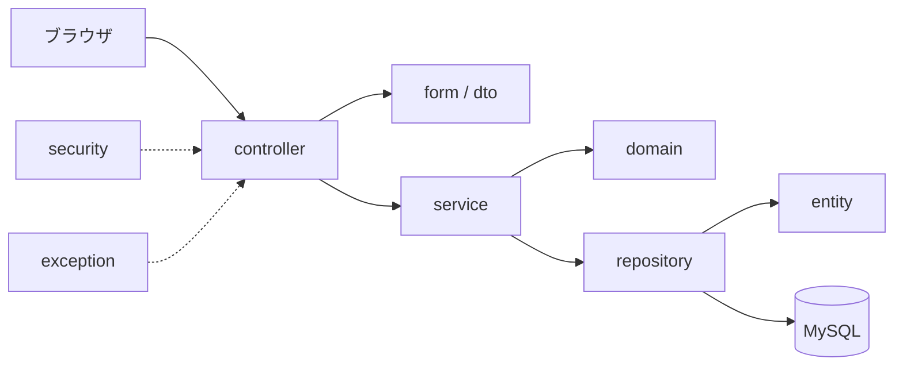

### 4.3 リソース（`src/main/resources`）の置き場所

| 場所 | 内容 |
|---|---|
| `application.properties` | 設定。DB のパスワードは環境変数から読む（Phase 2） |
| `schema.sql` | テーブル作成の SQL（`CREATE TABLE IF NOT EXISTS`、Q17、章3） |
| `messages.properties` | エラーメッセージ・画面の文言（章6）。**issue 018**：トップの見込みの文 `top.landing`、予実比較の見込みの文（`top.pace.…` は、なくした） |
| `templates/` | 画面のファイル（Thymeleaf）。4.4.2 に一覧 |
| `static/css/bootstrap.min.css` | Bootstrap v5.3.8 の CSS（配布物そのまま。先頭の著作権表示を消さない）。ログイン前から読める（章2、`/css/**`）。ライセンスは `THIRD-PARTY-NOTICES.md` |
| `static/css/style.css` | 自作の CSS（**色の変数 `--hb-…` と、Bootstrap の変数の上書き**、**フォントの指定（`@font-face`）と文字の大きさ**、**余白・角の丸みの変数**、**取引の登録・編集画面の幅と金額の欄の見た目**、**トップの円・棒・「今日」の線の規則と、棒・円の色の変数（`--hb-chart-…`）、ヘッダー（ロゴ・メニューのアイコン）、**ログイン・登録の2列とカード、取引一覧の見出しの行とカード**、トップの2列と季節のメーターの左右、ひとことのアイコンの四角、今週の進み具合の規則、予実比較の着地見込みの 1 行**、Bootstrap にないもの、テストが確かめるクラス）。Bootstrap のあとに読み込む。ログイン前から読める（章2） |
| `static/fonts/` | Zen Kaku Gothic New の woff2（`ZenKakuGothicNew-Regular.woff2`〔400〕、`ZenKakuGothicNew-Bold.woff2`〔700〕）と、ライセンス全文 `OFL.txt`（issue 015 の 2 回目）。ログイン前から読める（章2、`/fonts/**`）。ブラウザに 30 日覚えさせる（7.10）。ライセンスは `THIRD-PARTY-NOTICES.md` |
| `hitokoto/` | きょうのひとことの文面と日付の表（issue 016）。`shichijuni-ko.json`（七十二候72個）、`nijushi-sekki.json`（二十四節気24個の当日の文と、「ごろ」の月日）、`nenchu-gyoji.json`（年中行事11個）、`nijushi-sekki-dates.json`（二十四節気の日付の表。2025〜2027年）。UTF-8。起動のとき1回だけ読む。文面を直すときは、このファイルを直す（5.12）。ライセンスの表示は要らない（自作の文面と、事実の日付） |
| `static/js/back-reload.js` | 自作の短い JavaScript。ブラウザの「戻る」で覚えていた画面が出たとき（`pageshow` の `event.persisted` が `true`）に、画面を読み直す（7.10、Phase 8 の Q8-25）。`common.html` の `head` から、全画面で読み込む。ログイン前から読める（章2、`/js/**`）。利用者の入力は扱わない |
| `static/js/amount-buttons.js` | 自作の短い JavaScript（issue 009）。取引の登録・編集画面の、金額の入力を助けるボタンの動き（足す、税込にする、欄を空にする、税込のボタンの押せる・押せないの切り替え）。計算は整数だけ。欄の値を読んで書き戻すだけで、利用者の入力をファイルの中に埋め込まない。**この画面だけ**で読み込む（`transactions/form.html` の中。`defer`）。`/js/**` は許可済みで、設定は変えない（章2） |
| `static/js/budget-total.js` | 自作の短い JavaScript（issue 019）。予算設定画面の、予算額の合計を、開いたときと欄を書き換えるたびに計算して、合計行に書く。欄の値を読んで足すだけ（読み方は `amount-buttons.js` と同じ）。数字でない欄と空の欄は合計に入れず、固定の文「数字でない欄があります」「空の欄があります」の `hidden` を外す。文を作らない。通信しない。利用者の入力をファイルの中に埋め込まない。**この画面だけ**で読み込む（`budgets/form.html` の中。`defer`）。計算の関数を `window.BudgetTotal` に出す（Console での確かめ用）。`/js/**` は許可済み（章2） |

### 4.4 controller と、画面（テンプレート）

#### 4.4.1 Controller と受け持つ URL

| クラス | 役割 | 受け持つ URL（章2） |
|---|---|---|
| `TopController` | トップ（メーターと円グラフ）の表示 | `GET /` |
| `AuthController` | ログイン画面と、アカウント登録の画面・処理 | `GET /login`、`GET /register`、`POST /register` |
| `TransactionController` | 取引の一覧・登録・詳細・編集・削除 | `/transactions`、`/transactions/new`（GET・POST）、`/transactions/{id}`、`/transactions/{id}/edit`（GET・POST）、`/transactions/{id}/delete`（POST） |
| `CategoryController` | 科目の一覧・追加・変更・削除 | `/categories`（GET・POST）、`/categories/{id}/edit`（GET・POST）、`/categories/{id}/delete`（POST） |
| `VendorController` | 取引先の一覧・追加・変更・削除 | `/vendors`（GET・POST）、`/vendors/{id}/edit`（GET・POST）、`/vendors/{id}/delete`（POST） |
| `PaymentMethodController` | 支払方法の一覧・追加・変更・削除 | `/payment-methods`（GET・POST）、`/payment-methods/{id}/edit`（GET・POST）、`/payment-methods/{id}/delete`（POST） |
| `BudgetController` | 予算設定の表示と保存。**GET の任意の `auto`**（issue 019）：文字列で受け取り、`"1"`・`"2"`・`"3"` だけを受け付ける。ほかは `NotFoundException`（404）。年と季節の検査のあとに行う | `/budgets`（GET・POST） |
| `ComparisonController` | 予実比較の表示 | `/comparison`（GET） |

- **URL の読み方**（Phase 8、issue 001、Q8-1）：`TransactionController`・`CategoryController`・`VendorController`・`PaymentMethodController`・`BudgetController`・`ComparisonController` は、URL の共通の頭の部分を**クラスの `@RequestMapping`**（例：`@RequestMapping("/categories")`）に書き、各メソッドの注釈には、その後ろの部分だけを書く（例：`@GetMapping("/{id}/edit")`。頭の部分だけのメソッドは、`@GetMapping` に URL を書かない）。URL の全体は、クラスの注釈とメソッドの注釈を**合わせて**読む（上の表の「受け持つ URL」が全体）。理由：Spring の標準的な書き方で、同じ頭の部分を何度も書かずに済むため。`HomeController` と `AuthController` は、頭の部分が共通でないので、メソッドの注釈に URL の全体を書く。
- `POST /login` と `POST /logout` は、Controller を作らず **Spring Security** が処理する（`security`、4.5）。
- 科目・取引先・支払方法の Controller は、形が同じだが**3つに分ける**。理由：文字数の制限や削除の条件が違い、入門者には3つの独立した同じ形のほうが読みやすいため。

#### 4.4.2 テンプレート（`templates/`）の一覧

| ファイル | 画面（章2） | 使う Controller |
|---|---|---|
| `fragments/common.html` | 共通部品：ヘッダー（**ロゴ**、メニュー、ユーザー名、ログアウト。**今開いている項目を、画面から渡す文字で示す**）、**ロゴの小部品（`brand`。2 つのヘッダーが共有）**、成功・エラーメッセージの表示場所、`head`（`bootstrap.min.css`、`style.css` の順に読み込む） | 全画面。メニューは、トップ、取引一覧、科目、取引先、支払方法、予算、予実比較の順 |
| `fragments/icons.html` | アイコンの部品（issue 017）。`icon(名前, 大きさ, 線の太さ)`。名前は固定の文字だけ（12 個。2.3 の「アイコン」） | ヘッダー、トップ（ボタンの「＋」、ひとこと） |
| `fragments/season.html` | 共通部品：季節の見出し（「2026年 春（3月〜5月）」、冬は年をまたぐ形）と、「前の季節」「次の季節」のリンクと、同じ行の真ん中の「今の季節」ボタン（行き先は季節を指定しない URL。Phase 8 の issue 007）、年と季節を選ぶ GET のフォーム（年は2000〜2100、季節は4つ、「表示」ボタン。Phase 8 の G1）。範囲の端（2000年春の前、2100年冬の次）ではリンクを出さない。リンクの先の URL は引数で渡す。予算設定と予実比較で共有する（P10、Q6-5） | `BudgetController`、`ComparisonController` |
| `fragments/public-header.html` | 共通部品：ログイン前のヘッダー（ロゴだけ。`publicHeader`。issue 017 の 2 回目）。**`common.html` に置かない**：Thymeleaf は `header(…)` の「header」を、部品の名前だけでなく**要素の名前としても探す**ので、`common.html` に `<header>` 要素を 2 つ置くと、ログイン後の全画面に 2 つ目のヘッダーも出てしまう（`HeaderCountTest` が確かめる） | `login.html`、`register.html` |
| `fragments/auth-intro.html` | 共通部品：ログイン・登録の左の紹介（チップ、見出し、説明、チェック 2 行。issue 017 の 2 回目） | `login.html`、`register.html` |
| `login.html` | ログイン。**ロゴだけのヘッダー + 2 列（紹介 + カード）** | `AuthController` |
| `register.html` | アカウント登録。ログインと同じ形 | `AuthController` |
| `transactions/list.html` | 取引一覧。**見出しの行、件数、カードの中の表** | `TransactionController` |
| `transactions/form.html` | 取引の登録・編集（共用） | `TransactionController`。複写のときだけ、固定の 1 行を出す（issue 012）。**992px 以上では 2 列**（左：日付・科目・取引先・支払方法／右：金額・入力を助けるボタンの行・摘要。2.3）。ラベルの横に「必須」「任意・30 文字以内」。上に「← 取引一覧に戻る」、右下に「キャンセル」と送信ボタン。`static/js/amount-buttons.js` をこの画面だけで読み込む。入力欄の `th:field` は変えない |
| `transactions/detail.html` | 取引詳細 | `TransactionController`。「編集」の隣に「この取引を写して登録」のリンク（issue 012） |
| `categories/list.html` | 科目一覧（追加フォームを含む） | `CategoryController` |
| `categories/edit.html` | 科目変更 | `CategoryController` |
| `vendors/list.html`、`vendors/edit.html` | 取引先の一覧・変更 | `VendorController` |
| `payment-methods/list.html`、`payment-methods/edit.html` | 支払方法の一覧・変更 | `PaymentMethodController` |
| `budgets/form.html` | 予算設定 | `BudgetController`。入力欄は行ごと（`rows[0].amount` …）。見出しと前後リンクは `fragments/season.html` を使う。**issue 019**：「自動予算」ボタンと一言、選ぶ欄、最初の文、5 列の表、合計行、`budget-total.js` の読み込み。`th:text` だけで、`th:utext` は使わない |
| `comparison/index.html` | 予実比較 | `ComparisonController`。見出しと前後リンクは `fragments/season.html`。表は科目、予算、実績、差額の列と、右端の 💮 の列（セルは `<td class="text-center within-mark">`。見出しは画面に出さず、読み上げ用の「評価」だけを `visually-hidden` で添える。予算内の行に `💮予算内`。Phase 8 の issue 005）と、最下行の合計行。文言（「予算」「実績」「差額」「未設定」「合計」など）はテンプレートに直接書く（Q7-5）。色は `<tr>` に CSS のクラス（赤：`row-over`、青：`row-low`、予算内〔💮〕の行：`row-within`、それ以外の色なしはクラスなし。合計行は `total-row` も付く）を付け、判定はしない（`BudgetColorJudge` で済んでいる）。**issue 018**：年と季節を選ぶ欄の下、表の上に、着地見込みの 1 行と補足（5.13）。表の形は変えない |
| `top/index.html` | トップ（issue 010） | `TopController`。季節のメーター、今週の円グラフ（`conic-gradient`）、きょうのひとこと、今週の科目ごとのメーター（2.3、5.11、5.12）。JavaScript は使わない。`style` 属性には、数字と固定の文字だけを入れる（7.5）。**issue 018**：季節のメーターの見込みの一文（5.11、5.13） |
| `error/404.html` | 404 画面（B7、章2） | Spring Boot が 404 のときに自動で使う。`GlobalExceptionHandler` からも使う |
| `error/403.html` | 403 画面（CSRF のトークン不正など、7.7、S3） | Spring Boot が 403 のときに自動で使う |
| `error/4xx.html` | 400 番台のその他のエラー画面（400、405 など。404・403 を除く、7.7、S9） | Spring Boot が 400 番台で、404・403 の専用画面がないときに自動で使う |
| `error/5xx.html` | 500 番台の予期しないエラー画面（7.7、S3、S9） | Spring Boot が 500 番台のときに自動で使う |

- 共通部品は Thymeleaf の「フラグメント」（部品の読み込み）で共有する（P5）。理由：追加のライブラリが要らず、標準の機能だけで済むため。
- **画面のクラスの付け方**（Phase 8、Q8-20）：見た目は Bootstrap のクラス（`btn`、`form-control`、`table`、`alert` など）で付ける。ただし、テストが HTML の文字列で確かめている要素には、Bootstrap のクラスを足さない：`
`、`<td class="num">`・`<th class="num">`、予実比較の `<tr class="row-over">`・`<tr class="row-low">`・`<tr class="row-within">`・`<tr class="total-row">`、メニューの `<a>`。これらの見た目は `style.css` で付ける。`<tr>` の色（赤・青）が Bootstrap の表の色に負けないよう、`style.css` では `td` に直接指定する。
- 取引の登録と編集は、入力項目が同じなので `form.html` を共用する（章2 の U1：同じ URL に GET・POST）。
- 科目・取引先・支払方法には、詳細画面を作らない（章2）。

### 4.5 service、security、exception、domain、config

#### service

| クラス | 役割（1行） | 主に扱うテーブル |
|---|---|---|
| `RegistrationService` | アカウント登録。ユーザー名の重複確認、パスワードのハッシュ化、ユーザーと初期データ（3.11）を**同じトランザクション**で作る | `users`、`categories`、`budgets`、`vendors`、`payment_methods` |
| `CategoryService` | 科目の一覧・追加・変更・削除。追加時に、**今の季節**の予算0円の行を作る（Q3、R11）。削除は「取引で使用中でない」「すべての季節の予算が0円または未設定」を確認し、その科目の予算の行をすべて先に消してから科目を消す（3.7） | `categories`、`budgets` |
| `VendorService` | 取引先の一覧・追加・変更・削除（使用中は削除不可） | `vendors` |
| `PaymentMethodService` | 支払方法の一覧・追加・変更・削除（使用中は削除不可） | `payment_methods` |
| `BudgetService` | 指定した季節の、自分の全科目の予算の取得（保存済みの額がなければ**0円**を初期値にする、Q23・Q24。**issue 019 で、「直前の設定のある季節の額」をやめた**）と、その季節の全科目のまとめての保存（作る・更新する、Q25） | `budgets`、`categories`。**Phase 6 で作ったメソッド**：`edit`（表示用の行。何も書かない）、`rowsOf`（入力エラーで表示し直すための行。科目IDの確認を先に行い、送られた順のまま科目名と印を引く）、`save`（まとめて保存。科目IDの確認を先に行い、だめなら何も保存しない）。範囲外の季節は、どれも `NotFoundException`。**消すもの**：`nearestEarlierOf`（前の季節の額を探す処理） |
| `AutoBudgetService`（issue 019） | 自動予算の案と、表の元の数字を作る（`AutoBudgetView` を返す、5.14）。`BudgetService.edit` の行（保存済み、または0円。ルール④の「今の値」）、`BudgetRepository.findByUserIdAndSeasonYearAndSeason`（直前の季節の予算）、`TransactionRepository.sumByCategoryAndMonth`（過去の実績）を使い、計算は `domain` に渡す。**読むだけ**（データベースに書かない） | `categories`、`budgets`、`transactions`。`propose(userId, period, choice, today)`（最初の引数が `userId`。「今日」は呼ぶ側が日本時間の `Clock` から取って渡す）。範囲外の季節は `NotFoundException`。科目・予算・取引は、すべて自分の分だけ |
| `TransactionService` | 取引の一覧・詳細・登録・更新・削除。登録・更新のとき、選んだ科目・取引先・支払方法が**自分のものか**を確認する（3.9） | `transactions` |
| `ComparisonService` | 季節の期間の取引を科目ごとに集計し、予算（未設定なら「未設定」）・実績・差額（未設定なら空欄）・色・予算内の印（💮）・合計行を作る（`ComparisonResult` を返す、5.9） | `categories`、`budgets`、`transactions`。**Phase 7 で作ったメソッド**：`compare(userId, period)`（読むだけ。最初の引数が `userId`）。範囲外の季節（null を含む）は `NotFoundException`。科目は `CategoryService.list(userId)`、その季節の予算は `BudgetRepository.findByUserIdAndSeasonYearAndSeason`（その季節の行だけ。前の季節の額は使わない）、実績は `TransactionRepository.sumByCategory` |
| `TopService` | トップの画面用のデータを作る（issue 010、5.11）。今の季節の合計は `ComparisonService.compare` の合計行を使い、今週の科目ごとの実績（`sumByCategory`）と、今日が入っている季節の科目ごとの予算から、週の予算・切り上げた実績・色・円グラフの並びを作る（`TopView` を返す） | `categories`、`budgets`、`transactions`。`top(userId, today)`（読むだけ。最初の引数が `userId`。「今日」は呼ぶ側が日本時間の `Clock` から取って渡す）。科目・予算・取引は、すべて自分の分だけ |
| `HitokotoService`（issue 016） | きょうのひとこと用のデータ（`HitokotoView`）を作る（5.12）。その日の暦の項目（候・節気・行事）と、次の節気の補足、グラフへのひとことを、`domain` の計算に渡してまとめる。`TopService` から呼ばれる | なし（ファイルの文面と、`TopService` が集めた今週の数字だけを使う。DB を新しく検索しない）。`hitokoto(today, 今週の数字)`（読むだけ） |
| `HitokotoTexts`（issue 016） | 文面と日付の表のファイル（4.3 の `hitokoto/`）を、起動のとき1回だけ読んで持つ。件数（72・24・11）、番号、空の文がないことを確かめ、合わなければ起動を失敗させる（欠けたまま動かさない） | なし |

- 各 Service には、更新を行うメソッドに **トランザクション**（途中で失敗したら全部取り消す）を付ける。
- 名前の重複や「削除できない」は、Service が下の例外を投げ、Controller がメッセージに変える。

#### security

| クラス | 役割（1行） |
|---|---|
| `SecurityConfig` | ログイン必須、`/login`・`/register`・CSS 以外は未ログインで開けない、CSRF 対策、BCrypt のパスワード変換、ログイン成功後はトップ、`POST /logout` の設定 |
| `CustomUserDetailsService` | ログイン時に、ユーザー名から `users` を探して Spring Security に渡す |
| `LoginUser` | ログイン中のユーザーの情報（ユーザーID、ユーザー名）を持つ。Controller は、ここからユーザーIDを取り出す（P3。理由：毎回データベースを引かずに、安全にユーザーIDを取り出せるため） |

#### exception

| クラス | 役割（1行） |
|---|---|
| `NotFoundException` | 存在しない、または他人のデータ。404 にする（B7） |
| `DuplicateException` | ユーザー名、または科目・取引先・支払方法の名前が重複。入力エラーとして画面に戻す（Q9・Q10） |
| `DeletionNotAllowedException` | 使用中、またはいずれかの季節に0円でない予算があるため削除できない（要件4.3）。理由のメッセージを持つ |
| `LimitExceededException`（Phase 6、R14） | 科目・取引先・支払方法が、1人あたりの上限（256個、`Limits`）に達していて、追加できない。入力エラーとして画面に戻す |
| `GlobalExceptionHandler`（Phase 4 で作成） | `NotFoundException` と、ID が数字でない URL（例：`/transactions/abc`）を `error/404.html` に変換する。**状態コードも 404 にする**（B7、7.7、S4） |

#### domain

| クラス | 役割（1行） |
|---|---|
| `Season` | 春・夏・秋・冬と月の対応、URL で使う名前（`spring` など）。`fromUrlName`（小文字の4つだけを受け付ける）。列挙の宣言の順（春→夏→秋→冬）が期間の順。**issue 019 で、`earlierInYear` は、使わなくなったので消す**（他で使っていないことを確かめてから） |
| `SeasonPeriod` | 年と季節の組み合わせ。今日の日付から季節と年を決める（冬は12月起点）、期間の開始日と終了日の翌日、前の季節・次の季節、2000年春〜2100年冬の範囲の判定（Q7・B15）。**予実比較と予算設定の両方**で使う。アカウント登録と科目の追加で「今の季節」を求めるのにも使う（R11）。**Phase 6 で足したもの**：`startDate`・`endDateExclusive`、`previous`・`next`（範囲の端では空）、`isInRange`、`isBefore`（期間の順の比べ方。DB の季節の文字の順 `AUTUMN` < `SPRING` < `SUMMER` < `WINTER` とは違う）、`parse`（URL の年と季節の文字列から季節を求める。年は半角の数字4桁だけで2000〜2100、季節は小文字の4つだけ。不正・片方だけは空で、呼ぶ側が 404 にする、Q6-2）。**Phase 7 で足したもの**：`resolve(year, season, today)`（URL の文字列と今日から、表示する季節を決める。両方とも null なら今日の季節、それ以外は `parse` の結果。予算設定と予実比較の Controller が同じ決まりで使う。空のとき 404 にするのは Controller。`domain` は例外の仕組みに頼らない、Q7-1） |
| `BudgetColor` | 色の種類：赤（`RED`）・青（`BLUE`）・色なし（`NONE`）。**💮 は色ではないので、ここには入れない**（Phase 8、Q8-33） |
| `BudgetColorJudge` | 予算と実績から色を決める（Phase 7：`judge(Long budget, long actual)`、予算の `null` が未設定、Q7-2）。**予算が未設定なら、色なし**。設定されていれば、次の**順番**で判定する（要件4.4）。①実績 ＞ 予算なら赤（予算が0円でも、実績があれば赤）。②予算が0円なら色なし（実績も0円のとき）。③実績 × 3 ≦ 予算なら青（ちょうど1/3も青）。④それ以外は色なし。合計行にも同じ順番で使う（Q21、Q22）。**予算内の印**（Phase 8、issue 005、Q8-33）：`isWithinBudget(Long budget, long actual)`。予算が設定されていて（`null` でない）、予算 ＞ 0、実績 ＞ 0、実績 ≦ 予算、実績 × 3 ＞ 予算 のとき `true`（上の④に当たる行。予算ちょうども `true`）。それ以外は `false`。計算は `long`。`judge` と `BudgetColor` は変えない。合計行にも同じメソッドを使う |
| `Limits`（Phase 6、R14、P11） | 1人あたりの科目・取引先・支払方法の上限（256個）を1か所で決める。予算設定画面が受け取れる行の数（Spring の標準の256行）と同じ数 |
| `WeekPeriod`（issue 010） | 今週の期間。日付を含む週（日曜〜土曜）の開始日、終了日の翌日（次の日曜）、その日が週の何日目か（日曜＝1、土曜＝7） |
| `WeeklyAmount`（issue 010） | 週の予算＝季節の予算 ÷ 13 を100円単位で切り上げ（式：`予算 ÷ 1,300 を切り上げて × 100`。未設定の `null` はそのまま）と、今週の実績の100円単位の切り上げ。`long` で計算する |
| `PeriodProgress`（issue 010） | 日が進んだ割合（今日を含めた日数 ÷ 全部の日数）と、棒の長さ（実績 ÷ 予算、100％で止める）を、**1000分率の整数**で求める（小数の誤差を避ける）。季節の日数は `SeasonPeriod` の期間から、週は7。**issue 017**：季節の終わりまであと何日（今日を含む。季節の日数 − 今日が何日目か + 1）、使った割合（使った額 × 100 ÷ 予算を四捨五入した整数％。予算が未設定・0円なら「なし」。100％をこえてもそのまま）、「今日」の位置（日数 × 100 ÷ 全部の日数を四捨五入した整数％）。整数だけで計算する（`(2 × 分子 × 100 + 分母) ÷ (2 × 分母)`） |
| `LandingForecast`（issue 018） | 着地見込みの計算。入力は、合計の予算（未設定は `null`）、合計の実績、季節、今日。D ＝ 季節の日数、L ＝ D − 今日が季節の何日目か（今日を含む。最後の日は 0。`PeriodProgress.seasonDaysLeft` より 1 小さい）。**見込み ＝（実績 × D ×（D ＋ L）＋ 予算 × L²）÷ D²**（整数だけ。実績 ×（1 ＋ L/D）＋ 予算 ×（L/D）² と同じ）。100 円単位で切り上げる。予算に対する％は、切り上げ後の額 ÷ 予算の四捨五入（`PeriodProgress.roundedPercent` と同じ決まり）。**計算は `long` で、`Math.multiplyExact`・`addExact` を使い、あふれたら `ArithmeticException`（黙って違う数字を出さない）。100 円の切り上げは、`Math.ceilDiv(分子, 100 × D × D) × 100`（小数を使わない）**。予算が未設定・0 円、今の季節でないときは、結果なし（空）。画面にもデータベースにも依存しない（5.13） | 新しいクラス（`PaceComment` は、置きかえたので消す） |
| `ProposalChoice`（issue 019） | 選ぶ割合：1＝これで OK（100%）、2＝節約したい（90%）、3＝上乗せしたい（110%）。URL の文字列（`"1"`〜`"3"`）から求める。それ以外は空。**形**：列挙 `OK`・`SAVE`・`EXTRA`、`int percent()`（100・90・110）、`static Optional<ProposalChoice> fromParam(String)`（`"1"`・`"2"`・`"3"` と完全に同じものだけ。`null`・空・`01`・全角・前後の空白は空） |
| `AutoBudgetSeasons`（issue 019） | 画面の季節と今日から、使う季節を決める。①画面の季節と同じ季節の、1・2・3 年前（範囲内のものだけ）。②傾向の 12 季節（T1・T2・T3 の各 4 季節）。画面の季節より前で、もう終わっている（終了日の翌日 ≦ 今日の）いちばん新しい季節を末尾にして数える。2000年春より前にかかるときは、傾向の季節なし。③直前の季節（画面の季節の 1 つ前）。④集計する期間（いちばん古い季節の開始日 〜 画面の季節の開始日の前）。**形**：`static AutoBudgetSeasons of(SeasonPeriod screen, LocalDate today)`、`List<SeasonPeriod> sameSeasonYears()`（1・2・3 年前の順）、`Optional<List<SeasonPeriod>> trendSeasons()`（古い順の 12 個。先頭 4 つが T1、次が T2、最後の 4 つが T3）、`Optional<SeasonPeriod> previousSeason()`、`LocalDate aggregateFrom()`、`LocalDate aggregateToExclusive()`（＝画面の季節の開始日）。**使う季節が 1 つもないとき**は、`aggregateFrom` も画面の季節の開始日にして、空の期間にする |
| `MedianAmount`（issue 019） | 記録のある年の実績（0〜3 個）から、**中央値の 2 倍**（整数）を求める。3 個＝真ん中の 2 倍、2 個＝合計（平均の 2 倍）、1 個＝その額の 2 倍、0 個＝なし。半円を出さないため、2 倍のまま持つ。表に出す額は、これを 2 で割って切り上げ。**形**：`static OptionalLong twice(List<Long> amounts)`（順番は問わない。あふれたら `ArithmeticException`。**4 個以上を渡したら `IllegalArgumentException`**）、`static long display(long twice)` |
| `SpendingTrend`（issue 019） | 傾向の % を求める。入力は T1・T2・T3（全科目の実績の合計）。**傾向 ＝ 四捨五入（100 ×（S ＋ 3 ×（T3 − T1））÷ S）**（S ＝ T1＋T2＋T3。半分は切り上げ。`Math.floorDiv`）。上限は 70〜130%。結果は、% と「上限で止めたか」。12 季節に取引のない季節があるときは、計算せず 100%（「計算しなかった」の印）。**形**：`static Result of(boolean allSeasonsHaveRecords, long t1, long t2, long t3)`、`record Result(int percent, boolean capped, boolean calculated)`。**ちょうど 130%（70%）は上限扱いにしない**（四捨五入のあとで 131% 以上・69% 以下のときだけ `capped`）。**S が 0 のときは「計算しなかった」**（100%） |
| `SpendingPace`（issue 019） | 直前の季節の「ペース」。終わった季節＝実績そのまま。今日を含む季節＝実績 × 季節の日数 ÷ 過ぎた日数（今日を含む）。**過ぎた日数が 14 日未満、またはまだ始まっていない季節は、使えない（空）**。表示は 100 円単位に切り上げ。案には、割り算の前の分数を使う。**形**：`static Optional<Pace> of(long actual, SeasonPeriod previous, LocalDate today)`、`record Pace(long numerator, long denominator)`（終わった季節は 実績 / 1、今日を含む季節は（実績 × 季節の日数）/ 過ぎた日数。約分しない）、`long displayAmount()`（100 円切り上げ） |
| `BudgetProposal`（issue 019） | 科目ごとの案。入力は、中央値の 2 倍（なし／0 もある）、傾向の %、選ぶ割合、直前の季節の実績、ペースの材料、直前の季節の予算（`null` は未設定）、今の値。**ルール①〜④を上から順に当てはめる**。①中央値 ＞ 0。②直前の実績 ＞ 0 かつペースが使える。③直前の予算 ＞ 0。④今の値のまま。結果は、ルールの番号と額。**形**：`static Result of(OptionalLong twiceMedian, int trendPercent, ProposalChoice choice, long previousActual, Optional<SpendingPace.Pace> pace, Long previousBudget, long currentValue)`、`record Result(int rule, long amount)`、`LIMIT = 3,000,000`。上限はルール①〜③にかける（④は今の値のまま） |
| `PieSlices`（issue 010） | 円グラフの並び。0円の科目を除き、金額の多い順（同額は科目の登録順）に並べ、6科目以下は全部、7科目以上は上位5科目＋「その他」にまとめる。割合（整数％に四捨五入）と、円の区切り（1000分率）を求める。割合は切り上げた額から。**各切れに、その科目の今週の判定（色と予算内の印）を持たせる。「その他」は判定なし** |
| `SolarTermCalendar`（issue 016） | 二十四節気の日付の表から、今日が「節気の日」か、何の候（初候・次候・末候。通し番号1〜72）か、次の節気とあと何日かを求める。節気の日 +0日＝節気、+1〜4日＝初候、+5〜9日＝次候、+10日〜次の節気の前の日＝末候。前の年と次の年の表も使う。表のない年は、文面の「ごろ」の月日で代わりに求め、「代わりの計算を使った」印を返す。画面にも DB にも依存しない |
| `EventDays`（issue 016） | 年中行事の日を求める。月日が決まっているもの（元日・七草・ひな祭り・端午の節句・七夕・お盆・七五三・大晦日）と、節気から引くもの（節分＝立春の前の日、お彼岸入り＝春分・秋分の3日前）。日付の型で引く（月日で引かない） |
| `GraphComment`（issue 016） | グラフへのひとこと。今週の数字（科目名・週の予算・切り上げた実績・合計・今日の曜日）から、出せる型（最多・残り・未使用）を決め、日付で1つ選び、文の部品（型・科目名・金額・残り日数）を返す。文そのものは作らない（文は `messages.properties`） |

#### config

| クラス | 役割（1行） |
|---|---|
| `AppConfig` | 日本時間の「今日」を返す部品（`Clock`）を用意する（B6） |

### 4.6 entity と repository

#### テーブルとの対応

| テーブル（章3） | Entity | Repository | 主な検索（すべて `user_id` で絞る） |
|---|---|---|---|
| `users` | `User` | `UserRepository` | ユーザー名で1件（ログインと重複確認） |
| `categories` | `Category` | `CategoryRepository` | 自分の科目を `id` 順で全件、ID＋`user_id` で1件、同じ名前があるか |
| `vendors` | `Vendor` | `VendorRepository` | 同上（取引先） |
| `payment_methods` | `PaymentMethod` | `PaymentMethodRepository` | 同上（支払方法） |
| `budgets` | `Budget` | `BudgetRepository` | 指定した季節の自分の予算を全件、科目ごとの、（**issue 019 でやめた**：表示季節より前で設定のある最も近い季節の予算〔初期値用〕）、科目に0円でない予算がある季節があるか、科目の予算をすべて削除、科目・年・季節で1件（保存の作成・更新用）。**Phase 6 で足した検索**（Q6-4 の A）：`findByUserIdAndSeasonYearAndSeason`（その季節。自動予算の「直前の季節の予算」にも使う）。科目を一緒に読み込む（`@EntityGraph`）。`findByUserIdAndSeasonYearLessThan`（年が前）と `findByUserIdAndSeasonYearAndSeasonIn`（同じ年で季節が前）は、**issue 019 で使わなくなったので消す**（他で使っていないことを確かめてから）。`Budget` には `changeAmount` を足した |
| `transactions` | `Transaction` | `TransactionRepository` | 自分の取引を日付の新しい順（同じ日は `id` の新しい順）で全件、ID＋`user_id` で1件、科目／取引先／支払方法が使われているか、期間内の科目ごとの合計、**期間内の科目・月ごとの合計（issue 019）** |

- **Phase 4 で前倒しで作ったもの**：`Transaction` の Entity（3.6 の全列、P7 の関連つき）と、`TransactionRepository` の「使用中の確認」の3メソッド（`existsByUserIdAndCategoryId`、`existsByUserIdAndVendorId`、`existsByUserIdAndPaymentMethodId`。科目・取引先・支払方法の削除の判定に使う、5.5）。一覧・1件取得・集計などの検索は、Phase 5・7 で足す。

- **Phase 5 で `TransactionRepository` に足したもの**：`findByUserIdOrderByTransactionDateDescIdDesc(userId)`（一覧。日付の新しい順、同じ日は `id` の新しい順）と、`findByIdAndUserId(id, userId)`（詳細・編集・更新・削除）。期間内の科目ごとの合計は、Phase 7 で足した（下）。`Transaction` には、値を入れ替える `update(...)` を足した（`user_id` と `id` を変えるメソッドは作らない）。
- 検索は、**名前付きの検索（Spring Data JPA のメソッド）またはパラメータ付きの検索**で書き、文字列を連結した SQL は使わない（SQL インジェクション対策、章7）。
- **取引一覧・詳細の検索では、科目・取引先・支払方法もまとめて読み込む**（取引1件ごとに別々に読み込まない）。理由：一覧の件数分だけ追加の検索が走る無駄を避けるため。**方法は、Repository のメソッドに `@EntityGraph`（読み込む関連の名前を指定）を付けること**（Phase 5、Q5-5 の A）。メソッド名の検索のまま、SQL を書かずに済み、`@Query` を使わない状態を保てる。取引の件数が増えても、一覧の SQL が 1 回で済むことを、自動テストで確かめた（`TransactionRepositoryFetchTest`）。
- **D5：`spring.jpa.open-in-view` は `false` にする**（Phase 5 で決定。`application.properties` に書いた）。画面（テンプレート）を作っている間は、データベースの接続（Hibernate のセッション）を持たない。理由：`true`（標準）だと、画面の中で読み込み忘れた関連を、画面を作りながら読みにいけてしまうため、読み込み忘れに気づきにくい。`false` にすると、読み込み忘れは `LazyInitializationException` という失敗として見つかる。Service が必要な関連をすべて読み込んで返す作りと合う。
  - 比べた結果（ブラウザ、`false` で起動）：起動ログに `open-in-view` の警告が出ず、取引の一覧・詳細・登録・編集の画面と、登録の入力エラー（金額に `abc`）の表示し直しが、エラーなく表示された。一覧と詳細の SQL（`select`）は、それぞれ 1 回だった。
  - **注意**：自動テスト（MockMvc）は、各テストをトランザクションで包むため、`false` でも読み込み忘れの失敗を見つけられない（セッションが閉じない）。読み込み忘れの確認は、ブラウザで行う（Phase 8 でも、画面を一通り開いて確かめる）。
- Entity のつなぎ方（P7）：`Transaction` は科目・取引先・支払方法を関連（`ManyToOne`）として持ち、一覧にそのまま名前を表示できるようにする。`Budget` も科目を関連として持つ。`user_id` は、ユーザーの `Entity` ではなく**数値のID**として持つ。理由：持ち主での絞り込みが簡単で、毎回ユーザーを読み込まずに済むため。
- **Phase 7 で `TransactionRepository` に足したもの**：`sumByCategory(userId, start, endExclusive)`。**このアプリで初めての `@Query`**（パラメータ付きの JPQL。`where t.userId = :userId and t.transactionDate >= :start and t.transactionDate < :endExclusive group by t.category.id`、結果は `CategoryActual`）。理由：メソッド名の検索では `GROUP BY` と `SUM` が書けないため。値はすべてパラメータで渡し、文字列を連結しない（7.4 が許す形）。期間は「開始日以上、終了日の翌日未満」（5.8）。取引がない科目は結果に出ない（Service が0円にする）。合計は `Long`（INT を超えうる、3.1）。集計には `@EntityGraph` は要らない（科目のIDと合計だけを返す）（Q7-3 の A）。
- **issue 019 で `TransactionRepository` に足したもの**：`sumByCategoryAndMonth(userId, start, endExclusive)`。`sumByCategory` と同じ形の `@Query`（パラメータ付きの JPQL。`where t.userId = :userId and t.transactionDate >= :start and t.transactionDate < :endExclusive group by t.category.id, 年, 月`。年と月は JPQL の関数で取り出す。結果は `MonthlyActual`）。自動予算の過去の実績（同じ季節の 3 年と、傾向の 12 季節と、直前の季節）を、**1 回の検索で集める**。Service が月を季節にまとめる。取引のない科目・月は結果に出ない。値はすべてパラメータで渡し、文字列を連結しない（7.4）。
- 期間内の科目ごとの合計は、Repository が「科目ID と合計」の組（`CategoryActual`、P4）で返す。`dto` に置く。

### 4.7 form と dto

#### form（入力を受け取る）

| クラス | 使う画面 | 入力項目（制限は要件5章、章6） |
|---|---|---|
| `RegisterForm` | アカウント登録 | ユーザー名、パスワード |
| `TransactionForm` | 取引の登録・編集 | 日付、金額、科目ID、摘要、取引先ID、支払方法ID |
| `CategoryForm` | 科目の追加・変更 | 名前（10文字以下） |
| `VendorForm` | 取引先の追加・変更 | 名前（20文字以下） |
| `PaymentMethodForm` | 支払方法の追加・変更 | 名前（10文字以下） |
| `BudgetForm` | 予算設定 | 科目ごとの予算額の並び（科目IDと金額を1行分とする）。年と季節は URL で受け取る（2.4）。1つでもエラーなら全部保存しない（章2）。**形**：`rows`（行の並び）。各行は `BudgetForm.Row`（科目ID、予算額）。予算額は `rows.amount`（行の番号を除いた名前）で `StrictIntegerEditor` を登録すると、全行に効く（Phase 6 の実験、Q6-1。行の番号つき `rows[0].amount` で登録すると、その行にしか効かない）。メッセージのキーも `rows.amount` の形でどの行にも当たる（Q6-7） |

- ログインの入力は、Spring Security が受け取るので Form を作らない。
- 金額は整数で受け取る（B5）。数字でない入力は入力エラーにする。

#### dto（表示のためのデータ）

| クラス | 役割（1行） |
|---|---|
| `ComparisonRow` | 予実比較の1行分：科目名、予算（**未設定のときは空**）、実績、差額（**予算が空なら空**）、色。合計行にも使う。**形**（Phase 7、Q7-4 の A）：`record ComparisonRow(String categoryName, Long budget, long actual, Long difference, BudgetColor color, boolean withinBudget)`（`withinBudget` は Phase 8 の issue 005 で足した。予算内の印〔💮〕を出すかどうか。`BudgetColorJudge.isWithinBudget` の結果）。`null` が未設定・空欄。合計行の科目名は `null`（画面で「合計」を出す） |
| `ComparisonResult` | 予実比較の画面全体：見出し（年・季節・期間）、行の並び、合計行、前・次の季節のリンク先（範囲の端では「なし」）。**形**：`record ComparisonResult(SeasonPeriod period, SeasonPeriod previous, SeasonPeriod next, List<ComparisonRow> rows, ComparisonRow total)`。前・次は範囲の端で `null`。科目が0件のとき `rows` は空（画面は表と合計行を出さない。合計行の値は作る：予算 `null`・実績0・差額 `null`・色なし）。画面が読む値はすべてこの中に入れて渡す（`open-in-view=false`） |
| `CategoryActual` | 科目ごとの実績（科目IDと合計）。Repository の集計結果（P4）。**形**：`record CategoryActual(Long categoryId, Long total)` |
| `BudgetEditView` | 予算設定画面の表示データ：見出し（年・季節・期間）、前・次の季節のリンク先、各行（科目、初期値の額、「未設定」の印の有無）（Q26）。**形**：期間（`SeasonPeriod`）、前・次の季節（範囲の端では null）、行（`BudgetEditView.Row`：科目ID、科目名、最初の値、「未設定」の印）。入力エラーで表示し直すときの行は、最初の値が null（値は送られた値を使う）。**issue 019**：「自動予算」ボタンを出すか（`autoAvailable`）、開いたときの合計（`total`。入力エラーの表示し直しでは `null`）、自動予算の中身（`auto`。押していないときは `null`）を足す |
| `AutoBudgetView`、`AutoBudgetView.Row`（issue 019） | 自動予算の表示データ。**全体**：選んだ割合（1〜3）、直前の季節（`SeasonPeriod`）、直前の季節の予算の合計（設定済みの科目だけ。なければ `null`）と実績の合計、直前の季節が今日を含むか、今日の日付、実績の合計の「このペースなら」（なければ `null`）、画面の季節の名前（文の「過去の○」に使う）、記録のある年が 1 つ以上あるか、傾向（%、増減の種類〔増える・減る・ほぼ同じ・計算しなかった〕、上限で止めたか）、案の合計、一部の科目がルール②〜④か（①と混ざるとき）、記録はあるが全科目が②〜④か、材料なし（全科目が④）か。**行**：科目ID、科目名、直前の予算（`null`＝未設定）、直前の実績、「このペースなら」（なければ `null`）、ルールの番号（①〜④）、根拠の部品（年の並び・平均か中央値か・もとの額・直前の季節の名前など）、案の額。画面が読む値は、すべてこの中に入れて渡す（`open-in-view=false`）。**形**（テストのために決めた）：全体＝`choice`、`previousSeason`（範囲の外は `null`）、`previousBudgetTotal`、`previousActualTotal`、`previousContainsToday`、`today`、`previousPaceTotal`、`screenSeason`、`hasRecordYears`、`trendPercent`、`trendKind`（`UP`・`DOWN`・`SAME`・`NOT_CALCULATED`）、`trendCapped`、`proposalTotal`、`someFromPrevious`（①と②〜④が混ざるときだけ true）、`allFromPrevious`（記録のある年があり、全科目が②〜④で、全科目が④ではないときだけ true）、`noMaterial`、`rows`。行＝`categoryId`、`categoryName`、`previousBudget`、`previousActual`、`paceAmount`（今日を含む季節で 14 日以上、かつ実績が 0 円より大きいときだけ）、`rule`、`basisKind`（`MEDIAN`・`AVERAGE`・`SINGLE_YEAR`・`PACE`・`ACTUAL`・`BUDGET`・`NONE`）、`years`（季節の年。古い順）、`yearsConsecutive`、`baseAmount`、`amount` |
| `MonthlyActual`（issue 019） | 科目・月ごとの実績。`sumByCategoryAndMonth` の結果。**形**：`record MonthlyActual(Long categoryId, int year, int month, Long total)` |
| `TopView`、`WeekRow`（issue 010） | トップの画面全体（今の季節のメーターの値、今週の期間、円グラフの並びと区切りの文字、科目ごとの行と合計行）。`WeekRow` は科目名（合計行は `null`）、週の予算（未設定は `null`）、切り上げた実績、差額、色、予算内の印、棒の長さ。円の1切れ（科目名または「その他」、金額、割合、円の区切り、色の番号、**今週の判定の色と予算内の印**）は、domain の `PieSlices.Slice`。画面が読む値は、すべてこの中に入れて渡す（`open-in-view=false`）。**issue 017**：`TopView` に、今日の日付、季節の終わりまであと何日、使った割合（%。なければ `null`）、今日の位置（%）、季節の最初と最後の月を足した。`WeekRow` に、状態の文の元（メッセージのキーと、オーバーした額）を足した。**issue 018**：ペースの一言のキー（`paceKey`）をやめて、**見込みの額（100 円単位。なければ `null`）と、予算に対する％（なければ `null`）**を足した |
| `HitokotoView`、`CalendarItem`（issue 016） | きょうのひとこと。`CalendarItem` は暦の1項目（種類〔七十二候・二十四節気・年中行事〕、名前、読み、文）。`HitokotoView` は、`CalendarItem` の並び（0〜2個。行事が先）、次の節気の補足（名前とあと何日。ないときは `null`）、グラフへのひとことの部品（ないときは `null`）。`TopView` が持つ。**issue 017**：`CalendarItem` に「題の補足」（七十二候は「立冬の初候」、二十四節気は「立冬」、年中行事はなし）を足した |

- 取引一覧・詳細は、Entity をそのまま画面に渡して表示する（P6）。理由：項目が Entity とほぼ同じで、専用のクラスを作ると増えるだけなため。画面が読む科目・取引先・支払方法は、Repository が一緒に読み込んで渡す（4.6、D5 で `open-in-view=false`）。
- 取引の登録・編集の入力は `TransactionForm` で受ける。金額は、専用の変換クラス `StrictIntegerEditor` で読み（6.5）、日付の範囲は自作の注釈 `TransactionDateRange` で確かめる（6.6）。どちらも `form` パッケージに置いた（P9）。

### 4.8 作らないもの

要件にない・今回やらないため、クラスを作らない。

- ユーザーの削除・パスワード再設定・ユーザー情報の変更（要件8章）
- 季節のテーブルと Entity（季節はプログラムの `Season`、3.1）
- 権限（管理者など）を表すクラス
- 取引の検索・絞り込み・ページ分けのクラス（Q5）
- カロリー管理、アラート、予算の自動設定（要件9章）
- データを JSON で返す API 用の Controller

### 4.9 要件にはないが作るもの（確定）

| 番号 | 決めたこと | 理由 |
|---|---|---|
| P1 | `domain` パッケージを作る（`Season`、`SeasonPeriod`、`BudgetColor`、`BudgetColorJudge`） | 計算だけの部分を単体テストしやすくするため |
| P2 | `config` パッケージに `AppConfig`（日本時間の「今日」）を置く | 日本時間を1か所で決め、テストで日付を固定するため |
| P3 | `LoginUser` を作る | ユーザーIDを安全に取り出すため |
| P4 | `CategoryActual`（集計結果の入れ物）を `dto` に置く | 集計結果を受け取るため |
| P5 | 共通部品は Thymeleaf のフラグメントで共有する | 追加のライブラリが要らないため |
| P6 | 取引一覧・詳細は Entity をそのまま画面に渡す | 専用のクラスを増やさないため |
| P7 | `user_id` は数値で持ち、科目などは関連として持つ | 絞り込みが簡単で、名前を表示しやすいため |
| P8 | 例外を 3 種類（`NotFoundException`、`DuplicateException`、`DeletionNotAllowedException`）に分ける | 404・入力エラー・削除不可で画面の動きが違うため。**のちに R14 で、`LimitExceededException`（個数の上限）を足して4種類になった**（P11） |
| P9 | `form` パッケージに、金額（予算額）を整数に読む専用の変換クラス `StrictIntegerEditor` と、取引の日付の範囲の注釈 `TransactionDateRange`（と、その確認クラス）を置く（Phase 5、Q5-1 の C、Q5-2 の A。のちに R13 で、全角の数字は半角に直して受け付けるよう変更） | Spring 標準の変換が全角数字・途中の空白・16 進を通すため（6.5）。Bean Validation に日付の範囲の注釈がないため（6.6） |
| P10 | `templates/fragments/season.html`（季節の見出しと前後リンク）を、共有の部品として作る（Phase 6、Q6-5 の A）。季節の名前（春・夏・秋・冬）は `messages.properties`（`season.*`）に置く | 予算設定と予実比較で同じ形を使い、書き写さないため。画面の文言は `messages.properties` に置く（6.8） |
| P11 | `exception` に `LimitExceededException`、`domain` に `Limits`（1人あたりの科目・取引先・支払方法の上限、256）を置く（Phase 6、R14） | 追加を断る理由（入力エラー）を、重複・削除不可と分けて扱うため。上限の数を1か所で決めるため |
| P12 | 年と季節の受け取り（URL の文字列と今日から季節を決める）を、`SeasonPeriod.resolve` に取り出し、予算設定と予実比較の Controller が同じ部品を使う（Phase 7、Q7-1）。空なら 404 にするのは Controller | 2つの画面で URL の決まりが食い違わないようにするため。`domain` は例外の仕組みに頼らず、単体テストしやすくするため |
| P13 | `ComparisonRow`・`ComparisonResult`・`CategoryActual` は `record` にする（Phase 7、Q7-4）。色は `BudgetColor`（列挙）で持ち、画面では判定せず、CSS のクラス名に置き換えるだけにする（赤は `row-over`、青は `row-low`、予算内の印がある行は `row-within`） | 値を持つだけの入れ物で、`BudgetEditView` と作りをそろえるため。色の判定を `BudgetColorJudge` の1か所にするため。予算内の印（💮）は、色とは別に真偽値 `withinBudget` で持つ（Phase 8、issue 005、Q8-33） |

---

## 5. 主な処理の流れ

取引の登録と予実比較の大まかな道すじは 1.4 にある。ここでは、それ以外の主な処理の中身を書く。

### 5.1 共通の決まり

- Controller は、ログイン中のユーザーのID（`LoginUser` から取り出す）を Service に必ず渡す（4.1）。以降の図では、この受け渡しを省く。
- Service の「更新する処理」は、**1つのトランザクション**にする。途中で例外が起きたら、その処理で行った変更をすべて取り消す。
- Service が投げる例外を、Controller は次のように画面の動きに変える（4.5）。

| 例外 | 画面の動き |
|---|---|
| `NotFoundException` | 404 画面（B7） |
| `DuplicateException` | 同じ画面を表示し直し、名前の項目の横に「すでにあります」と表示（入力値は残す） |
| `LimitExceededException`（R14） | 同じ画面を表示し直し、名前の項目の横に「科目は256個までです」（取引先・支払方法も同じ形）と表示（入力値は残す） |
| `DeletionNotAllowedException` | 一覧へ戻り、削除できない理由を表示（章2） |

- 入力チェックの結果（必須・文字数・範囲）は、Service を呼ぶ前に Controller で確かめる（章6）。この章は、それより後の処理を書く。

### 5.2 ログイン

ログインの確認は、Controller を作らず Spring Security が行う。`CustomUserDetailsService` が、ユーザー名から `users` を探して渡す（4.5）。

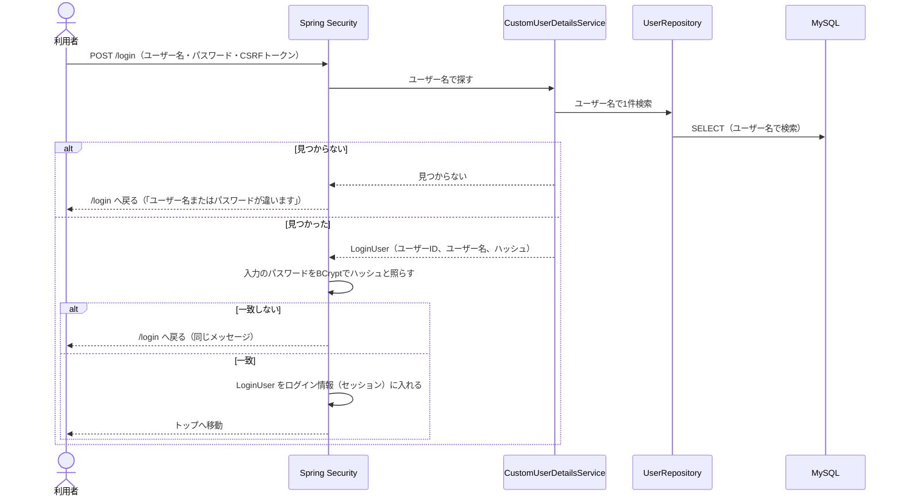

- 「ユーザー名がない」と「パスワードが違う」は、同じメッセージにする（B8）。
- ログイン後の各リクエストでは、Controller が `LoginUser` から**ユーザーIDを取り出して** Service に渡す（画面からのユーザーIDは使わない、3.9）。毎回データベースを引かない（P3）。
- ユーザー名を探すときの大文字・小文字の扱いは、照合順序で決まる（Q10、3.12）。
- ログアウト（`POST /logout`）は、Spring Security がログイン情報を捨て、`/login` へ移動する。

### 5.3 アカウント登録と初期データの作成

`RegistrationService` が、ユーザーと初期データ（3.11）を**同じトランザクション**で作る。途中で失敗したら、ユーザーも含めてすべて取り消す。

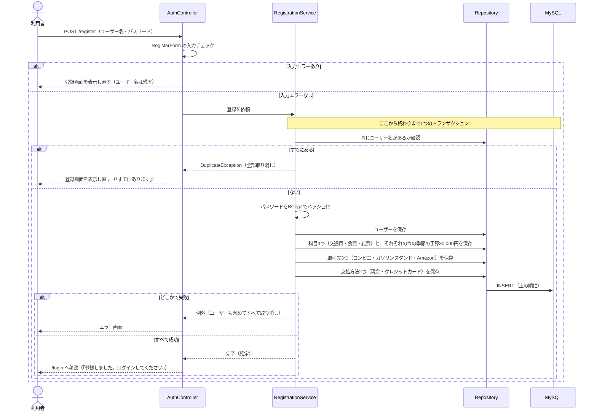

- 初期データの作成は、`CategoryService` ではなく `RegistrationService` が Repository を使って直接行う。理由：`CategoryService` の追加は予算を0円で作るが、初期の科目は30,000円で作るため。
- 同時に同じユーザー名で登録され、確認をすり抜けた場合は、DB の一意制約（3.2）が最後の守りになる。そのエラーも `DuplicateException` として扱う。
- 作る順番は、科目・取引先・支払方法とも 3.11 のとおり（`id` の順＝表示の順、Q14）。

### 5.4 科目・取引先・支払方法の追加

`POST /categories`（取引先は `/vendors`、支払方法は `/payment-methods`）。

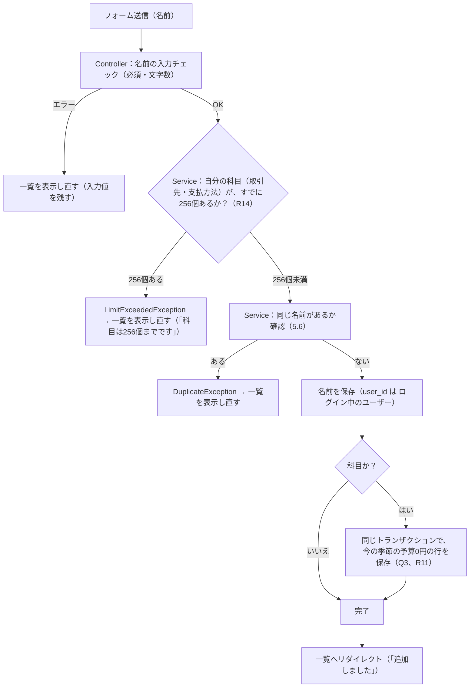

- 科目の追加では、名前の保存と、**今の季節**（5.8）の予算0円の行の保存を**同じトランザクション**にする。ほかの季節の予算は作らない（未設定）。どちらかが失敗したら、両方取り消す。
- 取引先・支払方法の追加は、予算の行を作らない以外は同じ。
- **個数の上限（Phase 6、R14）**：科目・取引先・支払方法は、それぞれ**1人あたり256個まで**（`Limits`）。追加のとき、Service が、自分のものの個数を数える（`user_id` で絞る）。すでに256個あれば、**256個目までは追加でき、257個目は追加できない**。追加できないときは、`LimitExceededException` で、一覧を表示し直し、名前の項目の横に「科目は256個までです」（取引先は「取引先は256個までです」、支払方法は「支払方法は256個までです」）と表示する（入力値は残す）。上限の確認は、同じ名前の重複の確認（5.6）より先に行う。変更・削除は、上限に関係なくできる（削除すると、また追加できる）。
  - **理由**：予算設定画面は、行を256行までしか受け取れない（5.7）。科目が257個以上あると、普通に使っていても予算を保存できなくなるため、科目の数を、その行数と同じ256個までにした。取引先・支払方法は、予算の画面には関係しないが、同じ上限にそろえた（簡単で、分かりやすいため）。
  - アカウント登録のときの初期データ（科目3つ、取引先3つ、支払方法2つ）も、この個数に含まれる。
  - 上限は、アプリ（Service）だけで守り、DB の制約にはしない。同時に2つの追加が重なると、まれに257個になりうる（個人用で、起きにくい）。そのとき、予算設定の保存は、行が256行を超えるため 400 になる（5.7）。Phase 8 の確認に含める。

### 5.5 科目・取引先・支払方法の削除

`POST /categories/{id}/delete` など。削除前の確認ダイアログは画面（ブラウザ）で行い、Service は「削除してよいか」を判定する。

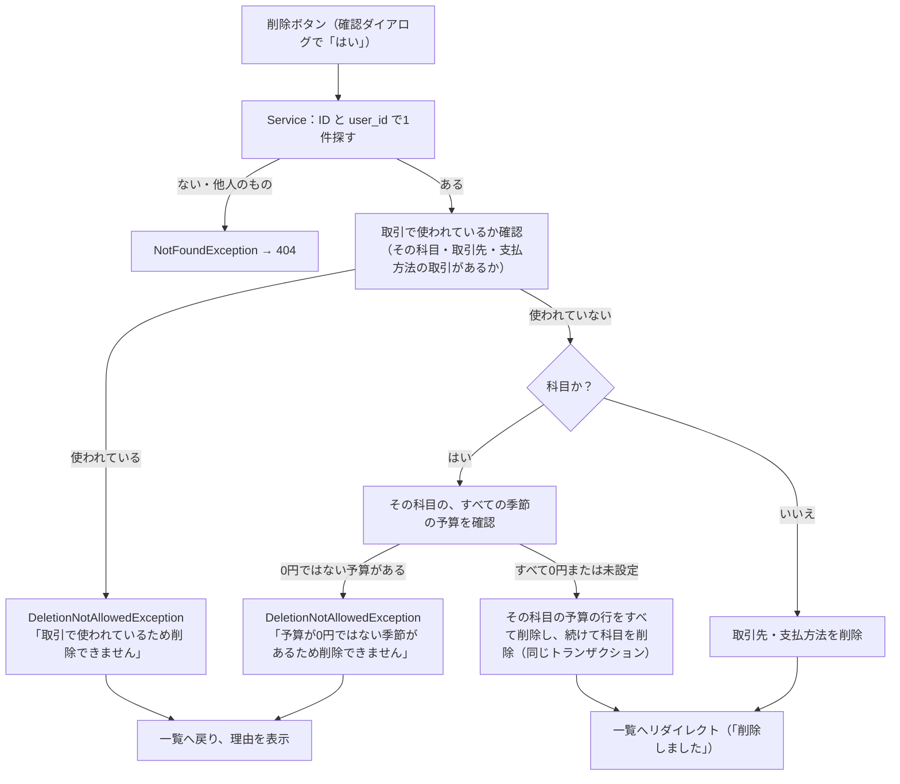

- 科目の削除は、**その科目の予算の行（どの季節のものも）をすべて先に消してから科目を消す**（3.7）。予算の行を残したまま科目を消そうとすると、DB の外部キーが拒否するため。
- 予算が「未設定」の季節は0円として扱うので、予算の行がない季節は削除をさまたげない（要件4.3）。
- 削除できない理由が2つ重なるときは、「取引で使われている」を先に判定し、**そのメッセージだけ**を表示する（F1）。
- 判定をすり抜けて DB の外部キーに拒否された場合（同時操作など）も、`DeletionNotAllowedException`（「取引で使われているため削除できません」）として扱う。
- 取引の削除（`POST /transactions/{id}/delete`）は、ID と `user_id` で探して見つかれば削除するだけ（見つからなければ 404）。

### 5.6 名前の重複チェック

科目・取引先・支払方法の名前は、同じユーザーの中で重複不可（Q9）。ユーザー名はシステム全体で重複不可（Q10）。

| 場面 | 確認すること |
|---|---|
| 科目・取引先・支払方法の**追加** | 自分の中に、同じ名前がすでにあるか |
| 科目・取引先・支払方法の**変更** | 自分の中に、**この行以外で**同じ名前があるか。**自分自身の今の名前は重複とみなさない**（名前を変えずに保存しても、エラーにしない） |
| **アカウント登録** | 同じユーザー名がすでにあるか（持ち主の区別はない） |

- 名前は、前後の空白を取り除いてから比べる（B9）。
- 比べ方（大文字・小文字、かな、全角半角を同じとみなすか）は、DB の照合順序で決まる。`utf8mb4_0900_as_ci` に決めた（3.12）。アプリ側の確認も、DB に問い合わせて同じ基準で行う。
- アプリ側の確認をすり抜けた場合（同時操作など）は、DB の一意制約（3.2〜3.5）が拒否する。そのエラーも `DuplicateException` として扱う。

### 5.7 予算の表示とまとめての保存（季節ごと）

予算は「科目・年・季節」ごとに1つ（3.6）。`GET /budgets?year=…&season=…` で、指定した季節の、自分の全科目の予算額を並べて表示する。`POST /budgets?year=…&season=…` で、その季節の全科目の予算額をまとめて保存する（Q8、R11）。年と季節の指定と404は、予実比較と同じ（2.4、5.8）。

**表示（`GET`）：入力欄の最初の値を決める**

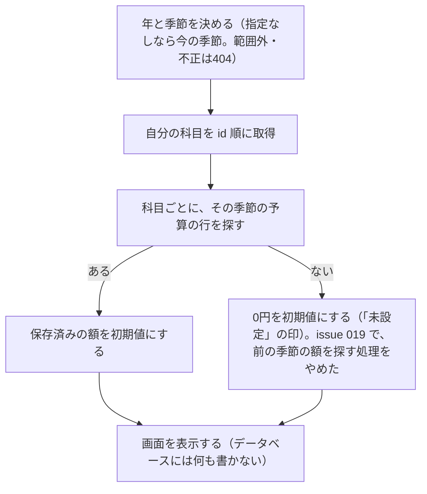

- 〔Q23 の「直前」は、**issue 019 でやめた**。前の季節の額を、初期値には使わない。直前の季節の予算と実績は、自動予算（5.14）だけが使う。〕
- **画面を開いただけでは、行は作らない**。データベースに書くのは、保存したときだけ。
- **`auto` があるとき（issue 019）**：年と季節の検査のあとに `auto` を検査し、5.14 の案を入力欄の最初の値にして表示する。**この GET も、データベースに何も書かない**。保存は、今までどおり `POST` だけ（案のまま変えなかった行も、その額で保存される）。

**保存（`POST`）**（Phase 6、Q6-3 の A で、順番を見直した。下の「見直し」を見る）

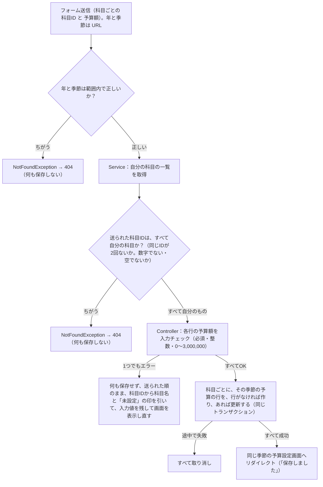

- **見直し（Phase 6、Q6-3）**：当初の図は「入力チェック → 科目IDの確認」の順だった。しかし、入力エラーで表示し直すときは、送られた科目IDから**科目名と「未設定」の印**を出す必要があり、IDが自分の科目でなければ名前を出せない。そこで、**科目IDの確認を先に行う**順にした（7.8 の「変更の送信は、入力が間違っていても、先に ID を確かめる」と同じ考え方）。他人のデータの有無が分かる差は出ない（他人のID・存在しないIDは、入力の正誤に関係なく、同じ 404）。
- 保存すると、その季節の**全科目の行**が、画面に表示されていた額で作られる・更新される（Q25）。初期値の 0 円や自動予算の案のまま変えなかった行も、その額で保存され、「未設定」の印は消える。
- 画面から送られる科目IDは書き換えられるため、**必ず自分の科目か確認する**（3.9）。他人の科目IDが1つでも混ざれば、404 で、ほかの行も含めて何も保存しない。
- 同じ科目IDが2回送られたときも不正として 404 にして、何も保存しない（F3）。科目IDが数字でない・空のときも、不正として 404 にする（画面の隠し項目で、利用者が書き換えない限り起きない）。
- 年と季節が範囲外のときは、Controller が 404 にする。Service も、範囲外の季節なら `NotFoundException` にする（守りを二重にする）。
- エラーで表示し直すときの行は、送られた順のまま（科目IDから名前と印を引く）。送られなかった科目の行は出ない。
- 送られなかった科目の、その季節の予算は変えない（F2）。
- 一意制約 `(category_id, season_year, season)`（3.6）が、同時操作で同じ行が2つできるのを防ぐ最後の守りになる。拒否されたときは、特別な扱いをせず、500 番台のエラー画面になる（Q6-6 の A。何も二重には保存されない。二重送信などで起きうるが、個人用の家計簿では起きにくい）。
- 別の季節へ移動するリンクを押したとき、保存していない入力は確認なしで捨てられる（Q27 の d）。
- **Service の null の守り**（issue 002）：Form・行の並び・行そのものが null のとき、保存のときは金額が null のときも、`NotFoundException`（何かを書く前に検査する）。画面（HTTP）からは到達しない（`rows` が送られなければ空の並びで、行の抜けは空の行で埋められる）が、Controller の入力チェックに頼らず、Service でも守る二重の守りとして入れた。
- **行の数の上限と、束縛の失敗は 400**（Phase 6、Q6-9 の見直し。R14 と issue 002）：行の並び（`rows[0]`、`rows[1]`、…）は、Spring の標準で**256行まで**しか組み立てられない（この標準は変えない）。科目は1人あたり256個までと決めた（5.4、R14）ので、**256行なら、いつでも保存できる**。257行以上を送る、行の番号を書き換える（`rows[-1]`、`rows[abc]` など）と、束縛そのものが失敗する（`InvalidPropertyException`）。これは利用者の送信の形がおかしいことなので、**500 ではなく 400 にして、400 番台の画面（`error/4xx.html`）を出す**（7.7。`GlobalExceptionHandler`）。何も保存されない。
  - **見直しの経緯**：当初（Q6-9 の A）は、科目の数に上限がなかったので、標準の256行のまま、「科目が257以上あると保存できない」「束縛の失敗は500になる」を受け入れていた。ChatGPT のレビューの追加の指摘を受けて、本人が、科目の数に上限を設け（R14）、束縛の失敗を400にすると決めた。

### 5.8 季節の決定と期間

`domain` の `SeasonPeriod` が行う。画面にもデータベースにも依存しない計算なので、単体テストで確かめる（Phase 7）。「今の季節」は、予実比較と予算設定を季節の指定なしで開いたとき、アカウント登録の初期の予算、科目の追加で作る予算（0円）の、4つで使う（R11）。

**季節と月**

| 季節 | 月 | 年の決め方 |
|---|---|---|
| 春 | 3〜5月 | その月の年 |
| 夏 | 6〜8月 | その月の年 |
| 秋 | 9〜11月 | その月の年 |
| 冬 | 12〜2月 | **12月がある年**。12月はその年、**1月・2月は前の年** |

**今日の日付から季節と年を決める**（`season` と `year` を指定せずに開いたとき。「今日」は日本時間、B6）

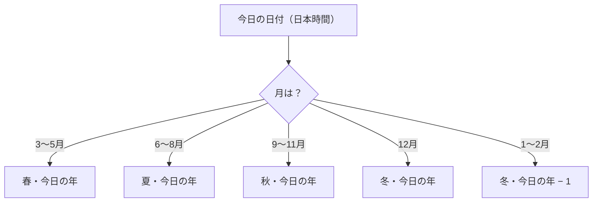

| 今日 | 季節と年 |
|---|---|
| 2027年2月28日（うるう年は29日） | 2026年の冬 |
| 2027年1月15日 | 2026年の冬 |
| 2026年12月1日 | 2026年の冬 |
| 2026年11月30日 | 2026年の秋 |
| 2027年3月1日 | 2027年の春 |

**期間（開始日以上、終了日の翌日未満）**

| 季節（Y年） | 開始日（含む） | 終了日の翌日（含まない） |
|---|---|---|
| 春 | Y年3月1日 | Y年6月1日 |
| 夏 | Y年6月1日 | Y年9月1日 |
| 秋 | Y年9月1日 | Y年12月1日 |
| 冬 | Y年12月1日 | **Y＋1年3月1日** |

- 取引は「日付 ≧ 開始日 かつ 日付 ＜ 終了日の翌日」で選ぶ。理由：2月の最終日（28日か29日か）を数えなくても、3月1日を境にきれいに分けられるため。
- 例：2026年の冬は 2026年12月1日 ≦ 日付 ＜ 2027年3月1日。2027年2月28日の取引は冬、3月1日の取引は春に入る。
- `year` と `season` が URL で指定されたとき（予実比較・予算設定）の確認（2000〜2100、季節の名前、片方だけは不可）と、前・次の季節の求め方は 2.4 のとおり。不正なら `NotFoundException`（404）。

### 5.9 予実比較の集計と色の判定

`ComparisonService` が、期間内の科目ごとの予算・実績・差額・色を作る。全体の道すじは 1.4（例2）。ここでは中身を書く。予算は季節ごとに持つ（3.6）ので、**表示する季節の予算**を使う。

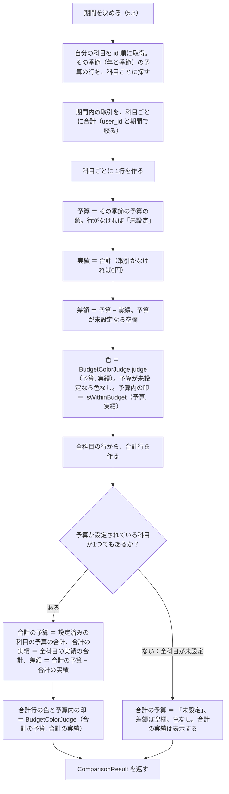

**色の判定の順番**（`BudgetColorJudge`。要件4.4、各行も合計行も同じ）

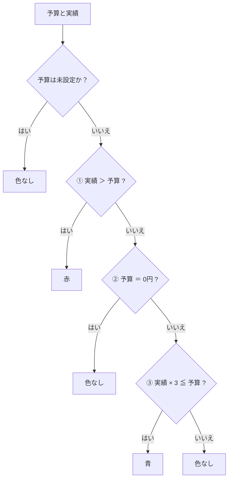

| 予算 | 実績 | 色 | 理由 |
|---|---|---|---|
| 30,000円 | 30,001円 | 赤 | ① 超過 |
| 30,000円 | 30,000円 | 色なし | 超過ではない。③ 90,000 ≦ 30,000 は成り立たない |
| 30,000円 | 10,000円 | 青 | ③ 30,000 ≦ 30,000（ちょうど1/3も青） |
| 30,000円 | 10,001円 | 色なし | ③ 30,003 ≦ 30,000 は成り立たない |
| 30,000円 | 0円 | 青 | ③ 0 ≦ 30,000 |
| 0円 | 1円 | 赤 | ① 予算が0円でも、実績があれば赤 |
| 0円 | 0円 | 色なし | ② 予算が0円（③ を通すと 0 ≦ 0 で青になってしまうので、先に除く） |
| 未設定 | 5,000円 | 色なし | 予算が未設定。比べる予算がない（差額も空欄） |
| 未設定 | 0円 | 色なし | 同上 |

- 「予算が未設定」と「予算が0円」は別。0円は設定済みなので、実績があれば①で赤になる。未設定は①〜④の判定をせず、色なし（要件4.4）。
- ①②③の順番は変えない。②を③より先に置くことで、「予算0円・実績0円」が青にならない。

**予算内の印（💮）**（Phase 8、issue 005。`BudgetColorJudge.isWithinBudget`。各行も合計行も同じ。Q8-27〜Q8-33）：色の判定で**④（それ以外は色なし）に当たり、かつ予算が設定されていて予算 ＞ 0、実績 ＞ 0** の行に付ける。式にすると、予算が設定されていて、実績 ≦ 予算 かつ 実績 × 3 ＞ 予算（このとき実績 ＞ 0、予算 ＞ 0 になる）。

| 予算 | 実績 | 色 | 💮 | 理由 |
|---|---|---|---|---|
| 30,000円 | 20,000円 | 色なし | あり | 予算の1/3を超え、予算以下 |
| 30,000円 | 30,000円 | 色なし | あり | 予算ちょうども含む（Q8-29） |
| 30,000円 | 10,001円 | 色なし | あり | 10,001 × 3 ＝ 30,003 ＞ 30,000 |
| 30,000円 | 10,000円 | 青 | なし | ちょうど1/3は青。💮 は色なしの行だけ |
| 30,000円 | 0円 | 青 | なし | 実績が0円（Q8-28） |
| 30,000円 | 30,001円 | 赤 | なし | 超過 |
| 0円 | 1円 | 赤 | なし | 赤 |
| 0円 | 0円 | 色なし | なし | 実績が0円（Q8-28） |
| 未設定 | 5,000円 | 色なし | なし | 予算が未設定（Q8-28） |
- 金額の合計と「実績 × 3」の計算は、`INT` ではなく大きい整数（`Long`）で行う（3.1）。
- **合計行**（Q22 の C）：合計の予算は**設定済みの科目の予算だけ**を足し、合計の実績は**全科目の実績**を足す。予算が未設定の科目の実績も、合計の実績に入る。これは「予算0円でも実績があれば赤」と同じ考え方で、予算のない科目の支出も全体に含める。
  - 例：交通費 10,000円（予算 30,000円）、食費 5,000円（予算 未設定）→ 合計の予算 30,000円、合計の実績 15,000円、差額 15,000円。
  - 科目を追加する前の季節では、追加した科目の実績は0円なので、合計に影響しない。
  - 全科目が未設定のときだけ、合計行も予算「未設定」・差額は空欄・色なし。
- 合計行の実績は、全科目の実績を足したもの。取引はすべて自分の科目に属する（外部キー、3.7）ので、取り漏れはない。
- 色を付ける場所は、その行の文字全体（F4）。
- **予算内の行（💮）の背景**（Phase 8、Q8-36〜Q8-41）：その行（合計行も）の `<tr>` に `row-within` を付け、背景を薄いアプリコット `#FFF2E5` にする（issue 015 で変えた値。薄いターコイズ `#E1F3F2` と、前の薄い緑 `#e3f8e9` の色の違いが小さい（ΔE 7.4）ため。薄いアプリコットでは 12.6 に離れる。Bootstrap の `--bs-success-bg-subtle` は使わず、この値を直接使う。文字との明るさの比は、実装のあとに測って、手順書に記録する）。`style.css` で、Bootstrap の表の変数 `--bs-table-bg` だけを上書きする（`.comparison-table tr.row-within`）。そのため、行にマウスを載せたときの色や、合計行の上の線は残る。文字の色は変えない（赤・青は文字の色、こちらは背景なので、重ならない。💮 の行は色なしの行だけ）。右端の 💮 は、セルに `within-mark` を付け、`style.css` で文字の 1.5 倍（`font-size: 1.5em`）にする。注記の文は変えない（Q8-40）。
- 予算は季節ごとに持つので、過去の季節は、その季節に設定した予算で比べる。設定していない季節は「未設定」になる（R11）。
- 科目が0件のときは、行は空で、画面は表と合計行を出さず、「先に科目を追加してください」の案内を出す（2.3、Q7-7）。
- 画面を開いても、データベースの行は変わらない（読むだけ）。
- ブラウザの確認（Phase 7）で、赤・青・色なしが1つの画面にそろうこと（食費は赤、交通費は青、雑費は色なし、合計行は色なし）と、季節の境目（8月31日と9月1日、11月30日と12月1日、2月28日と3月1日）の取引の振り分けを確かめた。

### 5.10 追加で決めた点（確定）

要件にもそれまでの決定にもなかった点を、確認のうえで決めたものです。

| 番号 | 決めたこと | 理由 |
|---|---|---|
| F1 | 科目の削除で「使用中」と「いずれかの季節に0円でない予算がある」が重なるときは、「取引で使われている」のメッセージだけを出す | 取引を消さないと進めないので、先に知らせたほうが分かりやすい |
| F2 | 予算のまとめて保存で、送られなかった科目の予算は変えない | 画面は全科目を送るため通常は起きない。想定外の送信で、勝手に書き換えない |
| F3 | 予算のまとめて保存で、同じ科目IDが2回送られたときも、不正として 404 にして何も保存しない | 書き換えられた送信を受け付けないため |
| F4 | 予実比較で色を付ける場所は、**その行の文字全体**（科目名・予算・実績・差額）。数字だけには付けない。合計行も同じ。**色の値**（Phase 7、Q7-6 の A と C）：文字色だけ。赤は `#c62828`、青は `#1565c0`、色なしは今の文字色。表の下に色の意味の注記を出す | 要件の「赤字／青字で表示する」を、行ごとに分かりやすく見せるため |
| F5 | 予実比較の予算内の印（💮）は、**新しい右端の列**に出す。合計行にも付ける。色の行（赤・青）とは別の列なので、行の文字の色には影響しない。**その行（合計行も）の背景を薄いアプリコットにし、💮 を文字の 1.5 倍にする**（`row-within`、`within-mark`。Q8-36〜Q8-41）。列の見出しと印には、読み上げ用の文字を添える（Phase 8、Q8-27〜Q8-34） | 既存のセルの形〔`<td class="num">…</td>` など。テストが確かめている〕を変えずに足すため。絵文字は読み上げで意味が通らないため |

### 5.11 トップの集計（issue 010）

`TopService.top(userId, today)` が、トップの画面用のデータ（`TopView`）を作る。読むだけ。「今日」は日本時間の `Clock` から1回だけ取り、すべての計算に同じ値を渡す（B6）。計算は `domain`（4.5）に置く。画面にもデータベースにも依存しない `long` と整数だけの計算にして、`BudgetColorJudge` と同じように境界値でテストする。

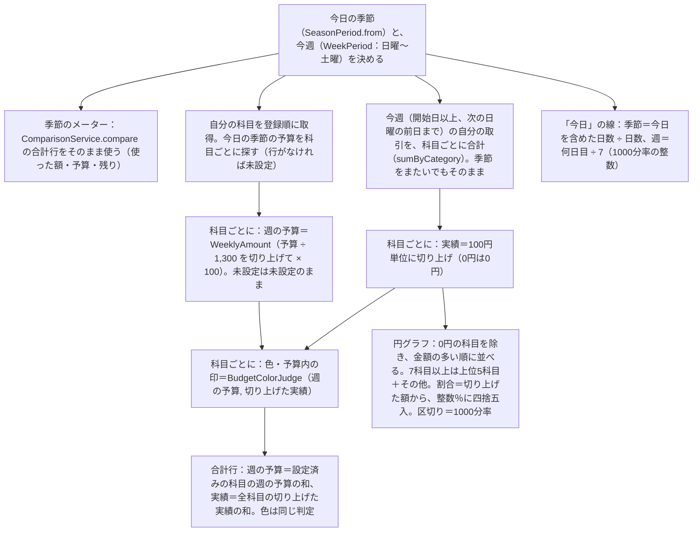

| 項目 | 決まり |
|---|---|
| 今週 | 日曜〜土曜（日曜を1日目とする）。範囲は「開始日以上、開始日 + 7 日 未満」 |
| 週の予算 | 今日が入っている季節の、その科目の予算 ÷ 13 を100円単位で切り上げ。整数の式は「（予算 + 1,299）÷ 1,300 の商 × 100」。予算0円は0円、未設定は未設定。例：30,000円 → 2,400円、1円 → 100円、1,300円 → 100円、1,301円 → 200円 |
| 今週の実績 | 科目ごとに「（実績 + 99）÷ 100 の商 × 100」。例：1円 → 100円、100円 → 100円、101円 → 200円 |
| 合計 | 科目ごとに切り上げた額の和（和を切り上げたものではない）。週の予算の合計は、設定済みの科目だけ。全部未設定なら「未設定」 |
| 色・💮 | `BudgetColorJudge.judge` と `isWithinBudget` に、週の予算と切り上げた実績を渡す。合計行も同じ。判定は、画面に出ている額で行う（どちらも100円の倍数） |
| 「今日」の線 | 今日を含めた日数 × 1000 ÷ 全部の日数（切り捨て）。季節の日数は春92・夏92・秋91・冬90または91。週は7（日曜 142、土曜 1000） |
| 季節の見出しの行と%（issue 017） | 「あと ○ 日」＝季節の日数 − 今日が何日目か + 1（今日を含める。秋の11月8日は 91 − 69 + 1 = 23）。「予算のうち ○%」＝使った額 × 100 ÷ 予算（四捨五入）。「季節の ○%」＝今日を含めた日数 × 100 ÷ 季節の日数（四捨五入）。予算が未設定・0円なら「予算のうち ○%」は出さない。棒の長さは今までどおり（1000分率、100%で止める） |
| 状態の短い文（issue 017） | 赤＝「赤：○円オーバー」（実績 − 週の予算）、青＝「青：1/3以下」、💮＝「💮 予算内」、週の予算が未設定＝「予算なし」、予算0円で実績0円（色なし）＝文なし。判定は `BudgetColorJudge`。合計の行も同じ |
| 見込みの一文（issue 018） | 事実の文（季節の％と、使った割合。どちらも四捨五入した整数）と、見込み（5.13）を 1 つの文にする：「季節は ○% 過ぎて、予算は ○% 使いました。このペースだと、季節の終わりには約 ○円（予算の ○%）の見込みです。」。**5 ポイントの判定（ゆっくりめ・ほぼ予定どおり・速め）はなくした**〔issue 017 のペースの一言を置きかえた〕。予算が未設定・0円のときは出さない。色は濃いターコイズ（`#0B6E6B`）の太字で、赤・青の意味の色は使わない。見込みの数字を述べるだけで、前もっての知らせはしない（9章のアラートとは別） |
| 棒の長さ | 実績 × 1000 ÷ 予算（切り捨て）。1000で止める。予算0円で実績があれば1000、実績0円なら0。予算が未設定なら棒を出さない |
| 円グラフ | 並び：切り上げた額の多い順。同額は科目の登録順。6科目以下は全部（6つ目は灰色）。7科目以上は上位5科目＋「その他」（灰色。束ねた科目の数を添える）。割合：額 × 100 ÷ 合計を、四捨五入して整数％（足して100％にならなくてもよい）。円の区切りは1000分率で、最後はちょうど1000。**判定：週の予算と切り上げた実績から `BudgetColorJudge` で決める（「今週の進み具合」と同じ）。「その他」は判定なし** |
| `style` の文字 | 円の `conic-gradient(var(--hb-chart-N) 開始% 終了%, …)` と、棒の幅 `width: 42.5%` は、Java が数字と固定の文字だけで組み立てる。科目名は入れない（7.5） |

- 科目・予算・取引は、すべて `user_id` で絞る（3.9）。`ComparisonRow` は科目の ID を持たないので使い回さず、`TopService` が自分で科目と予算を取る。
- 季節をまたぐ週では、週の予算は今日の季節のもの。日付が変わって季節が変わると、週の予算も変わる。
- 合計は、100円単位の切り上げを積み重ねるので、元の額の合計より最大で「99円 × 科目の数」多くなる。

### 5.12 きょうのひとこと（issue 016）

トップの円グラフの下の枠。①暦のひとこと、②グラフへのひとこと。どちらもサーバー側で作って `th:text` で出す。JavaScript・外部の API・CDN は使わない。`TopService.top` が、すでに集めた今週の数字と「今日」を `HitokotoService` に渡し、結果を `TopView` に入れる。新しい DB 検索はしない（3.9 の `user_id` の絞りは、`TopService` の中で済んでいる）。

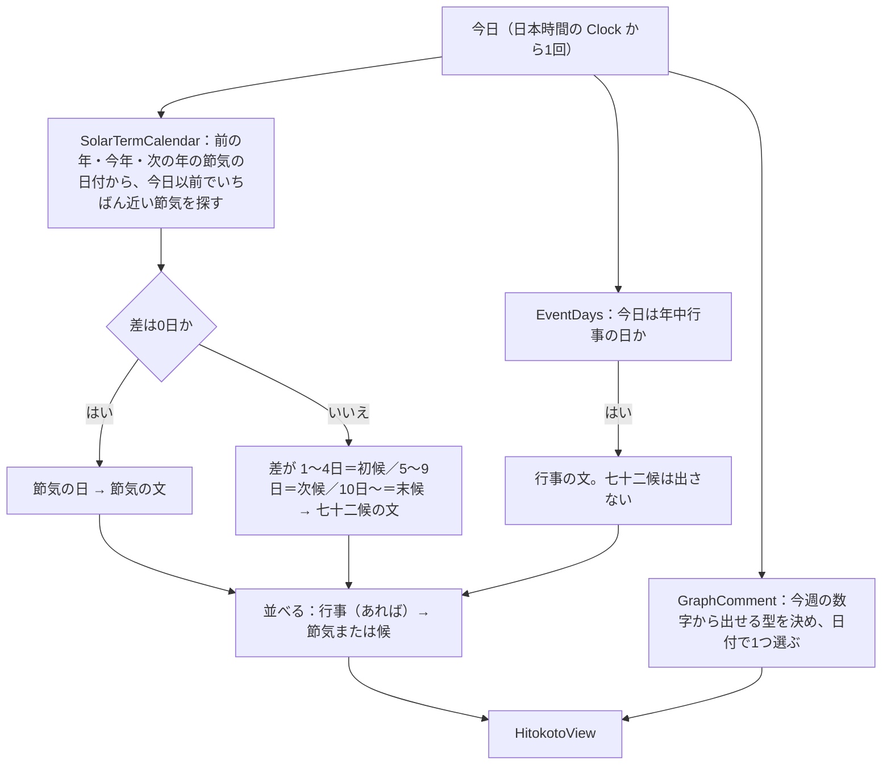

| 項目 | 決まり |
|---|---|
| 出し分け | ふだん：七十二候。節気の日：節気（七十二候の代わり）。行事の日：行事（七十二候の代わり）。行事と節気が同じ日：行事を先、その下に節気。行事の日で節気の日でないときは、行事だけ（候は出さない） |
| 二十四節気の日付 | 年ごとの表（`nijushi-sekki-dates.json`）。形は `{ "2026": { "小寒": "2026-01-05", … 24個 } }`。**表に持つのは2025〜2027年だけ**（国立天文台の暦要項で確かめた年。72件は Codex が暦要項と照らし合わせて一致。本人の目視の照合はしていない）。出どころの URL と取得日は、手順書 issue-016-hitokoto.md の実施の記録に残す。**2028年以降は表を持たず、「ごろ」の日付で動く**（2028年の暦要項は未公開。毎年2月ごろに公開されたら、その年を足す。足し方は手順書の付録 B）。1月は前の年の冬至から数え、年末の「次の節気」は次の年の小寒（1月5日ごろ）なので、前後の年の表も使う |
| 表の外の年 | **今日の前の節気と次の節気が、どちらも表の日付で求まるときだけ表を使う。どちらかが表の外なら、その日は**文面の「ごろ」の月日で代わりに動かす（最大で1日ずれることがある）。代わりに動かした日は「次の節気」の補足を出さない。起動後、最初に使ったとき、ログに警告を1度だけ出す。例外は投げない |
| 表の更新 | 毎年2月ごろ、暦要項が公開されたら、その年を表に足す（手順書の付録 B）。足す日付は、暦要項で確かめたものだけ |
| 七十二候 | 通し番号は、立春の初候を1、大寒の末候を72とする。始まりの日は計算で出す（節気の日 +0／+5／+10日）。節気の当日は節気の文を出すので、初候の文が出るのは当日の翌日から4日間、次候は5日間、末候は次の節気の前の日まで（4〜6日間） |
| 年中行事 | 元日1/1、七草1/7、ひな祭り3/3、端午の節句5/5、七夕7/7、お盆8/13、七五三11/15、大晦日12/31（月日）。節分＝立春の前の日、春のお彼岸入り＝春分の3日前、秋のお彼岸入り＝秋分の3日前（節気から引く）。十五夜・土用の丑の日は入れない。重なる日は、行事が先、節気が後 |
| 次の節気の補足 | 「次の節気：立冬まであと3日」。日数＝次の節気の日 − 今日。節気の当日と、表のない年は出さない。行事の日・候の日は出す |
| 枠の見せ方 | 各項目は、小さい見出し（種類・名前・読み。例：「七十二候　草露白（くさのつゆしろし）」「二十四節気　立冬」「年中行事　七夕」）と文。行事と節気の間に線を1本 |
| 文面のファイル | `hitokoto/` の下の4つの JSON（4.3）。七十二候：`number`・`sekki`・`position`（`first`／`second`／`third`）・`name`・`reading`・`text`。二十四節気：`number`・`name`・`reading`・`text`・`approx`（ごろの月日）。年中行事：`name`・`rule`（`FIXED`〔月日〕／`BEFORE_SEKKI`〔節気の名前と日数〕）・`text`。節気の日付：年ごとに、節気の名前と日付の対。UTF-8。起動のとき1回だけ読み、件数（72・24・11）・番号・空の文を確かめる（`HitokotoTexts`） |
| 文面の直し方 | 文面の原本は、アプリの中のファイル（JSON）。`docs/hitokoto-source.md` は、文面を確認した記録として残し、書き換えない。文面を直すときは JSON を直す。文面の言い回しは、本人の決めたもの。コードの側で変えない |
| グラフへのひとこと：材料 | `TopService` が集めた今週の数字だけ。科目ごとの週の予算（未設定は `null`）と、100円単位に切り上げた実績、合計の行、今日の曜日。**画面に出ている額と同じ**（切り上げ後の額） |
| グラフへのひとこと：型 | **最多**（今週の取引が1件以上。切り上げた実績が最大の科目。同額は科目の登録順。「その他」ではなく本当の科目）。**残り**（週の予算が1科目以上に設定済み。合計の行の「週の予算 − 実績」と、土曜までの日数〔日曜6〜土曜0〕。マイナスのときは、こえた額を述べる）。**未使用**（週の予算が設定済みで、今週の実績が0円の科目がある。週の予算が最大のもの1科目。同額は登録順） |
| グラフへのひとこと：選び方 | 出せる型を「最多 → 残り → 未使用」の順に並べ、`今日の通算日（epochDay） ÷ 出せる型の数` の余りで1つ選ぶ。同じ日は何度開いても同じ。出せる型がなければ出さない。取引0件で週の予算がある：残りだけ。取引0件で週の予算がない：出さない。取引があり予算が全部未設定：最多だけ。科目が0件：出さない |
| グラフへのひとこと：言い方 | 文は `messages.properties`（`hitokoto.graph.…`）に置き、科目名・金額・日数は引数で入れる。事実だけを「です・ます」で述べ、評価・命令・感嘆符を使わない。禁止の言葉（使いすぎ、無駄、節約、控え、気をつけ、がんばって、！）は、テストで確かめる。超過のときも、こえた額を述べるだけ |

- 要件定義書 9 章のアラート機能（前もっての知らせ）や、着地見込み（5.13）とは別。グラフへのひとことは、今の数字を述べるだけ。
- 季節のメーターの下の一言（Q010-3）は、issue 016 の時点では出さなかったが、issue 017 で出すことにした（ペースの一言。5.11）。**issue 018 で、見込みの一文に置きかえた（5.13）**。グラフへのひとこと（上の表）とは別。

---

### 5.13 着地見込み（issue 018）

季節の終わりの**合計**の見込みを、予実比較の表の上に 1 行、トップの一文に出す。**数字を見せるだけで、前もって知らせる機能（要件定義書 9 章のアラート）ではない。**

**式**（要件 4.4）：見込み ＝ 実績 ×（1 ＋ r）＋ 予算 × r²。r ＝ 残りの割合 ＝ L ÷ D。D ＝ 季節の日数（`PeriodProgress.seasonDays`）、L ＝ 残りの日数 ＝ D − 今日が季節の何日目か（今日は経過に含める）。**L は `seasonDaysLeft`（今日を含む残り日数）より 1 小さい**（最後の日は 0）。「残りの予算（予算 × r）× 補正率（実績 ÷ 予算 ＋ r）」を足した実績の形と同じ答えになる（整理前の式との一致は、単体テストで確かめる）。

**整数で計算する形**：見込み ＝（実績 × D ×（D ＋ L）＋ 予算 × L²）÷ D²。100 円単位の切り上げは、`Math.ceilDiv(分子, 100 × D × D) × 100`（小数を使わない）。

**例**：今の demo（実績 107,800、予算 175,000、91 日中 70 日目）→ 141,996.45… → **約 142,000 円**（予算の 81%）。季節の 3 日目に食費 15,000 円（予算 40,000 円）→ 66,911.60… → **約 67,000 円**。

**性質**（境界値のテストで確かめる）：予定どおりのペース（実績 ＝ 予算 × 経過の割合）なら、どの日でも見込み ＝ 予算。見込み ≧ 実績。最後の日（L ＝ 0）は見込み ＝ 実績。初日に実績 0 円でも、予算に近い値から始まる（予算 175,000 円で 171,200 円）。季節の初めは予算を信じ、日がたつほど実際のペースを信じる。**初日から出す**（「初めの何日は出さない」はない）。

**出さない**：予算が未設定（設定済みの科目がない）とき、予算の合計が 0 円のとき、今日が属する季節でないとき（過去・未来の季節）、科目が 0 件のとき。

**「予算の ○%」の端数**：`PeriodProgress.roundedPercent`（四捨五入。半分は切り上げ）。「予算は ○% 使いました」と同じ決まり。分子は、表示する見込みの額（100 円切り上げ後）。**「上回ります」は、金額（切り上げ後の見込み ＞ 予算）で決め、％では決めない**。このため、見込みが予算を、予算の 0.5% 未満だけ上回るとき（予算 175,000 円なら 175,100〜175,800 円）は、「予算の 100%」と出ても、予実比較は「上回ります」と出る。同じ画面に両方が出ることはない（％はトップ、「上回ります」は予実比較）。今の画面にも、実績が予算を 0.2% 超えたとき、トップは 100%、予実比較の行は赤になる、同じ仕組みの動きがある（Q018-9 の A）。

**桁あふれ**：式の計算は `long` で行い、`Math.multiplyExact`・`addExact` を使って、あふれたら `ArithmeticException` にする（黙って違う数字を出さない）。例外は、そのまま上に投げる（画面はエラー画面）。季節が 92 日のとき、実績が約 5.5 × 10^14 円までは `long` に収まる（取引 1 件の上限 1,000,000 円、予算の合計は最大約 7.7 億円なので、実際には届かない）。「予算の ○%」の計算も、同じ方法にする。既存の `PeriodProgress.roundedPercent` は、分子が約 4.6 × 10^16 円を超えるとあふれる（検査がない）。この回では変えない。

**弱点**：決まった日にまとめて払うもの（電気代など）は、払う日で見込みが上下する。画面の補足に書く。

**テスト**：`LandingForecastTest`（`domain`）。上の例、季節の日数（春 92・夏 92・秋 91・冬 90・冬 91）、最後の日・初日、予定どおりなら予算、見込み ≧ 実績、100 円切り上げの境目、予算なし・0 円、今の季節でない、**大きな金額（実績 5 億円・予算 7.68 億円など）、あふれたら例外**、整理前の式との一致（分数での比較）、「予算の ○%」と「上回ります」の境目（予算ちょうど、100 円多い、予算 20,000 円以下）。画面は `TopServiceTest`・`TopLayoutTest`・`ComparisonControllerTest`（今の季節だけ、色・印がない、警告の言葉が出ない）。

### 5.14 自動予算（issue 019）

予算設定画面の「自動予算」で、**過去の同じ季節の実績**と**ここ 3 年の傾向**から、科目ごとの予算の案を入力欄に入れる（要件 4.3）。**押しても保存しない。計算はサーバーの `domain` だけで行う**。画面の `GET /budgets?year=…&season=…&auto=1|2|3` で、案を入れた画面を作る。経理の「前年実績ベースの予算編成」にあたる。issue 018 の着地見込み（`LandingForecast`）は、**使わない**〔予算を混ぜて出す式なので、予算から予算を作ることになるため〕。

**`auto` の検査**：Controller が文字列で受け取り、`"1"`・`"2"`・`"3"` と**完全に同じ**ものだけを受け付ける（`ProposalChoice` が求める）。空・`0`・`4`・`01`・`abc` は `NotFoundException`（404、7.8）。年と季節の検査（範囲外・不正は 404）が先。`auto` の値は、画面にそのまま出さない（選んだ割合は、列挙から固定の文字を出す）。

**流れ**（読むだけ。書かない）

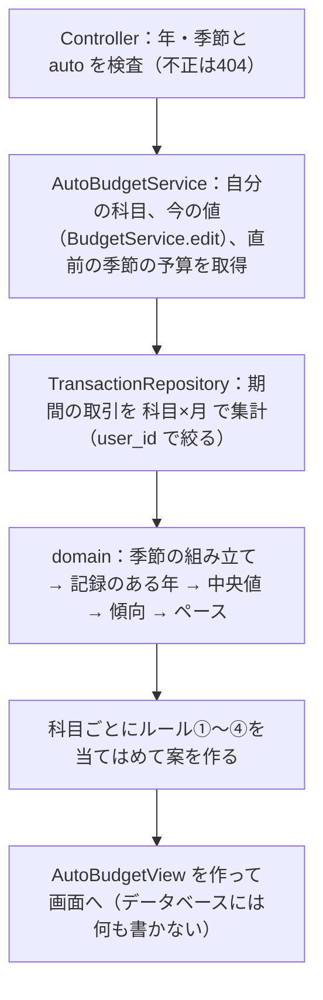

**使う期間**（`AutoBudgetSeasons`）

| 名前 | 内容 | 例（2026/11/11 に 2026 年 冬を開く） |
|---|---|---|
| 同じ季節の過去 3 年 | 画面の季節の 1・2・3 年前の同じ季節。範囲（2000年春〜）の外は数えない | 2025 冬・2024 冬・2023 冬 |
| 直前の季節 | 画面の季節の 1 つ前 | 2026 秋（今日を含む） |
| 傾向の 12 季節 | 画面の季節より前で、**もう終わっている**いちばん新しい季節で終わる 4 季節を T3、その前を T2、さらに前を T1 | T3＝2025 秋〜2026 夏、T2＝2024 秋〜2025 夏、T1＝2023 秋〜2024 夏（冬もこの中） |

「もう終わっている」は、季節の終了日の翌日が今日以前のこと。**一度に集計する期間**は、いちばん古い季節の開始日から、画面の季節の開始日の前まで（1 回の検索。4.6）。**使う季節が 1 つもないとき**（例：2000 年 春を開く）は、開始日も画面の季節の開始日にして、空の期間にする。

**記録のある年と、もとの額（中央値）**：同じ季節の過去 3 年のうち、**その季節に自分の取引（科目を問わず）が 1 件以上ある年**が、記録のある年。記録のある年に、その科目の実績が 0 円なら 0 円として数える。記録のある年が 3・2・1 個なら、**中央値・2 つの平均・その額**を使う（計算は中央値の 1 つだけ。`MedianAmount` は 2 倍のまま持ち、半円を出さない）。**表示だけ**書き分ける：3 年分＝「中央値」、2 年分＝「平均」、1 年分＝「去年の冬」〔その年が 1 年前のとき。ほかは「2023 年の冬」〕。2 年分では飛び抜けた年を外せないので、「中央値」と書かない。年が続いていないときは「2023・2025 年の冬の平均」。冬以外の季節は、「冬」を季節名にする。

**傾向（全科目で同じ）**：T1・T2・T3 は、その 4 季節の**全科目の実績の合計**。S ＝ T1＋T2＋T3 として、**傾向 ＝ 四捨五入（100 ×（S ＋ 3 ×（T3 − T1））÷ S）%**〔1 年あたりの伸び ＝（T3 − T1）÷ 2、平均 ＝ S ÷ 3 のとき（平均 ＋ 伸び × 2）÷ 平均 と同じ〕。**傾向の % だけ、整数に四捨五入する**（半分は切り上げ）。画面に出す % と、計算にかける % は、同じ値。上限は 70〜130%（上限で止めたときは、文に「（上限）」を付ける）。**四捨五入したあとの % がちょうど 130（70）のときは、上限で止めたことにしない**（131 以上・69 以下のときだけ「上限」。文は「30% 多く」「30% 少なく」のまま）。12 季節のどれかに自分の取引が 1 件もないとき、または 12 季節が 2000年春より前にかかるときは、計算せず 100%。**S が 0 のとき（0 で割れない）も、計算せず 100%（「計算しなかった」）**。

**ペース（ルール②の元）**（`SpendingPace`）：直前の季節が**終わっていれば**、実績そのまま。**今日を含んでいれば**、実績 × 季節の日数 D ÷ 過ぎた日数 n（今日を含む。D と n は `PeriodProgress` と同じ決まり）。**n が 14 未満のとき、まだ始まっていない季節のときは、使わない**（季節の初めは大きくぶれ、その額がそのまま入力欄に入るため）。予算の有無は関係ない。〔018 の着地見込みは、予算の項があり、予算 0 円の科目では小さく出る。そのため使わない〕

**科目ごとの案（上から順に、最初に当てはまるもの）**

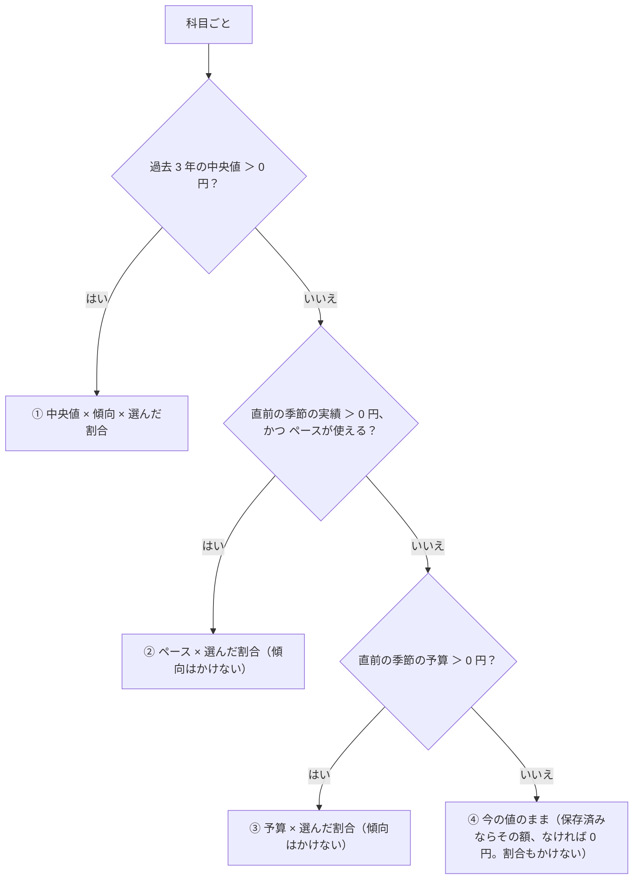

- ③は「設定済み」ではなく「**0 円より大きい**」。0 円の予算を案にすると、画面の季節にすでに保存した額を 0 円で上書きしてしまうため（Q019-1）。
- 割合：1＝100%、2＝90%、3＝110%（`ProposalChoice`）。**選び直すたびに、もとから計算する**（節約を 2 回押しても 81% にならない）。
- **整数の式**（c ＝ 選んだ割合の %、t ＝ 傾向の %、M2 ＝ 中央値の 2 倍）：
  - ①＝ 切り上げ（M2 × t × c ÷（2 × 100 × 100 × 1000））× 1000
  - ②＝ 切り上げ（実績 × D × c ÷（n × 100 × 1000））× 1000 〔終わった季節は 実績 × c ÷（100 × 1000）〕
  - ③＝ 切り上げ（予算 × c ÷（100 × 1000））× 1000
  - どれも 3,000,000 円を超えたら 3,000,000 円。**傾向の % のほかは、途中で丸めず、最後に 1 回だけ切り上げる**。②の案は、表の「このペースなら」（100 円切り上げ）から計算せず、実績から直接計算する（表の額 × 割合と、1,000 円単位でずれることがある、Q019-2）。
- **桁あふれ**：`long` と `Math.multiplyExact`・`addExact`。あふれたら `ArithmeticException`（黙って違う数字を出さない。5.13 と同じ）。

**最初に出す文**（`messages.properties` の固定の文。科目名以外に利用者の入力は混ざらない）

| 行 | 内容 |
|---|---|
| 1 行目 | 「直前の季節（2026 年 秋）は予算 175,000 円・実績 152,000 円（11/11 まで）でした。」予算が未設定なら「予算 未設定」。直前の季節が今日を含むときだけ、実績に今日までの日付を付ける |
| 2 行目 | 記録のある年が 1 つ以上あるときだけ出す。増える：「ここ 3 年、出費は増える傾向です。そのため、案は過去の冬の額より 10% 多くしています。」減る：「…減る傾向です。…6% 少なくしています。」上限：「…30% 多く（上限）しています。」100% ちょうど：「ここ 3 年、出費はほぼ同じです。」計算しなかった：「記録が 3 年分そろっていないので、増える・減る傾向は入れていません。」（「冬」は画面の季節の名前） |
| 注記 | 2 行目の下に小さく：「※ 過去の冬の額は、だいたい 2 年前の水準です。ここ 3 年の増え方を 2 年分延ばして、今年の冬の水準に合わせています。」**傾向を計算しなかったときは出さない** |
| 記録なし | 記録のある年が 1 つもないときは、2 行目と注記の代わりに「過去の冬の実績がないので、直前の季節の実績や予算をもとにしました。」（「冬」は画面の季節の名前） |
| 3 行目 | 「過去の冬の実績をもとにした自動予算は 168,000 円です。」案の合計。終わりに付ける言葉は、次の4通り（「記録のある年が 0」と「全科目が②〜④」は同じではない。記録があっても、どの科目も3年のうち1年しか使っていなければ中央値がすべて0円になり、全科目が②〜④になるため）。**記録のある年が 0** →「記録なし」の行（上）を出し、付けない。**記録はあるが全科目が②〜④**（全科目が④のときを除く）→「（すべての科目が直前の季節をもとにしています）」。**①と②〜④が混ざる** →「（一部の科目は直前の季節をもとにしています）」。**全科目が①** → 何も付けない |
| 材料なし | **全科目が④**のときは、「案を作れる材料がありません」を出し、入力欄は何も変えない（1 行目は出す） |

**表（5 列）の案の根拠のセル**：①「2023〜2025 年の冬の中央値 21,000 円（3 年）」「2024〜2025 年の冬の平均 21,500 円（2 年）」「去年の冬 22,050 円」。②「2026 年 秋のペース 45,500 円（過去の冬の実績がないため）」。終わった季節なら「2026 年 秋の実績 15,200 円（過去の冬の実績がないため）」。③「2026 年 秋の予算 30,000 円（実績がないため）」。④「材料なし（今の値のまま）」。

**計算の合った例**（2026/11/11 に 2026 年 冬を開く。直前の季節＝2026 年 秋。D＝91、n＝72）

① 傾向：T1＝570,000、T2＝600,000、T3＝630,000。S＝1,800,000、T3−T1＝60,000。（1,800,000 ＋ 3×60,000）÷ 1,800,000 ＝ 1.10 → **110%**。

② 科目と、当てはまるルール

| 科目 | 2023 冬 | 2024 冬 | 2025 冬 | もとの額（中央値） | 秋の予算 | 秋の実績 | ルール |
|---|---|---|---|---|---|---|---|
| 食費 | 84,000 | 96,000 | 90,000 | 90,000 | 95,000 | 49,200 | ① |
| 交通費 | 41,000 | 38,000 | 33,000 | 38,000 | 40,000 | 5,600 | ① |
| 雑費 | 30,000 | 24,000 | 18,000 | 24,000 | 30,000 | 22,000 | ① |
| 医療費 | 0 | 0 | 0 | 0 | 未設定 | 3,600 | ②（ペース） |
| 日用品 | 0 | 0 | 0 | 0 | 8,000 | 0 | ③ |
| 娯楽 | 0 | 0 | 0 | 0 | 未設定 | 0 | ④（冬 2026 に保存済みの 5,000 のまま） |

③ 医療費のペース：3,600 × 91 ÷ 72 ＝ 4,550（表は 100 円切り上げで「約 4,600」）。

④ 案（1,000 円切り上げ）

| 科目 | 1. これで OK（100%） | 2. 節約（90%） | 3. 上乗せ（110%） | 計算の例（100%） |
|---|---|---|---|---|
| 食費 | 99,000 | 90,000 | 109,000 | 90,000×1.10 ＝ 99,000 |
| 交通費 | 42,000 | 38,000 | 46,000 | 38,000×1.10 ＝ 41,800 → 42,000 |
| 雑費 | 27,000 | 24,000 | 30,000 | 24,000×1.10 ＝ 26,400 → 27,000 |
| 医療費 | 5,000 | 5,000 | 6,000 | 4,550 → 5,000（傾向はかけない。110% は 5,005 → 6,000） |
| 日用品 | 8,000 | 8,000 | 9,000 | 8,000×1.00 ＝ 8,000（90% は 7,200 → 8,000、110% は 8,800 → 9,000） |
| 娯楽 | 5,000 | 5,000 | 5,000 | 今の値のまま（割合もかけない） |
| **合計** | **186,000** | **170,000** | **205,000** | |

⑤ 表の「このペースなら」：食費 49,200×91÷72 ＝ 62,183 → 62,200、交通費 5,600 → 7,100、雑費 22,000 → 27,900、医療費 3,600 → 4,600（日用品・娯楽は実績 0 円で出さない）。**合計行**は、実績の合計 80,400×91÷72 ＝ 101,617 → **101,700**。科目の足し算（62,200＋7,100＋27,900＋4,600 ＝ 101,800）と 100 円ちがう（切り上げの積み重ね。そのままにする）。

⑥ 文：「直前の季節（2026 年 秋）は予算 173,000 円・実績 80,400 円（11/11 まで）でした。」〔予算は 95,000＋40,000＋30,000＋8,000〕「ここ 3 年、出費は増える傾向です。そのため、案は過去の冬の額より 10% 多くしています。」「過去の冬の実績をもとにした自動予算は 186,000 円です。（一部の科目は直前の季節をもとにしています）」

**テスト**：`domain` の各クラスの単体テスト（中央値：3・2・1・0 年、外れ値。傾向：110%・106%・100%・±30% の境目・12 季節に足りない。ペース：n＝13・14、終わった季節、季節の日数 89〜92。案：ルール①〜④の順、中央値 0 円、③は 0 円の予算で④になる、④は割合をかけない、切り上げの境目、上限 3,000,000 円、小さい科目で 90% が効かない、桁あふれ）。`AutoBudgetService`（他人のデータが入らない、保存されない、文の組み合わせ）。`BudgetController`（`auto` の 200・404、表が 5 列、`th:utext` なし）。合計の JavaScript は、Console の表（本人）と、HTML の印（MockMvc）で確かめる（1.1、2.3）。

## 6. 入力チェックの実現方法

### 6.1 方針

- チェックは**サーバー側で必ず行う**。画面（ブラウザ）の制限は、書き換えたり飛ばしたりして送れるため、チェックの代わりにしない。
- 入力値だけを見て分かるものは **Form の注釈（Bean Validation）**、データベースの状態が必要なものは **Service** でチェックする（6.3）。最後の守りとして、DB の制約（一意・外部キー・CHECK、章3）もある。
- エラーのとき、画面は**リダイレクトせずに同じ画面を表示し直し**、項目の横にエラーメッセージを出し、**入力値を残す**（要件3章、章2）。パスワードだけは残さない（章2）。
- Form には `user_id` の入力項目を作らない。画面から持ち主を指定できないようにするため（3.9）。
- 画面（HTML）側では、必須や文字数の制限を**付けない**（G1）。理由：入力エラーの表示と入力値の保持を、実際の画面で確かめられるようにするため（Phase 8 の境界値の確認）。ただし日付は日付入力の標準の部品を使う（章2）。金額は文字として受け付けて、サーバーで整数かを確かめる（6.5）。
- 取引の登録・編集画面のラベルの横に出す「必須」「任意・30 文字以内」の印は、**表示だけ**で、この決まりとは関係しない（`required`・`maxlength` は付けない。2.3）。

### 6.2 入力項目とチェックの一覧

「場所」は、F＝Form の注釈（Bean Validation）、S＝Service、D＝DB の制約（最後の守り）。画面に出す文は、6.8 のメッセージのとおり。

**アカウント登録（`RegisterForm`）**

| 項目 | ルール | 出どころ | 場所 | エラーメッセージ |
|---|---|---|---|---|
| ユーザー名 | 必須（前後の空白を取り除いて空欄でない） | 要件5章 | F | ユーザー名を入力してください |
| ユーザー名 | **半角英数字のみ**（`A-Z`、`a-z`、`0-9`。全角の英数字・記号・途中の空白は不可） | Q20 | F | ユーザー名は半角英数字で入力してください |
| ユーザー名 | 10文字以下 | 要件5章 | F | ユーザー名は10文字以内で入力してください |
| ユーザー名 | **同じユーザー名は登録不可** | 要件5章、Q10 | S（最後は D） | このユーザー名はすでに使われています |
| パスワード | 必須 | 要件5章 | F | パスワードを入力してください |
| パスワード | **半角の英数字と記号のみ**（空白は不可。全角・日本語は不可）。使える文字は、半角英数字と、半角の記号（`!` から `~` までの印字できる文字） | 要件5章（R10、H1） | F | パスワードは半角の英数字と記号で入力してください |
| パスワード | 8文字以上30文字以下 | 要件5章 | F | パスワードは8文字以上30文字以内で入力してください |

**取引（`TransactionForm`）**

| 項目 | ルール | 出どころ | 場所 | エラーメッセージ |
|---|---|---|---|---|
| 日付 | 必須 | 要件4.2 | F | 日付を入力してください |
| 日付 | 正しい日付の形（6.6） | — | F（型変換） | 日付を正しく入力してください |
| 日付 | **2000年3月1日から2100年12月31日まで**（6.6） | R12、R15 | F（D の CHECK も） | 日付は2000年3月1日から2100年12月31日までで入力してください |
| 金額 | 必須 | 要件4.2 | F | 金額を入力してください |
| 金額 | 整数（6.5） | B5 | F（型変換） | 金額は整数で入力してください |
| 金額 | **1円以上1,000,000円以下**（0円・マイナスは不可。1,000,000円ちょうどは可） | 要件5章 | F（D の CHECK も） | 金額は1円以上1,000,000円以下で入力してください |
| 科目 | 必須（未選択は不可） | 要件4.2 | F | 科目を選択してください |
| 科目 | 自分の科目であること（6.7） | 3.9 | S | （404 画面） |
| 取引先 | 必須 | 要件4.2 | F | 取引先を選択してください |
| 取引先 | 自分の取引先であること | 3.9 | S | （404 画面） |
| 支払方法 | 必須 | 要件4.2 | F | 支払方法を選択してください |
| 支払方法 | 自分の支払方法であること | 3.9 | S | （404 画面） |
| 摘要 | **任意**（空欄可。空欄は NULL で保存、3.6）。30文字以下 | 要件4.2、5章 | F | 摘要は30文字以内で入力してください |

**科目・取引先・支払方法（`CategoryForm`、`VendorForm`、`PaymentMethodForm`）**

| 項目 | ルール | 出どころ | 場所 | エラーメッセージ |
|---|---|---|---|---|
| 科目名 | 必須 | Q9 | F | 科目名を入力してください |
| 科目名 | 10文字以下 | 要件5章 | F | 科目名は10文字以内で入力してください |
| 科目名 | **同じユーザーの中で重複不可**（変更のとき、自分自身の今の名前は重複としない、5.6） | R8 | S（最後は D） | その科目名はすでにあります |
| 科目 | **1人あたり256個まで**（追加のとき。上限は重複の確認より先に確かめる。5.4） | R14 | S | 科目は256個までです |
| 取引先名 | 必須 | Q9 | F | 取引先名を入力してください |
| 取引先名 | 20文字以下 | 要件5章 | F | 取引先名は20文字以内で入力してください |
| 取引先名 | 同じユーザーの中で重複不可 | R8 | S（最後は D） | その取引先名はすでにあります |
| 取引先 | **1人あたり256個まで**（追加のとき） | R14 | S | 取引先は256個までです |
| 支払方法名 | 必須 | Q9 | F | 支払方法名を入力してください |
| 支払方法名 | 10文字以下 | 要件5章 | F | 支払方法名は10文字以内で入力してください |
| 支払方法名 | 同じユーザーの中で重複不可 | R8 | S（最後は D） | その支払方法名はすでにあります |
| 支払方法 | **1人あたり256個まで**（追加のとき） | R14 | S | 支払方法は256個までです |

**予算（`BudgetForm`。科目ごとの1行に対して）**

| 項目 | ルール | 出どころ | 場所 | エラーメッセージ |
|---|---|---|---|---|
| 予算額 | 必須 | 要件4.3 | F | 予算額を入力してください |
| 予算額 | 整数（6.5） | B5 | F（型変換） | 予算額は整数で入力してください |
| 予算額 | **0円以上3,000,000円以下**（0円は可、マイナスは不可） | 要件5章 | F（D の CHECK も） | 予算額は0円以上3,000,000円以下で入力してください |
| 科目ID | 自分の科目であること。同じIDが2回ないこと（5.7） | 3.9、F3 | S | （404 画面） |
| 年・季節（URL） | 年は2000〜2100の整数、季節は `spring`・`summer`・`autumn`・`winter`。どちらか片方だけの指定は不可（2.4）。指定なしは今の季節 | R11、B15 | S（またはController） | （404 画面） |

**削除・ログイン（入力値ではなく、状態の確認）**

| 場面 | ルール | 出どころ | 場所 | メッセージ |
|---|---|---|---|---|
| 科目・取引先・支払方法の削除 | 取引で使用中は不可 | 要件4.3 | S（最後は D の外部キー） | 取引で使われているため削除できません |
| 科目の削除 | いずれかの季節に0円でない予算があるときは不可（未設定の季節は0円として扱う） | 要件4.3、R11 | S | 予算が0円ではない季節があるため削除できません |
| ログイン | ユーザー名・パスワードの一致 | 要件4.1 | Spring Security | ユーザー名またはパスワードが違います（B8） |

- 要件5章の「科目、支払方法は10文字以下」「取引先名は20文字以下」「摘要は30文字以下」は、**全角も半角も1文字**として数える（B10）。DB の列の大きさ（3章）と同じ。
- ログインの入力（ユーザー名・パスワード）は、Form のチェックをしない。空欄などでも、一致しないものとして同じメッセージを出す。
- 取引先名・支払方法名・科目名の「必須」は、要件の入力必須の趣旨にそろえた。（要件5章に直接の記載はない）
- パスワードを半角の英数字と記号のみにする理由（H1）：BCrypt（ハッシュ化の方式）が扱える長さには上限（72バイトとされる）があり、全角文字を30文字入れるとバイト数で超えるおそれがあるため。半角なら30文字は30バイトで収まる。

### 6.3 Form でチェックするものと、Service でチェックするもの

| 区分 | 判断の基準 | 例 | 使う仕組み |
|---|---|---|---|
| **Form（Bean Validation）** | 入力された値**だけ**を見れば分かる | 必須、文字数、半角英数字のみ、パスワードの文字の種類、数値の範囲、数字・日付の形 | 項目に付ける注釈（必須：`@NotBlank`／`@NotNull`、文字数：`@Size`、形式：`@Pattern`、範囲：`@Min`／`@Max`）と、型変換のエラー |
| **Service** | **データベースの状態**を見ないと分からない | 名前の重複、自分のものか（持ち主）、削除してよいか、ユーザー名の重複 | Repository で調べ、例外を投げる（`DuplicateException`、`NotFoundException`、`DeletionNotAllowedException`、5.1） |
| **DB の制約** | 最後の守り（アプリの確認をすり抜けた場合） | 一意（UNIQUE）、外部キー、金額・予算額・取引の日付の CHECK | エラーを例外に変えて、上の Service の例外と同じ扱いにする（5.3、5.5、5.6） |

- 順番：Controller が Form のチェックを先に行い、**エラーがなければ**Service を呼ぶ。Form にエラーがあるときは、Service を呼ばない（重複や持ち主の確認は、入力が正しい形のときだけ行う）。
- 使う注釈の組み合わせは、Phase 3〜6 でそれぞれの Form を作るときに決める。この章では、どの項目に何のルールがあるかを決める。
- **エラーの重なりの扱い（D4、Phase 3 で決定。6.9 と G7）**：Bean Validation は注釈のチェックの順番を保証しないため、1つの項目に複数のエラーが重なることがある。`RegisterForm` で4つの方法（注釈を並べるだけ、形式の正規表現が空文字を通すようにする、グループで順番を付ける、自作の注釈）を試し、**「形式の正規表現が空文字を通すようにして、『必須』を他のエラーと重ねない」方法（B）**にした。それ以外のエラー（型変換・形式・文字数・範囲）は、重なったら全部出す。
  - 理由：1項目1つを守るには自作の仕組みが要り、Phase 4〜6 の Form すべてに広がるため。形式と文字数の両方が違うときは、両方見えたほうが1回で直せるため。グループで順番を付ける方法は、他の項目のエラーが隠れるので使わない。
  - Phase 4〜6 の Form でも同じ方法を使う：「必須」の注釈（`@NotBlank`／`@NotEmpty`／`@NotNull`）、形式の注釈（`@Pattern`。空文字を通す正規表現）、文字数・範囲の注釈（`@Size`／`@Min`／`@Max`）を、項目ごとに並べる。
  - 受け入れる点：パスワードが空のとき「入力してください」と「8文字以上30文字以内で」の2つが出る。重なったときの表示の順番が一定ではない。
  - 各方法の実験の結果は、Phase 3 の手順書（4.5）に残してある。

### 6.4 前後の空白

- 文字列の入力は、**前後の空白（全角の空白を含む）を取り除いてから**判定し、保存する（B9）。例：「 食費 」→「食費」。
- 取り除いた結果が空なら、必須の項目は「必須」エラー。摘要は空欄とみなして NULL で保存する（3.6）。
- ユーザー名は、取り除いたあとに半角英数字だけなら可。途中に空白があれば形式エラー（Q20）。
- 取り除く方法は、Java の `String.strip()` を使う（Phase 3 で決定）。`String.trim()` は半角の空白などしか取らず、全角の空白（U+3000）を取らないため使わない。Spring 標準の `StringTrimmerEditor` も `trim()` と同じ動きなので、そのままでは使えない。
- **取り除く場所（Phase 4 で決定）**：**各 Form の値を受け取る部分（セッター）で `strip()` を使う**。`RegisterForm`（ユーザー名）、`CategoryForm`、`VendorForm`、`PaymentMethodForm` の4つが、同じ形。共通の仕組み（`@InitBinder` など）は作らない。理由：Form が少なく、1項目ずつで、単体テストで確かめやすいため。Phase 5 の摘要（空なら NULL、3.6）は、D6 として次のように決めた。
- **摘要（D6、Phase 5 で決定）**：`TransactionForm` の摘要のセッターで、`strip()` で前後の空白（全角を含む）を取り除き、**取り除いて空なら `null` にする**（Q5-6 の A）。共通の仕組みは作らない。理由：空を NULL にする項目は摘要だけで、Form の 1 か所で足りるため。文字数（30文字以下）は、取り除いたあとの長さで数える（例：30文字の前後に空白があってもエラーにならない）。単体テスト（`TransactionFormTest`）で確かめた。
- **パスワードは前後の空白を取り除かない**（G2）。理由：入力したとおりの文字列を、ハッシュ化して照合する必要があるため。空白は使えない文字なので、前後であっても途中であっても、空白が1つでもあれば「半角の英数字と記号」の形式エラーになる（H1）。

### 6.5 数字でない値が金額に入ったとき

対象：取引の金額、予算の予算額（B5：円単位の整数のみ。**R13 で、全角の数字（０〜９）は半角に直して受け付けるよう変更**）。

**整数として読む規則**（Q5-1 の C。Phase 5 で決定。下の「実験の結果」のとおり、Spring 標準の変換では足りなかったため。**Phase 6 で R13 により、手順2を足した**）：

1. 前後の空白（全角の空白を含む）を `strip()` で取り除く（6.4）。取り除いて空なら、値なし（`null`）として扱い、必須エラーにする。
2. **全角の数字（`０`〜`９`、U+FF10〜U+FF19）を、半角の数字（`0`〜`9`）に置き換える**（R13）。半角と全角が混ざっていてもよい（`１2３` は 123）。置き換えるのは、この10文字だけ。次のものは置き換えず、そのあとの手順3・4でエラーになる：全角のマイナス（`－`、`−`、`ー`）、全角のプラス・カンマ・ピリオド（`＋`、`，`、`．`）、途中にある全角の空白、ほかの国の数字（`١٢٣` など）、漢数字、丸数字。
3. 置き換えたあとの文字列が、**半角の数字だけ**、または**先頭の `-`（半角）と半角の数字だけ**なら、整数として読む（`010` は 10 になる。8 進数としては読まない）。
4. それ以外は、すべて型変換のエラーにする。例：途中の空白（半角・全角）、`0x10`・`#10`、カンマ、小数、`10円`、先頭の `+`（`+5`）、`1e3`。
5. 整数に収まらない大きな数も、型変換のエラーにする。

| 入力 | 扱い | メッセージ |
|---|---|---|
| 空欄（空白だけも含む） | 必須エラー | 金額を入力してください／予算額を入力してください |
| `abc`、`1,000`（カンマ）、`1 000`（途中に空白）、`１　２`（途中に全角の空白）、`1.5`（小数）、`10円`、`0x10`、`+5`、`－５`（全角のマイナス）、`１，０００`（全角のカンマ） | 整数に変換できない。型変換のエラー | 金額は整数で入力してください／予算額は整数で入力してください |
| 整数に収まらない大きな数（例：`99999999999`、`９９９９９９９９９９９`） | 同じく型変換のエラー | 同上 |
| **`１２３`（全角数字）、`１2３`（全角と半角が混ざる）、`０`、`-１２`（半角のマイナスと全角の数字）** | **半角に直して、123・123・0・-12 として読む（R13）。そのあと、範囲のチェックへ** | （エラーなし。範囲外なら、下の範囲のエラー） |
| `0`、`-5`、`1000001`（取引）。全角で打った `０`、`１０００００１` も同じ | 整数だが範囲外。範囲のエラー | 金額は1円以上1,000,000円以下で入力してください |
| `-1`、`3000001`（予算）。全角で打った `３０００００１` も同じ | 整数だが範囲外 | 予算額は0円以上3,000,000円以下で入力してください |
| ` 100 `（前後の空白）、`　１００　`（前後に全角の空白） | 空白を取り除いて 100 として扱う（6.4） | （エラーなし） |

- エラーのとき、入力した文字（`abc` など）は**そのまま画面に残す**。直すのが簡単になるため。全角で打って、範囲のエラーになったときは、入力欄には、半角に直した数字が出る（型変換のエラーのときだけ、入力した文字が、そのまま残る）。
- 型変換のエラーのとき、範囲のチェックは行わない（片方のメッセージだけ出す、G3）。
- この規則は、**金額の項目だけ**に使う専用の変換クラス（`StrictIntegerEditor`、P9）で行う。Controller の `@InitBinder` で、金額（Phase 6 では予算額）の項目にだけ付ける。他の整数の項目（科目ID など）には使わない。

**実験の結果**（2026-10-29、Phase 5。MVC が使うのと同じ変換サービスで、`Integer` の項目に束縛した）

Spring 標準の変換（`Integer` の項目に何も足さない場合）は、次のとおりだった。

| 入力 | 標準の変換の結果 | 6.5 の期待との違い（**当時**。全角数字は R13 で変更） |
|---|---|---|
| 空、半角の空白だけ、全角の空白だけ | `null`（必須エラーになる） | なし |
| `123`、` 123 ` | 123 | なし |
| `１２３`（全角数字） | **123 として通った** | あり（当時は型変換のエラーのはず。**R13 で、全角数字は通すことに変更**したので、この結果は今の規則と合う） |
| `1 000`（途中に空白） | **1000 として通った** | あり（同上。今も型変換のエラー） |
| `0x10`、`#10` | **16 として通った** | あり（16 進として読まれた。今も型変換のエラー） |
| `+5` | **5 として通った** | あり（今も型変換のエラー） |
| `010` | 10 | なし（8 進数にはならない） |
| `-5` | -5（範囲エラーになる） | なし |
| `1,000`、`1.5`、`10円`、`1e3`、`99999999999` | 型変換のエラー | なし |

- 全角数字・途中の空白・16 進を通すと、当時の「全角数字は入力エラー」（B5）に反し、意図しない金額が保存されるため、専用の変換にした。

**変更の記録（R13、Phase 6）：全角の数字は半角に直して受け付ける**（本人の決定）

- **変更**：金額・予算額で、全角の数字（`０`〜`９`）は半角に直して受け付ける。それ以外（`0x10`・`#10`、途中の空白、カンマ、小数、`+5`、全角のマイナスなど）は、今までどおり型変換のエラー。
- **理由**：日本語入力がオンのまま数字を打つと全角になり、そのたびにエラーになるのは使いにくいため。Phase 5 の実験で見つけた、本当に危ないもの（`0x10` が 16 になる、`1 000` が 1000 になる）は、引き続き防げる。
- 変更前の決定（B5「全角数字は入力エラー」、Q5-1 の C の規則）は、Phase 1・Phase 5 の記録に残してある。要件定義書 5章にも、この規則を足した（R13）。

### 6.6 日付が正しくない形で送られたとき

- 画面の日付入力は、`2026-10-19` の形で送る（標準の日付入力の部品）。
- 次のときは、型変換のエラー「日付を正しく入力してください」にする。
  - 空欄（→ 必須のエラー「日付を入力してください」）
  - 日付の形でない文字（書き換えて送られた場合）
  - 存在しない日付（例：`2026-02-30`）
- **取引の日付は、2000年3月1日から2100年12月31日まで**（R12、R15）。形が正しくても、この範囲の外（例：`0226-05-01`、`1999-12-31`、`2000-02-29`、`2101-01-01`）はエラー「日付は2000年3月1日から2100年12月31日までで入力してください」にする（G4）。**5桁の年（例：`20026-05-01`）は、日付の形として読めないので、上の型変換のエラー「日付を正しく入力してください」になる**（Q5-3 の A。どちらも入力エラーで止まるので、G4 の目的は果たせる）。理由：年の打ち間違いを入力エラーで止めるため。範囲外の日付が登録されると、予実比較に出ず、間違いに気づけないため。この範囲は、予実比較・予算設定で見られる季節の範囲（2000年春〜2100年冬、2.4）に合わせた。下限の 2000年3月1日は 2000年春の初日（R15。以前の下限 2000年1月1日では、2000年1月・2月の取引が1999年の冬に入り、予実比較に出なかった。issue 003）。
- 表示（`2026/10/19`）と入力（`2026-10-19`）の形が違うのは、入力欄には標準の入力部品を使うため（章2）。

### 6.7 プルダウンの値（科目ID・取引先ID・支払方法ID）が空・不正なとき

プルダウンの先頭には「選択してください」（値は空）を置く。

| 送られた値 | 扱い | 画面 |
|---|---|---|
| 空（未選択） | 必須エラー | 項目の横に「科目を選択してください」など。入力値を残して同じ画面 |
| 数字に変換できない文字（書き換え） | 未選択と同じ扱い（型変換のエラーを、必須と同じメッセージにする、G5） | 同上 |
| 数字だが、存在しない・他人のID | Service が `NotFoundException` | 404 画面（B7）。保存しない |
| 数字で、自分のもの | 正常 | — |

- 他人のIDを送られても、他人のデータの有無は教えない（B7）。
- 画面を開いたまま別の画面で科目を削除し、その科目を選んで送ったときも、同じく 404 になる（存在しないIDのため）。通常の操作では起きにくいので、特別な画面は作らない。
- プルダウンの選択肢は、ログイン中のユーザー自身のものだけを並べる（Q14、登録順）。エラーで同じ画面に戻るときも、選択肢を取り直して、**選んでいた値を残す**。

### 6.8 エラーメッセージの置き場所

- すべてのメッセージを、`src/main/resources/messages.properties` の**1か所**に日本語で書く（4.3）。注釈や Service には文章を直接書かず、メッセージの名前（キー）だけを書く。理由：文言の直しが1か所で済むため。
- キーの付け方（G6）：
  - Form の入力チェック：`項目の種類.フォーム名.項目名`（例：金額の必須のキー、金額の範囲のキー、金額の型変換のキー）。Spring の標準の探し方に合わせて、項目ごとに書き分ける。
  - Service の結果：`error.duplicate.category`（科目名の重複）、`error.limit.category`・`error.limit.vendor`・`error.limit.paymentMethod`（個数の上限、R14）、`error.delete.inUse`（使用中）、`error.delete.budgetNotZero`（いずれかの季節に0円でない予算がある）のように、`error.` から始める。
  - ログイン失敗：`error.login.failed`。
- 6.2 の「エラーメッセージ」の列の文を、そのまま `messages.properties` に書く。文末は、ていねいな言い方に統一する（「〜してください」「〜できません」「〜があります」）。
- 文字コードは UTF-8 とし、日本語をそのまま書く。`application.properties` に `spring.messages.encoding=UTF-8` を書き、ファイルも UTF-8 で保存する。日本語が文字化けせずに画面に表示されることを、Phase 2 で確かめた（C2）。
- 成功メッセージ（「登録しました」など、2.6）も、同じファイルに書く。科目・取引先・支払方法の「追加しました」「変更しました」「削除しました」は、3つで共通のキー（`success.added`、`success.updated`、`success.deleted`）を使う（Phase 4 で決定）。取引など、文言が違うものは別のキーを足す。取引は、登録が `success.transactionRegistered`（登録しました）、更新が `success.transactionUpdated`（更新しました、U2）で、削除は `success.deleted` を使う（Phase 5、Q5-8 の A。登録のキーの名前は、Phase 8 で `success.registered` から変えた）。アカウントの登録は `success.accountRegistered`（登録しました。ログインしてください。Phase 8 で `success.register` から変えた）。

### 6.9 画面でのエラー表示と入力値の保持

- **項目の横**：その項目のエラーを、入力欄の近く（真下）に赤い文字で表示する。「必須」エラーは、他のエラーと重ならないようにする（形式の正規表現は空文字を通す、G7）。必須以外のエラー（型変換・形式・文字数・範囲）が重なったときは、**全部表示する**（形式と文字数の両方が違うときは、どちらも直す必要があるため）。重なったときの表示の順番は一定ではない。
- **画面の上部**：成功メッセージと、削除できない理由などの「項目に結び付かないエラー」を表示する（2.1、2.3 の共通部分）。
- **入力値の保持**：入力エラーで同じ画面を表示し直すとき、入力した値をそのまま入力欄に入れる。数字でない金額も、そのまま残す（6.5）。プルダウンは選んでいた値、日付は入力した日付を残す。**パスワードは残さない**（章2）。
- **予算設定**：エラーのある行の横にエラーを表示し、**全行の入力値を残す**（1つでもエラーなら何も保存しない、5.7）。
- **一覧画面の追加フォーム**（科目・取引先・支払方法）：エラーのときは、一覧と一緒に画面を表示し直す。フォームには入力値とエラーが入り、一覧は取り直して最新にする（章2）。
- 重複のエラー（Service）も、入力チェックのエラーと同じように、名前の項目の横に表示し、入力値を残す。

### 6.10 追加で決めた点（確定）

要件にもそれまでの決定にもなかった点を、確認のうえで決めたものです。

| 番号 | 決めたこと | 理由 |
|---|---|---|
| G1 | 画面（HTML）側では、必須・文字数の制限を付けない。金額は文字として受け付ける | サーバー側のエラー表示と入力値の保持を、実際の画面で確かめられるようにするため |
| G2 | 前後の空白は全角の空白も含めて取り除く。ただしパスワードは取り除かない | B9 の具体化。パスワードは入力どおりに照合する必要があるため |
| G3 | 型変換のエラーのときは、範囲のメッセージを出さない（1項目に1つ） | 「整数で入力してください」と「範囲」の両方が出ると混乱するため |
| G4 | 取引の日付は、2000年3月1日〜2100年12月31日の範囲外ならエラーにする（Q15 の変更、R12、R15） | 年の打ち間違い（`0226` や `20026` など）を入力エラーで止めるため。範囲外が登録されると、予実比較に出ず、間違いに気づけないため |
| G5 | プルダウンの値が数字に変換できないときは、未選択と同じメッセージにする | 書き換えられた送信にも、利用者向けの簡単な表示で済ませるため |
| G6 | メッセージのキーは、Form は Spring の標準の付け方、Service と認証は `error.` から始める | 文言の置き場所を1か所にしつつ、探しやすくするため |
| G7 | 「必須」エラーが、他のエラーと重ならないようにする（形式の正規表現は空文字を通す）。それ以外のエラー（型変換・形式・文字数・範囲）は、重なったら全部出す。**見直し**：当初は「1つの項目に表示するエラーは1つだけ。優先順は 必須 → 型変換 → 形式 → 文字数・範囲」とした。Phase 3 で試して見直した（Bean Validation は注釈のチェックの順番を保証しないため）。**受け入れる点**：パスワードが空のとき「入力してください」と「8文字以上30文字以内で」の2つが出る。重なったときの表示の順番が一定ではない | 1項目1つを守るには自作の仕組みが要り、Phase 4〜6 の Form すべてに広がるため。形式と文字数の両方が違うときは、どちらも直す必要があるので、両方見えたほうが1回で直せるため。グループで順番を付ける方法は、他の項目のエラーが隠れるので使わない（Phase 3 の手順書 4.5 に実験の結果） |
| H1 | パスワードは**半角の英数字と記号のみ**（空白は不可）、8文字以上30文字以下。要件5章に足した（R10） | BCrypt が扱える長さの上限（72バイトとされる）に収めるため。ユーザー名も半角英数字のみ（Q20）で、そろう |

---

## 7. セキュリティ対策の実現方法

### 7.1 方針

- 要件6章の6つの対策を、**Spring Security と Thymeleaf、Spring Data JPA の標準の仕組み**で実現する。自分で暗号やチェックの仕組みを作らない。理由：実績のある標準の仕組みのほうが安全で、入門者にも確かめやすいため。
- 標準の守りを**外さない**（CSRF 対策を無効にしない、`th:utext` を使わない、文字列連結の SQL を書かない）。
- 要件にない対策は、理由とともに 7.12（S1〜S7）にまとめた。
- 確認は、Phase 8 で行った（確認表は 7.11。記録は Phase 8 の手順書 4.6）。

### 7.2 要件6章の対策と、実現方法

| 要件6章の対策 | どうやって実現するか | 関係する章 |
|---|---|---|
| パスワードはハッシュ化して保存する | 登録のとき、`RegistrationService` が BCrypt（Spring Security の `PasswordEncoder`）でハッシュ化し、`users.password_hash` に保存する。元のパスワードは保存しない・画面に出さない・ログに出さない。ログインでは、入力をハッシュと照らして確かめる（元に戻さない）。`PasswordEncoder` は `SecurityConfig` で1つだけ用意する | 3.2、5.2、5.3、6（H1） |
| ログインしていない人は、ログイン画面とアカウント登録画面以外を開けない | `SecurityConfig` で「すべての URL はログイン必須」を基本にし、例外を `/login`、`/register`、`/css/**`、`/js/**`、`/fonts/**`、`/error` だけにする（7.3）。未ログインは `/login` へ移動する | 2.2、4.5、5.2 |
| SQL インジェクション対策 | 検索・保存はすべて Spring Data JPA の**パラメータ付き**の方法で行い、入力値を文字列でつなげた SQL を**書かない**（7.4） | 4.6 |
| XSS 対策 | 画面に出す値は `th:text`（または `[[...]]`）で表示し、**`th:utext` は使わない**（7.5） | 2、4.4 |
| CSRF 対策 | Spring Security の CSRF 対策を**有効のまま**使う。データを変えるリクエストはすべて POST にし、フォームにトークンを入れる（7.6） | 2.1、2.2 |
| ユーザーごとのデータ分離（要件4.1） | すべての検索を `user_id` で絞る。ユーザーIDは `LoginUser` から取り、画面からの値を使わない。取引・予算で選ぶ科目などは、Service で自分のものか確認する。他人のデータは 404 で、有無を教えない（7.8） | 3.9、4.1、5.1、6.7 |

### 7.3 ログイン必須の設定

- 基本：すべての URL でログインを必須にする。
- ログインなしで開けるもの（これだけ）：

| URL | 理由 |
|---|---|
| `/login`（GET・POST） | ログインのため |
| `/register`（GET・POST） | アカウント登録のため（R2） |
| `/css/**` | 画面の見た目の CSS。ログイン画面と登録画面にも使うため |
| `/js/**` | 画面の短い JavaScript（7.10 の「戻る」の処理）。全画面が読み込むので、ログイン画面と登録画面にも要る。許可しないと、未ログインでは JavaScript の代わりにログイン画面が返り、読み込めない |
| `/fonts/**` | 画面のフォント（Zen Kaku Gothic New）。ログイン画面と登録画面にも使うため。許可しないと、未ログインではフォントの代わりにログイン画面が返り、読み込めない |
| `/error` | Spring Boot がエラー画面を出すときに使う URL。ログイン前でもエラー画面を表示できるようにするため（2.5、7.7） |

- 未ログインでそれ以外を開いたら、`/login` へ移動する。ログイン成功後は、開こうとしていた URL に関係なく、トップへ移動する（U5）。
- ログアウト（`POST /logout`）：ログイン情報（セッション）を捨てて、`/login` へ移動する。POST にして CSRF のトークンを必須にする（7.6）。
- ログイン失敗は、「ユーザー名またはパスワードが違います」だけを表示する（B8）。失敗の回数制限は付けない（B12）。
- 画面のボタンを隠すだけにせず、**サーバー側で必ず確認する**。URL を直接開かれても、同じ確認が働く。

### 7.4 SQL インジェクション対策

- Repository の検索は、**名前付きの検索（Spring Data JPA のメソッド）またはパラメータ付きの検索**で書く（4.6）。入力値は「値」として渡し、SQL の文字列に連結しない。
- `schema.sql` は固定の文章で、入力値を含まない。
- 守りの確認（Phase 8）：コードの中で、SQL を文字列でつなげている箇所がないかを検索する。ユーザー名・摘要などに `' OR '1'='1` を入力しても影響がないことを確かめる。

### 7.5 XSS 対策

- Thymeleaf の `th:text` は、表示する値に含まれる `<` `>` `&` などの記号を無害な文字に変えてから出力する。摘要・科目名・取引先名・支払方法名・ユーザー名など、**利用者が入力した値はすべて `th:text` で表示する**。
- **`style` 属性には、`domain` が計算した数字と固定の文字（変数名・`%`・`conic-gradient` など）だけを入れる。** 利用者の入力（科目名・取引先名・摘要など）は入れない（トップの円グラフと棒。issue 010）。科目名は `th:text` で別に出す。テストで、`style` の値が数字と固定の文字だけであること、`"`・`<`・`;` などを含む科目名が `style` に出ないことを確かめる。
- **きょうのひとこと（issue 016）**：文面はアプリの中のファイルの文だけ（利用者の入力ではない）。科目名はグラフへのひとことの部品として `th:text`（`#{…}` の引数）で出し、`th:utext` は使わない。`style` 属性には何も入れない。
- **アイコン（issue 017）**：固定の `<svg>`（アプリの中の `fragments/icons.html`）だけ。名前は固定の文字だけで渡す。利用者の入力は入れない。`` を入力しても、画面にただの文字として表示されること。コードの中で `th:utext` を検索して、使っていないこと。

### 7.6 CSRF 対策

- Spring Security の CSRF 対策を有効のまま使う（無効にしない）。
- データを変える操作（登録・変更・削除・ログアウト、`/login`・`/register` の送信も含む）は、すべて **POST** にする。GET ではデータを変えない（2.1）。
- フォームは、Thymeleaf の `th:action` で書く。トークン（隠し項目）が自動で入る。
- トークンがない、または違う POST は、403 として拒否する。このときの画面は 7.7 のとおり。
- 守りの確認（Phase 8）：フォームにトークンが入っていること。トークンなしの POST が拒否されること。

### 7.7 予期しないエラーの画面

エラーの画面は、種類ごとに用意する。**どの画面にも、エラーの詳しい中身（スタックトレース、例外の名前・メッセージ、SQL、ファイルのパス、DB の情報）を出さない。**

| 種類 | 例 | 状態コード | 画面に出す文 | テンプレート |
|---|---|---|---|---|
| 404 | 存在しない URL、存在しない・他人のID、予実比較・予算設定の範囲外の年（B7） | 404 | 「ページが見つかりません」と、取引一覧へのリンク | `error/404.html`（章2） |
| 403 | CSRF のトークンがない・違う、アクセスが許されない操作 | 403 | 「操作を完了できませんでした。もう一度やり直してください」と、取引一覧へのリンク | `error/403.html`（S3） |
| その他の 400 番台 | 不正な形の URL・リクエスト（400）、許されない方法（405）、**送信の形がおかしくて、入力の束縛に失敗したとき（400。行の番号を書き換えた予算設定の送信など。R14、issue 002）**など | 400、405 など | 「操作を完了できませんでした。もう一度やり直してください」と、取引一覧へのリンク | `error/4xx.html`（S9） |
| 500 番台の予期しないエラー | DB が止まっている、プログラムの不具合 | 500 など | 「エラーが発生しました。しばらくしてからもう一度お試しください」と、取引一覧へのリンク | `error/5xx.html`（S3、S9） |

- **エラー画面を出すときは、HTTP の状態コードも 404・403・500 にそろえる。** 画面だけ「見つかりません」で、状態コードが 200（成功）にならないようにする。`NotFoundException` や ID が数字でない URL を `GlobalExceptionHandler` で画面に変えるときも、状態コードを 404 に設定する（4.5）。
- エラーの詳しい中身は、**サーバーのログ（開発中はコンソール）にだけ**出す。画面には出さない。
- Spring Boot がエラーの詳細を画面に含める設定（スタックトレース、例外のメッセージ、入力エラーの詳細）は、すべて**含めない**に明示する（S2）。
- Spring Boot 標準の英語のエラーページ（Whitelabel）が出ないよう、上の4種類の画面（404、403、その他の 400 番台、500 番台）を必ず用意する（S3、S9）。Spring Boot は、状態コードごとの専用の画面（`404.html`、`403.html`）を先に探し、なければ `4xx.html`、`5xx.html` を使う。
- 画面のテンプレートの説明コメントは、ブラウザに送られる HTML に出ないよう、Thymeleaf の出力されないコメント（`<!--/* … */-->`）で書く（Phase 3 で決定）。エラー画面の説明が、利用者に見えてしまわないようにするため。
- ID が数字でない URL（例：`/transactions/abc`）も、404 画面にする（S4）。
- **束縛の失敗は、500 ではなく 400 にする**（Phase 6、issue 002）：送信された項目の名前の書き換え（例：`rows[-1]`、`rows[abc]`、`rows[300]`）で、入力を Form に束縛できないとき（`InvalidPropertyException`）は、`error/4xx.html` を、状態コード 400 で出す（`GlobalExceptionHandler`）。理由：500 はサーバーの不具合、400 は送信の形がおかしい、という意味で、区別できるようにするため。画面にも、ログにも、エラーの詳しい中身は出さない。何も保存されない。
- ログイン前でも表示できる（`/error`、7.3）。表示のリンク先は取引一覧で、未ログインならログイン画面へ移動する。

### 7.8 他人のデータの有無を教えない

- 次のとき、**同じ 404 画面**にする（B7）：存在しないID、他人のID、予実比較・予算設定の範囲外の年・不正な季節（B15）、ID が数字でない URL。
- 「存在しないが他人のもの」と「そもそも存在しない」を区別して見せない。メッセージも、画面も、状態コードも、同じ。
- 他人のIDを書き換えて送った場合（取引の科目ID、予算の科目ID、削除・編集の URL）も、同じ 404（6.7、5.7）。
- **変更の送信（`POST …/edit`）は、入力が間違っていても、先に ID と `user_id` で探す**（Phase 4 で決定）。他人・存在しないIDなら、入力の正誤に関係なく 404 にする。理由：先に入力チェックの結果で画面を返すと、他人のIDには 200（フォームの表示し直し）、存在しないIDには 404 と、差が出て、他人のデータの有無が分かるため。
- ID が数字でない URL、数値の範囲を超える ID も、同じ 404（画面も状態コードも同じ、S4）。
- **自動予算の `auto`（issue 019）**：`GET /budgets` の `auto` が `"1"`・`"2"`・`"3"` 以外（空・`0`・`4`・`01`・`abc` など）のときも、同じ 404（画面も状態コードも同じ）。`auto` で見えるのは自分のデータだけ（3.9）。
- 取引の複写の `copyFrom`（`GET /transactions/new?copyFrom={id}`）も同じ。他人の取引の ID、存在しない ID、数字でない・範囲外の値は、同じ 404。写す元は ID と `user_id` の両方で探す（2.3）。
- ログイン失敗も、ユーザー名の有無を教えない同じメッセージにする（B8）。
- 例外：アカウント登録のときの「このユーザー名はすでに使われています」は、ユーザー名の有無が分かってしまうが、登録のために必要なので表示する（要件5章）。ログイン画面でユーザー名の有無を調べられないことで、最小限に抑える。

### 7.9 秘密情報の扱い

秘密情報＝DB のパスワード、`root` のパスワード、パスワードのハッシュを含むデータ。リポジトリ（GitHub）に**入れない**。

| 対象 | 扱い |
|---|---|
| DB のパスワード | 環境変数から読む。設定ファイル（`application.properties`）には書かない（1.5） |
| DB の接続先・ユーザー名 | 環境変数から読めるようにする（1.5）。名前は `HB_DB_URL`、`HB_DB_USER`（パスワードは `HB_DB_PASSWORD`）。値は設定ファイルに書かない |
| アプリが使う DB ユーザー | **アプリ専用のユーザー**を作り、このアプリのデータベースだけを操作できるようにする。`root` はアプリから使わない（1.5、Phase 2）。データベース名は `householdbudget`、ユーザー名は `hb_app`（接続元は `localhost` のみ）。権限は必要最小限で、`householdbudget` だけに `SELECT, INSERT, UPDATE, DELETE, CREATE, INDEX, REFERENCES` を与える（Phase 2 で、`schema.sql` の実行に不足がないことを確かめた）。`DROP`・`ALTER`・`GRANT OPTION` は与えない |
| `root` のパスワード | 自分だけが分かる場所に控える。リポジトリにも、README にも書かない（Phase 0） |
| バックアップ、ダンプの `.sql` ファイル | データベースの中身（`users` のパスワードのハッシュを含む）が入るので、**コミットしない**。置き場所はリポジトリの外が望ましい。リポジトリの中に置くときは、決まったフォルダ（`backup/`）に置き、`.gitignore` で除外する（S7） |
| 秘密を書いた設定ファイル | 作る場合は、`.gitignore` で除外する（S7） |
| 初期のアカウント | 既定のアカウントや、決まったパスワードは**作らない**（S6）。採用担当者などは、自分で登録して試す（要件2章） |

- `.gitignore` に入れるもの（S7）：`backup/`、`*.dump`、`*.dump.sql`、`*.bak`、`.env`、`application-local.properties`。ただし **`schema.sql`（テーブル作成）は、秘密を含まないのでコミットする**。`.sql` という拡張子全体は除外しない。
- コミットの前に `git status` で、含めたくないファイルが入っていないことを確かめる。
- もしコミットしてしまったら、ファイルを消すだけでは履歴に残る。そのパスワードを**変更**してから、相談して対処する。
- 画面のスクリーンショット（Phase 9）に、パスワードや接続情報が写っていないことを確かめる。
- ログに、パスワードやそのハッシュを出さない。SQL の値（パラメータ）を表示するログの設定は、オンにしない（S5）。

### 7.10 セッションと Cookie

- ログイン状態は、Spring Security の標準の**セッション**で保つ（B12：ログイン状態の維持の機能は付けない）。
- **ログイン後にセッションIDを新しくする**ことは、Spring Security の標準の動き（セッション固定攻撃への対策）で行う。この設定を**無効にしない**。標準の動きで足りるかを Phase 3 で確かめた（C1）：**ブラウザの開発者ツールで、ログイン前後でセッションの Cookie（`JSESSIONID`）の値が変わった**。標準の動きで足りるので、設定は変えていない。
  - 自動テスト（MockMvc）では、セッションIDが変わらなかった（本物のサーバーと動きが違う）ため、この確認はテストに入れていない。Phase 8 でも、ブラウザで確かめる。
  - 同じ確認で、`JSESSIONID` に `HttpOnly` が付き、`SameSite` が `Lax` になっていることも確かめた（S1）。
- ログアウトでは、セッションを捨てる。
- **ログアウトのあと、ブラウザの「戻る」で、ログアウト前の画面が表示されたままになることがある**（Phase 8 の F2。ブラウザが画面を覚えておく「戻る・進む」の高速化〔bfcache〕による。サーバーは `Cache-Control: no-store` を返していて、「詳細」などを押すとログイン画面へ移動する＝サーバーは正しく断っている）。対策は、**短い JavaScript** `static/js/back-reload.js`（Phase 8 の Q8-25 の案 F）：`pageshow` イベントの `event.persisted` が `true`（覚えていた画面を見せたとき）なら `location.replace(location.href)` で、同じ URL を GET で開き直す（Q8-26）。開き直すと、ログアウト後はログイン画面へ移動する。`location.reload()` にしないのは、入力エラーで出し直した画面〔POST の応答〕で「フォームを再送信しますか」と聞かれ、使う人が戸惑うため。理由：Chrome・Edge・Safari のどれでも、HTTP でも働く。Cookie を消す方法〔`deleteCookies`〕や `Clear-Site-Data` は、ブラウザや HTTPS かどうかで効くか分からない。削除の確認で、すでに JavaScript を使っている。
  - この JavaScript は固定のファイルで、利用者の入力を扱わない・埋め込まない（7.5）。HTML の中には書かない（別ファイルにして `common.html` の `head` から読む）。
  - ログイン前の画面（ログイン、登録、エラー）も同じ枠を使うので、`/js/**` はログインなしで開けるようにする（7.3）。
  - 限界：JavaScript が無効なブラウザでは働かない。覚えていた画面が一瞬見えることがある。画面を開き直すので、覚えていた画面の入力途中の値は消える。POST だけで開ける URL〔削除など〕のエラー画面を覚えていたときは、開き直すと別のエラー画面〔405 など〕になる（どちらもエラー画面で、データは出ない）。
- セッションの Cookie には、`HttpOnly`（JavaScript から読めない）と `SameSite=Lax`（他のサイトからの POST に付かない）を明示的に設定する（S1）。
- セッションIDの受け渡しは、**Cookie だけ**にする。URL に付ける方式（`;jsessionid=…`）は使わない（S8）。
- `Secure`（HTTPS のときだけ送る）は、今は自分のパソコンの HTTP なので付けない。インターネットへの公開（要件9章）をするときに必要になる。
- 画面を返すときの HTTP のヘッダー（クリックジャッキング対策など、Spring Security が標準で付けるもの）は、**そのまま使い、外さない**。`Cache-Control: no-store` が付いていることは、自動テスト `CacheControlHeaderTest` で確かめる（Phase 8、4.14）。ただし、**静的なフォントのファイル（`/fonts/**`）だけは例外**とし、`Cache-Control: max-age=30日` を付けて、ブラウザに覚えさせる（毎回約 2 MB を取り直さないため。issue 015 の 2 回目、Q15-8）。Spring MVC が静的ファイルに `Cache-Control` を付けると、Spring Security は上書きしない（実際の応答で確かめた）。画面（HTML）と `/css/**`・`/js/**` は、`no-store` のまま。フォントのファイルを入れ替えるときは、ファイル名を変える。

### 7.11 守りの確認（Phase 8）

Phase 8 の手順書 4.6 の確認表のとおり。この章との対応：

| 対策 | 確認方法 | この章 |
|---|---|---|
| パスワードのハッシュ化 | DB を見て、元のパスワードが読めないこと | 7.2 |
| ログイン必須 | ログアウト状態で各 URL を開き、ログイン画面に移動すること | 7.3 |
| SQL インジェクション | `' OR '1'='1` を入力しても影響がないこと。文字列連結の SQL がないかコードを検索 | 7.4 |
| XSS | `` を入力しても、ただの文字として表示されること。`th:utext` を検索 | 7.5 |
| CSRF | フォームにトークンが入っていること。トークンなしの POST が拒否されること（403） | 7.6 |
| データ分離 | 2ユーザーで、別ユーザーのIDを URL に入れても見えない・変更できないこと（404） | 7.8 |
| エラーの詳細を出さない | DB を止めた状態で画面を開き、詳しい中身が出ないこと | 7.7 |
| **状態コード** | 存在しない URL・他人のID・数字でない ID は **404**、トークンなしの POST は **403**、DB を止めたときは **500** になっていること。ブラウザの開発者ツールの「ネットワーク」で状態コードを見る（画面だけ 404 で、状態コードが 200 になっていないこと） | 7.7 |
| 秘密情報 | `git status` と履歴を見て、パスワード・ダンプが含まれていないこと | 7.9 |
| セッションID | ログイン前後で Cookie の値が変わること | 7.10 |
| 画面の応答ヘッダー、ログアウト後の「戻る」 | 画面の応答に `Cache-Control: no-store` が付くこと（自動テスト `CacheControlHeaderTest`）。ログアウトのあと「戻る」で前の画面が残らないこと（ブラウザ。`back-reload.js`。PC は確認済み。iPad の Safari では確かめていない〔行わないことにした。8.4〕） | 7.10 |

### 7.12 追加で決めた点（確定）

要件にはない対策を、確認のうえで決めたものです。

| 番号 | 決めたこと | 理由 |
|---|---|---|
| S1 | セッションの Cookie に `HttpOnly` と `SameSite=Lax` を明示的に設定する | JavaScript から盗まれにくくし、他のサイトからの送信に Cookie が付くのを防ぐため |
| S2 | エラーの詳細（スタックトレース・例外のメッセージ・入力エラーの詳細）を画面に含めない設定を、標準任せにせず明示する | 標準の動きが変わっても、中身が画面に出ないようにするため |
| S3 | 403 画面（`error/403.html`）と 500 番台の画面を用意する。4.4.2 のテンプレート一覧にも足した（500 番台の画面は、S9 で `error/500.html` から `error/5xx.html` に変えた） | 英語の標準ページや詳細が出るのを防ぐため |
| S4 | ID が数字でない URL（例：`/transactions/abc`）も 404 にする。`GlobalExceptionHandler` で変換する（4.5 に追記した） | 「不正な指定は 404」でそろえ、400 のエラー画面を増やさないため |
| S5 | SQL の値（パラメータ）を表示するログの設定は、オンにしない | パスワードのハッシュなどがログに残るのを防ぐため |
| S6 | 既定のアカウントや決まったパスワードを作らない | 誰でも入れるアカウントをなくすため |
| S7 | `.gitignore` に `backup/`、`*.dump`、`*.dump.sql`、`*.bak`、`.env`、`application-local.properties` を入れる。`schema.sql` は除外しない | 秘密情報を含むファイルを、うっかりコミットしないため |
| S8 | セッションIDの受け渡しを Cookie だけにする。`application.properties` に `server.servlet.session.tracking-modes=cookie` を書く（7.10） | セッションIDを URL に出さないため。URL に出ると、履歴や画面のコピーから漏れるおそれがある。実際に、Cookie がまだ無いときの 403 画面で、CSS の URL に `;jsessionid=…` が付き、Spring Security が拒否して（400）CSS が読めなくなった |
| S9 | 400 番台のその他の画面（`error/4xx.html`）を足し、500 の画面は `error/500.html` から `error/5xx.html` に置き換える。404・403 はそのまま。4.4.2 と 7.7 に書いた | 400（不正な形の URL）や 405 で、英語の標準ページ（Whitelabel）が出るのを防ぐため。500 番台の全部を覆うため |

---

## 8. 決まっていない点

### 8.1 この章の決まり

- Phase 1 の間に決めた点（Q1〜Q27、B1〜B15、要件定義書の修正 R1〜R12（Phase 1 のあとの R13 は 6.5、R14 は 5.4、R15 は 6.6）、U1〜U7、P1〜P8（のちの P9〜P13 は 4.9）、F1〜F4、G1〜G7、H1、S1〜S7）は、すべて章1〜7に反映した。ここには**書かない**。
- ここに残すのは、**Phase 1 では決めず、後の Phase で決める（または確かめる）と決めた点だけ**。決めたら、結果を該当する章に書き、この章から消す。
- 「いつまでに」の Phase に着手する前に、その Phase の手順書へ移す。

### 8.2 後の Phase で決める点

- **入れなかったもの**（issue 016）：十五夜、土用の丑の日。年ごとの日付の表が要るため。年中行事の `rule` を増やせる形にしてあるので、あとから足せる。

- **面接のあとに決める**（Phase 9 の手順書 3.3）：デモ用アカウント `demo` を、面接のあとに残すか消すか（Q8-14）。
- （D5 と D6 は、Phase 5 で決めて、4.6 と 6.4 に書いた。）

### 8.3 後の Phase で確かめる点

決めるのではなく、実際に動かして確かめる点。

- （iPad の Safari での確認〔Phase 9 の 4.9〕は、**行わないことにして閉じた**。8.4。）
- （C1 は Phase 3 で確かめて、7.10 に書いた。）

### 8.4 決める必要がなくなった点

- **BCrypt が扱える長さ（72バイト）を超えたときの動き**：H1 で、パスワードを半角の英数字と記号のみ（8〜30文字）にしたため、30文字でも30バイトに収まる。決める必要はない（6.2）。
- **iPad の Safari での確認（Phase 9 の 4.9。面接前のリハーサル）**：**行わないことにした**（2026年11月5日）。理由：面接では iPad を使わず、私用でもあまり使わないため。Phase 8 の 4.13 で一度、iPad から全画面を見られている。確かめていないのは、ログアウトのあと「戻る」で前の画面が残らないこと（F2。PC のブラウザでは確認済み）、予実比較の 💮 の表示と薄い緑の背景（`#e3f8e9`）、「今の季節」ボタンの折り返し、金額の入力を助けるボタン。iPad で見つかる崩れを、README の「既知の制限」に載せるかを決める必要もなくなった。別の機器から開く手順は、`docs/ipad-demo.md` に残す。
